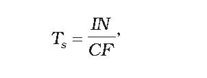
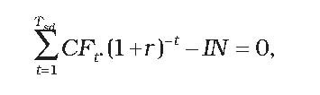
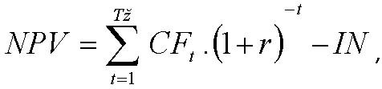
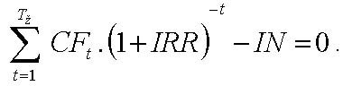

Príloha č. 3 k vyhláške č. 179/2015 Z. z.

- EKONOMICKÉ VYHODNOTENIE OPATRENÍ

  - 1. Pri ekonomickom vyhodnotení opatrení sa použije statická metóda ekonomického vyhodnotenia:

    - jednoduchá doba návratnosti, doba splatenia investície

    - vzorec

    - 

    - kde: IN sú investičné náklady,

    - CF sú ročné prínosy (cash flow, zmena peňažného toku po realizácii opatrení).

  - 2. Ak je to možné, pri ekonomickom vyhodnotení opatrení sa použijú aj dynamické metódy ekonomického vyhodnotenia:

    - a) reálna doba návratnosti Tsd, doba splatenia investície pri uvažovaní diskontnej sadzby sa vypočíta z podmienky

      - vzorec

      - 

      - kde: CFt sú ročné prínosy projektu (zmena peňažných tokov po realizácii projektu),

      - r je diskontný faktor,

      - (1 + r)-t je odúročiteľ,

    - b) čistá súčasná hodnota (NPV)

      - vzorec

      - 

      - kde: Tž je doba životnosti zariadenia,

    - c) vnútorné výnosové percento (IRR),

      - hodnota IRR sa vypočíta z podmienky

      - vzorec

      - 

  - 3. Výsledky ekonomického vyhodnotenia opatrení sa uvedú prehľadným spôsobom, napríklad podľa tabuliek č. 3.1 a 3.2.

    - Tabuľka č. 3.1 Výsledky ekonomického vyhodnotenia - 1. časť

  - Riadok | Číslo opatrenia | Názov opatrenia | Náklady | Ročné úspory | | | | |

  - | | | | energia | náklady na energiu | osobné náklady | náklady na opravy a údržbu | ostatné náklady | celkom

  - | | | euro | MWh/ rok | eur/ rok | | | |

  - 1 | 1 | | | | | | | |

  - 2 | 2 | | | | | | | |

  - 3 | 3 | | | | | | | |

  - ... | ... | | | | | | | |

  - n | n | | | | | | | |

  - n+1 | celkom | | súčet riadkov 1 až n | | | | | | 1)

  - 1) | Pri výpočte celkovej hodnoty úspor sa zohľadnia synergické efekty jednotlivých navrhovaných opatrení. Výsledok nemusí byť jednoduchým súčtom úspor vplyvom realizácie jednotlivých opatrení v riadkoch 1 až n. | | | | | | | |

    - Tabuľka č. 3.2 Výsledky ekonomického vyhodnotenia - 2. časť

  - Ukazovateľ | Hodnota | Jednotka

  - Náklady na realizáciu súboru opatrení | |

  - Zmena nákladov na zabezpečenie energie (-zníženie/+ zvýšenie) | |

  - Zmena osobných nákladov, napríklad mzdy, poistné, ... (-/+) | |

  - Zmena ostatných prevádzkových nákladov, napríklad opravy a údržba, služby, réžia, poistenie majetku, ... (-/+) | |

  - Zmena iných samostatne uvádzaných nákladov, napríklad emisie, odpady a iné (-/+) | |

  - Zmena tržieb, napr. za teplo, elektrinu, využité odpady, ... (-/+) | |

  - Prínosy z realizácie súboru opatrení celkom | |

  - Doba hodnotenia | |

  - Diskontný faktor | |

  - Jednoduchá doba návratnosti (Ts) | |

  - Reálna doba návratnosti (Tsd) | |

  - Čistá súčasná hodnota (NPV) | |

  - Vnútorné výnosové percento (IRR) | |

  - Iné údaje | |
