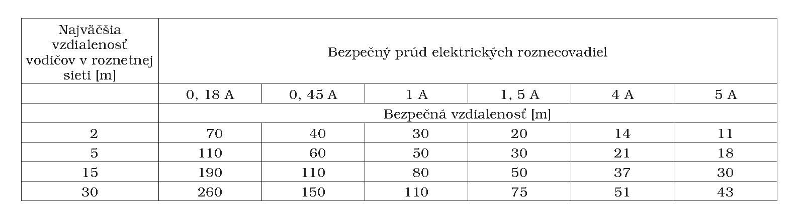

Príloha č. 1 k vyhláške č. 200/2015 Z. z.

- BEZPEČNÁ VZDIALENOSŤ OD MIESTA OHROZENIA ATMOSFÉRICKÝM VÝBOJOM 

  - Bezpečná vzdialenosť je najmenšia vzdialenosť roznetného vedenia od

  - a)povrchu,

  - b)konca elektricky vodivých ciest (koľajníc, potrubia a podobne), ak nie sú prerušené,

  - c)najbližšieho prerušenia elektricky vodivých ciest, ak je dĺžka izolačnej vzdialenosti najmenej 2 cm.

  - Ak elektricky vodivé cesty nie sú prerušené podľa písmena c), ale sú vzájomne prepojené a uzemnené na rozvetvené uzemnenie, pripúšťa sa vzdialenosť meraná od najbližšieho prepojenia o 300 m dlhšia, ako je uvedené v tabuľke. Prepojenie sa musí vykonať aspoň trikrát po 100 m medeným vodičom s priemerom 6 mm alebo vodičom s ekvivalentným odporom; prvé prepojenie elektricky vodivých ciest sa musí vykonať pri ústí podzemného diela.
