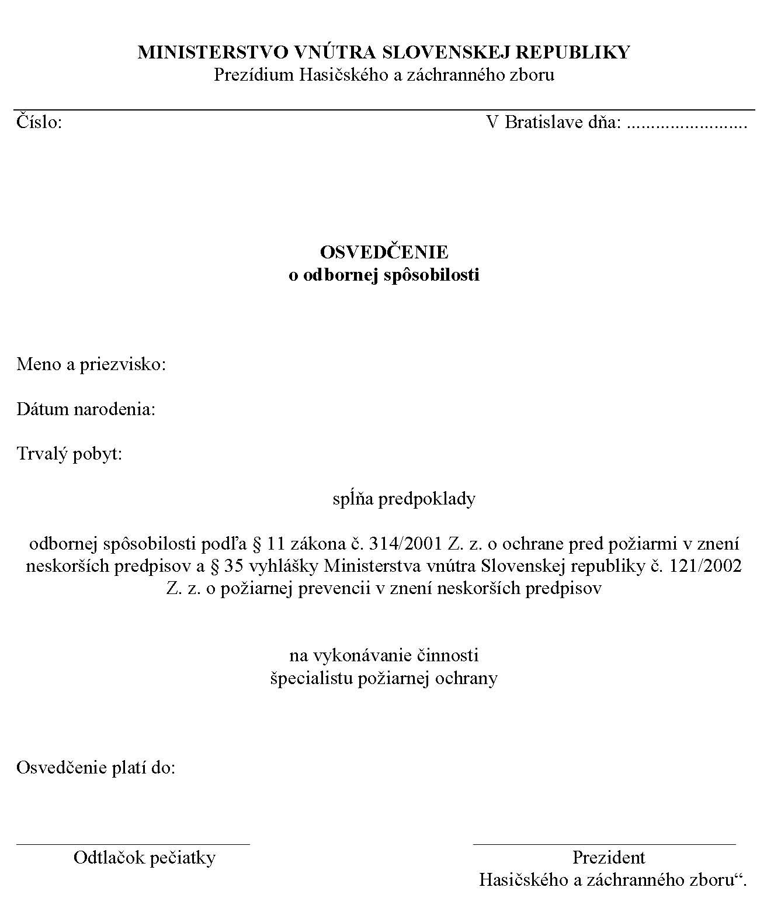
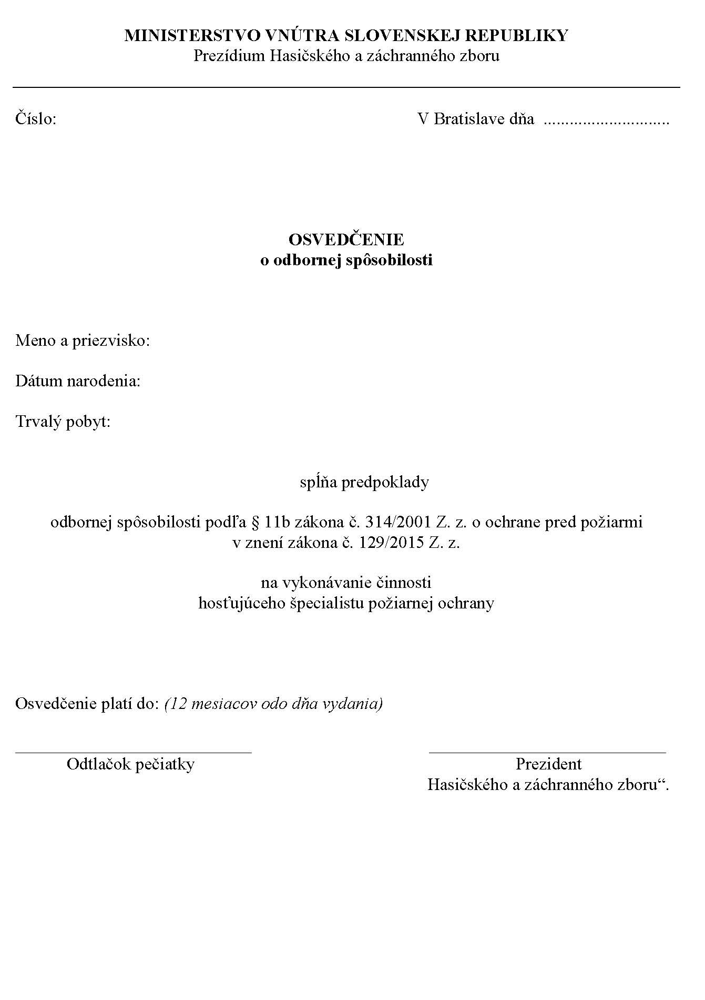
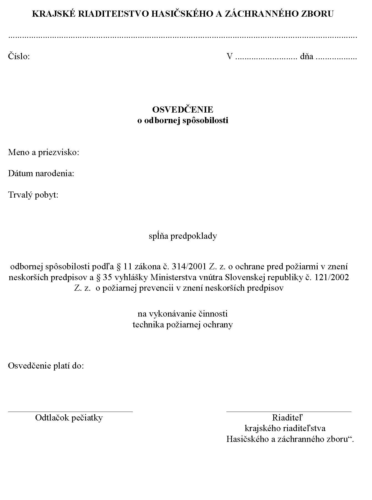
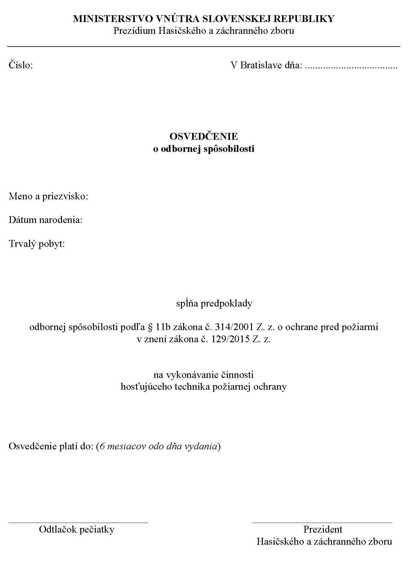
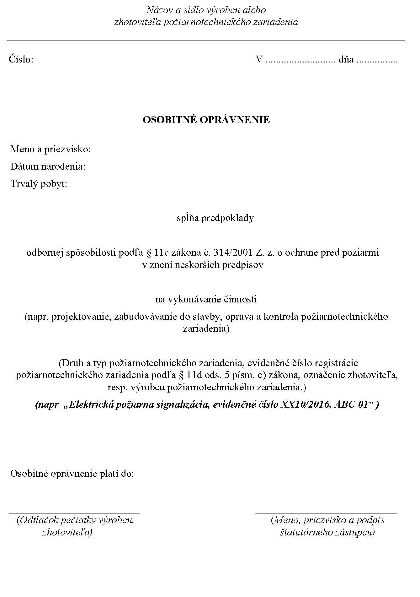
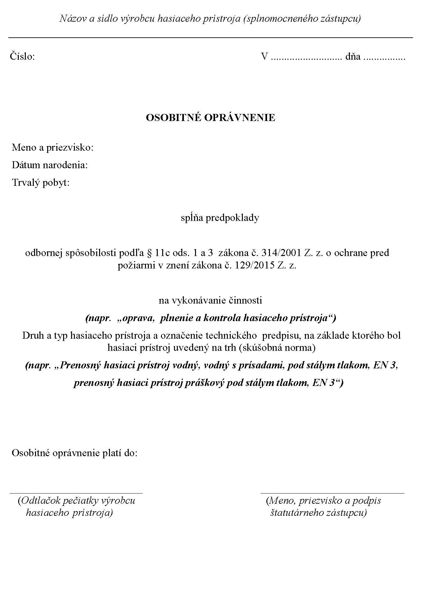
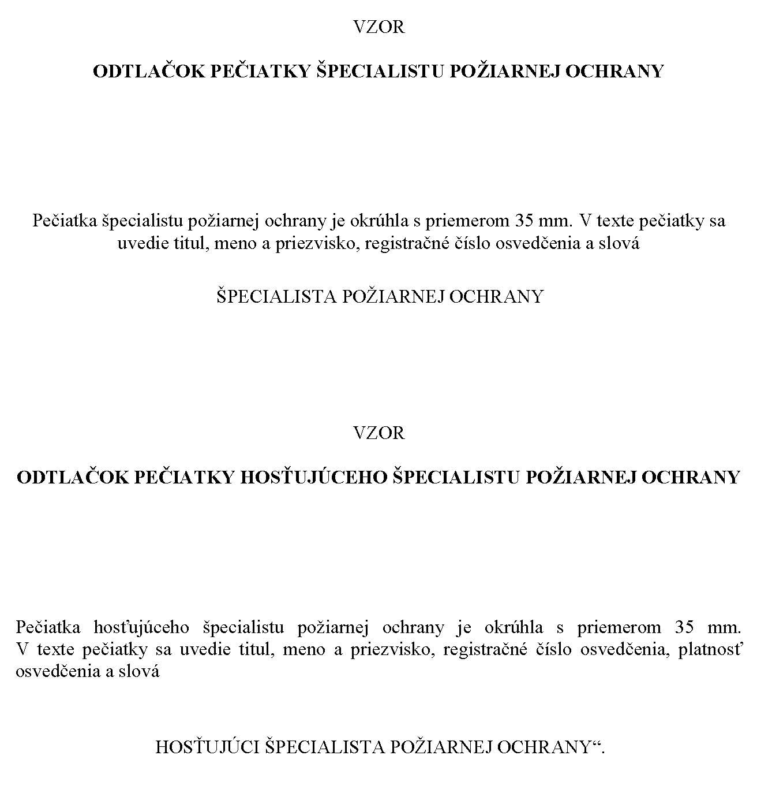
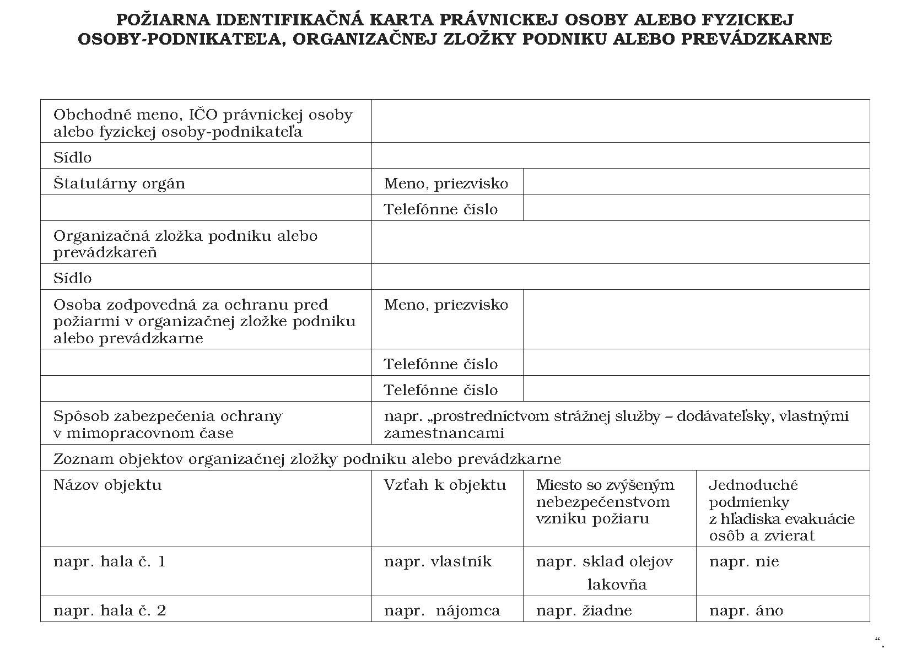

# Čl. I

Vyhláška Ministerstva vnútra Slovenskej republiky č. 121/2002 Z. z. o požiarnej prevencii v znení vyhlášky č. 591/2005 Z. z. a vyhlášky č. 259/2009 Z. z. sa mení a dopĺňa takto:

- 1. Úvodná veta znie:

- „Ministerstvo vnútra Slovenskej republiky podľa § 4 písm. a) až f), i), k), m) a n), § 5 písm. a), e), f) a h), § 6a, § 11 ods. 16, § 11a ods. 5, § 11c ods. 13, § 11d ods. 7, § 12 ods. 13, § 13 ods. 3, § 14 ods. 1 písm. c), e), h), j), n) a o), § 15 ods. 3 a § 25 ods. 5 zákona č. 314/2001 Z. z. o ochrane pred požiarmi v znení neskorších predpisov (ďalej len "zákon") ustanovuje:“.

- 2. Poznámka pod čiarou k odkazu 3 znie:

- „3)

- Vyhláška Ministerstva práce, sociálnych vecí a rodiny Slovenskej republiky č. 508/2009 Z. z., ktorou sa ustanovujú podrobnosti na zaistenie bezpečnosti a ochrany zdravia pri práci s technickými zariadeniami tlakovými, zdvíhacími, elektrickými a plynovými a ktorou sa ustanovujú technické zariadenia, ktoré sa považujú za vyhradené technické zariadenia v znení neskorších predpisov.“.

- 3. V § 5 uvádzacej vete sa za slovami "fyzická osoba-podnikateľ" vypúšťa čiarka a tieto slová: "pre ktorú sa tieto činnosti vykonávajú,".

- 4. V § 5 písm. a) sa na konci pripájajú tieto slová: "podľa technickej normy3a)".

  - Poznámka pod čiarou k odkazu 3a znie:

  - „3a)

  - Napríklad STN EN ISO 9606-1 Kvalifikačné skúšky zváračov. Tavné zváranie. Časť 1: Ocele (ISO 9606-1:2012 vrátane Cor. 1: 2012) (05 0712) STN EN ISO 17660-1 Zváranie. Zváranie výstužnej ocele. Časť 1: Zaťažené nosné zvárané spoje (ISO 17660-1: 2006) (05 0250).“.

- 5. V § 5 písmeno b) znie:

- „b)

- vydáva písomné povolenie na zváranie pred jeho začatím a určuje podmienky z hľadiska protipožiarnej bezpečnosti, po ktorých splnení možno túto činnosť vykonávať,“.

- 6. V § 7 písm. a) sa slovo "navrhuje" nahrádza slovom "určuje".

- 7. V § 7 písmeno e) znie:

- „e)

- pred začatím spaľovania oznamuje na linku tiesňového volania miesto, čas spaľovania a osobu zodpovednú za dodržiavanie podmienok protipožiarnej bezpečnosti pri spaľovaní horľavých látok.“.

- 8. § 9a sa vypúšťa.

- 9. V § 10 ods. 1 písmeno a) znie:

- „a)

- textová časť, ktorá obsahuje

- 1.

- údaje o vlastníkovi lesa, správcovi alebo obhospodarovateľovi lesa a kontaktné údaje osoby zodpovednej za ochranu lesa pred požiarmi,

- 2.

- opis vodných zdrojov vhodných na hasenie požiarov; osobitne sa vyznačia vodné zdroje vhodné na hasenie leteckou technikou,“.

  - Poznámka pod čiarou k odkazu 6b sa vypúšťa.

- 10. V § 10 ods. 1 písm. b) uvádzacia veta znie:

- „b)

- grafická časť, ktorej základom je porastová mapa6c) alebo obrysová mapa,6c) do ktorej sa vyznačujú“.

  - Poznámka pod čiarou k odkazu 6c znie:

  - „6c)

  - § 35 ods. 4 písm. f) a g) vyhlášky Ministerstva pôdohospodárstva Slovenskej republiky č. 453/2006 Z. z. o hospodárskej úprave lesov a ochrane lesa.“.

- 11. V § 10 ods. 1 písm. b) prvom bode sa čiarka na konci nahrádza bodkočiarkou a pripájajú sa tieto slová: "osobitne sa vyznačia vodné zdroje vhodné na hasenie leteckou technikou,".

- 12. V § 10 ods. 1 sa písmeno b) dopĺňa štvrtým bodom, ktorý znie:

- „4.

- lesná dopravná sieť, ktorá sa nedá použiť na príjazd hasičskej techniky a uskutočnenie zásahu.“.

- 13. V § 10 ods. 3 písmená b) a c) znejú:

- „b)

- nad 100 ha do 1 000 ha najmenej 40 kusov náradia aspoň štyroch druhov, napríklad lopaty, motyky, hrable, krompáče a sekery,

- c)

- nad 1 000 ha najmenej 60 kusov náradia aspoň štyroch druhov, napríklad lopaty, motyky, sekery, hrable, krompáče a široké lopaty a tri vhodné ručné striekačky.“.

- 14. V § 12 odsek 2 znie:

- „(2)

- Usporiadať podujatie, na ktorom sa zúčastňuje väčší počet osôb, v objektoch a na miestach, ktoré nie sú na tieto účely určené, možno len na základe spracovaného písomného návrhu opatrení, ktorý sa posudzuje v rámci vydávania súhlasu na usporiadanie podujatí, na ktorých sa zúčastňuje väčší počet osôb.“.

- 15. § 13 vrátane nadpisu znie:

- 㤠13

- Podmienky prevádzkovania požiarnych zariadení

- (1)

- Prevádzkovateľ požiarneho zariadenia zabezpečuje vykonávanie jeho pravidelnej kontroly najmenej raz za 12 mesiacov podľa požiadaviek uvedených v prevádzkových pokynoch alebo v návode na obsluhu, kontrolu a údržbu dodanom výrobcom, dovozcom alebo zhotoviteľom. Výsledok vykonanej kontroly sa zaznamenáva do požiarnej knihy.

- (2)

- Ak výrobca alebo dovozca požiarneho zariadenia alebo zhotoviteľ požiarnotechnického zariadenia neurčil obsah, rozsah a spôsob pravidelnej kontroly požiarneho zariadenia, prevádzkovateľ zabezpečuje najmenej raz za 12 mesiacov kontrolu najmä

- a)

- celkového stavu, pohotovosti a označenia zariadenia,

- b)

- úplnosti, neporušenosti a funkčnosti zariadenia,

- c)

- množstva a kvality hasiacej látky,

- d)

- priechodnosti potrubí,

- e)

- stavu náhradného zdroja elektrickej energie.

- (3)

- Prevádzkovateľ požiarneho zariadenia bez zbytočného odkladu zabezpečí opravu a odstránenie nedostatkov, ktoré sa zistili jeho kontrolou.

- (4)

- Súčasťou požiarneho zariadenia je priložená sprievodná dokumentácia, ktorú tvoria najmä

- a)

- doklady preukazujúce splnenie parametrov podstatných vlastností alebo doklady o overení zhody vlastností podľa osobitných predpisov,6ja)

- b)

- prevádzkové pokyny,

- c)

- prevádzkový denník.

- (5)

- Sprievodná dokumentácia podľa odseku 4 písm. b) a c) sa nevzťahuje na hasiace prístroje, núdzové osvetlenie, požiarne výťahy, evakuačné výťahy a zariadenia na trvalú dodávku elektrickej energie pri požiari s výnimkou záložných zdrojov.6jb)

- (6)

- Prevádzkové pokyny určujú základné požiadavky na obsah, rozsah a spôsob zabezpečenia a vykonávania inštalácie, prevádzkovania, údržby, opráv a kontrol zariadenia, ako aj základné povinnosti prevádzkovateľa pri plnení týchto požiadaviek. Potrebné údaje o realizácii určených požiadaviek vrátane konkrétnych zistení sú uvedené v prevádzkovom denníku.

- (7)

- Rozdelenie požiarnotechnických zariadení podľa druhu a typu je uvedené v prílohe č. 4.

- (8)

- Podmienky prevádzkovania požiarnych zariadení uvedené v odsekoch 1 až 4 a 6 sa nevzťahujú na požiarne zariadenia, ktorých podmienky prevádzkovania a kontroly ustanovuje osobitný predpis.6k)“.

  - Poznámky pod čiarou k odkazom 6ja a 6jb znejú:

  - „6ja)

  - Nariadenie Európskeho parlamentu a rady (EÚ) č. 305/2011 z 9. marca 2011, ktorým sa ustanovujú harmonizované podmienky uvádzania stavebných výrobkov na trh a ktorým sa zrušuje smernica Rady 89/106/EHS (Ú. v. EÚ L 88, 4. 4. 2011).

  - Zákon č. 264/1999 Z. z. o technických požiadavkách na výrobky a o posudzovaní zhody a o zmene a doplnení niektorých zákonov v znení neskorších predpisov.

  - Zákon č. 133/2013 Z. z. o stavebných výrobkoch a o zmene a doplnení niektorých zákonov.

  - 6jb)

  - STN 92 0203 Požiarna bezpečnosť stavieb. Trvalá dodávka elektrickej energie pri požiari (92 0203).“.

- 16. Za § 13 sa vkladá § 13a, ktorý vrátane nadpisu znie:

- 㤠13a

- Podmienky zabezpečenia protipožiarnej bezpečnosti pri prevádzkovaní technických zariadení a zabezpečenia ich kontroly

- (1)

- Na zabezpečenie protipožiarnej bezpečnosti sa technické zariadenia prevádzkujú tak, aby

- a)

- nespôsobili za bežných prevádzkových podmienok vznietenie alebo zapálenie horľavých látok alebo stavebných konštrukcií,

- b)

- bol zabezpečený voľný prístup k ovládacím prvkom technických zariadení slúžiacich najmä na ich vypnutie, vykonanie údržby, opravy a kontroly,

- c)

- nevznikol požiar v stavbe pri prerušení a následnom obnovení dodávky elektrickej energie,

- d)

- nedošlo k úniku horľavých látok z technického zariadenia, ktoré by mohli spôsobiť vznik a rozšírenie požiaru.

- (2)

- Kontrola technického zariadenia z hľadiska protipožiarnej bezpečnosti je súčasťou preventívnej protipožiarnej prehliadky podľa § 14 ods. 2 písm. h).“.

- 17. V § 14 ods. 2 písmeno g) znie:

- „g)

- funkčnosti požiarnych zariadení,“.

- 18. § 14 sa dopĺňa odsekom 3, ktorý znie:

- „(3)

- Záznam o vykonaní preventívnej protipožiarnej prehliadky bytového domu obsahuje

- a)

- označenie a adresu bytového domu,

- b)

- dátum vykonania preventívnej protipožiarnej prehliadky,

- c)

- zistené skutočnosti a nedostatky s uvedením opisu a miesta ich zistenia,

- d)

- navrhované opatrenia na odstránenie zistených nedostatkov,

- e)

- meno, priezvisko a podpis technika požiarnej ochrany, ktorý vyhotovil záznam,

- f)

- meno, priezvisko a podpis osoby, ktorá bola oboznámená s výsledkom preventívnej protipožiarnej prehliadky.“.

- 19. V § 15 ods. 1 sa na konci pripájajú tieto slová: "okrem takých, ktoré sú občasnými pracovnými miestami6l)".

- 20. V § 15 ods. 5 písmeno d) znie:

- „d)

- zoznam právnických osôb a fyzických osôb - podnikateľov, ktoré majú sídlo v objekte, pre ktoré je zriadená spoločná ohlasovňa požiarov, vrátane telefónnych čísiel ich štatutárnych orgánov.“.

- 21. V § 15 sa odsek 5 dopĺňa písmenom e), ktoré znie:

- „e)

- prehľad miest so zvýšeným nebezpečenstvom vzniku požiaru, ktoré sa nachádzajú v objekte.“.

- 22. V § 16 sa vypúšťa písmeno a).

  - Doterajšie písmená b) a c) sa označujú ako písmená a) a b).

- 23. § 17 sa vypúšťa.

- 24. V § 19 ods. 1 sa vypúšťa písmeno a).

  - Doterajšie písmená b) a c) sa označujú ako písmená a) a b).

- 25. V § 20 ods. 2 písm. a) sa vypúšťajú slová "s požiarnym štatútom,".

- 26. V § 20 ods. 3 sa vypúšťajú slová "alebo na účel ubytovania po dobu dlhšiu ako 30 po sebe nasledujúcich kalendárnych dní".

- 27. V § 22 sa vypúšťa odsek 2.

  - Doterajšie odseky 3 a 4 sa označujú ako odseky 2 a 3.

- 28. V § 22 odsek 3 znie:

- „(3)

- Na školení o ochrane pred požiarmi sa nezúčastňuje technik požiarnej ochrany, špecialista požiarnej ochrany, členovia protipožiarnej hliadky pracoviska a zamestnanci a členovia hasičských jednotiek.“.

- 29. V § 23 sa vypúšťajú odseky 2 až 5.

  - Doterajšie odseky 6 až 11 sa označujú ako odseky 2 až 7.

- 30. V § 24 ods. 1 písmeno a) znie:

- „a)

- požiarna identifikačná karta,“.

- 31. V § 24 ods. 1 písmeno g) znie:

- „g)

- doklady o kontrole požiarnych zariadení podľa osobitného predpisu,6k)“.

- 32. V § 24 ods. 1 sa vypúšťa písmeno m).

  - Doterajšie písmeno n) sa označuje ako písmeno m).

- 33. V § 24 sa za odsek 1 vkladá nový odsek 2, ktorý znie:

- „(2)

- Dokumentácia ochrany pred požiarmi pre bytové domy sa vypracúva v rozsahu podľa odseku 1 písm. g) a m).“.

  - Doterajší odsek 2 sa označuje ako odsek 3.

- 34. § 25 vrátane nadpisu znie:

- 㤠25

- Požiarna identifikačná karta

- (1)

- Požiarna identifikačná karta sa vypracúva pre každú právnickú osobu alebo fyzickú osobu-podnikateľa; ak sa člení na organizačné zložky podniku alebo prevádzkarne, vypracúva sa pre každú z nich.

- (2)

- Požiarna identifikačná karta obsahuje

- a)

- obchodné meno právnickej osoby alebo fyzickej osoby-podnikateľa, identifikačné číslo organizácie IČO, sídlo, meno a priezvisko štatutárneho orgánu právnickej osoby alebo fyzickej osoby-podnikateľa,

- b)

- názov a sídlo organizačnej zložky podniku alebo prevádzkarne právnickej osoby alebo fyzickej osoby-podnikateľa, pre ktorú je požiarna identifikačná karta spracovaná, vrátane uvedenia osoby zodpovednej za ochranu pred požiarmi v nej,

- c)

- spôsob zabezpečenia ochrany pred požiarmi v mimopracovnom čase,

- d)

- zoznam objektov a prehľad miest so zvýšeným nebezpečenstvom vzniku požiaru s uvedením názvu objektu a vzťahu k objektu (vlastník, nájomca).

- (3)

- Požiarnu identifikačnú kartu vypracuje technik požiarnej ochrany a ukladá sa u právnickej osoby alebo fyzickej osoby-podnikateľa, v organizačnej zložke podniku alebo v prevádzkarni, pre ktorú je vypracovaná.

- (4)

- Vzor požiarnej identifikačnej karty je uvedený v prílohe č. 12.“.

- 35. V § 28 odseky 2 a 3 znejú:

- „(2)

- Požiarny evakuačný plán tvorí

- a)

- textová časť, ktorá obsahuje

- 1.

- určenie zamestnancov, ktorí budú riadiť evakuáciu a miesto, z ktorého ju budú riadiť,

- 2.

- určenie zamestnancov a prostriedkov, pomocou ktorých sa bude evakuácia vykonávať,

- 3.

- určenie spôsobu evakuácie a ciest na evakuáciu,

- 4.

- určenie miesta, kde sa evakuované osoby, prípadne zvieratá budú sústreďovať, a určenie zodpovedného zamestnanca, ktorý vykoná kontrolu počtu evakuovaných osôb a zvierat,

- 5.

- spôsob zabezpečenia poskytnutia prvej zdravotnej pomoci postihnutým osobám,

- b)

- grafická časť, ktorú tvoria pôdorysy jednotlivých podlaží objektu a ktoré obsahujú

- 1.

- označenie podlažia, pre ktoré je spracovaná,

- 2.

- vyznačenie smerov úniku,

- 3.

- vyznačenie umiestnenia požiarnych zariadení, najmä hasiacich prístrojov a hadicových zariadení,

- 4.

- grafické vyznačenie presnej polohy pozorovateľa,

- 5.

- zobrazenie celého objektu alebo situačného plánu s vyznačením miesta, kde sa evakuované osoby alebo zvieratá budú sústreďovať,

- 6.

- umiestnenie legendy použitých grafických symbolov a značiek.

- (3)

- Požiarny evakuačný plán vypracúva technik požiarnej ochrany. Grafická časť požiarneho evakuačného plánu sa umiestňuje pri každom vstupe na podlažie. V stavbách, v ktorých sa poskytujú služby na základe zmluvy o ubytovaní, sa grafická časť požiarneho evakuačného plánu umiestňuje na viditeľnom mieste v každej ubytovacej jednotke pri vstupe na únikovú cestu.“.

- 36. V § 28 odsek 10 znie:

- „(10)

- Objekt s jednoduchými podmienkami z hľadiska evakuácie osôb a zvierat je stavba, v ktorej sa zdržujú len osoby znalé spôsobu evakuácie a v ktorej sa vykonáva súčasná evakuácia po únikových cestách vedúcich priamo na voľné priestranstvo, pričom táto stavba má najviac dve nadzemné podlažia a jedno podzemné podlažie, v ktorom nie je trvalé pracovné miesto alebo dočasné pracovné miesto.“.

- 37. V § 29 ods. 4 sa slová "tri mesiace" nahrádzajú slovami "šesť mesiacov".

- 38. § 29a sa vypúšťa.

- 39. V § 31 sa vypúšťa odsek 1.

  - Doterajšie odseky 2 až 5 sa označujú ako odseky 1 až 4.

- 40. V § 31 odsek 1 znie:

- „(1)

- Požiarnu identifikačnú kartu, požiarne poriadky pracovísk, požiarne poplachové smernice a požiarne evakuačné plány schvaľuje štatutárny orgán právnickej osoby alebo ním poverená osoba, fyzická osoba - podnikateľ alebo ňou poverená osoba.“.

- 41. V § 31 ods. 3 sa slová "Požiarny štatút právnickej osoby alebo fyzickej osoby podnikateľa" nahrádzajú slovami "Požiarnu identifikačnú kartu".

- 42. V § 31e sa vypúšťa písmeno a).

  - Doterajšie písmená b) až f) sa označujú ako písmená a) až e).

- 43. § 33 až 35 vrátane nadpisov znejú:

- 㤠33

- Rozsah odbornej prípravy

- (1)

- Základná odborná príprava je zameraná na získanie teoretických vedomostí, praktických skúseností a aplikačných postupov a jej rozsah je pre

- a)

- preventivára požiarnej ochrany obce najmenej 80 hodín,

- b)

- technika požiarnej ochrany najmenej 120 hodín,

- c)

- špecialistu požiarnej ochrany najmenej 200 hodín.

- (2)

- Rozsah jednotlivých obsahových častí odbornej prípravy preventivára požiarnej ochrany obce, technika požiarnej ochrany a špecialistu požiarnej ochrany je uvedený v prílohe č. 10.

- (3)

- Aktualizačná odborná príprava pre osoby uvedené v odseku 1sa vykonáva raz za päť rokov v trvaní najmenej jednej štvrtiny základnej odbornej prípravy.

- § 34

- Projekt odbornej prípravy

- (1)

- Projekt odbornej prípravy je základným dokumentom na vykonávanie odbornej prípravy, vypracúva ho odborný garant a predkladá sa v písomnej a elektronickej podobe. Projekt odbornej prípravy obsahuje

- a)

- cieľ a zameranie odbornej prípravy,

- b)

- profil absolventa odbornej prípravy,

- c)

- zoznam lektorov s uvedením prednášanej tematiky odbornej prípravy,

- d)

- súhlas lektora s lektorskou činnosťou v odbornej príprave,

- e)

- tematický a časový plán odbornej prípravy,

- f)

- učebné texty,

- g)

- vzor potvrdenia o absolvovaní odbornej prípravy.

- (2)

- Učebné texty obsahujú najmä

- a)

- platné všeobecne záväzné právne predpisy na úseku ochrany pred požiarmi,

- b)

- zoznam odporučenej odbornej literatúry,

- c)

- otázky na ústnu časť overenia odbornej spôsobilosti.

- (3)

- Materiálno-technické vybavenie na vykonávanie odbornej prípravy musí zodpovedať druhu vykonávanej odbornej prípravy, pričom obsahuje najmä

- a)

- miesto vykonávania odbornej prípravy,

- b)

- opis a kapacitu priestorov, v ktorých sa bude vykonávať odborná príprava,

- c)

- zoznam audiovizuálnej techniky,

- d)

- zoznam učebných pomôcok.

- (4)

- Právnická osoba alebo fyzická osoba-podnikateľ, ktorá má oprávnenie na vykonávanie odbornej prípravy a vykonáva ju, vedie triednu knihu, ktorú uchováva päť rokov od skončenia odbornej prípravy.

- § 35

- Overovanie odbornej spôsobilosti a osvedčovanie pravosti písomností

- (1)

- Odborná spôsobilosť sa overuje skúškami alebo uplatnením kompenzačného mechanizmu podľa § 11a ods. 3 písm. b) a odsekov 7 a 8 zákona a preukazuje sa osvedčením o odbornej spôsobilosti alebo osobitným oprávnením. Vzory osvedčení o odbornej spôsobilosti a vzory osobitného oprávnenia sú uvedené v prílohách č. 2 až 2b, 3 až 3c a 5 a 5a.

- (2)

- Potvrdenie o absolvovaní odbornej prípravy pre preventivára požiarnej ochrany obce, technika požiarnej ochrany a špecialistu požiarnej ochrany platí 18 mesiacov od skončenia odbornej prípravy.

- (3)

- Na overenie odbornej spôsobilosti preventivára požiarnej ochrany obce, technika požiarnej ochrany a špecialistu požiarnej ochrany sa prihlasuje fyzická osoba (ďalej len "žiadateľ") písomne na štátnom orgáne príslušnom na overovanie odbornej spôsobilosti a vydávanie osvedčenia o odbornej spôsobilosti na vykonávanie príslušnej činnosti. Vzor prihlášky na overenie odbornej spôsobilosti je uvedený v prílohe č. 9.

- (4)

- Súčasťou prihlášky na overenie odbornej spôsobilosti je

- a)

- potvrdenie o absolvovaní odbornej prípravy vo vymedzenom rozsahu u právnickej osoby alebo fyzickej osoby-podnikateľa, ktorá má na jej vykonávanie oprávnenie vydané Ministerstvom vnútra Slovenskej republiky (ďalej len "ministerstvo"),

- b)

- fotokópia platného osvedčenia o odbornej spôsobilosti u žiadateľa o pravidelné overenie odbornej spôsobilosti po absolvovaní aktualizačnej odbornej prípravy,

- c)

- overený doklad o najvyššom stupni ukončeného vzdelania u žiadateľa o overenie odbornej spôsobilosti preventivára požiarnej ochrany obce, technika požiarnej ochrany a špecialistu požiarnej ochrany po absolvovaní základnej odbornej prípravy.

- (5)

- Deň doručenia prihlášky na overenie odbornej spôsobilosti príslušnému štátnemu orgánu alebo deň podania žiadosti o uznanie odbornej kvalifikácie podľa § 11a ods. 3 písm. a) zákona je dňom začatia konania vo veci overenia odbornej spôsobilosti. Štátny orgán vykonáva overenie odbornej spôsobilosti

- a)

- do 60 dní odo dňa začatia konania u žiadateľa o odbornú spôsobilosť špecialistu požiarnej ochrany,

- b)

- do 30 dní odo dňa začatia konania u žiadateľa o odbornú spôsobilosť preventivára požiarnej ochrany obce alebo technika požiarnej ochrany.

- (6)

- Príslušný štátny orgán vykonávajúci overenie odbornej spôsobilosti písomne pozve žiadateľa najmenej

- a)

- 30 dní pred termínom vykonania overenia odbornej spôsobilosti, ak ide o odbornú spôsobilosť špecialistu požiarnej ochrany,

- b)

- 15 dní pred termínom vykonania overenia odbornej spôsobilosti, ak ide o odbornú spôsobilosť preventivára požiarnej ochrany obce alebo technika požiarnej ochrany.

- (7)

- Overenie odbornej spôsobilosti sa vykonáva pred skúšobnou komisiou, ktorú písomne zriaďuje príslušný štátny orgán vykonávajúci overenie odbornej spôsobilosti.

- (8)

- Skúšobná komisia na overenie odbornej spôsobilosti preventivára požiarnej ochrany obce, technika požiarnej ochrany a špecialistu požiarnej ochrany má nepárny počet členov, najmenej však troch, pričom všetci členovia sú príslušníkmi Hasičského a záchranného zboru, z ktorých jeden je predsedom skúšobnej komisie. Overenie odbornej spôsobilosti pozostáva

- a)

- z ústnej časti a praktického riešenia protipožiarnej bezpečnosti stavby, ak ide o špecialistu požiarnej ochrany,

- b)

- z písomnej časti a ústnej časti, ak ide o preventivára požiarnej ochrany obce a technika požiarnej ochrany.

- (9)

- Písomná časť overenia odbornej spôsobilosti sa vykonáva formou testu, ktorý obsahuje 50 otázok zo všetkých overovaných oblastí, ak ide o technika požiarnej ochrany, a 30 otázok, ak ide o preventivára požiarnej ochrany obce. Čas na vypracovanie písomnej časti overenia odbornej spôsobilosti je 60 minút. Písomná časť overenia odbornej spôsobilosti sa hodnotí klasifikačným stupňom vyhovel, ak žiadateľ správne zodpovedal najmenej 90 % otázok.

- (10)

- Ústna časť overenia odbornej spôsobilosti sa vykonáva zodpovedaním otázok, ktoré si žiadateľ vyberie náhodným výberom z okruhov otázok, a to tri otázky, pričom každá je z iného okruhu otázok, ak ide o špecialistu požiarnej ochrany a technika požiarnej ochrany, a dve otázky z dvoch okruhov otázok, ak ide o preventivára požiarnej ochrany obce. Čas na prípravu odpovede je 20 minút. Skúšobná komisia hodnotí úplnosť a správnosť odpovede na každú otázku klasifikačným stupňom vyhovel alebo nevyhovel a celkovo hodnotí ústnu časť klasifikačným stupňom vyhovel, ak boli vyhovujúco zodpovedané všetky otázky.

- (11)

- Praktická časť overenia odbornej spôsobilosti špecialistu požiarnej ochrany sa vykonáva spracovaním riešenia protipožiarnej bezpečnosti stavby, ktorú si žiadateľ vyberie náhodným výberom z jednotlivých druhov stavieb, a jeho obhajobou pred skúšobnou komisiou. Čas na praktickú časť overenia odbornej spôsobilosti špecialistu požiarnej ochrany je 180 minút. Pri praktickej časti žiadateľ používa technické normy, všeobecne záväzné právne predpisy a iné predpisy súvisiace s riešením protipožiarnej bezpečnosti vybranej stavby. Skúšobná komisia hodnotí úplnosť a správnosť riešenia protipožiarnej bezpečnosti a celkovo hodnotí praktickú časť klasifikačným stupňom vyhovel, ak bolo riešenie protipožiarnej bezpečnosti spracované vyhovujúco.

- (12)

- Rozdelenie jednotlivých druhov stavieb a obsah a postup riešenia protipožiarnej bezpečnosti pre praktickú časť overenia odbornej spôsobilosti špecialistu požiarnej ochrany sú uvedené v prílohe č. 11.

- (13)

- Okruhy otázok na písomnú časť a na ústnu časť overenia odbornej spôsobilosti preventivára požiarnej ochrany obce, technika požiarnej ochrany a špecialistu požiarnej ochrany sa zverejňujú na webovom sídle ministerstva.

- (14)

- Skúška na overenie odbornej spôsobilosti sa uskutočňuje v poradí písomná časť a ústna časť, ak ide o preventivára požiarnej ochrany obce a technika požiarnej ochrany, a praktická časť a ústna časť, ak ide o špecialistu požiarnej ochrany. Podmienkou postupu do ďalšej časti skúšky je hodnotenie klasifikačným stupňom vyhovel v predchádzajúcej časti.

- (15)

- O skúške a jej výsledku skúšobná komisia vyhotoví zápisnicu. Ak žiadateľ na skúške vyhovie, osvedčenie o odbornej spôsobilosti vydá ten, kto overenie vykonal.

- (16)

- Ak žiadateľ na skúške nevyhovie, môže skúšku dva razy opakovať. Termín opakovanej skúšky sa určuje tak, aby sa konala najskôr jeden mesiac a najneskôr do troch mesiacov odo dňa vykonania skúšky, na ktorej žiadateľ naposledy nevyhovel. Na opakovanej skúške žiadateľ vykonáva iba tie časti overenia, ktoré boli pri predchádzajúcej skúške hodnotené klasifikačným stupňom nevyhovel alebo ktoré neabsolvoval. Ak žiadateľ nevyhovie ani na druhej opakovanej skúške, príslušný štátny orgán vykonávajúci overovanie odbornej spôsobilosti vydá rozhodnutie o tom, že nevyhovel. Ďalšiemu overeniu odbornej spôsobilosti sa môže žiadateľ podrobiť až po absolvovaní základnej odbornej prípravy.

- (17)

- Ak žiadateľ svoju neúčasť na overení odbornej spôsobilosti dostatočne neospravedlní alebo nepreukáže dôvod neúčasti, posudzuje sa, že na skúške nevyhovel.

- (18)

- Špecialista požiarnej ochrany a hosťujúci špecialista požiarnej ochrany osvedčujú pravosť písomností, ktoré vytvorili pri vykonávaní činnosti špecialistu požiarnej ochrany, odtlačkom svojej pečiatky a svojím podpisom na titulnej strane a každej piatej strane textovej časti vpravo dole a na každom výkrese. Vzor odtlačku pečiatky špecialistu požiarnej ochrany a hosťujúceho špecialistu požiarnej ochrany je uvedený v prílohe č. 6.

- (19)

- Na overenie odbornej spôsobilosti pri uplatnení kompenzačného mechanizmu podľa § 11a ods. 3 písm. a) zákona sa odseky 5 až 11 a 14 až 17 vzťahujú rovnako.“.

- 44. V § 36 písmeno b) znie:

- „b)

- dokumentácia o dobrovoľnom hasičskom zbore obce,“.

- 45. V § 37 ods. 1 písmeno c) znie:

- „c)

- údaje o početnom stave a vybavení dobrovoľného hasičského zboru obce,“.

- 46. V § 38 ods. 2 sa vypúšťa druhá veta.

- 47. V § 38 ods. 4 prvej vete sa vypúšťajú slová "podľa odsekov 2 a 3".

- 48. V § 39 ods. 1 písm. c) sa slová "požiarnotechnických zariadení" nahrádzajú slovami "požiarnych zariadení".

- 49. V § 40b ods. 1 písm. g) sa slová "požiarnotechnickými zariadeniami" nahrádzajú slovami "požiarnymi zariadeniami".

- 50. V § 40b ods. 1 sa vypúšťajú písmená l) a m).

  - Poznámka pod čiarou k odkazu 8 sa vypúšťa.

- 51. V § 40b ods. 3 písm. e) sa slová "dymu a tepla" nahrádzajú slovami "tepla a splodín horenia".

- 52. Za § 44 sa vkladá § 44a, ktorý vrátane nadpisu znie:

- 㤠44a

- Prechodné ustanovenia k úpravám účinným od 1. septembra 2015

- (1)

- Dokumentácia podľa § 10, § 25 a § 28 ods. 3 a 10 účinných od 1. septembra 2015 musí byť v súlade s týmito ustanoveniami od 1. januára 2017.

- (2)

- Odborná príprava člena protipožiarnej hliadky právnickej osoby a fyzickej osoby-podnikateľa, ktorá bola vykonaná podľa predpisov účinných do 31. augusta 2015, sa považuje za školenie o ochrane pred požiarmi podľa § 21 ods. 1 písm. b), najdlhšie však 24 mesiacov od jej vykonania.“.

- 53. Prílohy č. 1 a 1a sa vypúšťajú.

- 54. Príloha č. 2 znie:

- „Príloha č. 2 k vyhláške č. 121/2002 Z. z.“.

- 

- 55. Za prílohu č. 2 sa vkladajú prílohy č. 2a a 2b, ktoré znejú:

- „Príloha č. 2a k vyhláške č. 121/2002 Z. z.

- Osvedčenie o odbornej spôsobilosti

- [Osvedčenie o odbornej spôsobilosti](assets/e9bab99419acf583e53c0e38307eeb34638550cf28034d7c4867794ce1b147b6.pdf)

- Príloha č. 2b k vyhláške č. 121/2002 Z. z.“.

- 

- 56. Príloha č. 3 znie:

- „Príloha č. 3 k vyhláške č. 121/2002 Z. z.“.

- 

- 57. Za prílohu č. 3 sa vkladajú prílohy č. 3a až 3c, ktoré znejú:

- „Príloha č. 3a k vyhláške č. 121/2002 Z. z.

- Osvedčenie o odbornej spôsobilosti

- [Osvedčenie o odbornej spôsobilosti](assets/ab9c50546834dcb5968857e66f4a102f8b647f3f50b37aa7e30b1def76f2906d.pdf)

- Príloha č. 3b k vyhláške č. 121/2002 Z. z.

- 

- Príloha č. 3c k vyhláške č. 121/2002 Z. z.

- Osvedčenie o odbornej spôsobilosti

- [Osvedčenie o odbornej spôsobilosti](assets/db79cf934d32e87d99d7b74dd9f75521d03dd22289ac1c32a032f49e3b2a6d4c.pdf)“.

- 58. Prílohy č. 4 až 6 vrátane nadpisov znejú:

- „Príloha č. 4 k vyhláške č. 121/2002 Z.z.

- Rozdelenie požiarnotechnických zariadení podľa druhov a typov

- I.

- Druhy požiarnotechnických zariadení

- 1.

- Stabilné hasiace zariadenia a polostabilné hasiace zariadenia

- 2.

- Zariadenia na odvod tepla a splodín horenia

- 3.

- Elektrická požiarna signalizácia vrátane hlasovej signalizácie požiaru

- II.

- Typy požiarnotechnických zariadení

- 1.

- Stabilné hasiace zariadenia a polostabilné hasiace zariadenia:

- 1a.

- vodné

- 1aa.

- sprinklerové,

- 1ab.

- rozstrekovacie (napr. záplavové, drenčerové),

- 1ac.

- hmlové,

- 1b.

- penové,

- 1c.

- práškové,

- 1d.

- plynové,

- 1e.

- aerosólové.

- 2.

- Zariadenia na odvod tepla a splodín horenia:

- 2a.

- s prirodzeným odvodom,

- 2b.

- s núteným odsávaním.

- 3.

- Elektrická požiarna signalizácia vrátane hlasovej signalizácie požiaru:

- 3a.

- adresovateľný systém,

- 3b.

- neadresovateľný systém,

- 3c.

- hlasová signalizácia požiaru.

- Príloha č. 5 k vyhláške č. 121/2002 Z.z.

- 

- Príloha č. 5a k vyhláške č. 121/2002 Z.z.

- 

- Príloha č. 6 k vyhláške č. 121/2002 Z.z.“.

- 

- 59. V prílohe č. 7 písmeno f) znie:

- „f)

- vybavenie stavby požiarnymi zariadeniami

- 1.

- signalizáciou

- 1a.

- osobitné oprávnenie o odbornej spôsobilosti na projektovanie signalizácie,

- 1b.

- určenie všetkých priestorov strážených signalizáciou a umiestnenie ústredne signalizácie,

- 2.

- stabilným hasiacim zariadením a polostabilným hasiacim zariadením

- 2a.

- osobitné oprávnenie o odbornej spôsobilosti na projektovanie stabilného hasiaceho zariadenia a polostabilného hasiaceho zariadenia,

- 2b.

- určenie priestorov chránených stabilným hasiacim zariadením a polostabilným hasiacim zariadením, umiestnenie strojovne, zdrojov hasiacej látky, možnosti pripojenia mobilnej techniky, spôsob spúšťania zariadení,

- 3.

- zariadením na hasenie iskier v pneumatických dopravníkoch

- 3a.

- osobitné oprávnenie o odbornej spôsobilosti na ich projektovanie,

- 4.

- zariadením na odvod tepla a splodín horenia pri požiari

- 4a.

- osobitné oprávnenie o odbornej spôsobilosti na ich projektovanie,

- 4b.

- vhodnosť ich umiestnenia, určenie plochy otvorov na odvod tepla a splodín horenia a prívod vzduchu,

- 5.

- inými zariadeniami, ako sú uvedené v bodoch 1 až 4, ktoré sú určené na hasenie požiaru, vrátane ich navrhovania a vhodnosti umiestnenia,

- 6.

- prenosnými hasiacimi prístrojmi a pojazdnými hasiacimi prístrojmi (ich druhy, počet a umiestnenie),“.

- 60. V prílohe č. 7 písmeno i) znie:

- „i)

- požiadavky na elektroinštaláciu stavby:

- 1.

- určenie druhu prostredia/zón (protokol o určení vonkajších vplyvov alebo prostredia),

- 2.

- vedenie elektroinštalácie na horľavých podkladoch,

- 3.

- opatrenia proti účinkom statickej elektriny a atmosférickej elektriny,

- 4.

- určenie požiadaviek na vlastnosti káblových rozvodov na určené požiarne úseky,

- 5.

- určenie požiadaviek na zariadenia na trvalú dodávku elektrickej energie pri požiari (ďalej len "TDEE"), a to najmä na

- 5a.

- vypínanie dodávky elektrickej energie pri požiari,

- 5b.

- hlavný zdroj a záložný zdroj alebo záložné zdroje,

- 5c.

- trasy káblov pre TDEE,

- 5d.

- elektrické rozvádzače pre TDEE,

- 5e.

- núdzové osvetlenie,“.

- 61. V prílohe č. 8 časti I. písm. b) sa slová "požiarnotechnické zariadenie" vo všetkých tvaroch nahrádzajú slovami "požiarne zariadenie" v príslušnom tvare.

- 62. V prílohe č. 8 časti I. písmeno f) znie:

- „f)

- zabezpečenie TDEE pre zariadenia, ktoré sú v prevádzke počas požiaru, overenie funkčnosti systému vypínania dodávky elektrickej energie pri požiari a vyhotovenie elektrických rozvodov v priestoroch podľa osobitného predpisu,7)“.

- 63. V prílohe č. 8 časť II. znie:

- „II.

- Zoznam dokladov v kolaudačnom konaní

- a)

- osobitné oprávnenie o odbornej spôsobilosti na zabudovanie požiarnotechnického zariadenia,

- b)

- potvrdenie o vykonaní kontroly elektrickej požiarnej signalizácie pri jej odovzdaní do prevádzky osobou s osobitným oprávnením o odbornej spôsobilosti na vykonávanie kontroly,

- c)

- doklad o skúške funkčnosti stabilného hasiaceho zariadenia alebo polostabilného hasiaceho zariadenia,

- d)

- zoznam určených osôb zodpovedných za prevádzku, údržbu a obsluhu elektrickej požiarnej signalizácie, ako aj doklad o ich vyškolení na vykonávanie tejto činnosti,

- e)

- doklad preukazujúci splnenie parametrov podstatných vlastností stavebných výrobkov podľa osobitného predpisu,6ja)

- f)

- doklad o preukázaní zhody technických zariadení a technologických zariadení podľa osobitného predpisu,6ja)

- g)

- sprievodná dokumentácia a doklady o kontrole a odborných skúškach požiarnych zariadení,

- h)

- potvrdenie o vykonaní preskúšania komína.“.

  - Poznámka pod čiarou k odkazu 11 sa vypúšťa.

- 64. Príloha č. 9 znie:

- „Príloha č. 9 k vyhláške č. 121/2002 Z. z.

- PRIHLÁŠKA NA OVERENIE ODBORNEJ SPÔSOBILOSTI

- [PRIHLÁŠKA NA OVERENIE ODBORNEJ SPÔSOBILOSTI](assets/29683522037b00307bb957aece442d0593130dcab5ff3c7a3ebd265ef1f3b5a8.pdf)“.

- 65. Príloha č. 10 vrátane nadpisu znie:

- „Príloha č. 10 k vyhláške č. 121/2002 Z. z.

- ROZSAH JEDNOTLIVÝCH OBSAHOVÝCH ČASTÍ ODBORNEJ PRÍPRAVY ŠPECIALISTOV POŽIARNEJ OCHRANY, TECHNIKOV POŽIARNEJ OCHRANY A PREVENTIVÁROV POŽIARNEJ OCHRANY OBCÍ

- Právnická osoba alebo fyzická osoba-podnikateľ, ktorá žiada o vydanie oprávnenia na vykonávanie odbornej prípravy špecialistov požiarnej ochrany a technikov požiarnej ochrany podľa § 12 zákona, vychádza pri spracovaní tematického plánu a časového rozvrhu odbornej prípravy z § 32 a 33.

- I.

- Špecialisti požiarnej ochrany

- Minimálny časový rozsah jednotlivých obsahových častí odbornej prípravy špecialistov požiarnej ochrany je

- 1.

- v základnej odbornej príprave:

- a)

- organizácia a riadenie ochrany pred požiarmi, zákon, jeho vykonávacie predpisy a ďalšie osobitné predpisy2) súvisiace s predmetom ich činnosti............................................................. 32 hodín

- b)

- základy procesov horenia a hasenia............................................................................................................................................................................................................................. 4 hodiny

- c)

- základné požiadavky protipožiarnej bezpečnosti stavieb a požiadavky protipožiarnej bezpečnosti pri prevádzkovaní a kontrole technických a technologických zariadení............................... 74 hodín

- d)

- zásady protipožiarnej bezpečnosti pri skladovaní horľavých látok a manipulácii s nimi a pri činnostiach spojených so zvýšeným nebezpečenstvom vzniku požiaru .......................................24. hodín

- e)

- funkcie, parametre a podmienky prevádzkovania a kontroly požiarnych zariadení, hasičskej techniky, hasiacich prostriedkov a iných vecných prostriedkov ochrany pred požiarmi................. 20 hodín

- f)

- určovanie síl a prostriedkov na likvidáciu požiarov............................................................................................................................................................................................................ 6 hodín

- g)

- praktická časť - riešenie protipožiarnej bezpečnosti jednotlivých druhov stavieb - obsah a postup riešenia protipožiarnej bezpečnosti................................................................................... 40 hodín

- 2.

- v aktualizačnej odbornej príprave:

- a)

- organizácia a riadenie ochrany pred požiarmi, zákon, jeho vykonávacie predpisy a ďalšie osobitné predpisy2) súvisiace s predmetom ich činnosti................................................................. 8 hodín

- b)

- základy procesov horenia a hasenia............................................................................................................................................................................................................................... 1 hodina

- c)

- základné požiadavky protipožiarnej bezpečnosti stavieb a požiadavky protipožiarnej bezpečnosti pri prevádzkovaní a kontrole technických a technologických zariadení................................ 18 hodín

- d)

- zásady protipožiarnej bezpečnosti pri skladovaní horľavých látok a manipulácii s nimi a pri činnostiach spojených so zvýšeným nebezpečenstvom vzniku požiaru.......................................... 6 hodín

- e)

- funkcie, parametre a podmienky prevádzkovania a kontroly požiarnych zariadení, hasičskej techniky, hasiacich prostriedkov a iných vecných prostriedkov ochrany pred požiarmi.................... 5 hodín

- f)

- určovanie síl a prostriedkov na likvidáciu požiarov............................................................................................................................................................................................................. 2 hodiny

- g)

- praktická časť - riešenie protipožiarnej bezpečnosti jednotlivých druhov stavieb - obsah a postup riešenia protipožiarnej bezpečnosti.................................................................................... 10 hodín

- II.

- Technici požiarnej ochrany

- Minimálny časový rozsah jednotlivých obsahových častí odbornej prípravy technikov požiarnej ochrany je

- 1.

- v základnej odbornej príprave:

- a)

- organizácia a riadenie ochrany pred požiarmi, zákon, jeho vykonávacie predpisy a ďalšie osobitné predpisy2) súvisiace s predmetom ich činnosti................................................................ 36 hodín

- b)

- základy procesov horenia a hasenia ..............................................................................................................................................................................................................................4 hodiny

- c)

- základné požiadavky protipožiarnej bezpečnosti stavieb a požiadavky protipožiarnej bezpečnosti pri prevádzkovaní a kontrole technických a technologických zariadení............................... 20 hodín

- d)

- zásady protipožiarnej bezpečnosti pri skladovaní horľavých látok a manipulácii s nimi a pri činnostiach spojených so zvýšeným nebezpečenstvom vzniku požiaru...................................... 32 hodín

- e)

- funkcie, parametre a podmienky prevádzkovania a kontroly požiarnych zariadení, hasičskej techniky, hasiacich prostriedkov a iných vecných prostriedkov ochrany pred požiarmi................ 24 hodín

- f)

- praktická časť - spracovanie dokumentácie ochrany pred požiarmi................................................................................................................................................................................... 4 hodiny

- 2.

- v aktualizačnej odbornej príprave:

- a)

- organizácia a riadenie ochrany pred požiarmi, zákon, jeho vykonávacie predpisy a ďalšie osobitné predpisy2) súvisiace s predmetom ich činnosti.............................................................. 10 hodín

- b)

- základy procesov horenia a hasenia .............................................................................................................................................................................................................................1 hodina

- c)

- základné požiadavky protipožiarnej bezpečnosti stavieb a požiadavky protipožiarnej bezpečnosti pri prevádzkovaní a kontrole technických a technologických zariadení............................... 4 hodiny

- d)

- zásady protipožiarnej bezpečnosti pri skladovaní horľavých látok a manipulácii s nimi a pri činnostiach spojených so zvýšeným nebezpečenstvom vzniku požiaru....................................... 8 hodín

- e)

- funkcie, parametre a podmienky prevádzkovania a kontroly požiarnych zariadení, hasičskej techniky, hasiacich prostriedkov a iných vecných prostriedkov ochrany pred požiarmi................. 6 hodín

- f)

- praktická časť - spracovanie dokumentácie ochrany pred požiarmi.................................................................................................................................................................................. 1 hodina

- III.

- Preventivári požiarnej ochrany obce

- Minimálny časový rozsah jednotlivých obsahových častí odbornej prípravy preventivárov požiarnej ochrany obce je:

- 1.

- v základnej odbornej príprave:

- a)

- organizácia a riadenie ochrany pred požiarmi, zákon, jeho vykonávacie predpisy a ďalšie osobitné predpisy2) súvisiace s predmetom ich činnosti.............................................................. 24 hodín

- b)

- základy procesov horenia a hasenia............................................................................................................................................................................................................................. 2 hodiny

- c)

- základné požiadavky protipožiarnej bezpečnosti stavieb a požiadavky protipožiarnej bezpečnosti pri prevádzkovaní a kontrole technických a technologických zariadení............................. 14 hodín

- d)

- zásady protipožiarnej bezpečnosti pri skladovaní horľavých látok a manipulácii s nimi a pri činnostiach spojených so zvýšeným nebezpečenstvom vzniku požiaru..................................... 20 hodín

- e)

- funkcie, parametre a podmienky prevádzkovania a kontroly požiarnych zariadení, hasičskej techniky, hasiacich prostriedkov a iných vecných prostriedkov ochrany pred požiarmi.............. 16 hodín

- f)

- praktická časť - spracovanie dokumentácie obce na úseku ochrany pred požiarmi........................................................................................................................................................... 4 hodiny

- 2.

- v aktualizačnej odbornej príprave:

- a)

- organizácia a riadenie ochrany pred požiarmi, zákon, jeho vykonávacie predpisy a ďalšie osobitné predpisy2) súvisiace s predmetom ich činnosti.............................................................. 6 hodín

- b)

- základy procesov horenia a hasenia ............................................................................................................................................................................................................................1 hodina

- c)

- základné požiadavky protipožiarnej bezpečnosti stavieb a požiadavky protipožiarnej bezpečnosti pri prevádzkovaní a kontrole technických a technologických zariadení.............................. 3 hodiny

- d)

- zásady protipožiarnej bezpečnosti pri skladovaní horľavých látok a manipulácii s nimi a pri činnostiach spojených so zvýšeným nebezpečenstvom vzniku požiaru..................................... 6 hodín

- e)

- funkcie, parametre a podmienky prevádzkovania a kontroly požiarnych zariadení, hasičskej techniky, hasiacich prostriedkov a iných vecných prostriedkov ochrany pred požiarmi ..............3 hodiny

- f)

- praktická časť - spracovanie dokumentácie ochrany pred požiarmi.................................................................................................................................................................................1 hodina.

- Cieľom odbornej prípravy špecialistov požiarnej ochrany, technikov požiarnej ochrany a preventivárov požiarnej ochrany obcí je dosiahnuť u absolventov odbornej prípravy takú znalosť predpisov, organizácie a riadenia ochrany pred požiarmi, základov procesov horenia a hasenia, základných požiadaviek protipožiarnej bezpečnosti stavebných objektov, zásad protipožiarnej bezpečnosti pri manipulácii s horľavými látkami a pri ich skladovaní, pri činnostiach spojených so zvýšeným nebezpečenstvom vzniku požiaru, funkcií a parametrov požiarnych zariadení, hasičskej techniky, hasiacich prostriedkov a iných vecných prostriedkov ochrany pred požiarmi, aby dokázali svoje znalosti aplikovať pri vykonávaní činností, na ktoré boli odborne pripravovaní.“.

- 66. Za prílohu č. 10 sa vkladajú prílohy č. 11 a 12, ktoré vrátane nadpisov znejú:

- „Príloha č. 11 k vyhláške č. 121/2002 Z. z.

- ROZDELENIE JEDNOTLIVÝCH DRUHOV STAVIEB A OBSAH A POSTUP RIEŠENIA PROTIPOŽIARNEJ BEZPEČNOSTI PRE PRAKTICKÚ ČASŤ OVERENIA ODBORNEJ SPÔSOBILOSTI ŠPECIALISTU POŽIARNEJ OCHRANY

- I.

- Rozdelenie jednotlivých druhov stavieb:

- a)

- nevýrobná stavba,

- b)

- výrobná stavba a stavba poľnohospodárskej výroby,

- c)

- sklad v jednopodlažnej stavbe.

- II.

- Riešenie protipožiarnej bezpečnosti stavby pre praktickú časť overenia odbornej spôsobilosti špecialistu požiarnej ochrany obsahuje najmä

- a)

- členenie stavby na požiarne úseky,

- b)

- určenie požiarneho rizika,

- c)

- určenie požiadaviek na konštrukcie stavby,

- d)

- zabezpečenie evakuácie osôb a zvierat,

- e)

- určenie požiadaviek na únikové cesty,

- f)

- určenie odstupových vzdialeností,

- g)

- určenie požiarnobezpečnostných opatrení,

- h)

- určenie zariadení na zásah.

- Príloha č. 12 k vyhláške č. 121/2002 Z. z.“.

- 
