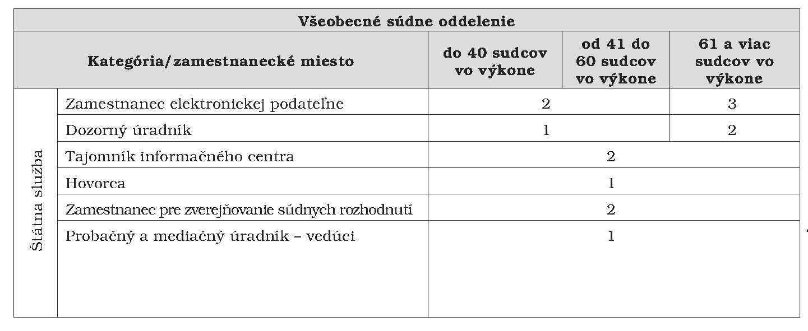

# Čl. I

Vyhláška Ministerstva spravodlivosti Slovenskej republiky č. 149/2011 Z. z. o pravidlách určovania počtu miest sudcov, zamestnancov súdov, voľných miest sudcov a rozdeľovania zamestnaneckých miest na súdy v znení vyhlášky č. 95/2012 Z. z. sa mení a dopĺňa takto:

- 1. V § 8 ods. 5 sa vypúšťajú slová „probačných a mediačných úradníkov a“.

- 2. V § 9 sa za odsek 5 vkladajú nové odseky 6 a 7, ktoré znejú:

- „(6)

- Počet miest probačných a mediačných úradníkov, ktorí sú vedúcimi štátnymi zamestnancami, sa uvádza v prílohe č. 2; počet miest probačných a mediačných úradníkov na krajskom súde v ostatných prípadoch určuje ministerstvo v súčinnosti s predsedom tohto krajského súdu.

- (7)

- Počet miest justičných čakateľov určuje ministerstvo.“.

  - Doterajšie odseky 6 a 7 sa označujú ako odseky 8 a 9.

- 3. V prílohe č. 1 sa vypúšťa riadok

- „

- Probačný a mediačný úradník | 1 | 2

- “.

- 4. V prílohe č. 2 tabuľka „Všeobecné súdne oddelenie“ znie:

- 

- 5. V prílohe č. 5 sa vypúšťa riadok

- „

- Kontrolór | 1 | 1

- “.
