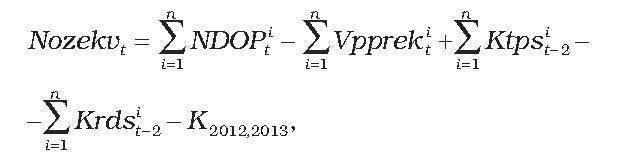
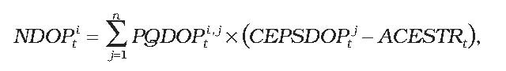
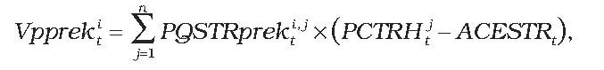

# Čl. I

Vyhláška Úradu pre reguláciu sieťových odvetví č. 221/2013 Z. z., ktorou sa ustanovuje cenová regulácia v elektroenergetike v znení vyhlášky č. 189/2014 Z. z. a vyhlášky č. 143/2015 Z. z. sa mení a dopĺňa takto:

- 1. § 10a sa dopĺňa odsekmi 3 až 6, ktoré znejú:

- „(3)

- Cena elektriny podľa odseku 1 písm. b) sa na jednej budove uplatní len pre jedného výrobcu elektriny a pre jedno zariadenie výrobcu elektriny.

- (4)

- Cena elektriny podľa odseku 1 písm. e) až g) sa uplatní len pre jedného výrobcu elektriny a pre jedno zariadenie výrobcu elektriny, ktoré obsahuje všetky technologické časti zariadenia výrobcu elektriny, ktorými sa vykonáva celý proces premeny energie obsiahnutej v biomase na elektrinu.

- (5)

- Pri technológii podľa odseku 2 písm. c) štvrtého bodu a piateho bodu, technológii podľa odseku 2 písm. d) siedmeho bodu a technológii podľa odseku 2 písm. e) sa spolu so žiadosťou výrobcu elektriny o vydanie potvrdenia o pôvode elektriny vyrobenej vysoko účinnou kombinovanou výrobou predkladá aj potvrdenie o pôvode paliva, v ktorom sa uvedie názov výrobcu paliva, chemické zloženie paliva a jeho výhrevnosť preskúšané v akreditovanom laboratóriu podľa osobitného predpisu.52)

- (6)

- Cena elektriny podľa odseku 2 písm. f) sa uplatní, ak je elektrina vyrábaná výhradne v tomto zariadení výrobcu elektriny a zároveň zariadenie výrobcu elektriny obsahuje všetky technologické časti zariadenia výrobcu elektriny, ktorými sa vykonáva celý proces premeny energie obsiahnutej v primárnom palive na elektrinu.“.

- 2. § 10b sa dopĺňa odsekmi 3 až 6, ktoré znejú:

- „(3)

- Cena elektriny podľa odseku 1 písm. b) sa na jednej budove uplatní len pre jedného výrobcu elektriny a pre jedno zariadenie výrobcu elektriny.

- (4)

- Cena elektriny podľa odseku 1 písm. e) až g) sa uplatní len pre jedného výrobcu elektriny a pre jedno zariadenie výrobcu elektriny, ktoré obsahuje všetky technologické časti zariadenia výrobcu elektriny, ktorými sa vykonáva celý proces premeny energie obsiahnutej v biomase na elektrinu.

- (5)

- Pri technológii podľa odseku 2 písm. c) štvrtého bodu a piateho bodu, technológii podľa odseku 2 písm. d) siedmeho bodu a technológii podľa odseku 2 písm. e) sa spolu so žiadosťou výrobcu elektriny o vydanie potvrdenia o pôvode elektriny vyrobenej vysoko účinnou kombinovanou výrobou predkladá aj potvrdenie o pôvode paliva, v ktorom sa uvedie názov výrobcu paliva, chemické zloženie paliva a jeho výhrevnosť preskúšané v akreditovanom laboratóriu podľa osobitného predpisu.52)

- (6)

- Cena elektriny podľa odseku 2 písm. f) sa uplatní, ak je elektrina vyrábaná výhradne v tomto zariadení výrobcu elektriny a zároveň zariadenie výrobcu elektriny obsahuje všetky technologické časti zariadenia výrobcu elektriny, ktorými sa vykonáva celý proces premeny energie obsiahnutej v primárnom palive na elektrinu.“.

- 3. V § 12 odsek 3 znie:

- „(3)

- Celkové plánované náklady na nákup elektriny vyrobenej z obnoviteľných zdrojov energie a vysoko účinnou kombinovanou výrobou prevádzkovateľa sústavy v roku t sa vypočítajú podľa vzorca

- 

- kde

- a)

- NDOPit sú plánované náklady na doplatok pre výrobcov elektriny z obnoviteľných zdrojov energie a vysoko účinnou kombinovanou výrobou vynaložené i-tým prevádzkovateľom regionálnej distribučnej sústavy v roku t, ktoré sa vypočítajú podľa vzorca

- 

- kde

- 1.

- PQDOPit je plánované množstvo elektriny, na ktoré možno uplatniť doplatok, vyrobenej v roku t v j-tom zariadení na výrobu elektriny výrobcov elektriny z obnoviteľných zdrojov energie a vysoko účinnou kombinovanou výrobou, ktorí sú pripojení do i-tej regionálnej distribučnej sústavy alebo na vymedzenom území ktorej sa nachádzajú, v jednotkách množstva elektriny,

- 2.

- CEPSDOPit je cena elektriny pre stanovenie doplatku pre zariadenie na výrobu elektriny výrobcov elektriny z obnoviteľných zdrojov energie a vysoko účinnou kombinovanou výrobou v eurách na jednotku množstva elektriny na rok t,

- 3.

- ACESTRt je cena elektriny na straty podľa osobitného predpisu55) určená ako aritmetický priemer cien elektriny základného pásma na účely pokrytia strát prevádzkovateľov regionálnych distribučných sústav bez nákladov na odchýlku; výška ceny elektriny základného pásma na účely pokrytia strát prevádzkovateľa regionálnej distribučnej sústavy v eurách na jednotku množstva elektriny na rok t je vypočítaná podľa § 28 ods. 3 písm. b) prvého bodu,

- b)

- Vpprekit je plánovaný výnos za predaj elektriny prevyšujúcej potreby pokrytia strát i-tým prevádzkovateľom regionálnej distribučnej sústavy v roku t, ktorý sa vypočíta podľa vzorca

- 

- kde

- 1.

- PQSTRprekitj je plánované množstvo elektriny v jednotkách množstva elektriny v j-tej hodine roku t prekúpené i-tým prevádzkovateľom regionálnej distribučnej sústavy v súvislosti s odberom elektriny i-tého prevádzkovateľa regionálnej distribučnej sústavy zo zariadení výrobcov elektriny s právom na podporu na účely pokrytia strát elektriny v distribučnej sústave; PQSTRprekitj sa vypočíta ako rozdiel v j-tej hodine roku t plánovaného diagramu na pokrytie strát elekriny v i-tej regionálnej distribučnej sústave a plánovaného diagramu odberu elektriny i-tého prevádzkovateľa regionálnej distribučnej sústavy zo zariadení výrobcov elektriny s právom na podporu, ak je tento rozdiel kladný, PQSTRprekitj sa rovná nule,

- 2.

- PCTRHjt je plánovaná určená cena elektriny v eurách na jednotku množstva elektriny na rok t v j-tej hodine roku t; PCTRHjt sa vypočíta pre každú hodinu každého dňa na rok t ako aritmetický priemer cien elektriny príslušných hodín v dňoch v období od 1. apríla roku t – 1 do 30. septembra roku t – 1 pri dennom obchodovaní v obchodnej oblasti, v rámci ktorej je denný trh s elektrinou organizovaný organizátorom krátkodobého trhu s elektrinou; od 1. marca 2013 je táto cena minimálne vo výške ceny elektriny na straty podľa osobitného predpisu,55)

- c)

- Ktpsit-2 je korekcia nákladov vynaložených na nákup elektriny od výrobcov elektriny z obnoviteľných zdrojov energie a vysoko účinnou kombinovanou výrobou vynaložené prevádzkovateľmi regionálnych distribučných sústav v roku t – 2,

- d)

- Krdsit-2 je korekcia výnosov z platieb na základe tarify za prevádzkovanie systému prevádzkovateľov regionálnych distribučných sústav v roku t – 2,

- e)

- K2012,2013 je korekcia nákladov prevádzkovateľa regionálnej distribučnej sústavy súvisiacich s prevzatím zodpovednosti za odchýlku za zariadenia na výrobu elektriny z obnoviteľných zdrojov energie a vysoko účinnej kombinovanej výroby elektriny a tepla, nákladov súvisiacich s dokupom elektriny, nákladov a výnosov súvisiacich s tarifou za prevádzkovanie systému fakturovanej odberateľom a samovýrobcom za roky 2012 a 2013, pre ostatné roky je rovná 0.“.

- 4. V § 12 ods. 4 uvádzacej vete sa na konci pripájajú tieto slová: „sa vypočíta podľa vzorca“.

- 5. V § 12 ods. 5 uvádzacej vete sa na konci vypúšťa dvojbodka a pripájajú sa tieto slová: „sa vypočíta podľa vzorca“.
