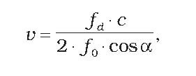
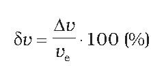

# Čl. I

Vyhláška Úradu pre normalizáciu, metrológiu a skúšobníctvo Slovenskej republiky č. 210/2000 Z. z. o meradlách a metrologickej kontrole v znení vyhlášky č. 310/2000 Z. z., vyhlášky č. 403/2000 Z. z., vyhlášky č. 9/2001 Z. z., vyhlášky č. 48/2001 Z. z., vyhlášky č. 75/2001 Z. z., vyhlášky č. 133/2001 Z. z., vyhlášky č. 27/2002 Z. z., vyhlášky č. 69/2002 Z. z., vyhlášky č. 427/2003 Z. z., vyhlášky č. 361/2004 Z. z., vyhlášky č. 669/2004 Z. z., vyhlášky č. 187/2005 Z. z., vyhlášky č. 570/2006 Z. z., vyhlášky č. 171/2008 Z. z., vyhlášky č. 13/2009 Z. z. a vyhlášky č. 162/2011 Z. z. sa mení takto:

- 1. § 12a znie:

- 㤠12a

- Táto vyhláška bola prijatá v súlade s právne záväzným aktom Európskej únie v oblasti technických noriem a technických predpisov.7)“.

  - Poznámka pod čiarou k odkazu 7 znie:

  - „7)

  - Smernica Európskeho parlamentu a Rady 98/34/ES z 22. júna 1998, ktorou sa stanovuje postup pri poskytovaní informácií v oblasti technických noriem a predpisov, ako aj pravidiel vzťahujúcich sa na služby informačnej spoločnosti (Mimoriadne vydanie Ú. v. EÚ, kap. 13/zv. 20) v platnom znení.“.

- 2. V prílohe č. 1 položka 2.1.8 znie:

- „

- 2.1.8 | Váhy s automatickou činnosťou na váženie cestných vozidiel za pohybu a na meranie nápravového zaťaženia triedy presnosti 0,2; 0,5; 1 a 2 pre hmotnosť vozidla a triedy presnosti A, B, C a D pre zaťaženie jednotlivej nápravy a pre zaťaženie skupiny náprav 2),3) | áno | áno | 1 rok | 30

- “.

- 3. Prílohy č. 30 a 31 vrátane nadpisov znejú:

- „Príloha č. 30 k vyhláške č. 210/2000 Z. z.

- VÁHY S AUTOMATICKOU ČINNOSŤOU NA VÁŽENIE CESTNÝCH VOZIDIEL ZA POHYBU A NA MERANIE NÁPRAVOVÉHO ZAŤAŽENIA

- Prvá časť

- Vymedzenie meradiel a spôsob ich metrologickej kontroly

- 1.

- Táto príloha sa vzťahuje na váhy s automatickou činnosťou na váženie cestných vozidiel za pohybu a na meranie nápravového zaťaženia (ďalej len „váhy na váženie za pohybu“), ktoré

- a)

- sa používajú ako určené meradlá podľa § 8 zákona,

- b)

- sa používajú na určenie a indikáciu hmotnosti cestných vozidiel (ďalej len „vozidlá“), určenie a indikáciu hmotnosti vozidiel a zaťaženia náprav vozidiel alebo určenie a indikáciu hmotnosti vozidiel, zaťaženia náprav vozidiel a zaťaženia skupiny náprav vozidiel pri ich vážení za pohybu a

- c)

- sú inštalované v riadenom priestore váženia na mieste, kde je rýchlosť váženého vozidla regulovaná.

- 2.

- Táto príloha sa nevzťahuje na váhy na váženie za pohybu, ktoré

- a)

- určujú zaťaženie nápravy ako dvojnásobok zaťaženia jedného kolesa alebo

- b)

- sú priamo inštalované na váženom vozidle.

- 3.

- Váhy na váženie za pohybu pred uvedením na trh podliehajú schváleniu typu a prvotnému overeniu.

- 4.

- Váhy na váženie za pohybu schváleného typu výrobca alebo dovozca označí značkou schváleného typu podľa § 14 ods. 2 zákona.

- 5.

- Váhy na váženie za pohybu, ktoré pri overení vyhovejú ustanoveným požiadavkám, sa označia overovacou značkou a vydá sa doklad o overení.

- Druhá časť

- Metrologické požiadavky, technické požiadavky, metódy technických skúšok pri schvaľovaní typu a metódy skúšania pri overení váh na váženie za pohybu

- 1.

- Definície

- 1.1

- Všeobecné definície

- 1.1.1

- Váhy na váženie za pohybu sú váhy s automatickou činnosťou vybavené nosičom zaťaženia vrátane plošiny, ktoré určujú a indikujú hmotnosť vozidla alebo určujú a indikujú hmotnosť vozidla a zaťaženie náprav vozidla alebo určujú a indikujú hmotnosť vozidla, zaťaženie náprav vozidla a zaťaženie skupín náprav vozidla počas jeho prejazdu cez ich nosič zaťaženia.

- 1.1.2

- Kontrolné váhy sú váhy používané na určenie statickej hmotnosti referenčného vozidla a statického zaťaženia jednotlivých náprav dvojnápravového kompaktného referenčného vozidla.

- 1.1.3

- Kontrolné váhy používané pri skúškach ako referenčné váhy môžu byť

- a)

- samostatné váhy alebo

- b)

- integrované váhy, ak skúšané váhy na váženie za pohybu umožňujú režim statického váženia.

- 1.2

- Konštrukcia

- 1.2.1

- Riadený priestor váženia je miesto určené na prácu váh na váženie za pohybu, ktoré je v súlade s požiadavkami na inštaláciu.

- 1.2.2

- Vážiaci úsek je úsek cesty s nosičom zaťaženia a s plošinami umiestnenými na oboch koncoch nosiča zaťaženia v smere jazdy váženého vozidla.

- 1.2.3

- Plošina je časť vážiaceho úseku, ktorá nie je nosičom zaťaženia, ale je umiestnená na oboch jeho koncoch tak, aby vytvárala priamu, rovnú a hladkú dráhu v smere jazdy váženého vozidla. Konštrukcia a geometria plošín musí vyhovovať požiadavkám technickej normy.1)

- 1.2.4

- Nosič zaťaženia je časť vážiaceho úseku určená na prijímanie zaťaženia od kolies vozidla, pomocou ktorej sa realizuje zmena rovnovážneho stavu váh na váženie za pohybu po ich zaťažení.

- 1.3

- Metrologické charakteristiky

- 1.3.1

- Váženie vcelku je váženie vozidla, ktoré celé spočíva na nosiči zaťaženia.

- 1.3.2

- Váženie po častiach je váženie vozidla postupne po dvoch alebo viacerých častiach na tom istom nosiči zaťaženia.

- 1.3.3

- Váženie za pohybu je proces určenia hmotnosti vozidla, zaťaženia nápravy alebo skupiny náprav pohybujúceho sa vozidla prechádzajúceho cez nosič zaťaženia váh na váženie za pohybu meraním a analýzou dynamických síl pneumatík vozidla.

- 1.3.4

- Statické váženie je váženie vozidiel alebo skúšobných zaťažení v pokoji.

- 1.3.5

- Hmotnosť vozidla je celková hmotnosť vozidla vrátane všetkých pripojených súčastí.

- 1.3.6

- Náprava vozidla (ďalej len „náprava“) je os so súpravou dvoch alebo viacerých kolies, ktorých stred otáčania leží približne na spoločnej osi prebiehajúcej cez celú šírku vozidla a uloženej priečne k smeru pohybu vozidla.

- 1.3.7

- Skupina náprav sú dve alebo viac náprav v definovanej skupine náprav a ich vzájomný čiastkový rázvor, ktorým je vzdialenosť stredov náprav v danej skupine náprav.

- 1.3.8

- Zaťaženie nápravy je časť hmotnosti vozidla pripadajúca na nápravu, ktorá v čase váženia spočíva na nosiči zaťaženia.

- 1.3.9

- Zaťaženie jednotlivej nápravy je zaťaženie nápravy, ktorá nie je súčasťou skupiny náprav.

- 1.3.10

- Statické referenčné zaťaženie jednotlivej nápravy je zaťaženie jednotlivej nápravy známej konvenčne pravej hodnoty určenej pri statickom vážení dvojnápravového kompaktného vozidla.

- 1.3.11

- Zaťaženie skupiny náprav je súčet zaťažení všetkých náprav v definovanej skupine náprav. Zaťaženie skupiny náprav je časť hmotnosti vozidla pripadajúca na skupinu náprav v čase váženia.

- 1.3.12

- Zaťaženie pneumatiky je časť hmotnosti vozidla pripadajúca na pneumatiku v čase váženia.

- 1.3.13

- Zaťaženie kolesa je súčet zaťažení všetkých pneumatík obsiahnutých v montáži kolesa na jednom konci nápravy. Montáž kolesa môže mať jednu alebo dve pneumatiky.

- 1.3.14

- Horná medza váživosti (Max) je najväčšie zaťaženie nosiča zaťaženia pri vážení za pohybu bez sčítavania.

- 1.3.15

- Dolná medza váživosti (Min) je hodnota zaťaženia, pod ktorou môžu byť výsledky váženia za pohybu pred sčítaním ovplyvnené zvýšenou relatívnou chybou.

- 1.3.16

- Rozsah váživosti je rozsah medzi dolnou medzou váživosti a hornou medzou váživosti.

- 1.3.17

- Hodnota dielika (d) je hodnota vyjadrená v jednotkách hmotnosti pre váženie za pohybu zodpovedajúca rozdielu medzi dvomi susednými indikovanými alebo vytlačenými hodnotami.

- 1.3.18

- Hodnota dielika pre stacionárne zaťaženie je hodnota vyjadrená v jednotkách hmotnosti pre váženie stacionárnych vozidiel alebo skúšobných závaží zodpovedajúca rozdielu medzi dvomi susednými indikovanými alebo vytlačenými hodnotami.

- 1.3.19

- Prevádzková rýchlosť (v) je priemerná rýchlosť váženého vozidla počas jeho pohybu cez nosič zaťaženia.

- 1.3.20

- Najväčšia prevádzková rýchlosť (vmax) je najväčšia rýchlosť vozidla, pri ktorej môžu váhy na váženie za pohybu vážiť za pohybu a nad ktorej hodnotou môžu byť výsledky váženia ovplyvnené zvýšenou relatívnou chybou.

- 1.3.21

- Najmenšia prevádzková rýchlosť (vmin) je najmenšia rýchlosť vozidla, pri ktorej môžu váhy na váženie za pohybu vážiť za pohybu a pod ktorej hodnotou môžu byť výsledky váženia ovplyvnené zvýšenou relatívnou chybou.

- 1.3.22

- Rozsah prevádzkovej rýchlosti je výrobcom špecifikovaný rozsah hodnôt medzi najmenšou prevádzkovou rýchlosťou a najväčšou prevádzkovou rýchlosťou, v ktorom sa môže vozidlo vážiť za pohybu.

- 1.3.23

- Najväčšia prejazdová rýchlosť je najväčšia rýchlosť, ktorou môže vozidlo prechádzať cez vážiaci úsek bez toho, aby spôsobilo trvalú zmenu funkčných charakteristík váh na váženie za pohybu nad rámec špecifikovaných charakteristík.

- 1.4

- Indikácie a chyby

- 1.4.1

- Indikácia váh je zobrazenie hodnoty veličiny poskytnuté meradlom. Pojem indikácia zahrňuje zobrazenie údaja na displeji aj na výtlačku.

- 1.4.2

- Primárne indikácie sú indikácie, signály a symboly, ktoré sú predmetom požiadaviek na váhy na váženie za pohybu.

- 1.4.3

- Najväčšia dovolená chyba (MPE) je najväčšia dovolená hodnota chyby určená podľa bodu 2.2, pričom chyba je vyjadrená ako rozdiel medzi indikáciou váh na váženie za pohybu a zodpovedajúcou konvenčne pravou hodnotou.

- 1.4.4

- Najväčšia dovolená odchýlka (MPD) je najväčšia dovolená odchýlka zaťaženia jednotlivej nápravy alebo zaťaženia skupiny náprav od korigovanej strednej hodnoty zaťaženia jednotlivej nápravy alebo zaťaženia skupiny náprav.

- 1.4.5

- Korigovaný výsledok je výsledok merania po algebrickej korekcii systematickej chyby.

- 1.5

- Vozidlá

- 1.5.1

- Vozidlo, ktoré je naložené alebo prázdne, ktoré musia váhy na váženie za pohybu rozpoznávať ako vozidlo určené na váženie.

- 1.5.2

- Kompaktné vozidlo je cestné vozidlo s nedeleným podvozkom, ku ktorému nie je pripojený príves ani náves. Kompaktné vozidlo má dve alebo viac náprav.

- 1.5.3

- Referenčné vozidlo je vozidlo so známou konvenčne pravou hodnotou hmotnosti a zaťaženia jednotlivých náprav pri dvojnápravovom kompaktnom vozidle alebo hmotnosti pri ostatných vozidlách použitých pri skúškach za pohybu, určenou na kontrolných váhach.

- 1.6

- Ďalšie termíny a definície sú uvedené v technickej norme.2)

- 2.

- Metrologické požiadavky

- 2.1

- Triedy presnosti

- 2.1.1

- Hmotnosť vozidla

- Na určenie hmotnosti vozidla sú váhy na váženie za pohybu rozdelené do štyroch tried presnosti

- a) | 0,2

- b) | 0,5

- c) | 1

- d) | 2

- 2.1.2

- Zaťaženie jednotlivej nápravy a zaťaženie skupiny náprav

- Na určenie zaťaženia jednotlivej nápravy alebo zaťaženia skupiny náprav sú váhy rozdelené do štyroch tried presnosti

- a) | A

- b) | B

- c) | C

- d) | D

- 2.1.3

- Váhy na váženie za pohybu môžu mať rôzne triedy presnosti na určenie zaťaženia jednotlivej nápravy a na určenie zaťaženia skupiny náprav.

- 2.1.4

- Vzťah medzi triedami presnosti

- Vzťah medzi jednotlivými triedami presnosti pre zaťaženie jednotlivej nápravy alebo pre zaťaženie skupiny náprav a triedami presnosti pre hmotnosť vozidla je uvedený v tabuľke č. 1.

- Tabuľka č. 1

- Trieda presnosti pre zaťaženie jednotlivej nápravy a pre zaťaženie skupiny náprav | Trieda presnosti pre hmotnosť vozidla | | |

- | 0,2 | 0,5 | 1 | 2

- A | x | x | |

- B | x | x | x |

- C | | x | x | x

- D | | | x | x

- 2.2

- Hranice chýb

- 2.2.1

- Váženie za pohybu

- 2.2.1.1

- Hmotnosť vozidla

- Najväčšou dovolenou chybou určenia hmotnosti vozidla pri jeho vážení za pohybu je väčšia z týchto hodnôt:

- a)

- hodnota vypočítaná podľa tabuľky č. 2 zaokrúhlená na hodnotu najbližšieho dielika stupnice,

- b)

- 1 d × počet náprav v súčte pri prvotnom overení alebo 2 d × počet náprav v súčte pri kontrole v prevádzke.

- Tabuľka č. 2

- Trieda presnosti pre hmotnosť vozidla | Percento konvenčnej hodnoty hmotnosti vozidla |

- | Prvotné overenie | Kontrola v prevádzke

- 0,2 | ±0,10 % | ±0,20 %

- 0,5 | ±0,25 % | ±0,50 %

- 1 | ±0,50 % | ±1,00 %

- 2 | ±1,00 % | ±2,00 %

- 2.2.1.2

- Zaťaženie jednotlivej nápravy a zaťaženie skupiny náprav

- Hranice chýb platné pre zaťaženie jednotlivej nápravy a pre zaťaženie skupiny náprav

- a)

- pre statické referenčné zaťaženie jednotlivej nápravy dvojnápravového kompaktného referenčného vozidla sú uvedené v bode 2.2.1.2.1,

- b)

- pre zaťaženie jednotlivej nápravy a pre zaťaženie skupiny náprav všetkých ostatných referenčných vozidiel sú uvedené v bode 2.2.1.2.2.

- 2.2.1.2.1

- Najväčšia dovolená chyba (MPE) pre dvojnápravové kompaktné referenčné vozidlo

- Pri skúškach za pohybu dvojnápravového kompaktného referenčného vozidla nesmie najväčší rozdiel medzi indikovaným zaťažením jednotlivej nápravy a konvenčne pravou hodnotou statického referenčného zaťaženia jednotlivej nápravy prekročiť väčšiu z týchto hodnôt:

- a)

- hodnotu z tabuľky č. 3 zaokrúhlenú na hodnotu najbližšieho dielika stupnice,

- b)

- 1 d pri prvotnom overení alebo 2 d pri kontrole v prevádzke.

- Tabuľka č. 3

- Trieda presnosti pre zaťaženie jednotlivej nápravy | Percento konvenčne pravej hodnoty statického referenčného zaťaženia jednotlivej nápravy |

- | Prvotné overenie | Kontrola v prevádzke

- A | ±0,25 % | ±0,50 %

- B | ±0,50 % | ±1,00 %

- C | ±0,75 % | ±1,50 %

- D | ±1,00 % | ±2,00 %

- 2.2.1.2.2

- Najväčšia dovolená odchýlka (MPD) pre všetky typy referenčných vozidiel okrem dvojnápravových kompaktných referenčných vozidiel

- Pre všetky typy referenčných vozidiel okrem dvojnápravových kompaktných referenčných vozidiel platí, že najväčší rozdiel medzi indikáciou zaťaženia jednotlivej nápravy alebo zaťaženia skupiny náprav zaznamenanej počas skúšok za pohybu a korigovanou strednou hodnotou zaťaženia jednotlivej nápravy alebo korigovanou strednou hodnotou zaťaženia skupiny náprav sa musí rovnať väčšej z týchto hodnôt:

- a)

- hodnote z tabuľky č. 4 zaokrúhlenej na hodnotu najbližšieho dielika stupnice,

- b)

- 1 d × n pri prvotnom overení alebo 2 d × n pri kontrole v prevádzke,

- kde n je počet náprav v skupine, pričom n = 1 je pre jednotlivú nápravu.

- Tabuľka č. 4

- Trieda presnosti pre zaťaženie jednotlivej nápravy a zaťaženie skupiny náprav | Percento korigovanej strednej hodnoty zaťaženia jednotlivej nápravy alebo zaťaženia skupiny náprav |

- | Prvotné overenie | Kontrola v prevádzke

- A | ±0,50 % | ±1,00 %

- B | ±1,00 % | ±2,00 %

- C | ±1,50 % | ±3,00 %

- D | ±2,00 % | ±4,00 %

- 2.2.2

- Statické váženie

- Najväčšia dovolená chyba pri statickom vážení pre zvyšujúce sa alebo znižujúce sa zaťaženie je uvedená v tabuľke č. 5.

- Tabuľka č. 5

- Trieda presnosti pre hmotnosť vozidla | Zaťaženie (m) vyjadrené v dielikoch stupnice | Najväčšie dovolené chyby |

- | | Prvotné overenie | Kontrola v prevádzke

- 0,2 0,5 1 | 0 ≤ m ≤ 500 | ±0,5 d | ±1,0 d

- | 500 < m ≤ 2 000 | ±1,0 d | ±2,0 d

- | 2 000 < m < 5 000 | ±1,5 d | ±3,0 d

- 2 | 0 ≤ m ≤ 50 | ±0,5 d | ±1,0 d

- | 50 < m ≤ 200 | ±1,0 d | ±2,0 d

- | 200 < m ≤ 1 000 | ±1,5 d | ±3,0 d

- 2.3

- Dielik stupnice (d)

- Pre konkrétny spôsob váženia za pohybu a kombináciu nosičov zaťaženia musí mať každé zariadenie na indikáciu hmotnosti a na tlač výsledkov váženia rovnakú hodnotu dielika.

- Vzťah medzi triedou presnosti, veľkosťou dielika stupnice a počtom dielikov stupnice pre hornú medzu váživosti je špecifikovaný v tabuľke č. 6.

- Tabuľka č. 6

- Trieda presnosti pre hmotnosť vozidla | d (kg) | Najmenší počet dielikov | Najväčší počet dielikov

- 0,2 | ≤ 5 | 500 | 5 000

- 0,5 | ≤ 10 | |

- 1 | ≤ 20 | |

- 2 | ≤50 | 50 | 1 000

- Hodnoty dielikov indikačných a tlačiarenských zariadení sú vyjadrené v tvare 1 × 10k, 2 × 10k alebo 5 × 10k, kde k je kladné alebo záporné celé číslo alebo nula.

- 2.4

- Dolná medza váživosti

- Dolná medza váživosti nesmie byť menšia, ako je zaťaženie vyjadrené v dielikoch stupnice špecifikované v tabuľke č. 7.

- Tabuľka č. 7

- Trieda presnosti pre hmotnosť vozidla | Dolná medza váživosti v dielikoch stupnice

- 0,2 0,5 1 | 50

- 2 | 10

- 2.5

- Zhoda medzi indikačným a tlačiarenským zariadením

- Výsledky váženia indikované dvomi zariadeniami s rovnakou hodnotou dielika musia byť pri rovnakom zaťažení zhodné.

- 2.6

- Teplota

- Váhy na váženie za pohybu musia vyhovovať metrologickým požiadavkám a technickým požiadavkám pri teplotách od –10 oC do +40 oC. Teplotný rozsah môže byť na osobitné účely iný, ale nie menší ako 30 oC, a musí byť vyznačený na váhach na váženie za pohybu.

- 2.7

- Prevádzková rýchlosť

- Váhy na váženie za pohybu musia vyhovovať metrologickým požiadavkám a technickým požiadavkám pri rýchlostiach vozidla v rozsahu prevádzkovej rýchlosti.

- 2.8

- Meracie jednotky

- Na vyjadrenie hmotnosti a zaťaženia sa používajú jednotky hmotnosti kilogram (kg) alebo tona (t).

- 2.9

- Ďalšie metrologické požiadavky sú uvedené v technickej norme.2)

- 3.

- Technické požiadavky

- 3.1

- Vhodnosť na účely používania

- Váhy na váženie za pohybu musia byť skonštruované tak, aby boli vhodné pre vozidlá, miesto používania a pracovné metódy, pre ktoré sú určené.

- 3.2

- Zneužitie

- Váhy na váženie za pohybu nesmú mať vlastnosti, ktoré umožňujú ich podvodné používanie.

- 3.3

- Náhodná porucha alebo nesprávne nastavenie

- Váhy na váženie za pohybu musia byť konštruované tak, že náhodné poškodenie alebo nesprávne nastavenie riadiacich prvkov spôsobujúce poruchu správnej činnosti sa nemôže vyskytnúť bez toho, aby ich výskyt nebol evidentný alebo signalizovaný.

- 3.4

- Používanie v režime váh s neautomatickou činnosťou

- Váhy na váženie za pohybu, ktoré môžu pracovať v režime váh s neautomatickou činnosťou, okrem toho, že musia vyhovovať požiadavkám technickej normy3) pre váhy s neautomatickou činnosťou, musia byť vybavené aj prostriedkami, ktoré umožňujú neautomatickú prevádzku, pri ktorej sa zablokuje automatická činnosť váh na váženie za pohybu aj váženie za pohybu.

- 3.5

- Automatická prevádzka

- Váhy na váženie za pohybu musia byť navrhnuté tak, aby zabezpečovali takú úroveň spoľahlivosti, pri ktorej je zaručené, že si uchovajú svoju presnosť a spĺňajú požiadavky najmenej po dobu jedného roka ich používania v bežných pracovných podmienkach. Všetky nedostatky sa musia automaticky a zreteľne indikovať.

- 3.6

- Kvalita indikácie

- Odčítanie primárnych údajov musí byť spoľahlivé, ľahké a jednoznačné v bežných pracovných podmienkach.

- 3.7

- Tlačiareň

- Tlač musí byť zreteľná a na daný účel stála. Vytlačené číslice musia mať výšku najmenej 2 mm. Pri tlači je názov alebo symbol meracej jednotky umiestnený na pravej strane hodnoty alebo na čele stĺpca hodnôt.

- 3.8

- Ukladanie dát

- Údaje o meraní sa môžu uložiť v pamäti váh na váženie za pohybu alebo v externej pamäti na ďalšie použitie. Údaje musia byť náležite chránené proti ich úmyselnej alebo neúmyselnej zmene v procese prenosu alebo ukladania a musia obsahovať všetky informácie potrebné na rekonštrukciu predchádzajúceho merania.

- 3.9

- Súčtové zariadenie

- Váhy na váženie za pohybu musia byť vybavené súčtovým zariadením, ktoré pracuje

- a)

- automaticky; zariadenie začne pracovať po rozpoznaní vozidla, alebo

- b)

- poloautomaticky; zariadenie začne automaticky pracovať po manuálnom príkaze.

- 3.10

- Zariadenie na rozpoznanie vozidla

- Váhy na váženie za pohybu, ktoré môžu pracovať bez zásahu operátora, musia byť vybavené zariadením na rozpoznanie vozidla. Toto zariadenie zistí prítomnosť vozidla vo vážiacom úseku a rozpozná, kedy je celé vozidlo odvážené. Váhy na váženie za pohybu nesmú indikovať ani vytlačiť údaj o hmotnosti, kým vážením neprešli všetky kolesá vozidla.

- 3.11

- Zariadenia na usmernenie vozidla

- Váhou na váženie za pohybu sa nesmú indikovať alebo vytlačiť údaje o hmotnosti vozidla, zaťažení jednotlivej nápravy alebo zaťažení skupiny náprav, ak niektoré z kolies neprešlo úplne cez nosič zaťaženia. Ak je pre danú váhu na váženie za pohybu určené váženie len v jednom smere, musí sa pri prejazde vozidla nesprávnym smerom objaviť chybové hlásenie alebo váhy na váženie za pohybu nesmú indikovať alebo vytlačiť hmotnosť vozidla, zaťaženia jednotlivej nápravy alebo zaťaženia skupiny náprav.

- 3.12

- Prevádzková rýchlosť

- Váhou na váženie za pohybu sa nesmú indikovať ani vytlačiť údaje o hmotnosti vozidla, zaťažení jednotlivej nápravy alebo zaťažení skupiny náprav, ak vozidlo prešlo cez nosič zaťaženia rýchlosťou mimo rozsahu špecifikovaného pre prevádzkovú rýchlosť bez toho, aby na túto skutočnosť zreteľne neupozornili hlásením, že výsledky nie sú overené.

- 3.13

- Softvér

- Softvér používaný vo váhach na váženie za pohybu musí byť inštalovaný tak, aby sa bez porušenia jeho zabezpečenia nedal nijako upravovať alebo aby identifikačný kód automaticky signalizoval zmenu v softvéri.

- 3.14

- Inštalácia

- Váhy na váženie za pohybu sa vyrábajú a inštalujú tak, aby nepriaznivý vplyv prostredia na výsledok váženia bol čo najmenší. Ak by niektoré podmienky inštalácie mohli ovplyvniť proces váženia, uvedú sa tieto v rozhodnutí o schválení typu. Inštalácia váh na váženie za pohybu musí vyhovovať požiadavkám technickej normy.1)

- 3.15

- Ďalšie technické požiadavky sú uvedené v technickej norme.2)

- 4.

- Nápisy a označenia

- 4.1

- Na váhach na váženie za pohybu sa uvádzajú údaje podľa bodov 4.1.1 a 4.1.2.

- 4.1.1

- Údaje uvedené v plnom znení

- a)

- meno alebo značka výrobcu,

- b)

- meno alebo značka dovozcu, ak ide o váhy na váženie za pohybu z dovozu,

- c)

- označenie typu váh na váženie za pohybu,

- d)

- výrobné číslo váh na váženie za pohybu na každom nosiči zaťaženia, ak majú váhy na váženie za pohybu viac nosičov zaťaženia,

- e)

- upozornenie „Nepoužívať na váženie kvapalných produktov“, ak typ váh na váženie za pohybu nie je schválený na váženie kvapalných produktov,

- f)

- najväčšia prejazdová rýchlosť vozidla pri vážení v km/h,

- g)

- smer váženia, ak typ váh na váženie za pohybu nie je schválený na váženie v obidvoch smeroch,

- h)

- dĺžka najdlhšieho váženého vozidla,

- i)

- hodnota dielika pre stacionárne zaťaženie, ak typ váh na váženie za pohybu je schválený aj na stacionárne váženie,

- j)

- napájacie napätie vo V,

- k)

- frekvencia zdroja elektrického prúdu v Hz,

- l)

- teplotný rozsah v oC, ak je iný ako –10 oC až +40 oC,

- m)

- identifikácia softvéru (ak sa vyžaduje).

- 4.1.2

- Údaje uvedené v kódoch

- a)

- trieda presnosti 0,2; 0,5; 1 alebo 2,

- b)

- trieda presnosti pre zaťaženie jednotlivej nápravy A, B, C alebo D, ak typ váh na váženie za pohybu je schválený aj na meranie zaťaženia jednotlivej nápravy,

- c)

- trieda presnosti pre zaťaženie skupiny náprav A, B, C alebo D, ak typ váh na váženie za pohybu je schválený aj na meranie zaťaženia skupiny náprav,

- d)

- horná medza váživosti Max = kg alebo t,

- e)

- dolná medza váživosti Min = kg alebo t,

- f)

- hodnota dielika d = kg alebo t,

- g)

- najväčšia prevádzková rýchlosť vmax = km/h,

- h)

- najmenšia prevádzková rýchlosť vmin = km/h,

- i)

- najväčší počet náprav vozidla Amax = , ak typ váh na váženie za pohybu je schválený aj na meranie zaťaženia jednotlivej nápravy alebo skupiny náprav,

- j)

- značka schváleného typu.

- 4.2

- Doplnkové nápisy

- V závislosti od konkrétneho účelu použitia váh na váženie za pohybu môže metrologický orgán vydávajúci certifikát o schválení typu váh na váženie za pohybu vyžadovať v rámci schvaľovania typu jeden alebo viac doplnkových nápisov.

- 4.3

- Vyhotovenie

- Nápisy a značky musia byť zreteľné, dobre čitateľné v bežných pracovných podmienkach a neodstrániteľné. Umiestňujú sa na dobre viditeľnom mieste váh na váženie za pohybu, na štítku upevnenom v blízkosti indikačného zariadenia alebo na samotnom indikačnom zariadení.

- 4.4

- Overovacie značky

- 4.4.1

- Umiestnenie

- Na váhach na váženie za pohybu musí byť vyhradené miesto na umiestnenie overovacej značky, ktoré musí

- a)

- byť také, aby časť váh na váženie za pohybu, na ktorej sa overovacia značka nachádza, nebolo možné odstrániť bez poškodenia overovacej značky,

- b)

- umožňovať jednoduché umiestnenie overovacej značky bez toho, aby sa tým zmenili ich metrologické vlastnosti,

- c)

- byť také, aby overovacia značka bola viditeľná v bežných pracovných podmienkach.

- 4.4.2

- Pripevnenie

- Ak sa značka vytvorí razením, nosič overovacej značky môže tvoriť platnička z olova alebo iného rovnocenného materiálu, ktorá je zapustená v doske umiestnenej na váhach na váženie za pohybu alebo vo vyvŕtanej dutine. Ak je značka na samolepiacej nálepke, na váhach na váženie za pohybu musí byť vyhradené vhodné miesto na umiestnenie tejto nálepky.

- 5.

- Požiadavky na elektronické váhy na váženie za pohybu

- Elektronické váhy na váženie za pohybu musia okrem ostatných požiadaviek spĺňať aj požiadavky podľa bodov 5.1 až 5.6.

- 5.1

- Pracovné podmienky

- Elektronické váhy na váženie za pohybu musia byť navrhnuté a vyrobené tak, aby v bežných pracovných podmienkach neprekročili najväčšie dovolené chyby.

- 5.2

- Rušivé vplyvy

- Konštrukcia a vyhotovenie elektronických váh na váženie za pohybu pri vystavení rušivým vplyvom

- a)

- nesmie vykazovať závažné poruchy alebo

- b)

- musí závažné poruchy rozpoznávať a reagovať na ne.

- Poruchy, ktoré sú menšie alebo sa rovnajú hodnote 1 d, sú dovolené bez ohľadu na hodnotu chyby údaja.

- 5.3

- Uplatnenie

- Požiadavky bodu 5.2 sa uplatňujú samostatne na

- a)

- každý jednotlivý prípad závažnej poruchy alebo

- b)

- každú časť elektronických váh na váženie za pohybu.

- 5.4

- Reakcia na závažnú poruchu

- Po rozpoznaní závažnej poruchy

- a)

- musí dôjsť k automatickému prerušeniu procesu váženia,

- b)

- musí dôjsť k automatickej vizuálnej signalizácii alebo

- c)

- musí dôjsť k automatickej zvukovej signalizácii.

- Signalizácia podľa písmen b) a c) musí trvať dovtedy, kým sa porucha neodstráni alebo nezasiahne operátor.

- 5.5

- Rozhranie

- Váhy na váženie za pohybu môžu byť vybavené komunikačným rozhraním umožňujúcim prepojenie váh na váženie za pohybu s externým zariadením a používateľským rozhraním umožňujúcim výmenu informácií medzi operátorom a váhami na váženie za pohybu. Rozhranie nesmie mať vplyv na správnu činnosť váh na váženie za pohybu a nesmie ovplyvňovať ich metrologické funkcie.

- 5.6

- Zabezpečenie rozhraní

- Komunikačné a používateľské rozhrania nesmú umožniť nedovolené ovplyvňovanie softvéru, metrologických funkcií váh na váženie za pohybu a meraných údajov spôsobené pripojenými zariadeniami alebo rušením pôsobiacim na rozhranie.

- 5.7

- Ďalšie požiadavky na elektronické váhy na váženie za pohybu sú uvedené v technickej norme.2)

- 6.

- Metódy technických skúšok pri schvaľovaní typu

- 6.1

- Dokumentácia

- Žiadosť o schválenie typu musí obsahovať dokumentáciu s údajmi

- a)

- metrologické charakteristiky váh na váženie za pohybu,

- b)

- súhrn špecifikácií váh na váženie za pohybu,

- c)

- opis funkcie komponentov a zariadení váh na váženie za pohybu,

- d)

- nákresy, schémy alebo všeobecné softvérové informácie objasňujúce konštrukciu a činnosť váh na váženie za pohybu,

- e)

- dokumenty preukazujúce, že konštrukcia a vyhotovenie váh na váženie za pohybu zodpovedajú technickým požiadavkám, metrologickým požiadavkám a technickej norme.2)

- 6.2

- Všeobecne

- Skúška na účely schvaľovania typu sa vykoná aspoň na jednej váhe na váženie za pohybu predstavujúcej konkrétny typ. Váha na váženie za pohybu musí byť kompletne inštalovaná na typickom mieste používania.

- 6.3

- Skúšky

- Skontroluje sa predložená dokumentácia a vykonajú sa skúšky na preverenie, či váhy na váženie za pohybu zodpovedajú

- a)

- technickým požiadavkám,

- b)

- metrologickým požiadavkám,

- c)

- ak ide o elektronické váhy na váženie za pohybu, aj požiadavkám na elektronické váhy na váženie za pohybu.

- 6.4

- Poskytnutie prostriedkov na vykonanie skúšky

- Vykonávateľ skúšky typu môže na účely skúšok vyžadovať od žiadateľa o schválenie typu náležité množstvo materiálu, kontrolné váhy, referenčné vozidlá a kvalifikovaný personál.

- 6.5

- Miesto skúšky

- Váhy na váženie za pohybu predložené na schválenie typu sa môžu skúšať na týchto miestach:

- a)

- na mieste, na ktorom sa vykonávateľ skúšky typu a žiadateľ o schválenie typu dohodnú, alebo

- b)

- v laboratóriu, ktoré vykonávateľ skúšky typu považuje za vhodné.

- 6.6

- Ďalšie špecifikácie metód technických skúšok pri schvaľovaní typu sú uvedené v technickej norme.2)

- 7.

- Metódy skúšok pri prvotnom overení a následnom overení

- 7.1

- Skúšky

- Vykonávateľ overenia preverí zhodu váh na váženie za pohybu so schváleným typom a preskúša, či váhy na váženie za pohybu vyhovujú technickým požiadavkám a metrologickým požiadavkám. Váhy na váženie za pohybu musia vyhovovať technickým požiadavkám a metrologickým požiadavkám pre všetky vozidlá a všetky produkty na vozidlách, na ktorých váženie sa váhy na váženie za pohybu v bežných pracovných podmienkach používajú. Skúšky vykoná príslušný metrologický orgán na mieste pri normálnej inštalácii váh na váženie za pohybu. Váhy na váženie za pohybu musia byť inštalované tak, aby spôsob automatického váženia bol pri skúške rovnaký, aký sa používa pri vážení na obchodné účely. Vykonávateľ overenia v odôvodnenom prípade a v záujme toho, aby sa predišlo duplicite skúšok, ktoré už boli predtým vykonané pri skúške typu, môže použiť tieto výsledky pri prvotnom overení podľa § 15 zákona.

- 7.2

- Poskytnutie prostriedkov na vykonanie skúšky

- Vykonávateľ overenia môže na účely skúšok vyžadovať od žiadateľa o overenie primerané množstvo materiálu, kontrolné váhy, referenčné vozidlá a kvalifikovaný personál.

- 7.3

- Miesto skúšky

- Skúšky pri overení sa vykonávajú kompletne na mieste inštalácie váh na váženie za pohybu a počas skúšky musia váhy na váženie za pohybu obsahovať všetky používané súčasti.

- 7.4

- Počet skúšok za pohybu

- 7.4.1

- Počet skúšok za pohybu pri prvotnom overení a pri prvotnom overení po oprave

- Pri skúšaní každej váhy na váženie za pohybu je potrebných najmenej 48 prejazdov referenčných vozidiel. Každé dvojnápravové kompaktné referenčné vozidlo a jedno alebo viac iných referenčných vozidiel vykoná najmenej 6 prejazdov pri dvoch rôznych rýchlostiach, naložené aj prázdne.

- 7.4.2

- Počet skúšok za pohybu pri následnom overení

- Pri skúšaní váh na váženie za pohybu je potrebných najmenej 40 prejazdov referenčných vozidiel. Každé dvojnápravové kompaktné referenčné vozidlo a jedno alebo viac iných referenčných vozidiel vykoná najmenej 5 prejazdov pri dvoch rôznych rýchlostiach, naložené aj prázdne.

- 7.5

- Ďalšie špecifikácie metód skúšok pri prvotnom a následnom overení a pri kontrole v prevádzke sú uvedené v technickej norme.2)

- 8.

- Kontrola v prevádzke

- 8.1

- Kontrola v prevádzke sa vykonáva ako pri následnom overení, pričom sa použijú hranice chýb pre kontrolu v prevádzke.

- 8.2

- Kontrola v prevádzke sa môže vykonať až po overení váh na váženie za pohybu.

- Príloha č. 31 k vyhláške č. 210/2000 Z. z.

- Cestné rýchlomery

- Prvá časť

- Vymedzenie meradiel a spôsob ich metrologickej kontroly

- 1.

- Táto príloha sa vzťahuje na cestné rýchlomery, ktoré sú používané na meranie rýchlosti cestných motorových vozidiel pri kontrole dodržiavania pravidiel cestnej premávky ako určené meradlá podľa § 8 zákona.

- 2.

- Táto príloha sa vzťahuje na

- a)

- cestné radarové rýchlomery, ktoré merajú rýchlosť meraného cestného motorového vozidla na základe Dopplerovho javu,

- b)

- cestné laserové rýchlomery, ktoré merajú rýchlosť meraného cestného motorového vozidla na základe merania zmeny vzdialenosti medzi meraným objektom a meradlom v čase,

- c)

- cestné úsekové meradlá rýchlosti, ktoré merajú priemernú úsekovú rýchlosť cestného motorového vozidla na základe merania času prejazdu meracím úsekom známej dĺžky,

- d)

- cestné meradlá priemernej rýchlosti, ktoré merajú priemernú úsekovú rýchlosť cestného motorového vozidla na základe merania rýchlosti meracieho vozidla, ktorá je pri dodržaní definovaných podmienok priradená meranému vozidlu.

- 3.

- Cestné rýchlomery pred uvedením na trh podliehajú schváleniu typu a prvotnému overeniu. Technické požiadavky, metrologické požiadavky, metódy technických skúšok pri schvaľovaní typu a metódy skúšania pri prvotnom a následnom overení cestných rýchlomerov sú uvedené v druhej časti.

- 4.

- Cestné rýchlomery schváleného typu výrobca alebo dovozca označí značkou schváleného typu podľa § 14 ods. 2 zákona.

- 5.

- Cestné rýchlomery, ktoré pri overení vyhovejú ustanoveným požiadavkám, sa označia overovacou značkou a vydá sa doklad o overení.

- 6.

- Cestné rýchlomery počas ich používania ako určené meradlá podliehajú následnému overeniu.

- Druhá časť

- Technické požiadavky, metrologické požiadavky, metódy technických skúšok pri schvaľovaní typu a metódy skúšania pri overení cestných rýchlomerov

- 1.

- Termíny a definície

- 1.1

- Termíny a definície vzťahujúce sa na cestné rýchlomery

- 1.1.1

- Cestný rýchlomer (ďalej len „rýchlomer“) je meradlo určené na meranie rýchlosti cestných motorových vozidiel (ďalej len „vozidlo“) umiestnené mimo vozidla, ktorého rýchlosť sa meria.

- 1.1.2

- Rýchlosť vozidla je fyzikálna veličina, ktorá je definovaná ako podiel dĺžky dráhy prejdenej meraným vozidlom a zodpovedajúceho časového intervalu pri dodržaní podmienky, že pohyb vozidla je rovnomerný po celej dráhe. Jednotkou rýchlosti je km/h.

- 1.1.3

- Priemerná úseková rýchlosť vozidla (ďalej len „úseková rýchlosť“) je rýchlosť, ktorá je definovaná ako podiel dĺžky meracieho úseku a času prejazdu meraného vozidla meracím úsekom.

- 1.1.4

- Snímač rýchlomera je časť rýchlomera, ktorá generuje signály charakterizujúce pohyb meraného alebo meracieho vozidla.

- 1.1.5

- Ovládacia jednotka je časť rýchlomera, ktorá slúži na ovládanie rýchlomera a na zadávanie vstupných hodnôt.

- 1.1.6

- Výpočtová jednotka je časť rýchlomera, ktorá spracúva signály zo snímača alebo snímačov a na základe nich vypočítava rýchlosť meraného vozidla a zabezpečuje správnosť nameraných údajov.

- 1.1.7

- Vyhodnocovacia jednotka je časť rýchlomera, ktorá je určená na vyhodnocovanie priestupkov a na tvorbu priestupkových dokumentov.

- 1.1.8

- Zobrazovacia jednotka je časť rýchlomera, ktorá zobrazuje namerané hodnoty rýchlosti a ďalšie údaje.

- 1.1.9

- Obrazová dokumentačná jednotka je časť rýchlomera, ktorá slúži na zaznamenanie dopravnej situácie pomocou obrazových dokumentov a na ich uchovávanie spolu s nameranými údajmi.

- 1.1.10

- Miesto merania je určené akčným rádiusom snímača alebo snímačov rýchlomera.

- 1.1.11

- Dopravná situácia je súbor objektov, zložený z meraného vozidla a okolitých objektov, ktoré by mohli mať vplyv na namerané údaje.

- 1.1.12

- Prenosný rýchlomer je rýchlomer, ktorý je možné prenášať z jedného stanoviska na iné, ale pri meraní musí byť umiestnený podľa pokynov výrobcu.

- 1.1.13

- Stacionárny rýchlomer je rýchlomer určený na pevnú inštaláciu na definovanom stacionárnom stanovišti.

- 1.1.14

- Mobilný rýchlomer je rýchlomer, ktorý je schopný merať rýchlosť vozidiel z pohybujúceho sa meracieho vozidla.

- 1.1.15

- Konštanta rýchlomera je parameter vyjadrujúci vzťah medzi počtom impulzov zo snímača rýchlosti meracieho vozidla a prejdenou dráhou dĺžky 1 km.

- 1.2

- Termíny a definície vzťahujúce sa na cestné radarové rýchlomery

- 1.2.1

- Rozdielová Dopplerova frekvencia fd je frekvencia vyjadrená ako rozdiel základnej frekvencie a frekvencie signálu, ktorý snímač rýchlomera prijme po odraze od meraného objektu. Táto frekvencia je úmerná rýchlosti pohybujúceho sa objektu na základe vzťahu:

- 

- kde v je rýchlosť meraného vozidla v m/s,

- fd je rozdielová Dopplerova frekvencia v Hz,

- f0 je základná frekvencia v Hz,

- α je základný merací uhol v stupňoch,

- c je rýchlosť šírenia vlnenia v m/s.

- 1.2.2

- Základný merací uhol á je uhol vymedzený osou maxima vyžarovacej charakteristiky snímača rýchlomera a osou jazdnej dráhy meraného vozidla.

- 1.2.3

- Základná frekvencia f0 je frekvencia signálu vysielaného snímačom rýchlomera, ktorá sa používa na meranie rýchlosti.

- 1.3

- Termíny a definície vzťahujúce sa na cestné laserové rýchlomery

- 1.3.1

- Vlnová dĺžka lasera λ je vlnová dĺžka monochromatického svetelného lúča žiarenia generovaného cestným laserovým rýchlomerom.

- 1.3.2

- Priestorový uhol vyžarovania laserového zväzku je rozbiehavosť vyžarovaného svetelného lúča lasera – vrcholový uhol svetelného kužeľa meraný v horizontálnej aj vo vertikálnej rovine.

- 1.3.3

- Výkon lasera je energia lúča vyžiareného laserom.

- 2.

- Technické požiadavky

- 2.1

- Všeobecné technické požiadavky

- 2.1.1

- Rýchlomer musí pri správnom používaní v súlade s technickou dokumentáciou zaručovať jednoznačné priradenie nameranej hodnoty rýchlosti meranému vozidlu.

- 2.1.2

- Rozsah pracovných teplôt okolia rýchlomera musí byť najmenej (–10 až +40) oC. Rýchlomer musí zachovávať svoje metrologické parametre v celom rozsahu pracovných teplôt okolia.

- 2.1.3

- Rozsah skladovacích teplôt rýchlomera musí byť najmenej (–25 až +70) oC. Skladovanie rýchlomera v danom rozsahu teplôt nesmie mať vplyv na metrologické parametre rýchlomera.

- 2.1.4

- Rýchlomer musí byť vybavený zariadením, ktoré mimo pracovný rozsah napájacieho napätia a rozsah pracovných teplôt okolia neumožní meranie alebo ho označí ako nesprávne.

- 2.1.5

- Rýchlomer musí byť vybavený zariadením, ktoré indikuje, že nameraná hodnota rýchlosti vozidla je mimo definovaný merací rozsah rýchlosti.

- 2.1.6

- Záznam o meraní sa vyhotovuje vo forme obrazového dokumentu. Správne zosúladenie optickej osi záznamového zariadenia a meracej osi snímača rýchlomera musí byť zabezpečené mechanicky alebo musí byť kontrolovateľné iným vhodným spôsobom popísaným v sprievodnej dokumentácii podľa bodu 2.1.14.

- 2.1.7

- Záznam o meraní musí obsahovať

- a)

- informáciu o miestnom čase a dátume,

- b)

- informáciu o mieste merania,

- c)

- jednoznačné identifikačné prvky meraného vozidla (napr. evidenčné číslo vozidla),

- d)

- nameranú hodnotu rýchlosti meraného vozidla a jednotku rýchlosti,

- e)

- jednoznačnú identifikáciu použitého rýchlomera,

- f)

- identifikáciu softvéru rýchlomera,

- g)

- nastavené limity rýchlosti,

- h)

- informácie, ktoré sú podľa technickej dokumentácie výrobcu rýchlomera potrebné na jednoznačné priradenie nameranej hodnoty rýchlosti meranému vozidlu,

- i)

- informáciu o smere jazdy meraného vozidla, ak rýchlomer umožňuje meranie rýchlosti vozidla v obidvoch smeroch jazdy vozidla,

- j)

- rýchlosť meracieho vozidla a jednotku rýchlosti, ak ide o mobilný rýchlomer, informácie o čase začiatku a čase konca merania rýchlosti, ak je záznam vo forme videosekvencie a tieto informácie sú potrebné na jednoznačné priradenie nameranej hodnoty rýchlosti meranému vozidlu.

- 2.1.8

- Rýchlomer musí byť skonštruovaný tak, aby bez porušenia overovacích značiek alebo zabezpečovacích značiek nebolo možné zmeniť jeho základné metrologické parametre, softvér rýchlomera a nastavenie konštanty rýchlomera.

- 2.1.9

- Rýchlomer nesmie pri používaní vyžarovať elektromagnetickú energiu, ktorou by mohla byť rušená činnosť iných technických zariadení podľa požiadaviek elektromagnetickej kompatibility.1)

- 2.1.10

- Softvér rýchlomera podliehajúci metrologickej kontrole musí byť identifikovateľný. Rýchlomer musí jednoduchým spôsobom umožňovať identifikáciu softvéru.

- 2.1.11

- Softvér, záznam o meraní a údaje podliehajúce metrologickej kontrole uložené v pamäti meradla alebo prenášané z pamäti meradla musia byť adekvátne chránené proti náhodnému alebo úmyselnému zneužitiu.

- 2.1.12

- Pri používaní mobilného rýchlomera musí byť zachovaný rozmer pneumatík poháňajúcich meracie vozidlo (hnacia náprava), ktorý bol určujúci pri nastavení konštanty rýchlomera.

- 2.1.13

- Súčasťou každého rýchlomera je predpísaná sprievodná dokumentácia. Predpísaná sprievodná dokumentácia obsahuje

- a)

- fyzikálny princíp činnosti rýchlomera,

- b)

- blokové zapojenie rýchlomera s vysvetlením činnosti jednotlivých blokov,

- c)

- technickú špecifikáciu rýchlomera,

- d)

- podmienky a spôsoby inštalácie a používania rýchlomera,

- e)

- informácie o základných zdrojoch chýb alebo neistôt merania, kvantifikáciu pre jednotlivé spôsoby používania,

- f)

- návod na obsluhu,

- g)

- záznamy o servisných úkonoch na rýchlomere.

- 2.1.14

- Na každej časti rýchlomera musia byť nezmazateľným spôsobom uvedené tieto údaje:

- a)

- značka alebo meno výrobcu,

- b)

- označenie typu,

- c)

- výrobné číslo,

- d)

- značka schváleného typu.

- 2.2

- Dodatočné technické požiadavky vzťahujúce sa na cestné radarové rýchlomery

- 2.2.1

- Cestný radarový rýchlomer musí zodpovedať bezpečnostným a zdravotným požiadavkám podľa osobitného predpisu2) týkajúceho sa mikrovlnného vysielania.

- 2.2.2

- Snímač cestného radarového rýchlomera musí byť konštruovaný tak, aby nebolo možné meranie rýchlosti v takej oblasti vyžarovacej charakteristiky antény, v ktorej môže dôjsť k chybám merania rýchlosti väčším než ±2 %.

- 2.2.3

- Cestný radarový rýchlomer musí byť navrhnutý tak, aby za normálnej prevádzky len výnimočne dochádzalo k meraniu rýchlosti vo vzdialenosti, ktorá presahuje dva jazdné pruhy. Ak v osobitých prípadoch je potrebné použiť väčší dosah merania, údaj o nastavenej citlivosti musí byť zobrazený v zázname o priestupku.

- 2.2.4

- Odchýlka nastavenia základného meracieho uhla nesmie spôsobiť chybu merania rýchlosti väčšiu ako ±0,5 %. Nastavenie základného meracieho uhla je dané upevnením snímača rýchlomera na konštrukcii rýchlomera alebo na vozidle.

- 2.3

- Dodatočné technické požiadavky vzťahujúce sa na cestné laserové rýchlomery

- 2.3.1

- Priestorový uhol vyžarovania laserového zväzku je uvedený v technickej dokumentácii výrobcu a nesmie byť väčší ako 10 mrad meraný ako rovinný uhol pre horizontálnu a vertikálnu rovinu na úrovni 50 % poklesu vyžarovaného výkonu.

- 2.3.2

- Výkon snímača cestného laserového rýchlomera musí vyhovovať požiadavkám bezpečnosti a ochrany zdravia pre triedu 1 pri jeho používaní.3)

- 2.3.3

- Pre cestný laserový rýchlomer musia byť v technickej dokumentácii alebo softvéri rýchlomera uvedené najmenšia meracia vzdialenosť a najväčší bočný odstup rýchlomera, aby nebola prekročená najväčšia dovolená chyba.

- 2.4

- Dodatočné technické požiadavky vzťahujúce sa na cestné úsekové meradlá rýchlosti

- 2.4.1

- Začiatok a koniec meraného úseku a prislúchajúce časové údaje prejazdu meraného vozidla musia byť jednoznačne vyznačené na zázname o priestupku.

- 2.5

- Dodatočné technické požiadavky vzťahujúce sa na cestné meradlá priemernej rýchlosti

- 2.5.1

- Dokumentácia cestného meradla priemernej rýchlosti musí jednoznačne popisovať podmienky priradenia rýchlosti meracieho vozidla meranému vozidlu.

- 2.5.2

- Počas merania nesmie byť možné meniť parametre kamerového systému, ktoré by mohli ovplyvniť výsledok merania.

- 3.

- Metrologické požiadavky

- 3.1

- Merací rozsah a chyba rýchlomera

- 3.1.1

- Merací rozsah rýchlomera musí byť najmenej (30 až 200) km/h.

- 3.1.2

- Absolútna chyba rýchlomera sa určuje podľa vzťahu:

- Δv = vx - ve (km/h)

- kde vx je hodnota rýchlosti, ktorú indikuje rýchlomer,

- ve je hodnota rýchlosti určená etalónovým zariadením.

- 3.1.3

- Relatívna chyba rýchlomera sa určuje podľa vzťahu:

- .

- 3.2

- Najväčšia dovolená chyba

- a)

- je ±3 km/h pri meraní rýchlosti do 100 km/h,

- b)

- je ±3 % z hodnoty meranej rýchlosti pre hodnoty rýchlosti nad 100 km/h.

- 4.

- Metódy technických skúšok pri schvaľovaní typu a metódy skúšania pri overení

- 4.1

- Technické skúšky rýchlomera pozostávajú

- a)

- z vonkajšej obhliadky rýchlomera a príslušenstva,

- b)

- zo skúšok rýchlomera v laboratóriu,

- c)

- zo skúšok rýchlomera v teréne,

- d)

- zo skúšok odolnosti rýchlomera voči rušeniam a ovplyvňujúcim veličinám.

- 4.2

- Referenčné podmienky pri skúškach

- 4.2.1

- Pri skúškach v laboratóriu musí byť teplota okolia 23 °C ±5 °C a relatívna vlhkosť vzduchu do 75 %.

- 4.2.2

- Napájacie napätie rýchlomera musí byť v rozsahu stanovenom výrobcom.

- 4.2.3

- Ostatné ovplyvňujúce veličiny pri skúške musia mať menovité hodnoty a musia byť v tolerancii podľa schválených technických podmienok, ktoré deklaruje výrobca rýchlomera.

- 4.3

- Technické skúšky pri schvaľovaní typu

- 4.3.1

- Vonkajšia obhliadka rýchlomera

- Pri vonkajšej obhliadke rýchlomera sa kontroluje

- a)

- úplnosť predpísanej sprievodnej dokumentácie,

- b)

- zhoda predloženého rýchlomera s predpísanou sprievodnou dokumentáciou,

- c)

- stav jednotlivých funkčných celkov z hľadiska prevádzky rýchlomera,

- d)

- identifikácia a zabezpečenie softvéru rýchlomera.

- 4.3.2

- Skúšky cestných radarových rýchlomerov v laboratóriu

- 4.3.2.1

- Meranie základnej frekvencie f0 snímača cestného radarového rýchlomera

- Meranie sa vykonáva pomocou vhodného meradla frekvencie po ustálení teploty rýchlomera pripojeného na napájacie napätie. Meranie sa vykonáva v súlade s odporúčaniami výrobcu.

- Cestný radarový rýchlomer pri skúške vyhovie, ak rozdiel medzi nameranou a menovitou základnou frekvenciou nespôsobí chybu merania rýchlosti väčšiu ako ±0,1 %.

- 4.3.2.2

- Meranie vyžarovacej charakteristiky snímača cestného radarového rýchlomera

- Meranie sa vykonáva pomocou vhodného meradla vyžiareného výkonu a točne pre horizontálnu rovinu. Meria sa šírka hlavného laloka, ktorá charakterizuje uhol vymedzujúci časť vyžarovacej charakteristiky, v ktorej je nameraný vyžiarený výkon najviac o polovicu (3 dB) menší ako maximum vyžarovacej charakteristiky. Ďalej sa meria úroveň postranných lalokov.

- Cestný radarový rýchlomer pri skúške vyhovie, ak šírka hlavného laloka je v súlade s technickou špecifikáciou rýchlomera a postranné laloky vyžarovacej charakteristiky sú najmenej o 15 dB menšie ako maximum vyžarovacej charakteristiky.

- 4.3.2.3

- Meranie vyžarovaného výkonu snímača cestného radarového rýchlomera

- Meranie sa vykonáva pomocou vhodného meradla vyžiareného výkonu v smere maxima vyžarovacej charakteristiky.

- Cestný radarový rýchlomer pri skúške vyhovie, ak vyžarovaný výkon je v súlade s technickou špecifikáciou rýchlomera.

- 4.3.2.4

- Skúška presnosti nízkofrekvenčnej časti cestného radarového rýchlomera

- Skúška sa vykonáva pomocou vhodného nízkofrekvenčného simulátora, ktorý simuluje signály s frekvenciou Dopplerovej rozdielovej frekvencie a s parametrami v súlade s technickou dokumentáciou výrobcu.

- Simuluje sa rýchlosť najmenej v desiatich bodoch rovnomerne rozložených v meracom rozsahu rýchlomera. Simulujú sa hodnoty pre príjazd aj odjazd meraného vozidla. Ak ide o mobilný rýchlomer, najmenej v troch bodoch sa simuluje aj rýchlosť meracieho vozidla pomocou vhodného simulátora, ktorý simuluje signály zo snímača vlastnej rýchlosti meracieho vozidla.

- Cestný radarový rýchlomer pri skúške vyhovie, ak chyba rýchlomera nepresiahne najväčšiu dovolenú chybu.

- 4.3.2.5

- Skúška základného meracieho uhla α snímača rýchlomera

- Meranie sa vykonáva pomocou vhodného meradla vyžiareného výkonu a točne pre horizontálnu rovinu.

- Cestný radarový rýchlomer pri skúške vyhovie, ak rozdiel medzi nameraným základným meracím uhlom a menovitým základným meracím uhlom nespôsobí chybu merania rýchlosti väčšiu ako ±0,5 %.

- 4.3.2.6

- Skúška presnosti cestného radarového rýchlomera

- Skúška sa vykonáva pomocou vhodného simulátora rýchlosti, ktorý simuluje rýchlosť vozidla tak, že prijme signál cestného radarového rýchlomera, upraví jeho frekvenciu o Dopplerovu rozdielovú frekvenciu a vyšle upravený signál späť tak, aby ho bol rýchlomer schopný prijať.

- Simuluje sa rýchlosť najmenej v desiatich bodoch rovnomerne rozložených v meracom rozsahu rýchlomera. Simulujú sa hodnoty pre príjazd aj odjazd meraného vozidla.

- Cestný radarový rýchlomer pri skúške vyhovie, ak chyba rýchlomera zväčšená o rozšírenú neistotu merania nepresiahne najväčšiu dovolenú chybu.

- 4.3.3

- Skúšky cestných laserových rýchlomerov v laboratóriu

- 4.3.3.1

- Skúška nastavenia zameriavacieho zariadenia rýchlomera

- Skúška sa vykonáva pomocou skúšobného obrazca vo vzdialenosti podľa odporúčania výrobcu. Kontroluje sa nastavenie podľa tolerančného poľa udávaného výrobcom. Ak výrobca nepredpisuje skúšobný obrazec a vzdialenosť, vykoná sa kontrolné meranie podľa štandardného skúšobného obrazca pre laserové meradlá rýchlosti pre vzdialenosť 50 m alebo 100 m.

- Cestný laserový rýchlomer pri skúške vyhovie, ak zosúladenie optickej osi záznamového zariadenia rýchlomera a meracej osi je v súlade s odporúčaniami výrobcu.

- 4.3.3.2

- Skúška presnosti cestného laserového rýchlomera

- Skúška sa vykonáva pomocou vhodného simulátora rýchlosti.

- Simuluje sa rýchlosť najmenej v desiatich bodoch rovnomerne rozložených v meracom rozsahu rýchlomera. Simulujú sa hodnoty pre príjazd aj odjazd meraného vozidla.

- Cestný laserový rýchlomer pri skúške vyhovie, ak chyba rýchlomera zväčšená o rozšírenú neistotu merania nepresiahne najväčšiu dovolenú chybu.

- 4.3.4

- Skúšky cestných úsekových meradiel rýchlosti v laboratóriu

- 4.3.4.1

- Skúška merania času

- Skúška sa vykonáva pomocou vhodného meradla času, ktoré je automaticky spúšťané pri vjazde skúšobného vozidla alebo objektu do meracej dráhy a automaticky vypínané pri jeho výjazde.

- Cestné úsekové meradlo rýchlosti pri skúške vyhovie, ak chyba merania času je menšia ako ±0,2 %.

- 4.3.4.2

- Skúška dĺžky meracieho úseku

- Skúška sa vykonáva pomocou vhodného meradla dĺžky.

- Cestné úsekové meradlo rýchlosti pri skúške vyhovie, ak rozdiel medzi nameranou a menovitou dĺžkou meracieho úseku je menší ako ±1 %.

- 4.3.5

- Skúšky cestných meradiel priemernej rýchlosti v laboratóriu

- 4.3.5.1

- Skúška presnosti cestného meradla priemernej rýchlosti simulátorom rýchlosti

- Meranie sa vykonáva pomocou vhodného simulátora rýchlosti, ktorý simuluje signály zo snímača vlastnej rýchlosti meracieho vozidla.

- Simuluje sa rýchlosť najmenej v desiatich bodoch rovnomerne rozložených v meracom rozsahu rýchlomera.

- Cestné meradlo priemernej rýchlosti pri skúške vyhovie, ak chyba rýchlomera zväčšená o rozšírenú neistotu merania nepresiahne najväčšiu dovolenú chybu.

- 4.3.6

- Skúšky rýchlomerov v teréne

- 4.3.6.1

- Terénna skúška presnosti rýchlomera

- Skúška sa vykonáva pomocou skúšobného vozidla, ktorého rýchlosť je meraná vhodným etalónovým zariadením do rýchlosti 130 km/h, najmenej v troch bodoch pre príjazd a odjazd. V rozsahu rýchlosti nad 130 km/h sa skúška vykonáva vhodným simulátorom rýchlosti najmenej v troch bodoch pre príjazd a odjazd. Ak ide o mobilný rýchlomer, meria sa najmenej v jednom bode za jazdy meracieho vozidla idúceho najmenej rýchlosťou 50 km/h.

- Ak ide o cestný radarový rýchlomer, je možné vykonať skúšku v celom meracom rozsahu rýchlomera terénnym simulátorom rýchlosti, ktorý simuluje reálne nahrávky odrazov signálu.

- Rýchlomer pri skúške vyhovie, ak chyba rýchlomera zväčšená o rozšírenú neistotu merania nepresiahne najväčšiu dovolenú chybu.

- 4.3.6.2

- Skúška nastavenia konštanty rýchlomera

- Skúška sa vykonáva len pri mobilných rýchlomeroch pomocou vhodného meradla dĺžky prejdenej dráhy.

- Cestný rýchlomer pri skúške vyhovie, ak chyba nastavenia konštanty nespôsobí chybu merania dĺžky prejdenej dráhy väčšiu ako ±1 %.

- 4.3.7

- Skúšky odolnosti proti rušeniam a ovplyvňujúcim veličinám

- 4.3.7.1

- Skúška presnosti

- Skúška sa vykonáva pre jednu ľubovoľnú hodnotu rýchlosti v meracom rozsahu skúšaného rýchlomera vhodným simulátorom, ktorý je umiestnený alebo zapojený tak, aby bol vplyv rušenia alebo ovplyvňujúcej veličiny na parametre simulátora minimalizovaný. Ak túto podmienku nie je možné splniť, musí byť etalón v dostatočnej miere odolný proti danej ovplyvňujúcej veličine alebo rušeniu.

- 4.3.7.2

- Skúška odolnosti proti medzným skladovacím teplotám

- Rýchlomer musí mimo používania bez poškodenia a zmeny metrologických parametrov odolávať pôsobeniu teplôt okolia v celom rozsahu skladovacích teplôt definovaných výrobcom.

- Skúška sa vykonáva suchým teplom podľa technickej normy4) pri hornej medzi rozsahu skladovacích teplôt počas 2 h. Následne sa vykonáva skúška chladom podľa technickej normy5) pri dolnej medzi rozsahu skladovacích teplôt počas 2 h. Dĺžka trvania skúšky sa počíta od ustálenia teploty. Skúša sa na vypnutom zariadení. Skúška presnosti sa vykonáva po vystavení ovplyvňujúcej veličine.

- Rýchlomer pri skúške vyhovie, ak po vystavení ovplyvňujúcej veličine chyba rýchlomera nepresiahne najväčšiu dovolenú chybu a rýchlomer nevykazuje žiadne mechanické poškodenie skúšaných častí.

- 4.3.7.3

- Skúška chladom

- Rýchlomer musí spoľahlivo pracovať na dolnej medzi rozsahu pracovných teplôt okolia definovaných výrobcom.

- Skúška sa vykonáva podľa technickej normy.5)

- Skúša sa na zapnutom zariadení. Skúška sa vykonáva pri dolnej medzi pracovných teplôt okolia počas 2 h. Čas skúšky sa počíta od ustálenia teploty. Skúška presnosti sa vykonáva počas vystavenia ovplyvňujúcej veličine.

- Cestný rýchlomer pri skúške vyhovie, ak počas vystavenia ovplyvňujúcej veličine chyba rýchlomera nepresiahne najväčšiu dovolenú chybu.

- 4.3.7.4

- Skúška suchým teplom

- Rýchlomer musí spoľahlivo pracovať na hornej medzi rozsahu pracovných teplôt okolia definovaných výrobcom.

- Skúška sa vykonáva podľa technickej normy.4)

- Skúša sa na zapnutom zariadení. Skúška sa vykonáva pri hornej medzi pracovných teplôt okolia počas 2 h. Čas skúšky sa počíta od ustálenia teploty. Skúška presnosti sa vykonáva počas vystavenia ovplyvňujúcej veličine.

- Cestný rýchlomer pri skúške vyhovie, ak počas vystavenia ovplyvňujúcej veličine chyba rýchlomera nepresiahne najväčšiu dovolenú chybu.

- 4.3.7.5

- Skúška cyklickým vlhkým teplom

- Rýchlomer musí spoľahlivo pracovať v prostredí s cyklickými zmenami teploty s možnosťou kondenzácie vodných pár.

- Skúška sa vykonáva podľa technickej normy.6)

- Skúša sa na zapnutom zariadení. Skúška sa vykonáva cyklickým vlhkým teplom, v dvoch 24 h cykloch s hornou teplotou 55 oC. Skúška presnosti sa vykonáva po vystavení rušeniu.

- Rýchlomer pri skúške vyhovie, ak po vystavení rušeniu chyba rýchlomera nepresiahne najväčšiu dovolenú chybu a rýchlomer nevykazuje žiadne mechanické poškodenie skúšaných častí.

- 4.3.7.6

- Skúška odolnosti proti vode

- Časti rýchlomera, ktoré počas prevádzky v súlade s návodom na obsluhu môžu byť vystavené pôsobeniu striekajúcej vody, musia byť odolné proti striekajúcej vode.

- Skúška sa vykonáva podľa technickej normy.7)

- Skúša sa na vypnutom zariadení. Skúška presnosti sa vykonáva po vystavení rušeniu.

- Rýchlomer pri skúške vyhovie, ak po vystavení rušeniu chyba rýchlomera nepresiahne najväčšiu dovolenú chybu a rýchlomer nevykazuje žiadne mechanické poškodenie skúšaných častí.

- 4.3.7.7

- Skúška odolnosti proti prachu

- Časti rýchlomera, ktoré počas prevádzky v súlade s návodom na obsluhu môžu byť vystavené nadmernému pôsobeniu prachu, musia byť odolné proti prachu.

- Skúška sa vykonáva podľa technickej normy.8)

- Skúša sa na vypnutom zariadení. Skúška presnosti sa vykonáva po vystavení rušeniu.

- Rýchlomer pri skúške vyhovie, ak po vystavení rušeniu chyba rýchlomera nepresiahne najväčšiu dovolenú chybu a rýchlomer nevykazuje žiadne mechanické poškodenie skúšaných častí.

- 4.3.7.8

- Skúška odolnosti proti náhodným vibráciám

- Cestný rýchlomer musí byť odolný proti náhodným vibráciám.

- Skúška sa vykonáva podľa technickej normy.9)

- Skúša sa na zapnutom zariadení. Rozsah frekvencie vibrácií je (10 až 150) Hz, celková úroveň efektívnej hodnoty zrýchlenia: 7 m/s2, úroveň spektrálnej hustoty zrýchlenia (10 až 20) Hz: 1 m2/s3, úroveň spektrálnej hustoty zrýchlenia (20 až 150) Hz: –3 dB/oktávu. Skúška presnosti sa vykonáva počas vystavenia ovplyvňujúcej veličine.

- Cestný rýchlomer pri skúške vyhovie, ak počas vystavenia ovplyvňujúcej veličine chyba rýchlomera nepresiahne najväčšiu dovolenú chybu.

- 4.3.7.9

- Skúška odolnosti proti mechanickým nárazom

- Časti rýchlomera, ktoré počas prevádzky v súlade s návodom na obsluhu nie sú pevne uchytené, musia byť odolné proti mechanickým nárazom.

- Skúška sa vykonáva podľa technickej normy.10)

- Skúšobná úroveň je 50 mm. Skúška sa vykonáva na vypnutom zariadení. Skúška presnosti sa vykonáva po vystavení rušeniu.

- Rýchlomer pri skúške vyhovie, ak po vystavení rušeniu chyba rýchlomera nepresiahne najväčšiu dovolenú chybu a rýchlomer nevykazuje žiadne mechanické poškodenie skúšaných častí.

- 4.3.7.10

- Skúška odolnosti proti statickým odchýlkam napájacieho napätia

- Rýchlomer musí byť odolný proti statickým odchýlkam v napájacom napätí a vo frekvencii v plnom rozsahu napájacieho napätia a frekvencie definovanom výrobcom.

- Skúšobné úrovne sú stanovené hranicami napájacích napätí alebo frekvencií napájacieho napätia stanovených výrobcom. Skúša sa na hornej aj dolnej medzi napájacieho napätia a frekvencie. Skúša sa na zapnutom zariadení. Skúška presnosti sa vykonáva počas vystavenia ovplyvňujúcej veličine.

- Cestný rýchlomer pri skúške vyhovie, ak počas vystavenia ovplyvňujúcej veličine chyba rýchlomera nepresiahne najväčšiu dovolenú chybu.

- 4.3.7.11

- Skúška krátkodobými prerušeniami napájacieho sieťového napätia

- Rýchlomer musí byť odolný proti krátkodobým prerušeniam napájacieho sieťového napätia.

- Skúška sa aplikuje len pre prístroje napájané zo striedavej elektrickej siete.

- Skúška sa vykonáva podľa technickej normy.11)

- Skúšobné úrovne (pokles na/dĺžka poklesu): 0 %/0,5 cyklu, 0 %/1 cyklus, 40 %/10 cyklov, 70 %/25 cyklov, 80 %/250 cyklov, 0 %/250 cyklov. Skúša sa na zapnutom zariadení. Skúška presnosti sa vykonáva počas vystavenia rušeniu.

- Rýchlomer pri skúške vyhovie, ak počas vystavenia rušeniu chyba rýchlomera nepresiahne najväčšiu dovolenú chybu.

- 4.3.7.12

- Skúška odolnosti proti rýchlym prechodovým javom

- Rýchlomer musí byť odolný proti rýchlym prechodovým javom na napájacích a signálnych vedeniach.

- Skúška sa vykonáva podľa technickej normy.12)

- Skúšobná úroveň: 2 kV na napájacích vedeniach, 1 kV na signálnych vedeniach. Skúška sa vykonáva na zapnutom zariadení. Skúška presnosti sa vykonáva počas vystavenia rušeniu.

- Rýchlomer pri skúške vyhovie, ak počas vystavenia rušeniu chyba rýchlomera nepresiahne najväčšiu dovolenú chybu.

- 4.3.7.13

- Skúška odolnosti proti výbojom

- Rýchlomer musí byť odolný proti výbojom na napájacích a signálnych vedeniach.

- Skúška sa aplikuje len na zariadenia, ktorých napájacie alebo signálne vedenia môžu byť v súlade s technickou dokumentáciou dlhšie ako 10 m.

- Skúška sa vykonáva podľa technickej normy.13)

- Skúšobný napäťový impulz: 1,2/50 µs, skúšobná úroveň: nesymetrické napätie 2 kV, symetrické napätie 1 kV. Skúška sa vykonáva na zapnutom zariadení. Skúška presnosti sa vykonáva po vystavení rušeniu.

- Rýchlomer pri skúške vyhovie, ak po vystavení rušeniu chyba rýchlomera nepresiahne najväčšiu dovolenú chybu.

- 4.3.7.14

- Skúška odolnosti proti magnetickému poľu sieťovej frekvencie

- Rýchlomer musí byť odolný proti magnetickým poliam sieťovej frekvencie.

- Skúška sa vykonáva podľa technickej normy.14)

- Skúšobná úroveň poľa: 30 A/m kontinuálne. Skúška sa vykonáva na zapnutom zariadení. Skúška presnosti sa vykonáva počas vystavenia rušeniu.

- Rýchlomer pri skúške vyhovie, ak počas vystavenia rušeniu chyba rýchlomera nepresiahne najväčšiu dovolenú chybu.

- 4.3.7.15

- Skúška odolnosti proti vedenému vysokofrekvenčnému elektromagnetickému poľu

- Rýchlomer musí byť odolný proti vedeným vysokofrekvenčným elektromagnetickým poliam.

- Skúška sa aplikuje len na zariadenia, ktorých napájacie alebo signálne vedenia môžu byť v súlade s technickou dokumentáciou dlhšie ako 3 m.

- Skúška sa vykonáva podľa technickej normy.15)

- Skúška sa vykonáva pre frekvenčné pásmo: (0,15 až 80) MHz, modulácia signálu: 80 % amplitúdová modulácia, sínusovou vlnou s frekvenciou 1 kHz. Úroveň rušenia: 20 V. Skúška sa vykonáva na zapnutom zariadení. Skúška presnosti sa vykonáva počas vystavenia rušeniu.

- Rýchlomer pri skúške vyhovie, ak počas vystavenia rušeniu chyba rýchlomera nepresiahne najväčšiu dovolenú chybu.

- 4.3.7.16

- Skúška odolnosti proti vyžarovanému vysokofrekvenčnému elektromagnetickému poľu

- Rýchlomer musí byť odolný proti vyžarovaným vysokofrekvenčným elektromagnetickým poliam.

- Skúška sa vykonáva podľa technickej normy.16)

- Skúška sa vykonáva pre frekvenčné pásma: (80 až 1 000) MHz, (800 až 960) MHz a (1,4 až 3) GHz, modulácia signálu: 80 % amplitúdová modulácia, sínusovou vlnou s frekvenciou 1 kHz. Úroveň rušenia: 20 V/m. Skúška sa vykonáva na zapnutom zariadení. Skúška presnosti sa vykonáva počas vystavenia rušeniu.

- Rýchlomer pri skúške vyhovie, ak počas vystavenia rušeniu chyba rýchlomera nepresiahne najväčšiu dovolenú chybu.

- 4.3.7.17

- Skúška odolnosti proti elektrostatickému výboju

- Rýchlomer musí byť odolný proti elektrostatickým výbojom.

- Skúška sa vykonáva podľa technickej normy.17)

- Skúšobné úrovne: kontaktný výboj 6 kV, vzdušný výboj 8 kV. Skúška sa vykonáva na zapnutom zariadení. Skúška presnosti sa vykonáva po vystavení rušeniu.

- Rýchlomer pri skúške vyhovie, ak po vystavení rušeniu chyba rýchlomera nepresiahne najväčšiu dovolenú chybu a rýchlomer nevykazuje žiadne mechanické poškodenie skúšaných častí.

- 4.3.7.18

- Skúška odolnosti proti elektrickým prechodovým javom na napájacích vodičoch vo vozidle

- Mobilný rýchlomer musí byť odolný proti elektrickým prechodovým javom, ktoré môžu vzniknúť na napájacích vodičoch umiestnených vo vozidle.

- Skúška sa aplikuje len pri zariadeniach určených na montáž do vozidiel, ktoré sú napájané z batérie vozidla.

- Skúška sa vykonáva podľa technickej normy.18)

- Skúšajú sa tieto impulzy: +50 V, –150 V, +100 V, pokles na 7 V. Skúška sa vykonáva na zapnutom zariadení. Skúška presnosti sa vykonáva počas vystavenia rušeniu.

- Rýchlomer pri skúške vyhovie, ak počas vystavenia rušeniu chyba rýchlomera nepresiahne najväčšiu dovolenú chybu.

- 4.3.7.19

- Skúška odolnosti proti väzobnému rušeniu

- Mobilný rýchlomer musí byť odolný proti elektrickým prechodovým javom, ktoré môžu vzniknúť na signálnych vedeniach umiestnených vo vozidle.

- Skúška sa aplikuje len pri zariadeniach určených na montáž do vozidiel, ktoré sú napájané z batérie vozidla.

- Skúška sa vykonáva podľa technickej normy.19)

- Skúšajú sa tieto impulzy: –60 V a +40 V. Skúška sa vykonáva na zapnutom zariadení. Skúška presnosti sa vykonáva počas vystavenia rušeniu.

- Rýchlomer pri skúške vyhovie, ak počas vystavenia rušeniu chyba rýchlomera nepresiahne najväčšiu dovolenú chybu.

- 4.4

- Rozsah skúšok pri prvotnom overení a následnom overení

- 4.4.1

- Pri prvotnom overení rýchlomerov sa kontroluje zhoda predloženého rýchlomera so schváleným typom a vykonáva sa súbor skúšok opodstatnený pre daný druh rýchlomera podľa bodov 4.3.1 až 4.3.6.

- 4.4.2

- Pri následnom overení rýchlomerov sa kontroluje zhoda predloženého rýchlomera so schváleným typom a vykonáva sa súbor skúšok opodstatnený pre daný druh rýchlomera podľa bodov 4.3.1 až 4.3.5. Ak ide o mobilný rýchlomer, vykonáva sa aj skúška podľa 4.3.6.2.

- 5.

- Overenie

- Rýchlomer, ktorý pri všetkých skúškach vyhovie ustanoveným požiadavkám, sa označí overovacou značkou a vydá sa doklad o overení podľa § 15 zákona.

- Tie časti, ktoré by po nedovolenom zásahu mohli byť príčinou udania nesprávneho výsledku, musia byť opatrené zabezpečovacou značkou (plombou alebo iným spôsobom ochránené pred nedovoleným zásahom).

- Overovacie značky a zabezpečovacie značky sa umiestňujú na rýchlomer v súlade s rozhodnutím o schválení typu rýchlomera.“.
