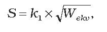
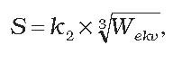
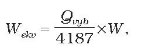
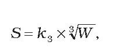

Príloha č. 2 k vyhláške č. 288/2015 Z. z.

- URČENIE BEZPEČNÝCH VZDIALENOSTÍ OD OBJEKTOV NA POVRCHU

  - 1. Bezpečná vzdialenosť od objektov S [m] s výbušninami, výbušnými predmetmi a muníciou podtriedy nebezpečenstva 1.1 až 1.3 sa vypočíta,

    - a) ak je obloženie menšie ako 2 000 kg, podľa vzorca

    - 

    - b) ak je obloženie 2 000 kg a väčšie, podľa vzorca

    - 

      - kde k1, k2 – koeficienty zvolené podľa charakteru ohrozeného objektu a dovoleného stupňa jeho poškodenia a ich hodnoty sú uvedené v tabuľke č. 1,

      - Wekv – ekvivalentné obloženie objektu [kg].

      - Ekvivalentné obloženie objektu sa vypočíta podľa vzorca

      - 

      - kde Qvyb – výbuchové teplo výbušniny [kJ kg-1] udané výrobcom,

      - W – obloženie objektu [kg].

  - 2. Ak ide o objekty s výbušninami, výbušnými predmetmi a muníciou podtriedy nebezpečenstva 1.1 až 1.3 umiestnené vo vale a o ohrozené objekty, pri ktorých sa počíta bezpečná vzdialenosť s koeficientom k1 až do hodnoty 2,5 alebo k2 až do hodnoty 8, môže sa vypočítaná bezpečná vzdialenosť podľa bodu 1 skrátiť až o 50 %.

  - 3. Ak ide o obloženie väčšie ako 10 000 kg, je potrebné doplniť bezpečnú vzdialenosť rozborom ďalších možných nežiaducich účinkov na širšie okolie.

  - 4. Bezpečná vzdialenosť od objektov S [m] s výbušninami, výbušnými predmetmi a muníciou podtried nebezpečenstva 1.4 až 1.6 sa vypočíta podľa vzorca

  - 

    - kde k3 – koeficient zvolený podľa charakteru objektu uvedený v tabuľke č. 2,

    - W – obloženie objektu [kg].

  - 5. Ak ide o objekty s výbušninami, výbušnými predmetmi a muníciou podtried nebezpečenstva 1.4 až 1.6 v stavebnom vyhotovení, ktoré zvyšuje ochranu ohrozených objektov, alebo objekty umiestnené vo valoch s požiarnou stenou bez otvoru smerujúcou k ohrozenému objektu a s výfukovou plochou smerujúcou do voľného priestoru, možno bezpečnú vzdialenosť vypočítanú podľa bodu 4 skrátiť až o 25 %.

  - 6. Ak leží ohrozený objekt v smere výfukovej plochy objektu s výbušninami, výbušnými predmetmi a muníciou podtriedy nebezpečenstva 1.4 až 1.6, je potrebné dodržať bezpečné vzdialenosti vypočítané podľa bodu 4, najmenej však

    - a) 60 m, ak ide o výrobné objekty v prevádzkach výrobní výbušnín s nebezpečenstvom výbuchu,

    - b) 100 m, ak ide o výrobné objekty bez nebezpečenstva výbuchu (správne, sociálne, energetické a iné objekty),

    - c) 240 m, ak ide o obytné budovy mimo územia výrobného závodu (cesty, železnice).

  - 7. Najmenšia vzdialenosť objektu s výbušninami, výbušnými predmetmi a muníciou podtried nebezpečenstva 1.4 až 1.6 od objektu s výbušninami, výbušnými predmetmi a muníciou podtried nebezpečenstva 1.1 až 1.3 je 28 m, od objektov s výbušninami, výbušnými predmetmi a muníciou podtried nebezpečenstva 1.4 až 1.6 je 25 m. Tieto najmenšie vzdialenosti sa vzťahujú na objekty s výbušninami, výbušnými predmetmi a muníciou podtried nebezpečenstva 1.4 až 1.6 bez vonkajších stavebných úprav podľa bodu 5 a objekty s výbušninami, výbušnými predmetmi a muníciou podtriedy nebezpečenstva 1.1 až 1.3 bez valu.

  - 8. Pri určovaní bezpečnej vzdialenosti medzi dvoma objektmi sa určí bezpečná vzdialenosť pre každý objekt osobitne, ale uvažuje sa väčšia z nich.

  - 9. Pri rôznom stavebnom vyhotovení a umiestnení objektov nebezpečných výbuchom sa určujú bezpečné vzdialenosti podľa týchto zásad:

    - a) ak nie je okolo objektu uzavretý val, tak v smere otvorených strán sa bezpečná vzdialenosť vypočíta ako pri objekte bez ochranných valov,

    - b) ak sú dva susedné objekty obrátené k sebe otvorenými stranami, bezpečná vzdialenosť medzi nimi sa vypočíta ako pri objektoch bez valov,

    - c) ak majú dva objekty spoločný val, považuje sa pri výpočtoch každý za objekt s jedným valom a postupuje sa podľa bodu 8,

    - d) ak sú objekty situované tak, že ich vzdialenosti sú kratšie ako vypočítané bezpečné vzdialenosti, musia sa tieto objekty považovať za súbor objektov. Bezpečné vzdialenosti sa vypočítajú podľa celkového obloženia všetkých objektov súboru,

    - e) v osobitných prípadoch možno vypočítané bezpečné vzdialenosti zmeniť len na základe odborného posudku.

  - Tabuľka č. 1

  - Koeficienty na určenie bezpečných vzdialeností od objektov s výbušninami, výbušnými predmetmi a muníciou podtriedy nebezpečenstva 1.1 až 1.3

  - Ohrozený objekt | Stupeň poškodenia objektu Stupeň ohrozenia zdravia | k1 | k2

  - Sklad výbušnín | Deštrukcia objektu, prelomenie muriva. Nedôjde k prenosu detonácie. Žiadna ochrana obsluhy skladu. | 0,5 | až 4

  - Nevýznamné objekty bez trvalej obsluhy | Úplné rozrušenie budov, prevrátenie železničných vozňov, poškodenie elektrickej siete a podobne. Nedostatočná ochrana osôb, ťažké ujmy na zdraví a smrť. | 0,5 až 1 | až 4

  - Výrobné objekty v prevádzkach výrobní výbušnín s nebezpečenstvom výbuchu | Rozrušenie menej odolných budov, vnútorných drevených priečok, rámov okien a dverí. Ťažké zranenia osôb spôsobené padajúcimi troskami. Vážne poškodenie ušných bubienkov a pľúc tlakovou vlnou. | 1 až 2,5 | až 8

  - Výrobné objekty bez nebezpečenstva výbuchu, správne, sociálne, energetické objekty | Poškodenie rámu okien a dverí, porušenie omietky, vnútorných drevených priečok. Dočasná strata sluchu, ťažké a smrteľné zranenia sú málo pravdepodobné. | 2,5 až 4,5 | až 15

  - Obytné budovy mimo územia výrobného závodu, cesty, železnice | Úplné zničenie zasklených okien. Ľahké zranenia, trauma. | 4,5až 6 | 5 až 22

  - Objekty celoštátneho významu, obce bez súvislej výškovej zástavby | Nepatrné poškodenie budov, čiastočné zničenie zasklených okien. | 6 až 17 | 2 až 60

  - Osobitne dôležité objekty celoštátneho významu s výškovou zástavbou, nemocnice | Náhodné poškodenie zasklených okien. | nad 17 | nad 60

  - Tabuľka č. 2

  - Koeficienty na určenie bezpečných vzdialeností od objektov s výbušninami, výbušnými predmetmi a muníciou podtriedy nebezpečenstva 1.4 až 1.6

  - Ohrozený objekt | k3

  - Sklady výbušnín, nevýznamné objekty bez trvalej obsluhy, výrobné objekty prevádzok výrobní výbušnín s nebezpečenstvom výbuchu. | 1 až 3,5

  - Výrobné objekty bez nebezpečenstva výbuchu. | 3,5 až 6,5

  - Správne, sociálne, energetické a iné objekty nesúvisiace s výrobou výbušnín. | 6,5 až 10

  - Ostatné budovy mimo územia výrobného závodu, cesty, železnice. | 10
