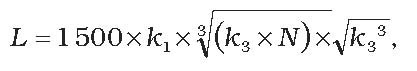

Príloha č. 3 k vyhláške č. 288/2015 Z. z.

- URČENIE BEZPEČNÝCH VZDIALENOSTÍ OD OBJEKTOV POD POVRCHOM

  - 1. Najmenšia vzdialenosť čiastkového priestoru na uskladňovanie výbušnín od iných objektov sa vypočíta

    - a) od objektov dôležitých pre nerušenú prevádzku podzemných pracovísk a od nezastavaného povrchu podľa vzorca

    - L = k1 x √ (k2 x N),

    - b) od povrchových objektov podľa vzorca

    - 

      - kde L – najmenšia prípustná vzdialenosť [m],

      - N – hmotnosť uskladnených výbušnín a výbušných predmetov v čiastkovom priestore na ich uskladňovanie [kg],

      - k1– konštanta prostredia, ktorej hodnoty sa volia, ak ide o

      - ílovité bridlice | 1,83

      - drobivé bridlice | 1,77

      - spevnené sedimenty | 1,66

      - vyvrelé horniny | 1,51

      - k2 – seizmický ekvivalent, ktorého hodnoty sa volia, ak ide o

      - banské skalné a povrchové trhaviny, výbušné predmety a muníciu | 1,00

      - bansky bezpečné protiprachové trhaviny | 0,80

      - bansky bezpečné protiplynové trhaviny I. kategórie | 0,65

      - bansky bezpečné protiplynové trhaviny II. kategórie | 0,50

      - k3 – rýchlosť kmitania [mm.s-1], ktorej hodnoty vyjadrujú mieru poškodenia ohrozeného objektu. K porušeniu stavieb na povrchu dochádza spravidla pri týchto rozmedziach rýchlosti kmitania:

      - Miera poškodenia ohrozeného objektu | k3 [mm.s-1]

      - a) prvé známky škôd (odlupovanie malty a vlasové trhliny v omietke, najmä na stykoch rôznych materiálov, v miestach pripojenia priečok a v stropných paneloch) | 10 až 30

      - b) ľahké škody (väčšie trhliny v omietke, v priečkach a v okolí otvorov, uvoľnenie samonosných prvkov, napríklad prekladov, opadávanie malých kusov omietky) | 30 až 60

      - c) vážne škody (trhliny v nosných múroch, opadávanie veľkých kusov omietky, komínového muriva a strešnej krytiny, trhliny v betónovom murive) | 60 až 140

      - d) deštrukcie (zrútenie priečok a časti muriva, trhliny v železobetóne) | nad 140

      - Rozmedzia sa znázorňujú graficky vo vzťahu medzi amplitúdou výchylky a kmitočtom. Na chatrných stavbách (napríklad zrúcaniny hradov) sa uvažuje možnosť ich porušenia pri polovičných hodnotách rýchlosti kmitania.

  - 2. Spodné hranice jednotlivých rozmedzí v písmenách a), b), c) platia, ak ide o menšie stavby (napríklad rodinné domy) založené na základových pôdach jemnozrnných zemín s odvodeným normovým namáhaním pod 0,15 N.mm-2. Ak ide o väčšie objekty, dobre osadené na základových pôdach štrkovitých zemín s hladinou podzemnej vody najmenej tri m pod základovou špárou, platia hodnoty vyššie. V prípadoch dobre osadených stavieb na skalných horninách možno uvedené rozmedzia rýchlosti kmitania ešte ďalej zvýšiť na základe odborného posúdenia. Zvýšenie rozmedzí rýchlosti kmitania uvedených v písmenách a) až d) je dovolené na základe odborného merania seizmických účinkov a pozorovania ohrozeného objektu.

  - 3. Rýchlosť kmitania sa meria spravidla na murive najnižšieho podlažia alebo na základoch objektu ako na referenčnom stanovisku. V miestach porušenia je rýchlosť kmitania vyššia, ako sú hodnoty k3 uvedené v písmenách a) až d).

  - 4. Ak sa merajú účinky na povrchu horniny mimo budovy, napríklad na budúcom stavenisku, je potrebné vziať do úvahy zmenu výchylky aj frekvencie pri prechode z horniny na budovu.
