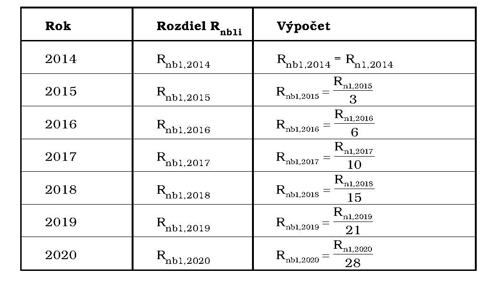
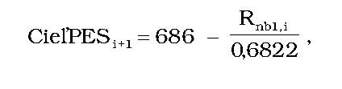
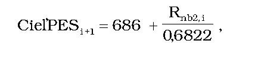

Príloha č. 1 k vyhláške č. 327/2015 Z. z.

- POSTUP PRI VÝPOČTE NÁRODNÉHO CIEĽA

  - A. Cieľ úspor energie u konečného spotrebiteľa

    - Cieľ úspor energie u konečného spotrebiteľa sa vypočíta pre príslušný kalendárny rok podľa tabuľky:

  - Rok | Cieľ Cksi | Výpočet

  - 2014 | Cks2014 | Cks2014 = Uskk

  - 2015 | Cks2015 | Cks2015 = Uskk x 3

  - 2016 | Cks2016 | Cks2016 = Uskk x 6

  - 2017 | Cks2017 | Cks2017 = Uskk x 10

  - 2018 | Cks2018 | Cks2018 = Uskk x 15

  - 2019 | Cks2019 | Cks2019 = Uskk x 21

  - 2020 | Cks2020 | Cks2020 = Uskk x 28

    - Cks2014 – cieľ úspor energie u konečného spotrebiteľa pre rok 2014 vyjadrený v PJ,

    - Cksi – cieľ úspor energie u konečného spotrebiteľa pre príslušný kalendárny rok vyjadrený v PJ,

    - Uskk – výpočtová úspora energie vo forme konečnej energetickej spotreby pre rok 2014 vyjadrená v PJ.

  - B. Postup pri úprave cieľa úspor energie u konečného spotrebiteľa

    - 1. Ak sa nedosiahne úspora energie na plnenie cieľa úspor energie u konečného spotrebiteľa v príslušnom kalendárnom roku vo výške určenej podľa tabuľky uvedenej v časti A, cieľ úspor energie u konečného spotrebiteľa pre nasledujúci kalendárny rok sa upraví podľa vzorca:

      - Cksi+1rev = Cksi+1 + Rn1,i ,

      - kde

      - Cksi+1rev je upravený cieľ úspor energie u konečného spotrebiteľa pre nasledujúci kalendárny rok vyjadrený v PJ,

      - Cksi+1 je cieľ úspor energie u konečného spotrebiteľa pre nasledujúci kalendárny rok vyjadrený v PJ,

      - Rn1,i je rozdiel plnenia cieľa úspor energie u konečného spotrebiteľa v príslušnom kalendárnom roku vyjadrený v PJ.

      - Rozdiel plnenia cieľa úspor energie u konečného spotrebiteľa sa pre príslušný kalendárny rok vypočíta podľa vzorca:

      - Rn1,i = Cksi - Usi ,

      - kde

      - Rn1,i je rozdiel plnenia cieľa úspor energie u konečného spotrebiteľa v príslušnom kalendárnom roku vyjadrený v PJ,

      - Cksi je cieľ úspor energie u konečného spotrebiteľa pre príslušný kalendárny rok podľa tabuľky uvedenej v časti A vyjadrený v PJ,

      - Usi je úspora energie na plnenie cieľa úspor energie u konečného spotrebiteľa dosiahnutá v príslušnom kalendárnom roku podľa prílohy č. 2 časti B vyjadrená v PJ.

    - 2. Ak sa prekročí úspora energie na plnenie cieľa úspor energie u konečného spotrebiteľa v príslušnom kalendárnom roku vo výške určenej podľa tabuľky uvedenej v časti A, cieľ úspor energie u konečného spotrebiteľa pre nasledujúci kalendárny rok sa upraví podľa vzorca:

      - Cksi+1rev = Cksi+1 - Rn2,i ,

      - kde

      - Cksi+1rev je upravený cieľ úspor energie u konečného spotrebiteľa pre nasledujúci kalendárny rok vyjadrený v PJ,

      - Cksi+1 je cieľ úspor energie u konečného spotrebiteľa pre nasledujúci kalendárny rok podľa tabuľky uvedenej v časti A vyjadrený v PJ,

      - Rn2,i je rozdiel plnenia cieľa úspor energie u konečného spotrebiteľa v príslušnom kalendárnom roku vyjadrený v PJ.

      - Rozdiel plnenia cieľa úspor energie u konečného spotrebiteľa sa pre príslušný kalendárny rok vypočíta podľa vzorca:

      - Rn2,i = Usi - Cksi ,

      - kde

      - Rn2,i je rozdiel plnenia cieľa úspor energie u konečného spotrebiteľa v príslušnom kalendárnom roku vyjadrený v PJ,

      - Cksi je cieľ úspor energie u konečného spotrebiteľa pre príslušný kalendárny rok podľa tabuľky uvedenej v časti A vyjadrený v PJ,

      - Usi je úspora energie na plnenie cieľa úspor energie u konečného spotrebiteľa dosiahnutá v príslušnom kalendárnom roku podľa prílohy č. 2 časti B vyjadrená v PJ.

  - C. Rozdiel plnenia cieľa bez kumulácie

    - Ak sa nedosiahne úspora energie na plnenie cieľa úspor energie u konečného spotrebiteľa v príslušnom kalendárnom roku vo výške určenej podľa tabuľky uvedenej v časti A, rozdiel plnenia národného cieľa bez kumulácie sa vypočíta pre jednotlivé kalendárne roky podľa tabuľky:

  - 

    - Rnb1,i – rozdiel plnenia národného cieľa bez kumulácie,

    - Rn1,i – rozdiel plnenia cieľa úspor energie u konečného spotrebiteľa v príslušnom kalendárnom roku vyjadrený v PJ.

    - Ak sa prekročí úspora energie na plnenie cieľa úspor energie u konečného spotrebiteľa v príslušnom kalendárnom roku vo výške určenej podľa tabuľky uvedenej v časti A, rozdiel plnenia národného cieľa bez kumulácie sa vypočíta pre jednotlivé kalendárne roky podľa tabuľky:

  - [Tabuľka](../assets/92ec0ad09d27071f98410b65964f1f1241e81beab79f2f2117159d53d6ab8ba7.pdf)

    - Rnb2,i – rozdiel plnenia národného cieľa bez kumulácie,

    - Rn2,i – rozdiel plnenia cieľa úspor energie u konečného spotrebiteľa v príslušnom kalendárnom roku vyjadrený v PJ.

  - D. Národný cieľ vo forme konečnej energetickej spotreby

    - Ak sa nedosiahne úspora energie na plnenie cieľa úspor energie u konečného spotrebiteľa v príslušnom kalendárnom roku vo výške určenej podľa tabuľky uvedenej v časti A, národný cieľ vo forme konečnej energetickej spotreby sa pre nasledujúci kalendárny rok vypočíta ako absolútna hodnota konečnej energetickej spotreby podľa vzorca:

    - CieľKESi+1 = 378 – Rnb1,i ,

    - kde

    - CieľKESi+1 je národný cieľ vo forme konečnej energetickej spotreby pre nasledujúci kalendárny rok vyjadrený v PJ,

    - Rnb1,i je rozdiel plnenia národného cieľa bez kumulácie pre príslušný kalendárny rok vyjadrený v PJ.

    - Ak sa prekročí úspora energie na plnenie cieľa úspor energie u konečného spotrebiteľa v príslušnom kalendárnom roku vo výške určenej podľa tabuľky uvedenej v časti A, národný cieľ vo forme konečnej energetickej spotreby sa pre nasledujúci kalendárny rok vypočíta ako absolútna hodnota konečnej energetickej spotreby podľa vzorca:

    - CieľKESi+1 = 378 + Rnb2,i ,

    - kde

    - CieľKESi+1 je národný cieľ vo forme konečnej energetickej spotreby pre nasledujúci kalendárny rok vyjadrený v PJ,

    - Rnb2,i je rozdiel plnenia národného cieľa bez kumulácie pre príslušný kalendárny rok vyjadrený v PJ.

  - E. Národný cieľ vo forme primárnej energetickej spotreby

    - Ak sa nedosiahne úspora energie na plnenie cieľa úspor energie u konečného spotrebiteľa v príslušnom kalendárnom roku vo výške určenej podľa tabuľky uvedenej v časti A, národný cieľ vo forme primárnej energetickej spotreby sa pre nasledujúci kalendárny rok vypočíta ako absolútna hodnota primárnej energetickej spotreby podľa vzorca:

    - 

    - kde

    - Cieľ PESi+1 je národný cieľ vo forme primárnej energetickej spotreby pre nasledujúci kalendárny rok vyjadrený v PJ,

    - Rnb1,i je rozdiel plnenia národného cieľa bez kumulácie pre príslušný kalendárny rok vyjadrený v PJ.

    - Ak sa prekročí úspora energie na plnenie cieľa úspor energie u konečného spotrebiteľa v príslušnom kalendárnom roku vo výške určenej podľa tabuľky uvedenej v časti A, národný cieľ vo forme primárnej energetickej spotreby sa pre nasledujúci kalendárny rok vypočíta ako absolútna hodnota primárnej energetickej spotreby podľa vzorca:

    - 

    - kde

    - Cieľ PESi+1 je národný cieľ vo forme primárnej energetickej spotreby pre nasledujúci kalendárny rok vyjadrený v PJ,

    - Rnb2,i je rozdiel plnenia národného cieľa bez kumulácie pre príslušný kalendárny rok vyjadrený v PJ.
