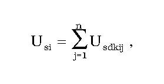

Príloha č. 2 k vyhláške č. 327/2015 Z. z.

- ÚSPORA ENERGIE NA PLNENIE CIEĽA U KONEČNÉHO SPOTREBITEĽA

  - A. Kumulatívna úspora energie

    - Kumulatívna úspora energie sa vypočíta ako súčin úspory energie v dôsledku zavedenia opatrenia na zlepšenie energetickej efektívnosti v príslušnom kalendárnom roku a kumulatívneho počtu kalendárnych rokov, ktoré uplynuli od zavedenia opatrenia na zlepšenie energetickej efektívnosti.

    - Kumulatívna úspora energie vo forme konečnej energetickej spotreby sa pre jednotlivé roky vypočíta podľa tabuľky:

  - Rok začiatku opatrenia | Kumulatívna úspora energie v jednotlivých rokoch Usdkij | | | | | |

  - | 2014 | 2015 | 2016 | 2017 | 2018 | 2019 | 2020

  - 2020 | | | | | | | Usdk

  - 2019 | | | | | | Usdk | Usdk x 2

  - 2018 | | | | | Usdk | Usdk x 2 | Usdk x 6

  - 2017 | | | | Usdk | Usdk x 2 | Usdk x 6 | Usdk x 10

  - 2016 | | | Usdk | Usdk x 2 | Usdk x 6 | Usdk x 10 | Usdk x 15

  - 2015 | | Usdk | Usdk x 2 | Usdk x 6 | Usdk x 10 | Usdk x 15 | Usdk x 21

  - 2014 | Usdk | Usdk x 2 | Usdk x 6 | Usdk x 10 | Usdk x 15 | Usdk x 21 | Usdk x 28

    - Usdk – úspora energie vo forme konečnej energetickej spotreby v dôsledku zavedenia opatrenia na zlepšenie energetickej efektívnosti vyjadrená v PJ,

    - Usdkij – kumulatívna úspora energie vo forme konečnej energetickej spotreby pre príslušný kalendárny rok dosiahnutá v dôsledku zavedenia opatrenia na zlepšenie energetickej efektívnosti vyjadrená v PJ.

    - Ak je životnosť opatrenia na zlepšenie energetickej efektívnosti uvedená v prílohe č. 4 nižšia ako počet rokov od začiatku vykonávania opatrenia na zlepšenie energetickej efektívnosti zostávajúcich do roku 2020, kumulatívna úspora energie sa vypočíta len pre roky, v ktorých trvá životnosť opatrenia.

  - B. Výpočet dosiahnutej úspory energie

    - Dosiahnutá úspora energie na plnenie cieľa úspor energie u konečného spotrebiteľa za jednotlivé roky sa vypočíta ako súčet kumulatívnych úspor energie dosiahnutých v dôsledku zavedenia všetkých opatrení na zlepšenie energetickej efektívnosti podľa vzorca:

  -  ,

    - kde

    - Usi je úspora energie na plnenie cieľa úspor energie u konečného spotrebiteľa dosiahnutá v príslušnom kalendárnom roku vyjadrená v PJ,

    - n je počet všetkých opatrení na zlepšenie energetickej efektívnosti vykonaných v príslušnom kalendárnom roku,

    - j je počet opatrení na zlepšenie energetickej efektívnosti vykonaných v príslušnom kalendárnom roku,

    - Usdkij je kumulatívna úspora energie dosiahnutá opatrením na zlepšenie energetickej efektívnosti vypočítaná podľa tabuľky uvedenej v časti A pre príslušný kalendárny rok.
