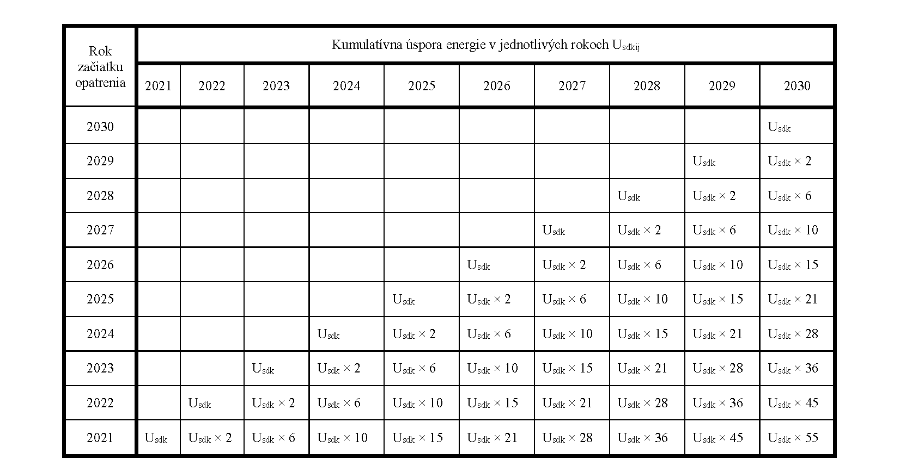

Príloha č. 2a k vyhláške č. 327/2015 Z. z.

- Úspora energie na plnenie národného cieľa úspory energie u konečného spotrebiteľa

  - A. Kumulatívna úspora energie

    - Kumulatívna úspora energie sa vypočíta ako súčin úspory energie v dôsledku zavedenia opatrenia na zlepšenie energetickej efektívnosti v príslušnom kalendárnom roku a kumulatívneho počtu kalendárnych rokov, ktoré uplynuli od zavedenia opatrenia na zlepšenie energetickej efektívnosti.

    - Ak je životnosť opatrenia na zlepšenie energetickej efektívnosti uvedená v prílohe č. 4 nižšia ako počet rokov od začiatku vykonávania opatrenia na zlepšenie energetickej efektívnosti zostávajúcich do roku 2030, kumulatívna úspora energie sa vypočíta len pre roky, v ktorých trvá životnosť opatrenia.

    - Kumulatívna úspora energie vo forme konečnej energetickej spotreby sa pre jednotlivé roky vypočíta podľa tabuľky:

    - 

    - Usdk je úspora energie vo forme konečnej energetickej spotreby v dôsledku zavedenia opatrenia na zlepšenie energetickej efektívnosti vyjadrená v PJ.

  - B. Výpočet dosiahnutej úspory energie

    - Dosiahnutá úspora energie na plnenie cieľa úspor energie u konečného spotrebiteľa za jednotlivé roky sa vypočíta ako súčet kumulatívnych úspor energie dosiahnutých v dôsledku zavedenia všetkých opatrení na zlepšenie energetickej efektívnosti podľa vzorca

    - 

    - U

    - s

    - i

    - =

    - ∑

    - j

    - =

    - 1

    - n

    - U

    - s

    - d

    - k

    - i

    - j

    - ,

    - kde je

    - Usi úspora energie na plnenie cieľa úspor energie u konečného spotrebiteľa dosiahnutá v kalendárnom roku vyjadrená v PJ,

    - n počet všetkých opatrení na zlepšenie energetickej efektívnosti vykonaných v kalendárnom roku,

    - j počet opatrení na zlepšenie energetickej efektívnosti vykonaných v kalendárnom roku,

    - Usdkij kumulatívna úspora energie vo forme konečnej energetickej spotreby pre kalendárny rok dosiahnutá v dôsledku zavedenia opatrenia na zlepšenie energetickej efektívnosti vyjadrená v PJ.
