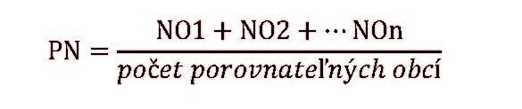

Príloha č. 12 k vyhláške č. 371/2015 Z.z.

- VÝPOČET OBVYKLÝCH NÁKLADOV

  - Pre výpočet obvyklých nákladov sa uplatňuje tento vzorec:

  - ON = PN ×SZ × PO

  - kde:

  - ON sú obvyklé náklady vyjadrené v eurách

  - PN sú priemerné ročné náklady na výkon činnosti triedeného zberu odpadov z obalov a odpadov z neobalových výrobkov zhodnej zložky komunálnych odpadov získané aritmetickým priemerom nákladov všetkých porovnateľných obcí, vyjadrené v eurách na liter

  - SZ štandard zberu určený v prílohe č. 10 pre zložku komunálnych odpadov pre príslušný kalendárny rok, v ktorom sa budú uhrádzať obvyklé náklady podľa § 59 ods. 8 zákona,

  - PO počet obyvateľov obce, ktorej sa navrhujú obvyklé náklady uhrádzať, k 30. júnu predchádzajúceho kalendárneho roka podľa údajov, ktoré obec poskytne Štatistickému úradu Slovenskej republiky

  - Pre výpočet priemerných ročných nákladov sa uplatňuje tento vzorec:

  - vzorec

- 

  - kde:

  - NO sú náklady porovnateľnej obce za predchádzajúci kalendárny rok na výkon činnosti triedeného zberu odpadov z obalov a odpadov z neobalových výrobkov zhodnej zložky komunálnych odpadov pripadajúce na jeden liter, vyjadrené v eurách na liter
