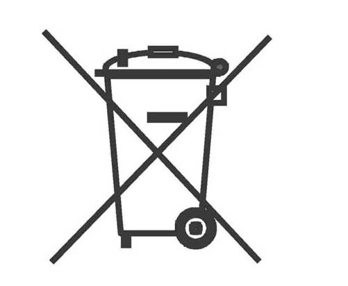

Príloha č. 10 k vyhláške č. 373/2015 Z. z.

- Grafický symbol, ktorým sa označuje batéria, akumulátor a sady batérií pre oddelený zber

  - Značka, ktorá označuje „oddelený zber“ pre všetky batérie a akumulátory, pozostáva z prečiarknutej smetnej nádoby na kolieskach, ako je zobrazené nižšie:

- 
