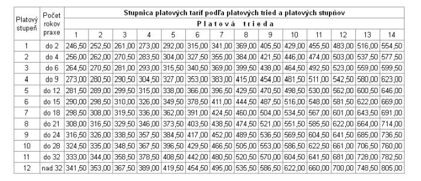
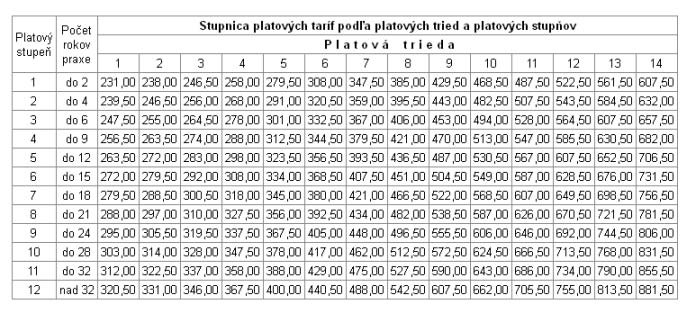
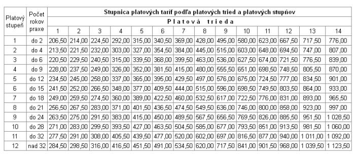

# Čl. VI

Zákon č. 553/2003 Z. z. o odmeňovaní niektorých zamestnancov pri výkone práce vo verejnom záujme a o zmene a doplnení niektorých zákonov v znení zákona č. 369/2004 Z. z., zákona č. 81/2005 Z. z., zákona č. 131/2005 Z. z., zákona č. 628/2005 Z. z., zákona č. 231/2006 Z. z., zákona č. 348/2007 Z. z., zákona č. 519/2007 Z. z., zákona č. 385/2008 Z. z., zákona č. 474/2008 Z. z., zákona č. 317/2009 Z. z., zákona č. 400/2009 Z. z., zákona č. 102/2010 Z. z., zákona č. 151/2010 Z. z., zákona č. 390/2011 Z. z., zákona č. 62/2012 Z. z., nálezu Ústavného súdu Slovenskej republiky č. 288/2013 Z. z., zákona č. 462/2013 Z. z., zákona č. 325/2014 Z. z. a zákona č. 32/2015 Z. z. sa mení a dopĺňa takto:

- 1. Za § 7a sa vkladá § 7b, ktorý vrátane nadpisu znie:

- 㤠7b

- Tarifný plat pri výkone práce vo verejnom záujme v zahraničí

- (1)

- Zamestnancovi pri výkone práce vo verejnom záujme v zahraničí zaradenému do platovej triedy podľa § 5 patrí tarifný plat v sume platovej tarify ustanovenej pre platovú triedu a platový stupeň, do ktorej je zaradený podľa

- a)

- základnej stupnice platových taríf zamestnancov uvedenej v prílohe č. 8,

- b)

- osobitnej stupnice platových taríf vybraných skupín zamestnancov podľa § 7 ods. 6 uvedenej v prílohe č. 9,

- c)

- osobitnej stupnice platových taríf učiteľov vysokých škôl, výskumných a vývojových zamestnancov a zdravotníckych zamestnancov uvedenej v prílohe č. 10.

- (2)

- Pedagogickému zamestnancovi a odbornému zamestnancovi pri výkone práce vo verejnom záujme v zahraničí patrí tarifný plat, ktorý je súčtom platovej tarify priznanej podľa odseku 3 a sumy zvýšenia platovej tarify podľa § 7 ods. 11. Rovnako sa postupuje aj u vedúceho pedagogického zamestnanca a vedúceho odborného zamestnanca pri výkone práce vo verejnom záujme v zahraničí.

- (3)

- Pedagogickému zamestnancovi a odbornému zamestnancovi pri výkone práce vo verejnom záujme v zahraničí patrí platová tarifa podľa stupnice platových taríf pedagogických zamestnancov a odborných zamestnancov uvedenej v prílohe č. 11 v závislosti od platovej triedy, do ktorej je zaradený podľa § 5, a pracovnej triedy, do ktorej je zaradený podľa § 5a. Zvýšenie platovej tarify sa zaokrúhľuje na 50 eurocentov nahor.“.

- 2. V § 12 ods. 2 sa slová „Ministerstvo zahraničných vecí Slovenskej republiky“ nahrádzajú slovami „Ministerstvo zahraničných vecí a európskych záležitostí Slovenskej republiky (ďalej len „ministerstvo zahraničných vecí“)“.

- 3. V § 21b ods. 6 a 7 a § 23 ods. 2 sa slová „Ministerstvo zahraničných vecí Slovenskej republiky“ nahrádzajú slovami „ministerstvo zahraničných vecí“.

- 4. V § 21b ods. 1 prvá veta znie: „Zamestnancovi, ktorý vykonáva práce vo verejnom záujme v zahraničí v krajine so sťaženými životnými podmienkami a ktorému sa poskytuje plat podľa § 22, patrí mesačne náhrada až do výšky 20 % z platovej tarify prvého platového stupňa šiestej platovej triedy základnej stupnice platových taríf zamestnancov pri výkone práce vo verejnom záujme v zahraničí podľa prílohy č. 8 vynásobenej objektivizovaným platovým koeficientom podľa § 23.“.

- 5. § 23 vrátane nadpisu znie:

- 㤠23

- Objektivizovaný platový koeficient

- (1)

- Objektivizovaný platový koeficient podľa § 22 ods. 1 sa vypočíta ako súčin platového koeficientu34) a

- a)

- čísla 0,971962616822 pre základnú stupnicu platových taríf zamestnancov pri výkone práce vo verejnom záujme v zahraničí uvedenú v prílohe č. 8,

- b)

- čísla 0,990476190476 pre osobitnú stupnicu platových taríf vybraných skupín zamestnancov pri výkone práce vo verejnom záujme v zahraničí uvedenú v prílohe č. 9 a pre osobitnú stupnicu platových taríf učiteľov vysokých škôl, výskumných a vývojových zamestnancov a zdravotníckych zamestnancov pri výkone práce v zahraničí uvedenú v prílohe č. 10,

- c)

- čísla 0,925678682688 pre platové tarify pedagogických zamestnancov a odborných zamestnancov pri výkone práce vo verejnom záujme v zahraničí uvedené v prílohe č. 11.

- (2)

- Objektivizovaný platový koeficient pre každú krajinu sa zaokrúhli na osem desatinných miest.

- (3)

- Vypočítané objektivizované platové koeficienty vydá ministerstvo zahraničných vecí opatrením, ktoré sa vyhlási v Zbierke zákonov Slovenskej republiky uverejnením jeho úplného znenia.“.

  - Poznámka pod čiarou k odkazu 34 znie:

  - „34)

  - § 103 zákona č. 400/2009 Z. z. o štátnej službe a o zmene a doplnení niektorých zákonov.“.

- 6. V § 28 sa za odsek 1 vkladá nový odsek 2, ktorý znie:

- „(2)

- Ustanovenie odseku 1 sa nevzťahuje na základnú stupnicu platových taríf zamestnancov pri výkone práce vo verejnom záujme v zahraničí uvedenú v prílohe č. 8, osobitné stupnice platových taríf zamestnancov pri výkone práce vo verejnom záujme v zahraničí uvedené v prílohách č. 9 a 10 a platové tarify pedagogických zamestnancov a odborných zamestnancov pri výkone práce vo verejnom záujme v zahraničí uvedené v prílohe č. 11.“.

  - Doterajšie odseky 2 až 4 sa označujú ako odseky 3 až 5.

- 7. Zákon sa dopĺňa prílohami č. 8 až 11, ktoré vrátane nadpisov znejú:

- „Príloha č. 8 k zákonu č. 553/2003 Z. z.

- ZÁKLADNÁ STUPNICA PLATOVÝCH TARÍF ZAMESTNANCOV PRI VÝKONE PRÁCE VO VEREJNOM ZÁUJME V ZAHRANIČÍ

- (v eurách mesačne)

- 

- Príloha č. 9 k zákonu č. 553/2003 Z. z.

- OSOBITNÁ STUPNICA PLATOVÝCH TARÍF VYBRANÝCH SKUPÍN ZAMESTNANCOV PRI VÝKONE PRÁCE VO VEREJNOM ZÁUJME V ZAHRANIČÍ

- (v eurách mesačne)

- 

- Príloha č. 10 k zákonu č. 553/2003 Z. z.

- OSOBITNÁ STUPNICA PLATOVÝCH TARÍF UČITEĽOV VYSOKÝCH ŠKÔL, VÝSKUMNÝCH

- A VÝVOJOVÝCH ZAMESTNANCOV A ZDRAVOTNÍCKYCH ZAMESTNANCOV PRI VÝKONE PRÁCE VO VEREJNOM ZÁUJME V ZAHRANIČÍ

- (v eurách mesačne)

- 

- Príloha č. 11 k zákonu č. 553/2003 Z. z.

- PLATOVÉ TARIFY PEDAGOGICKÝCH ZAMESTNANCOV A ODBORNÝCH ZAMESTNANCOV

- PRI VÝKONE PRÁCE VO VEREJNOM ZÁUJME V ZAHRANIČÍ

- (v eurách mesačne)

- Stupnica platových taríf | |

- Platová trieda | Pracovná trieda | Platová tarifa

- 6 | 1 | 388,5

- | 2 | 415,5

- 7 | 1 | 430,5

- | 2 | 461

- 8 | 1 | 477,5

- | 2 | 510

- 9 | 1 | 534

- | 2 | 570,5

- 10 | 1 | 583

- | 2 | 622,5

- 11 | 1 | 653,5

- | 2 | 697,5

- 12 | 1 | 732

- | 2 | 781

- “.
