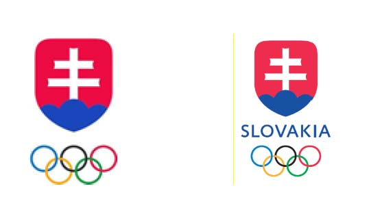

Príloha č. 1 k zákonu č. 440/2015 Z. z.

- OLYMPIJSKÁ SYMBOLIKA SLOVENSKÉHO OLYMPIJSKÉHO A ŠPORTOVÉHO VÝBORU

  - 1. Ako olympijská symbolika Slovenského olympijského a športového výboru sa rozumie

    - a) Olympijský emblém/emblémy Slovenského olympijského a športového výboru a Slovenského olympijského a športového múzea v slovenskej aj anglickej verzii, tak ako ho/ich schválil Medzinárodný olympijský výbor,

    - 

    - b) olympijská vlajka Slovenského olympijského a športového výboru (s olympijským emblémom Slovenského olympijského a športového výboru).

  - 2. Olympijskou symbolikou Medzinárodného olympijského výboru sa rozumie:

    - a) olympijský symbol, olympijská vlajka, olympijské motto: citius, altius, fortius, olympijské emblémy, olympijská hymna, olympijský oheň a olympijské pochodne,

    - b) olympijské identifikačné výrazy uvedené v článku 14 Olympijskej charty.

  - 3. Olympijská symbolika uvedená v bode 1. je výhradné vlastníctvo Slovenského olympijského a športového výboru. Olympijská symbolika Slovenského olympijského a športového výboru je predmet schválenia zo strany Medzinárodného olympijského výboru v súlade s článkom 31 Olympijskej charty.
