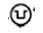

# Čl. I

Vyhláška Ministerstva dopravy, pôšt a telekomunikácií Slovenskej republiky č. 464/2009 Z. z., ktorou sa ustanovujú podrobnosti o prevádzke vozidiel v premávke na pozemných komunikáciách v znení vyhlášky č. 589/2009 Z. z., vyhlášky č. 71/2010 Z. z. a vyhlášky č. 228/2010 Z. z. sa mení a dopĺňa takto:

- 1. V § 3 odsek 17 znie:

- „(17)

- Špeciálne vozidlo sanitné s typom karosérie SC12) musí spĺňať technické požiadavky podľa osobitného predpisu13) a priestor pre pacienta v týchto vozidlách, ktoré sú prvýkrát prihlásené do evidencie vozidiel od 29. októbra 2012, musí spĺňať technické požiadavky podľa technickej normy13a) s výnimkou oddielu 6.5 Zoznam vybavenia.“.

  - Poznámky pod čiarou k odkazom 13 a 13a znejú:

  - „13)

  - Výnos Ministerstva zdravotníctva Slovenskej republiky z 11. marca 2009 č. 10548/2009-OL, ktorým sa ustanovujú podrobnosti o záchrannej zdravotnej službe) (oznámenie č. 98/2009 Z. z.) v znení výnosu z 9. júla 2010 č. 14016/2010-OL (oznámenie č. 338/2010 Z. z.)

  - 13a)

  - STN EN 1789+A1 Vozidlá záchrannej zdravotnej služby a ich vybavenie. Cestné ambulancie (Konsolidovaný text) (84 7080).“.

- 2. V § 4 ods. 3 písm. b) sa slová "spätným zrkadlom" nahrádzajú slovami "spätným zrkadlom alebo iným zariadením, ktoré zabezpečí nepriamy výhľad z vozidla".

- 3. V § 4 ods. 6 prvej vete sa slová "spätnými zrkadlami" nahrádzajú slovami "spätnými zrkadlami alebo iným zariadením, ktoré zabezpečí nepriamy výhľad z vozidla".

- 4. § 5 vrátane nadpisu znie:

- 㤠5

- Kolesá, pneumatiky a protisklzové reťaze

- (1)

- Na vozidle sa smú používať len typovo schválené alebo homologizované pneumatiky určené výrobcom vozidla v súlade s určením výrobcu pneumatík, ktoré sú zapísané v osvedčení o evidencii časti II alebo v technickom osvedčení vozidla.

- (2)

- Schválené alebo homologizované pneumatiky podľa odseku 1 nemusia byť použité pre vozidlá

- a)

- kategórií L1e, L2e a L6e s najväčšou prípustnou celkovou hmotnosťou vozidla rovnou alebo menšou 150 kg, v ktorých je prípustné použiť pneumatiky so šírkou prierezu pneumatiky menšou nanajvýš rovnou 67 mm,

- b)

- kategórie T, ktorých najväčšia rýchlosť vozidla neprevyšuje 40 km • h-1,

- c)

- kategórie Ra,

- d)

- kategórie Sa,

- e)

- kategórie PS, ktorých najväčšia rýchlosť vozidla neprevyšuje 40 km • h-1.

- (3)

- Okrem výrobcom vozidla určených pneumatík, pneumatiky musia byť zvolené tak, aby ich konštrukcia, vyhotovenie, rozmery a hustenie zodpovedali podmienkam prevádzky, najmä najväčšej technicky prípustnej hmotnosti vozidla (technicky prípustným hmotnostiam pripadajúcim na nápravy) a jeho najväčšej konštrukčnej rýchlosti určenej výrobcom vozidla a aby pritom dosahovali čo najväčšiu životnosť a hospodárnosť prevádzky vozidla. Ako náhradné koleso môže byť použité aj koleso s pneumatikou na núdzový dojazd alebo s náhradnou pneumatikou na dočasné použitie, ktorej konštrukcia a rozmer sú odlišné od pneumatiky pre normálne použitie a na tento účel je určená výrobcom vozidla a výrobcom pneumatiky.

- (4)

- Priestor, v ktorom sa koleso otáča, musí byť taký, aby v rámci obmedzenia daného zavesením a riadením, ktoré je určené výrobcom vozidla, umožnil neobmedzený pohyb pri použití maximálnej prípustnej veľkosti pneumatík a šírky ráfika vzhľadom na minimálnu a maximálnu hĺbku zálisu ráfika a taktiež aj v prípade použitia protisklzových reťazí alebo obdobných zariadení.

- (5)

- Na vozidle nesmú byť, okrem núdzového dojazdu a v prípade motocyklov s postranným vozíkom kategórie L4e, súčasne použité pneumatiky rôznych rozmerov a konštrukcií, ak pri schválení nebolo určené inak. Na rovnakej náprave musia byť použité iba zhodné pneumatiky. Konštrukciou pneumatiky sa rozumie konštrukcia diagonálna (BIAS-PLY), radiálna (PLY) a zmiešaná (BIAS BELTED). Zhodnou pneumatikou sa rozumie pneumatika s rovnakým rozmerom, konštrukciou, kategóriou použitia, názvom výrobcu, obchodnou značkou, indexom nosnosti, kategóriou rýchlosti a prierezom. Kategóriou použitia sa rozumie

- a)

- normálna cestná pneumatika,

- b)

- pneumatika na jazdu na snehu označená horským symbolom (symbol horského štítu so snehovou vločkou alebo symbolom snehovej vločky v horskom štíte s tromi vrcholmi),

- c)

- pneumatika s vylepšenými trakčnými vlastnosťami v blate alebo čerstvom alebo roztopenom snehu s označením "M+S" alebo "M.S" alebo "M&S",

- d)

- špeciálna pneumatika

- 1.

- pneumatika na špeciálne použitie, napríklad na zmiešané použitie na cestu a mimo nej alebo na iné špeciálne účely s označením "MPT", "ET", "ML" alebo "POR" definované v predpise EHK č. 117,5)

- 2.

- pneumatika s obmedzenou rýchlosťou,

- 3.

- pneumatika pre niektoré stavebné a poľnohospodárske stroje s označením "IND", "R-4" alebo "F-3",

- e)

- náhradné pneumatiky na dočasné použitie.

- (6)

- Pneumatiky musia byť vždy riadne nahustené na tlak predpísaný výrobcom vozidla, avšak nesmie byť prekročené hustenie predpísané výrobcom pneumatík. V prípade vozidiel kategórie M1 a N1 pri ťahaní prípojného vozidla, z dôvodu prídavného zaťaženia zadnej nápravy, je potrebné zvýšiť tlak v zadných pneumatikách najmenej o 20 kPa (0,2 bar) nad odporúčanú hodnotu tlaku pneumatiky, ak výrobca vozidla neurčil inak. Pri zdvojenej montáži kolies musia byť na hustenie vnútornej pneumatiky ventily usporiadané a kolesá vyhotovené tak, aby sa tlak vzduchu v pneumatike dal ľahko upraviť alebo merať, a to zo strany vonkajšieho kolesa bez demontáže kolies alebo inej náročnej manipulácie.

- (7)

- Nosnosť pneumatík vrátane náhradnej pneumatiky (ak je súčasťou výbavy) musí byť v prípade

- a)

- vozidla vybaveného zhodnými pneumatikami na všetkých nápravách v jednoduchom usporiadaní rovná najmenej polovici najväčšej prípustnej celkovej hmotnosti pripadajúcej na najviac zaťaženú nápravu podľa konštrukcie vozidla určenej výrobcom vozidla,

- b)

- vozidla vybaveného zhodnými pneumatikami v rámci jednotlivých náprav v jednoduchom usporiadaní najmenej rovná polovici maximálne prípustnej celkovej hmotnosti pre príslušnú nápravu určenej výrobcom vozidla; v prípade pneumatík tried C2 a C3 je možné zohľadniť zmenu nosnosti v závislosti od rýchlosti pneumatiky ustanovenú predpisom EHK č. 54,5)

- c)

- vozidiel kategórie M1, N1, O1 a O2 vybavených pneumatikami homologizovanými podľa predpisu EHK č. 305) v zdvojenom usporiadaní (dvojmontáži) najmenej rovná 0,27 násobku maximálne prípustnej celkovej hmotnosti pre príslušnú nápravu určenej výrobcom vozidla,

- d)

- vozidiel kategórie M2, M3, N, O3 a O4 vybavených pneumatikami homologizovanými podľa predpisu EHK č. 545) v zdvojenom usporiadaní (dvojmontáži) najmenej rovná 0,25 násobku maximálne prípustnej celkovej hmotnosti pre príslušnú nápravu určenej výrobcom vozidla,

- e)

- vozidiel kategórie L, ak je náprava vybavená

- 1.

- len jednou pneumatikou, najmenej rovná najväčšej technicky prípustnej hmotnosti pripadajúcej na príslušnú nápravu určenej výrobcom vozidla,

- 2.

- dvomi pneumatikami v jednoduchom usporiadaní, najmenej rovná polovici najväčšej prípustnej celkovej hmotnosti pripadajúcej na príslušnú nápravu určenej výrobcom vozidla,

- 3.

- dvomi pneumatikami v zdvojenom usporiadaní (dvojmontáži), najmenej rovná 0,54 násobku najväčšej prípustnej celkovej hmotnosti pripadajúcej na príslušnú nápravu určenej výrobcom vozidla,

- 4.

- dvomi súbormi pneumatík v zdvojenom usporiadaní (dvojmontáži), najmenej rovná 0,27 násobku najväčšej prípustnej celkovej hmotnosti pripadajúcej na príslušnú nápravu určenej výrobcom vozidla,

- f)

- vozidiel kategórie T, R a S

- 1.

- vybavených dvomi súbormi pneumatík v zdvojenom usporiadaní (dvojmontáži), najmenej rovná 0,285 násobku maximálne prípustnej celkovej hmotnosti pre príslušnú nápravu určenej výrobcom vozidla,

- 2.

- vybavených dvomi súbormi pneumatík v strojenom usporiadaní (trojmontáži), najmenej rovná 0,2 násobku maximálne technicky prípustnej hmotnosti pre príslušnú nápravu určenej výrobcom vozidla.

- (8)

- Symbol kategórie rýchlosti každej pneumatiky musí byť prinajmenšom zhodný s maximálnou konštrukčnou rýchlosťou vozidla. V prípade pneumatík triedy C1 s kategóriami rýchlosti V, W, Y, Z je pri zvýšení rýchlosti nutné zohľadniť závislosť na nosnosti pneumatiky podľa predpisu EHK č. 30.5) Ak sa použijú pneumatiky označené horským symbolom s nižšou kategóriou rýchlosti, ako je najväčšia konštrukčná rýchlosť vozidla, najmenej však kategórie rýchlosti zodpovedajúcej rýchlosti 160 km • h-1 a v prípade vozidiel kategórie L najmenej kategórie rýchlosti zodpovedajúcej rýchlosti 130 km • h-1, je nutné na túto skutočnosť upozorniť dodatkovým označením formou nálepky alebo štítku. Údaj na nálepke musí obsahovať najväčšiu prípustnú rýchlosť zimných pneumatík namontovaných na vozidle, ktorá počas prevádzky vozidla v cestnej premávke nesmie byť prekročená. Nálepka musí byť umiestnená v zornom poli vodiča. Upozornenie formou nálepky môže byť nahradené zariadením trvale nainštalovaným vo vozidle, napríklad palubným počítačom. Zníženie kategórie rýchlosti nie je dovolené pri použití pneumatík s vylepšenými trakčnými vlastnosťami pri jazde na snehu s označením "M+S", "M.S." alebo "M & S", avšak bez označenia horským symbolom.

- (9)

- Na zníženú najväčšiu prípustnú rýchlosť pneumatík je dodatkovým označením potrebné upozorniť vodiča aj v prípade použitia profesionálnych terénnych pneumatík s označením "POR", ktorých kategória rýchlosti je nižšia, ako je najväčšia konštrukčná rýchlosť vozidla.

- (10)

- Pneumatiky nesmú mať na svojom vonkajšom obvode, napríklad v oblasti behúňa, bočnice a pätky, trhliny ani poškodenia, ktoré obnažujú kordovú kostru alebo ju narúšajú. Hĺbka hlavných drážok v stredovej časti povrchu dezénu pneumatiky, ktorý pokrýva približne tri štvrtiny šírky povrchu dezénu jazdnej plochy pneumatiky, nesmie byť menej ako

- a)

- 1 mm na vozidlách kategórie L1e,

- b)

- 1,6 mm na vozidlách ostatných kategórií a 3 mm v prípadoch, keď osobitný predpis16) pre vozidlá kategórie M a N ustanovuje povinnosť použiť v cestnej premávke vozidlo vybavené zimnými pneumatikami.

- (11)

- Vzájomný rozdiel vonkajších priemerov jednotlivých pneumatík na rovnakej náprave alebo na zdvojenej montáži u nezaťaženého vozidla nesmie byť väčší ako 1,5 % vonkajšieho priemeru.

- (12)

- Ak sa pre náhradné koleso použije pneumatika pre normálne použitie, musí byť rovnakej veľkosti ako pneumatiky namontované na vozidle, nahustené najmenej na tlak zodpovedajúci najväčšiemu predpísanému husteniu pneumatík na vozidle. Koleso s pneumatikou na dočasné použitie a pneumatikou na núdzový dojazd možno použiť len na vozidlách kategórie M1 a N1, pričom uvedené pneumatiky musia byť homologizované podľa predpisu EHK č. 64.5)

- (13)

- Protektorované pneumatiky možno použiť na vozidlách, iba keď sú homologizované podľa predpisu EHK č. 1085) alebo podľa predpisu EHK č. 109.5)

- (14)

- Protektorované pneumatiky sa nesmú používať na prednej náprave autobusov triedy II a III vozidiel kategórie M2 a M3 a ani na motorových vozidlách na prepravu nebezpečných vecí ustanovených v časti 9 bode 9.1.2 dohody ADR.17)

- (15)

- Pneumatiky homologizované podľa predpisu EHK č. 755) určené pre vozidlá kategórií L2e a L5e môžu byť namontované aj na vozidlá kategórie L6e a L7e.

- (16)

- Pneumatiky pre vozidlá kategórie M a N a ich prípojné vozidlá môžu byť opravované iba odborne podľa podmienok uvedených v technickej norme18) alebo podobnej technickej norme týkajúcej sa opravy pneumatík, ktorá je uplatniteľná pre opravu pneumatík u ostatných kategórií vozidiel. Na núdzový dojazd môže byť pneumatika opravená svojpomocne pomocou schválených prípravkov aplikovaných vstreknutím roztoku do pneumatiky alebo predvulkanizovanými opravnými materiálmi bez demontáže pneumatiky. Všetky poškodené miesta na pneumatike musia byť opravené. Nepripúšťa sa použiť dušu do neopravenej bezdušovej pneumatiky. Opravené pneumatiky možno použiť len v tej istej alebo nižšej rýchlostnej kategórii a nosnostnej kategórii. Pri zmene kategórií sa musí pôvodné označenie odstrániť a nahradiť novým trvalým označením. Ak nemožno po oprave použiť pneumatiku ako bezdušovú, musí sa označenie "TUBELESS" na obidvoch bočniciach pneumatiky odstrániť. Pripúšťa sa použitie duše v prípadoch drobných prepichov alebo drobných poškodení behúňa s následnou stratou tesnosti bezdušovej pneumatiky.

- (17)

- Drážky dezénu pneumatík určených pre vozidlá kategórie M2, M3 a N a ich prípojné vozidlá označené výrobcom môžu byť dodatočne prehĺbené spôsobom predpísaným výrobcom pneumatík. Na obidvoch stranách bočnice pneumatiky musí byť vyznačený symbol

- OBRÁZOK

- 

- s priemerom najmenej 20 mm alebo nápis "REGROOVABLE". Prehlbovanie drážok dezénu pneumatík vozidiel kategórie M1 je zakázané.

- (18)

- Použitie pneumatík s protisklzovými hrotmi je pre všetky vozidlá, okrem vozidiel záchrannej služby, zakázané.

- (19)

- Protisklzové reťaze alebo iné rovnocenné zariadenia znamenajú zariadenie na zlepšenie prenosu hnacích síl a smerovej stability, ktoré sú znížené snehom alebo ľadom nachádzajúcim sa medzi kolesom a povrchom pozemnej komunikácie. Protisklzové reťaze alebo iné rovnocenné zariadenia sa môžu použiť iba na vozidlách s rozmermi pneumatík uvedenými v návode na použitie a podľa podmienok určených výrobcom vozidla. Protisklzové reťaze alebo iné rovnocenné zariadenia nesmú byť poškodené do takej miery, aby bola ovplyvnená ich funkčnosť na vozidle. Protisklzové reťaze alebo iné rovnocenné zariadenia sa smú používať len na úsekoch, kde je pozemná komunikácia pokrytá dostatočnou vrstvou snehu alebo ľadu.“.

- 5. V § 7 odsek 3 znie:

- „(3)

- Na vozidlá je možné dodatočne montovať svetelné zariadenia na označenie vozidiel taxislužby, autoškoly, sanitných vozidiel, hasičských vozidiel, vozidiel polície a vozidiel hromadnej osobnej dopravy, napríklad presvetlené smerové a číselné tabule. Na sanitných vozidlách sa pripúšťa použitie označenia svetelným nápisom "AMBULANCIA" a na hasičských vozidlách sa pripúšťa použitie označenia svetelným nápisom "HASIČI" svietiacim dopredu neprerušovaným bielym svetlom alebo červeným svetlom, ktoré smie byť v činnosti výhradne pri použití zvláštnych výstražných svietidiel. Na vozidlách Policajného zboru sa pripúšťa dopredu a dozadu svietiaci nápis "POLÍCIA" alebo iný nápis súvisiaci s cestnou premávkou, ktoré smie byť v činnosti výhradne pri použití zvláštnych výstražných svietidiel. Na vozidlách Vojenskej polície a obecnej polície sa pripúšťa dopredu a dozadu svietiaci nápis súvisiaci s cestnou premávkou, ktorý smie byť v činnosti výhradne pri použití zvláštnych výstražných svietidiel. Tieto nápisy svietiace dopredu môžu byť vyhotovené aj zrkadlovo. Montáž je možná iba za predpokladu, že nebudú vyžarovať v uhle 15° smerom von od obrysu vozidla dopredu červené svetlo a dozadu biele svetlo okrem nápisu "AMBULANCIA", "HASIČI" a "POLÍCIA" alebo iných nápisov súvisiacich s cestnou premávkou.“.

- 6. V § 8 ods. 1 sa na konci pripájajú tieto vety: "Spájacie zariadenia sa musia vzájomne zapojiť podľa návodu a pokynov výrobcu vozidla alebo výrobcu spájacieho zariadenia. Spájacie zariadenia musia zabezpečiť vzájomnú kompatibilitu pri spájaní vozidiel do jazdnej súpravy a musia zabezpečiť bezpečné vzájomné zapojenie vozidiel za všetkých podmienok prevádzky vozidla.".

- 7. V § 8 ods. 4 sa na konci bodka nahrádza bodkočiarku a pripájajú sa tieto slová: "to neplatí, ak pri schválení vozidla bolo určené inak a je to uvedené v osvedčení o evidencii časť II.".

- 8. § 8 sa dopĺňa odsekom 7, ktorý znie:

- „(7)

- V prípade, ak zaťaženie na ťažnú tyč (oje) prívesu so stredovou nápravou DC12 prevyšuje 50 kg, keď je príves rovnomerne naložený na najväčšiu prípustnú celkovú hmotnosť vozidla, musí byť príves na prednej previsnutej časti pred nápravou alebo na ťažnej tyči vybavený podperným zariadením nastaviteľným na výšku.“.

- 9. Nadpis § 9 znie: "Rýchlosť vozidla, zariadenia obmedzujúce rýchlosť a počítadlo prejdenej vzdialenosti".

- 10. V § 9 ods. 5 sa slová "osobitným predpisom.24)" nahrádzajú slovami "osobitným predpisom24) alebo predpisom EHK č. 89.5)".

- 11. § 9 sa dopĺňa odsekmi 6 a 7, ktoré znejú:

- „(6)

- Cestné motorové vozidlo musí byť vybavené počítadlom prejdenej vzdialenosti.

- (7)

- Stav počítadla prejdenej vzdialenosti cestného motorového vozidla nesmie byť pozmeňovaný a do počítadla prejdenej vzdialenosti nesmie byť zasahované.“.

- 12. V § 10 ods. 1 druhej vete sa slová "odpovedajúcich ľ otáčok" nahrádzajú slovami "odpovedajúcich 3/4 otáčok".

- 13. V § 11 ods. 9 a 10 sa na konci pripája táto veta: "Toto označenie musí byť dobre viditeľné pre ostatných účastníkov cestnej premávky.".

- 14. V § 11 sa za odsek 10 vkladajú nové odseky 11 až 14, ktoré znejú:

- „(11)

- Motorové vozidlá, ktoré používajú vo svojom pohonnom systéme skvapalnený zemný plyn, musia byť v zadnej časti vozidla povinne označené identifikačným znakom "LNG" podľa prílohy č. 7 k predpisu EHK č. 110;5) vozidlá kategórie M2 a M3 musia byť takým identifikačným znakom povinne označené aj v prednej časti vozidla a na vonkajšej strane dverí vpravo. Toto označenie musí byť dobre viditeľné pre ostatných účastníkov cestnej premávky.

- (12)

- Motorové vozidlá na vodíkový pohon musia byť povinne označené identifikačným znakom podľa osobitného predpisu.25a) Toto označenie musí byť dobre viditeľné pre ostatných účastníkov cestnej premávky.

- (13)

- Dobíjateľný zásobník energie, ktorý má vysoké napätie, musí byť v motorovom vozidle na elektrický pohon, označený piktogramom v tvare žltého trojuholníka ohraničeného čiernou farbou a symbolom blesku čiernej farby. Tento piktogram sa musí nachádzať tiež na všetkých krytoch a batériách, ktoré po odstránení odkryjú živé časti vysokonapäťových obvodov.

- (14)

- Motorové vozidlá prepravujúce odpad25b) musia byť označené vpredu a vzadu na vozidle kolmo k pozdĺžnej rovine dvoma pravouhlými reflexnými bielymi výstražnými tabuľkami z materiálu so spätným odrazom triedy 2,25c) so šírkou 400 mm a výškou minimálne 300 mm s čiernym písmenom "A" s výškou písmena 200 mm a hrúbkou 20 mm. V prípade jazdných súprav musí byť zadná tabuľka umiestnená na zadnej strane prípojného vozidla. Toto označenie musí byť dobre viditeľné pre ostatných účastníkov cestnej premávky.“.

  - Poznámky pod čiarou k odkazom 25a až 25c znejú:

  - „25a)

  - Príloha V nariadenia Komisie (EÚ) č. 406/2010 z 26. apríla 2010, ktorým sa vykonáva nariadenie Európskeho parlamentu a Rady (ES) č. 79/2009 o typovom schvaľovaní motorových vozidiel na vodíkový pohon. (Ú. v. EÚ L 122, 18. 5. 2010).

  - 25b)

  - Nariadenie Európskeho parlamentu a Rady (ES) č. 1013/2006 zo 14. júna 2006 o preprave odpadu (Ú. v. EÚ L 190, 12. 7. 2006) v platnom znení.

  - 25c)

  - STN 01 8020 Dopravné značky na pozemných komunikáciách (01 8020). STN EN 12899-1 Trvalé zvislé dopravné značky. Časť 1: Trvalé dopravné značky (73 7021).“.

  - Doterajšie odseky 11 a 12 sa označujú ako odseky 15 a 16.

- 15. V § 11 sa odsek 15 dopĺňa písmenom g), ktoré znie:

- „g)

- na prvých miestach za vodičom majú vyhradené miesto pre vodiaceho psa, ktoré je označené piktogramom vodiaceho psa spolu so zeleným krížom; to neplatí pre autobusy používané v diaľkovej doprave a medzinárodnej autobusovej doprave.“.

- 16. § 16 sa dopĺňa odsekom 7, ktorý znie:

- „(7)

- Dopravné jednotky pri preprave nebezpečných vecí17) musia byť vybavené osobitnou výbavou a výbavou na osobnú ochranu, ako aj protipožiarnou výbavou podľa osobitného predpisu.17) Počet hasiacich prístrojov podľa tohto odseku a podľa odseku 5 sa v prípade dopravných jednotiek použitých na prepravu nebezpečných vecí nesčítava, ale platí minimálny obsah náplní a minimálny počet hasiacich prístrojov na dopravnú jednotku podľa osobitného predpisu.17)“.

- 17. V § 18 sa za odsek 3 vkladá nový odsek 4, ktorý znie:

- „(4)

- Zvláštne výstražné svietidlo môže byť použité aj pri vlečení vozidiel v cestnej premávke37a) a na vozidle počas jeho núdzového státia najmä pri prerušení jazdy pre chybu na vozidle alebo na náklade alebo v dôsledku dopravnej nehody, ak také vozidlo tvorí prekážku cestnej premávky;37b) v tomto prípade, ak vozidlo nie je povinne vybavené zvláštnym výstražným svietidlom podľa odseku 2, možno použiť iba zvláštne výstražné svietidlo upevnené pomocou prenosného zariadenia.“.

  - Poznámky pod čiarou k odkazu 37a a 37b znejú:

  - „37a)

  - § 34 zákona č. 8/2009 Z. z.

  - 37b)

  - § 24 ods. 3 zákona č. 8/2009 Z. z.“.

  - Doterajší odsek 4 sa označuje ako odsek 5.

- 18. V § 18 ods. 5 sa slová "odsekoch 2 a 3" nahrádzajú slovami "odsekoch 2 až 4".

- 19. V § 19 odsek 2 znie:

- „(2)

- Na vozidlách s právom prednostnej jazdy podľa osobitného predpisu39) musia byť zvláštne zvukové výstražné znamenia

- a)

- spĺňajúce spodnú hladinu zvuku najmenej 105 dB(A) meranú podľa technických požiadaviek podľa predpisu EHK č. 28,5)

- b)

- ktorých frekvencia zmien výšky tónu môže byť premenlivá,

- c)

- uvedené do činnosti výlučne, keď sú v činnosti zvláštne výstražné svietidlá vyžarujúce svetlo modrej, červenej alebo kombináciu červenej a modrej farby.“.

- 20. V § 19 ods. 3 písm. a) sa na konci pripájajú tieto slová: "pokiaľ to dovoľuje konštrukcia vozidla,".

- 21. V § 19 odsek 5 znie:

- „(5)

- Vozidlo vybavené zvláštnymi výstražnými svietidlami vyžarujúcimi modrú farbu, červenú farbu alebo kombináciu červenej a modrej farby môže byť vybavené najviac šiestimi pármi doplnkových zvláštnych výstražných svietidiel vyžarujúcich prerušovaný tok svetla modrej farby, červenej farby alebo kombinácie červenej a modrej farby umiestnených a svietiacich vpredu a vzadu symetricky k pozdĺžnej zvislej rovine, ktoré musia byť umiestnené svojím najnižším bodom činnej svietiacej plochy najmenej 300 mm nad rovinou pozemnej komunikácie a svojím najvyšším bodom činnej svietiacej plochy najviac 2 800 mm nad rovinou pozemnej komunikácie a taktiež môže byť vybavené najviac šiestimi pármi doplnkových zvláštnych výstražných svietidiel vyžarujúcich prerušovaný tok svetla modrej farby umiestnených na bokoch symetricky k pozdĺžnej zvislej rovine. Vozidlá s pevne zabudovanými zvláštnymi výstražnými svietidlami uvedené do cestnej premávky od 1. januára 2016 musia byť vybavené jedným párom doplnkových zvláštnych výstražných svietidiel vyžarujúcich prerušovaný tok svetla modrej farby umiestnený na bokoch symetricky k pozdĺžnej zvislej rovine najviac 600 mm od predného obrysu vozidla v prípade, ak vzdialenosť zvláštneho výstražného svietidla podľa odseku 3 písm. a) od predného obrysu vozidla prevyšuje 1 200 mm.“.

- 22. V § 19 ods. 6 až 8 sa slová "pomocou magnetu alebo vákuovej prísavky" nahrádzajú slovami "pomocou prenosného zariadenia".

- 23. V § 22 ods. 3 v prvej vete sa slová "800 mm" nahrádzajú slovami "1100 mm" a na konci sa pripája táto veta: "Prívesný vozík za bicykel musí spĺňať najmenej technické požiadavky podľa technickej normy.42aa)".

  - Poznámka pod čiarou k odkazu 42aa znie:

  - „42aa)

  - STN EN 15918+A1 Bicykle. Prívesy bicyklov. Bezpečnostné požiadavky a skúšobné metódy (Konsolidovaný text) (30 9053).“.

- 24. V § 22 ods. 7 sa na konci pripája táto veta: "Sedadlo na prepravu dieťaťa musí spĺňať najmenej technické požiadavky podľa technickej normy.42ab)".

  - Poznámka pod čiarou k odkazu 42ab znie:

  - „42ab)

  - STN EN 14344 Výrobky pre deti a na starostlivosť o deti. Detské sedačky na bicykle. Bezpečnostné požiadavky a skúšobné metódy (94 3009).“.

- 25. V § 24 ods. 1 sa slovo "odrážaním" nahrádza slovami "odrážaním alebo pomocou gravitačnej sily".

- 26. Slová "km.h-1" sa v celom texte vyhlášky nahrádzajú slovami "km • h-1".
