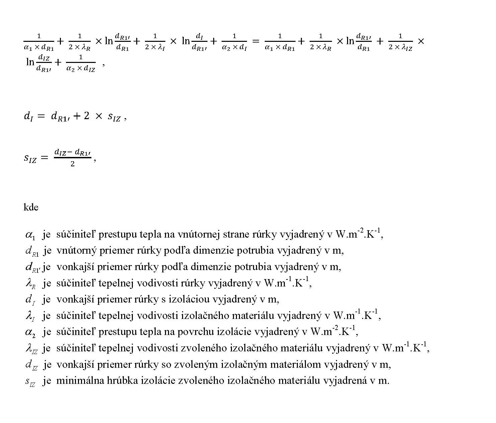

Príloha č. 2 k vyhláške č. 14 /2016 Z. z.

- Minimálna hrúbka tepelnej izolácie rozvodov tepla a teplej vody z iných materiálov ako oceľových rúrok alebo pri zvolenom izolačnom materiáli

  - 1. Minimálna hrúbka tepelnej izolácie rozvodov tepla a teplej vody z iných materiálov ako oceľových rúrok alebo pri zvolenom izolačnom materiáli sIZsa vypočíta z rovníc:

  - 

    - Pri výpočte sa nemusí zohľadniť súčiniteľ prestupu tepla na vnútornej strane rúrky α1 a pre súčiniteľ prestupu tepla na povrchu izolácie α2 je možné použiť hodnotu 10 W.m-2.K-1.

  - 2. Pre rozdeľovače a zberače tepla, v miestach križovania potrubí, v miestach spájania potrubí a pre potrubia a armatúry inštalované v prestupoch stien a stropov sa môže minimálna hrúbka izolácie znížiť o 50 % vypočítanej hodnoty hrúbky izolácie.
