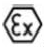

# § 14 Označenie CE

(1) Označenie CE sa umiestni na určený výrobok alebo na jeho štítok v súlade s § 25 ods. 1, 2, 4 a 6 zákona.

(2) Za označením CE nasleduje v súlade s § 25 ods. 2 zákona identifikačné číslo notifikovanej osoby, ak je zapojená do fázy kontroly výroby.

(3) Za označením CE a identifikačným číslom notifikovanej osoby nasleduje špecifické označenie ochrany pred výbuchom, značky skupiny a kategórie zariadenia a podľa potreby ďalšie označenia a údaje podľa prílohy č. 2 bodu 1.0.5.

(4) K označeniu CE a označeniu, značke a údajom podľa odseku 3 a identifikačnému číslu notifikovanej osoby môže byť umiestnená iná značka, ktorá označuje osobitné riziko alebo použitie určeného výrobku. Určený výrobok, ktorý je vyrobený pre konkrétne výbušné prostredie, je označený podľa prvej vety.
