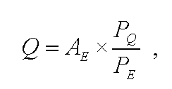
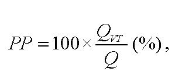

# § 1

(1) Ročná výroba tepla pre zariadenie výrobcu elektriny, ktoré vyrába elektrinu spaľovaním bioplynu získaného anaeróbnou fermentáciou alebo elektrinu z plynu vyrobeného termochemickým splyňovaním biomasy (ďalej len „zariadenie“) sa na účely posúdenia percentuálneho podielu dodávky využiteľného tepla vypočíta podľa vzorca

kde

Q - výroba tepla v megawatthodinách za rok,

AE - výroba elektriny v megawatthodinách za rok meraná na svorkách generátora inštalovaného v zariadení,

PQ - projektovaný inštalovaný tepelný výkon zariadenia v megawattoch; pri spaľovacom motore vypočítaný ako súčet využiteľného tepelného výkonu meraného na výstupe chladiacej kvapaliny motora a tepelného výkonu na výstupe výfukových plynov z motora,

PE - projektovaný inštalovaný elektrický výkon zariadenia v megawattoch.

(2) Do percentuálneho posúdenia podielu dodávky využiteľného tepla z ročnej výroby tepla sa započítava technologická spotreba tepla, najviac však do výšky 25 % z ročnej výroby tepla.

(3) Ak nie je technologická spotreba tepla meraná, vypočíta sa podľa vzorca

QTS = 0,1 x Q,

kde

Q - výroba tepla v megawatthodinách za rok,

QTS - technologická spotreba tepla v megawatthodinách za rok.

(4) Technologickou spotrebou tepla je teplo vyrobené v zariadení, ktoré sa spotrebuje na

- a) výrobu alebo uskladnenie bioplynu získaného anaeróbnou fermentáciou,

- b) výrobu alebo uskladnenie bioplynu vyrobeného termochemickým splyňovaním biomasy alebo

- c) úpravu fyzikálnych vlastností biomasy, ktorá vstupuje ako palivo do procesu výroby elektriny v tomto zariadení, bez ohľadu na to, kto túto úpravu vykonáva.

(5) Do percentuálneho posúdenia podielu dodávky využiteľného tepla z ročnej výroby tepla sa nezapočítava teplo využité pri výrobe elektriny.

(6) Percentuálny podiel dodávky využiteľného tepla sa vypočíta podľa vzorca

kde

PP - percentuálny podiel dodávky využiteľného tepla,

QVT - dodané využiteľné teplo v megawatthodinách za rok vrátane technologickej spotreby tepla v megawatthodinách za rok určenej podľa odsekov 2 a 3,

Q - výroba tepla v megawatthodinách za rok.
