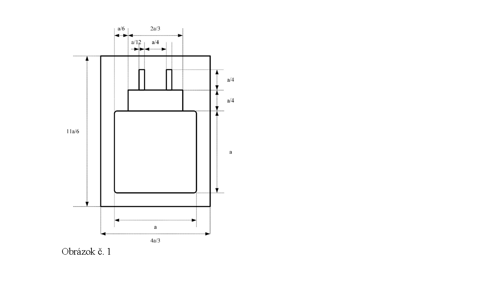
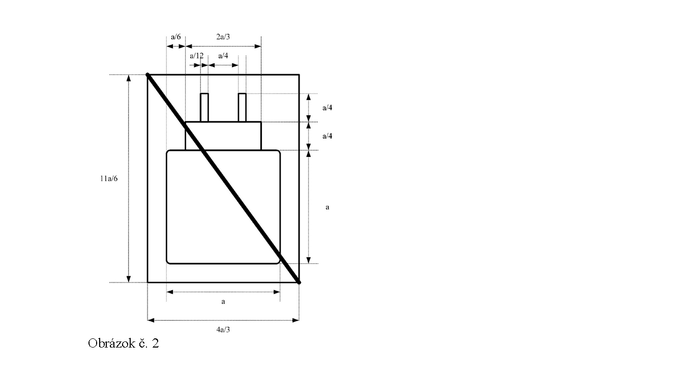
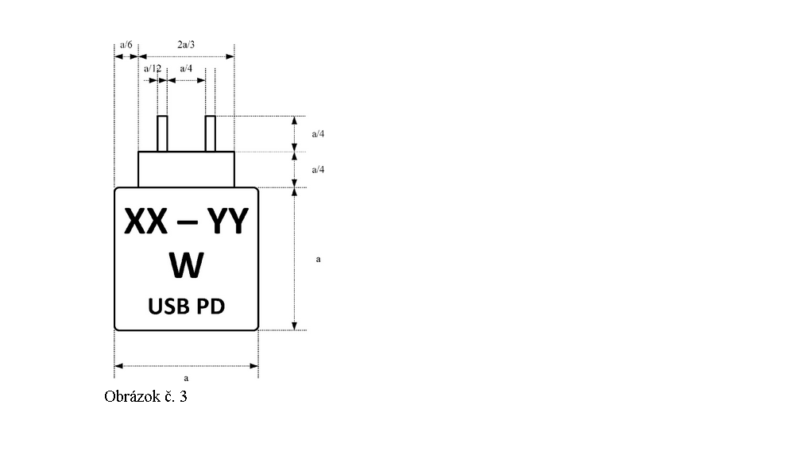

Príloha č. 1a k nariadeniu vlády č. 193/2016 Z. z.

- ŠPECIFIKÁCIE A INFORMÁCIE, KTORÉ SA TÝKAJÚ NABÍJANIA URČITEJ KATEGÓRIE ALEBO TRIEDY RÁDIOVÉHO ZARIADENIA

  - ČASŤ I Špecifikácie, ktoré sa týkajú funkcií nabíjania

    - 1. Požiadavky podľa druhého bodu a tretieho bodu sa uplatňujú na kategóriu alebo triedu rádiového zariadenia:

      - a) mobilný telefón,

      - b) tablet,

      - c) digitálny fotoaparát,

      - d) slúchadlá,

      - e) slúchadlá s mikrofónom,

      - f) ručná konzola pre videohru,

      - g) prenosný reproduktor,

      - h) elektronická čítačka,

      - i) klávesnica,

      - j) myš,

      - k) mobilný navigačný systém,

      - l) slúchadlá do uší,

      - m) laptop.

    - 2. Ak rádiové zariadenie uvedené v prvom bode možno nabíjať cez kábel, kategória alebo trieda rádiového zariadenia podľa prvého bodu musí spĺňať tieto požiadavky:

      - a) vybavenie portom USB typu C podľa technickej normy37a) alebo inej obdobnej technickej špecifikácie s porovnateľnými alebo prísnejšími požiadavkami, ktorý je prístupný a funkčný,

      - b) možnosť nabíjať pomocou káblov podľa technickej normy37a) alebo inej obdobnej technickej špecifikácie s porovnateľnými alebo prísnejšími požiadavkami.

    - 3. Ak kategóriu alebo triedu rádiového zariadenia uvedeného v prvom bode možno nabíjať cez kábel pri napätí vyššom ako 5 voltov, prúde vyššom ako 3 ampéry alebo výkone vyššom ako 15 wattov, musí rádiové zariadenie spĺňať tieto požiadavky:

      - a) integrovaný protokol nabíjania elektrickou energiou cez port USB (USB Power Delivery) podľa technickej normy37b) alebo inej obdobnej technickej špecifikácie s porovnateľnými alebo prísnejšími požiadavkami,

      - b) zabezpečenie, že akýkoľvek ďalší nabíjací protokol umožňuje úplnú funkčnosť protokolu nabíjania elektrickou energiou cez port USB (USB Power Delivery), a to bez ohľadu na použité nabíjacie zariadenie.

  - ČASŤ II Informácie o špecifikáciách, ktoré sa týkajú funkcií nabíjania a kompatibilných nabíjacích zariadení

    - Pri rádiovom zariadení podľa § 3 ods. 4 a 5 sa v súlade s požiadavkami podľa § 9 ods. 2 písm. b) uvedú tieto informácie, ktoré sa môžu sprístupniť aj prostredníctvom QR kódov alebo podobných elektronických riešení:

      - a) pre všetky kategórie alebo triedy rádiových zariadení, na ktoré sa vzťahujú požiadavky uvedené v časti I, opis požiadaviek na výkon pre káblové nabíjacie zariadenia, ktoré sa môžu s týmto rádiovým zariadením použiť, vrátane minimálneho výkonu potrebného na nabitie rádiového zariadenia a maximálneho výkonu potrebného na nabitie rádiového zariadenia pri maximálnej rýchlosti nabíjania vyjadreného vo wattoch, a to uvedením textu: „výkon nabíjačky musí byť najmenej [xx] wattov požadovaných rádiovým zariadením a najviac [yy] wattov, aby sa dosiahla maximálna rýchlosť nabíjania“; počet wattov vyjadruje minimálny výkon, ktorý je potrebný na nabitie rádiového zariadenia a maximálny výkon, ktorý rádiové zariadenie potrebuje na dosiahnutie maximálnej rýchlosti nabíjania,

      - b) pre rádiové zariadenie, na ktoré sa vzťahujú požiadavky podľa časti I tretieho bodu, opis špecifikácií týkajúcich sa funkcií nabíjania rádiového zariadenia, ak ho možno nabíjať cez kábel pri napätí vyššom ako 5 voltov, prúde vyššom ako 3 ampéry alebo výkone vyššom ako 15 wattov, vrátane informácie o tom, že rádiové zariadenie podporuje protokol nabíjania elektrickou energiou cez port USB (USB Power Delivery), a to uvedením textu „rýchle nabíjanie USB PD“, ako aj názvu akéhokoľvek ďalšieho podporovaného nabíjacieho protokolu v textovom formáte.

  - ČASŤ III Piktogram, ktorý označuje, či je nabíjacie zariadenie súčasťou rádiového zariadenia

    - 1. Piktogram má formát:

    - 1.1 Ak je nabíjacie zariadenie súčasťou rádiového zariadenia, piktogram má formát podľa obrázku č. 1.

      - 

    - 1.2 Ak žiadne nabíjacie zariadenie nie je súčasťou rádiového zariadenia, piktogram má formát podľa obrázku č. 2.

      - 

    - 2. Piktogram sa môže odlišovať od obrázku č. 1 alebo obrázku č. 2 najmä farbou, výplňou a hrúbkou čiar za predpokladu, že je viditeľný a čitateľný. Ak sa piktogram zmenší alebo zväčší, musí sa zachovať pomer podľa obrázku č. 1 alebo obrázku č. 2. Rozmer „a“ uvedený na obrázku č. 1 alebo obrázku č. 2 sa musí rovnať alebo byť väčší ako 7 mm.

  - ČASŤ IV Obsah a formát štítku

    - 1. Štítok má formát podľa obrázku č. 3.

      - 

    - 2. Písmená „XX“ sa nahradia číslom zodpovedajúcim minimálnemu výkonu vyjadrenému vo wattoch, ktorý rádiové zariadenie potrebuje na nabíjanie, ktorým sa určuje minimálny výkon, ktorý nabíjacie zariadenie potrebuje dodávať na nabíjanie rádiového zariadenia. Písmená „YY“ sa nahradia číslom zodpovedajúcim maximálnemu výkonu vyjadrenému vo wattoch, ktorý rádiové zariadenie potrebuje na dosiahnutie maximálnej rýchlosti nabíjania, ktorým sa určuje výkon, ktorý nabíjacie zariadenie potrebuje poskytovať na dosiahnutie aspoň tejto maximálnej rýchlosti nabíjania. Skratka „USB PD“ sa uvedie, ak rádiové zariadenie podporuje tento komunikačný protokol nabíjania. „USB PD“ je protokol, ktorý zabezpečuje najrýchlejší prívod prúdu z nabíjacieho zariadenia do rádiového zariadenia bez skrátenia životnosti batérie.

    - 3. Štítok sa môže odlišovať od obrázku č. 3 najmä farbou, výplňou a hrúbkou čiar, ak je viditeľný a čitateľný. Ak sa štítok zmenší alebo zväčší, musí sa zachovať pomer podľa obrázku č. 3. Rozmer „a“ uvedený na obrázku č. 3 sa musí rovnať alebo byť väčší ako 7 mm.
