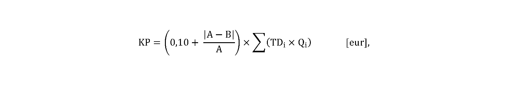

# § 9 Suma a spôsob výpočtu kompenzačnej platby za nedodržanie štandardov kvality distribúcie elektriny

(1) Ak nie je dodržaný štandard kvality podľa § 3 písm. a), suma kompenzačnej platby pri nedodržaní povolenej odchýlky od normalizovaného napätia pre odberateľov elektriny v domácnosti sa vypočíta podľa vzorca

KP = 0,20 × N [eur],

kde

N je počet dní trvania nedodržania štandardu kvality, pričom

- a) N je počet dní od dátumu, kedy je podanie týkajúce sa kvality napätia vyhodnotené ako opodstatnené, do dátumu odstránenia zníženej kvality napätia, alebo

- b) N je počet dní od dátumu nadobudnutia právoplatnosti stavebného povolenia alebo ohlásenia drobnej stavby do dátumu odstránenia zníženej kvality napätia,

- c) ak prevádzkovateľ distribučnej sústavy nepodá návrh na vydanie územného rozhodnutia, návrh na vydanie stavebného povolenia alebo návrh na ohlásenie drobnej stavby, N je počet dní za obdobie 240 dní odo dňa odoslania oznámenia koncovému odberateľovi elektriny, že podanie o zníženej kvalite napätia je opodstatnené, do dátumu odstránenia zníženej kvality elektriny.

(2) Ak nie je dodržaný štandard kvality podľa § 3 písm. a), suma kompenzačnej platby pri nedodržaní povolenej odchýlky od normalizovaného napätia pre odberateľov elektriny mimo domácnosti sa vypočíta podľa vzorca

kde

A je maximálna alebo minimálna hodnota napätia v rámci povolenej odchýlky od menovitého napätia na príslušnej napäťovej úrovni podľa prílohy č. 3a; ak B je väčšie ako maximálna hodnota napätia podľa prílohy č. 3a (Amax), uplatní sa vo výpočte hodnota Amax, ak B je menšie ako minimálna hodnota napätia podľa prílohy č. 3a (Amin), použije sa vo výpočte hodnota Amin,

B je skutočná hodnota napätia v príslušnom odbernom mieste zistená meraním podľa prílohy č. 3a,

TDi je i-tá tarifa za distribúciu elektriny bez taríf za prenos elektriny, strát pri prenose elektriny a strát pri distribúcii elektriny platná pre odberné miesto oprávnenej osoby v období od dátumu, kedy je podanie týkajúce sa kvality napätia vyhodnotené ako opodstatnené, do dátumu odstránenia zníženej kvality napätia,

Qi je objem distribuovanej elektriny do odberného miesta oprávnenej osoby po dobu trvania platnosti TDi v období od dátumu, kedy je podanie týkajúce sa kvality napätia vyhodnotené ako opodstatnené, do dátumu odstránenia zníženej kvality napätia; hodnoty TDi a Qi sa pri uplatnení lehoty na odstránenie príčiny zníženej kvality napätia podľa § 3 písm. c) vzťahujú na obdobie od dátumu nadobudnutia právoplatnosti stavebného povolenia alebo doručenia písomného oznámenia stavebného úradu, že proti uskutočneniu drobnej stavby alebo stavebných úprav nemá námietky, do dátumu odstránenia zníženej kvality napätia.

(3) Ak nie je v deň, kedy je podanie týkajúce sa kvality napätia vyhodnotené ako opodstatnené, alebo v deň odstránenia zníženej kvality napätia alebo v deň zmeny tarify za distribúciu elektriny vykonaný odpočet určeného meradla v dotknutom odbernom mieste, množstvo distribuovanej elektriny Qi vstupujúce do výpočtu kompenzačnej platby podľa odseku 2 sa vypočíta podľa vzorca

Qi = Q × Ni [eur],

kde

Q je priemerné denne distribuované množstvo elektriny do daného odberného miesta za posledný rok pred začiatkom platnosti TDi v období od dátumu, kedy je podanie týkajúce sa kvality napätia vyhodnotené ako opodstatnené, do dátumu odstránenia zníženej kvality napätia,

Ni je počet dní trvania platnosti TDiv období od dátumu, kedy je podanie týkajúce sa kvality napätia vyhodnotené ako opodstatnené, do dátumu odstránenia zníženej kvality napätia; hodnoty Q a Ni sa pri uplatnení lehoty na odstránenie príčiny zníženej kvality napätia podľa § 3 písm. c) vzťahujú na obdobie od dátumu nadobudnutia právoplatnosti stavebného povolenia alebo doručenia písomného oznámenia stavebného úradu, že proti uskutočneniu drobnej stavby alebo stavebných úprav nemá námietky, do dátumu odstránenia zníženej kvality napätia.

(4) Ak nie je dodržaný štandard kvality podľa § 3 písm. b), suma kompenzačnej platby sa vypočíta podľa vzorca

KP = A + B × (N – 5) | [eur], ak N < 5, potom KP = A,

kde

A = 35,

B = 7,

N je počet dní nedodržania štandardu kvality vrátane začatých dní.

(5) Ak nie je dodržaný štandard kvality podľa § 3 písm. c) prvého bodu, suma kompenzačnej platby sa vypočíta podľa vzorca

KP = A + B × (N – 10) | [eur], ak N < 10, potom KP = A,

kde

A = 28,

B = 14,

N je počet dní nedodržania štandardu kvality vrátane začatých dní.

(6) Ak nie je dodržaný štandard kvality podľa § 3 písm. c) druhého bodu, suma kompenzačnej platby je za každý aj začatý mesiac omeškania 70 eur.

(7) Ak nie je dodržaný štandard kvality podľa § 3 písm. c) tretieho bodu, suma kompenzačnej platby je za každý aj začatý mesiac nedodržania štandardu kvality 91 eur.

(8) Ak nie je dodržaný štandard kvality podľa § 3 písm. d), suma kompenzačnej platby je za každý aj začatý deň nedodržania štandardu kvality

- a) 260 eur, ak ide o distribúciu elektriny do odberného miesta pripojeného na napäťovej úrovni nad 1 kV,

- b) 35 eur, ak ide o distribúciu elektriny do odberného miesta pripojeného na napäťovej úrovni do 1 kV.

(9) Ak nie je dodržaný štandard kvality podľa § 3 písm. e) alebo písm. f), suma kompenzačnej platby sa vypočíta podľa vzorca

KP = [A + B × (N – 1)] × C [eur],

kde

A = 28,

B = 14,

N je počet dní nedodržania štandardu kvality vrátane začatých dní,

C = 1,2, pričom konštanta C sa vzťahuje na oprávnenú osobu, ktorou je odberateľ elektriny s elektrickým kúrením, ktorým je odberateľ elektriny s priamo výhrevným elektrickým vykurovaním, s akumulačným elektrickým vykurovaním alebo s tepelným čerpadlom (ďalej len „odberateľ s elektrickým kúrením“) od 1. septembra do 31. mája.

(10) Ak nie je dodržaný štandard kvality podľa § 3 písm. g), suma kompenzačnej platby sa vypočíta podľa vzorca

KP = [A + B × (N – 6)] × C | [eur], ak N < 6, potom KP = A × C,

kde

A = 18,

B = 12,

N je počet aj začatých hodín nedodržania štandardu kvality okrem celých hodín, kedy je zabezpečená distribúcia elektriny náhradným spôsobom,

C = 1,2, pričom konštanta C sa vzťahuje na oprávnenú osobu, ktorou je odberateľ elektriny s elektrickým kúrením od 1. septembra do 31. mája.

(11) Ak nie je dodržaný štandard kvality podľa § 3 písm. h), suma kompenzačnej platby je za každý aj začatý deň nedodržania štandardu kvality,

- a) 14 eur pre oprávnenú osobu pripojenú na napäťovej úrovni nad 1 kV,

- b) 4 eurá pre oprávnenú osobu pripojenú na napäťovej úrovni do 1 kV.

(12) Ak nie je dodržaný štandard kvality podľa § 3 písm. i), suma kompenzačnej platby sa vypočíta podľa vzorca

KP = [A + B × (N – 6)] × C | [eur], ak N < 6, potom KP = A × C,

kde

A = 7,

B = 5,

N je počet hodín nedodržania štandardu kvality vrátane začatých hodín,

C = 1,2, pričom konštanta C sa vzťahuje na oprávnenú osobu, ktorou je odberateľ elektriny s elektrickým kúrením od 1. septembra do 31. mája.

(13) Ak nie je dodržaný štandard kvality podľa § 3 písm. j) alebo písm. k), suma kompenzačnej platby sa vypočíta podľa vzorca

KP = A + B × (N – 5) | [eur], ak N < 5, potom KP = A,

kde

A = 14,

B = 4,

N je počet dní nedodržania štandardu kvality vrátane začatých dní.

(14) Ak nie je dodržaný štandard kvality podľa § 3 písm. l), suma kompenzačnej platby sa vypočíta podľa vzorca

KP = [A + B × (N – 10)] × C | [eur], ak N < 10, potom KP = A × C,

kde

A = 28,

B = 4,

N je počet dní nedodržania štandardu kvality vrátane začatých dní,

C je konštanta, ktorej hodnota je 2,0 pri odoslaní návrhu zmluvy o pripojení alebo odmietnutí pripojenia do sústavy s napäťovou úrovňou nad 1 kV a 1,0 pri odoslaní návrhu zmluvy o pripojení alebo odmietnutí pripojenia do sústavy s napäťovou úrovňou do 1 kV.

(15) Ak nie je dodržaný štandard kvality podľa § 3 písm. m), suma kompenzačnej platby sa vypočíta podľa vzorca

KP = [A + B × (N – 2)] × C | [eur], ak N < 2, potom KP = A × C,

kde

A = 14,

B = 12,

N je počet hodín nedodržania štandardu kvality vrátane začatých hodín,

C = 1,2, pričom konštanta C sa vzťahuje na oprávnenú osobu, ktorou je odberateľ elektriny s elektrickým kúrením od 1. septembra do 31. mája.

(16) Ak nie je dodržaný štandard kvality podľa § 3 písm. n), suma kompenzačnej platby je za každý aj začatý deň nedodržania štandardu kvality 7 eur.

(17) Ak nie je dodržaný štandard kvality podľa § 3 písm. p), suma kompenzačnej platby je za každý aj začatý deň nedodržania štandardu kvality 10 eur.

(18) Ak nie je dodržaný štandard kvality podľa § 3 písm. q), suma kompenzačnej platby je za každý aj začatý deň nedodržania štandardu kvality 35 eur.
