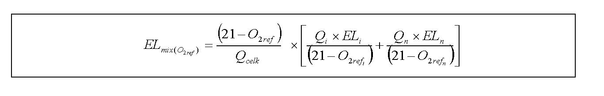

# Čl. I

Vyhláška Ministerstva životného prostredia Slovenskej republiky č. 410/2012 Z. z., ktorou sa vykonávajú niektoré ustanovenia zákona o ovzduší v znení vyhlášky č. 270/2012 Z. z. sa mení a dopĺňa takto:

- 1. V § 8 ods. 2 písm. g) sa na konci pripájajú tieto slová:

- „ide o fosílne palivá, palivá vyrobené z fosílnych palív, druhotné palivá,2a) biomasu podľa písmena i), bioplyn a priemyselné plyny,“.

  - Poznámka pod čiarou k odkazu 2a znie:

  - „2a) Vyhláška Ministerstva životného prostredia Slovenskej republiky č. 228/2014 Z. z., ktorou sa ustanovujú požiadavky na kvalitu palív a vedenie prevádzkovej evidencie o palivách v znení vyhlášky č. 367/2015 Z. z.“.

- 2. V § 25 odsek 3 znie:

- „(3)

- Ak ide o emisie z koncových oxidačných zariadení na čistenie odpadových plynov, pre činnosti podľa odseku 2 platia špecifické emisné limity pre odpadové plyny, špecifické technické požiadavky a špecifické podmienky prevádzkovania uvedené v prílohe č. 7 druhej časti písm. F bode 7; uplatnenie špecifických emisných limitov uvedených v prílohe č. 6 tretej časti pre prchavé organické látky podľa § 26 ods. 1 písm. a) a uplatňovanie špecifických emisných limitov uvedených v prílohe č. 6 štvrtej časti pre fugitívne emisie a celkové emisie tým nie je dotknuté.“.

- 3. § 29 sa dopĺňa odsekom 9, ktorý znie:

- „(9)

- Dodržanie emisného limitu pre odpadové plyny, fugitívne emisie a celkové emisie sa hodnotí počas skutočnej prevádzky zariadenia okrem

- a)

- skúšobnej prevádzky stacionárneho zdroja, časti zdroja alebo jej časového úseku za podmienok určených v súhlase, rozhodnutí alebo integrovanom povolení,

- b)

- doby, ak ide o emisný limit vyjadrený ako koncentrácia, vymedzenej pre daný stav:

- 1.

- nábeh a odstavovanie zariadenia alebo jeho časti podľa platnej dokumentácie, ak v súhlase, rozhodnutí alebo integrovanom povolení nie je určené inak,

- 2.

- funkčná a iná skúška automatizovaného meracieho systému, ktorá vyžaduje osobitný prevádzkový režim zariadenia,

- 3.

- údržba automatizovaného meracieho systému a jeho poruchy; uvedené sa nevzťahuje na diskontinuálne merania.“.

- 4. Nadpis prílohy č. 1 znie:

- „ČLENENIE A KATEGORIZÁCIA STACIONÁRNYCH ZDROJOV“.

- 5. V prílohe č. 1 tabuľke kategórii 5.7 druhom stĺpci sa slová „ako sú“ nahrádzajú slovom „najmä“.

- 6. V prílohe č. 4 druhej časti bode 1.3 druhý riadok tabuľky znie:

- 

- 7. V prílohe č. 4 štvrtej časti bode 3.2 tabuľke sa časť „Zariadenia s kotlami s vydaným povolením od 1. januára 2011 do 31. decembra 2013“ dopĺňa novým riadkom, ktorý znie:

- „

- ≥ 0,3 | Skvapalnené uhľovodíky | – | – | 200 | 100

- “.

- 8. V prílohe č. 5 štvrtej časti bod 1 znie:

- „[príloha](assets/66e7b47daec0d7c562cdaec1267a7578de7d5ce8fcb72b216df7b9bedea88ce3.pdf)“.

- 9. V prílohe č. 5 štvrtej časti bode 4 prvý riadok v druhom stĺpci tabuľky znie:

- „

- Štandardné stavové podmienky, suchý plyn, O2ref: podľa bodu 1

- “.

- 10. V prílohe č. 6 štvrtej časti bod 4.3 znie:

- „4.3

- Podmienky prevádzkovania a uplatňovanie emisných limitov pre procesy nanášania náterov v zariadeniach s podprahovou spotrebou rozpúšťadla

- Podmienky platnosti EL | Štandardné stavové podmienky | |

- | Všeobecné emisné limity sa neuplatňujú. | |

- Nanášanie náterov | Spotreba rozpúšťadla | Emisný limit TZL [mg/m3] | Požiadavky na obmedzovanie VOC

- Nanášanie náterov podľa osobitného predpisu15) | ≥ 0,6 t/rok a súčasne < ako najnižšia prahová hodnota v bode 4.2 pre danú činnosť | 31) | 1. Danú činnosť možno vykonávať výlučne s použitím regulovaných výrobkov, ktoré spĺňajú ustanovené hraničné hodnoty pre najvyšší obsah VOC podľa osobitného predpisu,15) alebo 2. platia emisné limity pre najnižšiu prahovú kapacitu podľa bodu 4.2.

- Nanášanie náterov na iný účel alebo iný povrch | ≥0,6 t/rok a súčasne < ako najnižšia prahová hodnota v bode 4.2 pre danú činnosť | 31) | Platia emisné limity pre najnižšiu prahovú kapacitu podľa bodu 4.2. Orgán ochrany ovzdušia môže určiť emisný limit individuálne alebo rozhodnúť o fugitívnych emisiách podľa § 25 ods. 6.

- 1) Pre zariadenia, ktoré boli povolené do 30. septembra 2016 platí, emisný limit pre TZL

- od 1. januára 2018.“.

- 11. V prílohe č. 7 druhej časti písm. A bod 4.1.5 znie:

- „4.1.5

- Chladenie koksu

- 4.1.5.1

- Pri budovaní nových zariadení na chladenie koksu musia byť použité procesy s nízkymi emisiami TZL.

- 4.1.5.2

- Výška veže pri využívaní mokrého chladenia koksu je najmenej 30 m. Veža musí byť vybavená odlučovaním, najmenej žalúziovým s účinným oplachovaním. Pre zariadenia s povolením vydaným do 31. marca 1998, ktoré sú uvedené do prevádzky do 31. marca 2001, táto požiadavka platí od 1. januára 2018.“.

- 12. V prílohe č. 7 druhej časti písm. A bode 4.2 sa v poslednom riadku tabuľky vypúšťajú slová „0,1 kg/t koksu2)“.

- 13. V prílohe č. 7 druhej časti sa písmeno A dopĺňa bodom 6, ktorý znie:

- „6. VÝROBA BIOPLYNU

- Výroba bioplynu zahŕňa

- a)

- poľnohospodárske bioplynové stanice – ide o spracovanie materiálov z poľnohospodárskej prvovýroby rastlinného pôvodu, napríklad cielene pestované plodiny, rastlinné odpady alebo pozberové zvyšky, alebo exkrementov z chovov hospodárskych zvierat,

- b)

- priemyselné bioplynové stanice – ide o spracovanie vedľajších živočíšnych produktov (napríklad jatočných odpadov, krvi, tukov, mäsokostnej múčky) a iných biologicky rozložiteľných odpadov z rôznych priemyselných výrob (napríklad z potravinárskeho, chemického a farmaceutického priemyslu) alebo kalov z priemyselných čistiarní odpadových vôd, pričom spolu s týmito surovinami možno spracúvať aj materiály uvedené v písmenách a) a c),

- c)

- komunálne bioplynové stanice – ide o spracovanie podielu biologicky rozložiteľného komunálneho odpadu (napríklad odpad zo záhrad a parkov, odpad z kuchýň a jedální, odpad z domácností) alebo kalov z komunálnych čistiarní odpadových vôd, pričom spolu s týmito surovinami možno spracúvať aj materiály uvedené v písmene a).

- 6.1 Technické požiadavky a podmienky prevádzkovania

- 6.1.1 Nakladanie so surovinami, ktoré môžu byť zdrojom zápachu

- 6.1.1.1

- Priestory na príjem a dávkovanie surovín, ktoré môžu byť zdrojom zápachu, nádrže a priestory na ich skladovanie, dotriedenie, úpravu a homogenizačná nádrž musia byť uzavreté s účinným tesnením a emisie pachových látok musia byť odvádzané na čistenie alebo iné zneškodnenie.

- 6.1.1.2

- Ak je bioplynová stanica pridruženou činnosťou chovu hospodárskych zvierat, na skladovanie exkrementov z daného chovu platia požiadavky podľa druhej časti písm. F bodu 9.2.3.

- 6.1.1.3

- Hygienizácia potrebná pri spracovaní určitých vedľajších živočíšnych produktov musí byť vykonávaná v uzavretých priestoroch zabezpečených proti úniku emisií pachových látok.

- 6.1.2 Fermentácia

- 6.1.2.1

- Fermentačná nádrž musí byť plynotesná a hermeticky uzavretá.

- 6.1.2.2

- Fermentačná nádrž musí byť dimenzovaná na optimálne využitie podľa druhu a množstva spracúvanej suroviny na základe výpočtu objemového zaťaženia fermentora; objemové zaťaženie fermentora je množstvo organickej sušiny použitého substrátu (v kg alebo v t), ktoré je dodávané na 1 m3 reaktora za jeden deň.

- 6.1.2.3

- Fermentačný proces musí byť riadený a musí viesť k dostatočnému rozloženiu organických látok tak, že výsledný digestát je stabilizovaný produkt s nízkym podielom biologicky rozložiteľných organických látok bez zápachu. Prevádzkové parametre určené na fermentáciu podľa druhu suroviny musia zabezpečiť

- a)

- optimálne objemové zaťaženie fermentora organickou sušinou podľa druhu suroviny,

- b)

- správnu teplotu (mezofilný proces v rozsahu najmä 20 °C – 45 °C, termofilný proces najmä v rozsahu 45 °C – 75 °C),

- c)

- dostatočnú zdržnú dobu na fermentáciu podľa druhu vstupných surovín a použitej technológie,

- d)

- ak ide o spracovanie vedľajších živočíšnych produktov, požiadavky podľa osobitného predpisu.25a)

- 6.1.2.4

- Pri zmene surovín sa na základe výsledkov skúšobnej/overovacej prevádzky prehodnotia prevádzkové parametre vrátane zdržnej doby a kapacity fermentačnej nádrže vzhľadom na odporúčané objemové zaťaženie fermentora.

- 6.1.3 Nakladanie s výstupmi

- Bioplyn

- 6.1.3.1

- Primárne opatrenie na zníženie obsahu zlúčenín síry v bioplyne ešte pred jeho spaľovaním musí byť zabezpečené, ak je to nákladovo primerané k environmentálnemu prínosu.

- 6.1.3.2

- Pri spaľovaní bioplynu na poľnom horáku platia požiadavky ustanovené v druhej časti písm. F bode 8.

- Fermentačné zvyšky, ktoré môžu byť zdrojom zápachu

- Fermentačné zvyšky sú digestát, ktorý zahŕňa separát (tuhý podiel digestátu) a fugát (tekutý podiel digestátu).

- 6.1.3.3

- Skladovací priestor na fermentačné zvyšky, ktoré môžu byť zdrojom zápachu, musí byť uzavretý a účinne utesnený alebo zakrytovaný a emisie pachových látok odvádzané na čistenie alebo iné zneškodnenie.

- 6.1.3.4

- Kapacita skladovacieho priestoru na fermentačné zvyšky musí pokryť najmenej štvormesačnú produkciu digestátu. Do tejto kapacity sa nezarátava časť digestátu, ktorý sa bezodkladne ďalej spracúva, napríklad fugát odvádzaný na čistenie odpadových vôd.

- 6.1.3.5

- Ak bioplynová stanica je v rámci jedného priemyselného areálu spojená s výrobou a spaľovaním/spoluspaľovaním energokompostu získaného z digestátu, o dostatočnej skladovacej kapacite rozhodne orgán ochrany ovzdušia podľa § 26 ods. 3 písm. c) zákona.

- 6.1.4 Dávkovanie a prečerpávanie surovín a fermentačných zvyškov, ktoré môžu byť zdrojom zápachu

- 6.1.4.1

- Pri nakládke a vykládke surovín alebo fermentačných zvyškov musia byť vykonané technicky dostupné opatrenia na obmedzovanie zápachu v čo najväčšom rozsahu.

- 6.1.4.2

- Zariadenia na dávkovanie surovín a odber fermentačných zvyškov musia byť v uzatvorenom priestore s účinným tesnením a emisie pachových látok odvádzané na čistenie, recirkuláciu pár alebo iné zneškodnenie. Výnimkou môže byť len čas nevyhnutne potrebný na dávkovanie tuhých materiálov do zariadenia a na jeho vyprázdnenie.

- 6.1.4.3

- Ak ide o tekuté látky v nehermetizovanej nádrži, musia byť dávkované alebo prečerpávané do nádrže podhladinovo.

- 6.1.4.4

- Hadice na prečerpávanie kvapalných surovín musia mať automatické uzatváranie pri rozpájaní.

- 6.1.5 Preprava zapáchajúcich materiálov

- 6.1.5.1

- Suroviny a fermentačné zvyšky, ktoré môžu byť zdrojom zápachu, možno prepravovať iba v transportnej nádobe, uzavretom kontajneri alebo prekryté tak, aby nedochádzalo k úniku pachov prepravovanej látky.

- 6.1.5.2

- Prostriedok použitý na prepravu musí byť bezodkladne po použití vyčistený tak, aby nebol zdrojom zápachu; požiadavka na bezodkladné vyčistenie sa vzťahuje aj na surovinami a fermentačnými zvyškami znečistenú manipulačnú plochu a dopravnú cestu.

- 6.1.5.3

- Čistenie a dezinfekciu prostriedkov použitých na prepravu možno vykonávať iba na spevnenej ploche. Odpadová voda sa musí odvádzať na čistenie alebo použiť v procese fermentácie.

- 6.1.6 Obmedzovanie zápachu

- 6.1.6.1

- Prevádzka bioplynovej stanice musí mať prijaté účinné technicko-organizačné opatrenia na elimináciu zápachu v čo najväčšom rozsahu pri bežnej prevádzke aj pri havarijných a poruchových stavoch. Opis prijatých opatrení na obmedzovanie zápachu musí byť súčasťou prevádzkového poriadku.

- 6.1.6.2

- Únik pachových látok do ovzdušia musí byť pravidelne monitorovaný a výsledky monitorovania zaznamenávané.

- 6.1.6.3

- Ak skladovanie digestátu alebo jeho aplikácia na pôdu spôsobuje v okolí intenzívny zápach, znamená to, že fermentačný proces nie je dostatočne kvalitný. Vtedy sa musí prehodnotiť technologický proces fermentácie, najmä upraviť skladbu surovín, znížiť objemové zaťaženie reaktora organickou sušinou, predĺžiť zdržnú dobu fermentácie, hermetizovať skladové priestory, zabezpečiť účinnejšie čistenie emisií pachových látok a striktne dodržiavať pracovnú disciplínu.

- 6.1.6.4

- Vyššiu stabilitu digestátu pri spracovaní živočíšnych zvyškov možno dosiahnuť viacstupňovou fermentáciou.

- 6.1.6.5

- Čistením vzdušniny s pachovými látkami sa rozumie odstraňovanie pachových látok zo vzdušniny v biofiltri alebo iným účinným odlučovaním. Zneškodnením sa rozumie ich spaľovanie napríklad v kogeneračnej jednotke alebo na poľnom horáku.

- 6.1.6.6

- Činnosť biofiltra musí byť kontinuálna.

- 6.1.6.7

- Voda z procesu – fugát – musí byť zachytávaná a, ak je to možné, opätovne využívaná v procese alebo odvádzaná na čistenie.

- 6.1.6.8

- Musia byť vykonané opatrenia na zabránenie priesakov odpadovej vody a iných kvapalných odpadov do pôdy.

- 6.1.7 Opatrenia pre zariadenia, ktoré sú už v prevádzke alebo majú vydané povolenie

- Pre zariadenia, ktoré boli povolené do 30. septembra 2016 alebo sú už v prevádzke, je termín na zosúladenie s vyššie uvedenými požiadavkami do 31. marca 2017, ak orgán ochrany ovzdušia podľa § 26 ods. 3 písm. l) zákona nerozhodne inak.“.

  - Poznámka pod čiarou k odkazu 25a znie:

  - „25a) Čl. 10 a príloha V nariadenia Komisie (EÚ) č. 142/2011 z 25. februára 2011, ktorým sa vykonáva nariadenie Európskeho parlamentu a Rady (ES) č. 1069/2009, ktorým sa ustanovujú zdravotné predpisy týkajúce sa vedľajších živočíšnych produktov a odvodených produktov neurčených na ľudskú spotrebu, a ktorým sa vykonáva smernica Rady 97/78/ES, pokiaľ ide o určité vzorky a predmety vyňaté spod povinnosti veterinárnych kontrol na hraniciach podľa danej smernice (Ú. v. EÚ L 54, 26. 2. 2011) v platnom znení.“.

- 14. V prílohe č. 7 druhej časti písm. B bode 5.2 tabuľke B šiesty riadok znie:

- „

- Kuplové pece | 20 | 1 000 | 1 0003) |

- “.

- 15. V prílohe č. 7 druhej časti bode 7.2 tabuľka B znie:

- „

- Podmienky platnosti EL | | Štandardné stavové podmienky, suchý plyn | |

- Časť zdroja, činnosť | | Emisný limit [mg/m3] | |

- | | TZL1) | SOX | NOX

- Doprava a manipulácia so surovinou alebo produktom | | 20, 502) | |

- Pecné agregáty vrátane pecí typu Imperial Smelting | Výroba olova | 53), 10, 204) | | 400

- | Výroba medi a zinku | 20, 504) | 1 5005) | 400

- | Ostatné výroby | 20, 502) | | 400

- Pretavovanie a odlievanie neželezných kovov a zliatin | | 10 | | 400

- | | Emisný limit PCDD + PCDF | |

- Recyklácia alebo spätné získavanie kovov a kovových zlúčenín | | ustanovené požiadavky6) | |

- 1) Platí ako denná priemerná hodnota.

- 2) Platí do 31. decembra 2019 pre zariadenia, ktoré dosahujú prahovú kapacitu pre výroby z rúd, koncentrátov alebo druhotných surovín metalurgickými procesmi s kapacitou spracovania kovu; pre primárne zariadenia ≤ 30 t/d, pre sekundárne zariadenia ≤ 15 t/d.

- 3) Platí od 1. januára 2020 pre zariadenia, ktoré dosahujú prahovú kapacitu pre výroby z rúd, koncentrátov alebo druhotných surovín metalurgickými procesmi s kapacitou spracovania kovu; pre primárne zariadenia ≥ 30 t/d, pre sekundárne zariadenia ≥ 15 t/d.

- 4) Platí do 31. decembra 2019 pre zariadenia povolené do 31. decembra 2013.

- 5) Platí pri spracovaní odplynov na H2SO4 pri výrobe Cu, pri zabezpečení opatrení na obmedzenie emisií SO3.

- 6) Platia pre vymedzené zariadenie podľa osobitného predpisu.20)“.

- 16. V prílohe č. 7 druhej časti písm. B bod 11 znie:

- „11. ŽIAROVÉ NANÁŠANIE OCHRANNÝCH POVLAKOV KOVOV

- 11.1 Technické požiadavky a podmienky prevádzkovania pre nové zariadenia

- Odpadové plyny zo žiarového zinkovania musia byť od pozinkovacích vaní odvádzané na čistenie s ohľadom na typ zinkového kúpeľa, technické možnosti a primeranosť nákladov k environmentálnemu prínosu.

- 11.2 Emisné limity

- Podmienky platnosti EL | Štandardné stavové podmienky, suchý plyn – SOX, NOX: O2 ref: 5 % objemu – Zn: O2 ref: 19 % objemu (platí len na priamy ohrev) | |

- Časť zdroja | Emisný limit [mg/m3] | |

- | SOX | NOX | Zn

- Žiarové pozinkovanie | 8001) | 400, 8002) | 10

- 1) Platí pre vykurovací plyn ako zmes vysokopecného a koksárenského plynu.

- 2) Platí pre zariadenia s predhrievaním vzduchu.“.

- 17. V prílohe č. 7 druhej časti písm. B bod 12.1 znie:

- „12.1

- Emisné limity

- Podmienky platnosti EL | Štandardné stavové podmienky, vlhký plyn

- Povrchové úpravy | Emisný limit [mg/m3]

- | HCl

- Povrchové úpravy s použitím HCl | 10, 301)

- 1) Platí pre zariadenia s vydaným povolením do 1. septembra 2009.“.

- 18. V prílohe č. 7 druhej časti písm. C bode 3.2 tabuľke prvý riadok znie:

- „

- Podmienky platnosti EL | Štandardné stavové podmienky, suchý plyn Pece na výpal slinku: O2 ref: 10 % objemu Výroba žiaruvzdorných tvárnic: O2 ref: 18 % objemu

- “.

- 19. V prílohe č. 7 druhej časti písm. C bod 4.1.3 znie:

- „4.1.3

- Pri procese sušenia kameniva sa materiál nesmie priamo vsypávať do spaľovacieho priestoru bez predohriatia. Toto platí pre všetky zariadenia od 1. januára 2017.“.

- 20. V prílohe č. 7 druhej časti písm. D sa bod 1.1 dopĺňa bodom 1.1.3, ktorý znie:

- „1.1.3

- Používanie ortuti alebo amalgámu vo výrobe chlóru alkalickým spôsobom možno len do 31. decembra 2020.“.

- 21. V prílohe č. 7 druhej časti písm. D bode 1.2 tabuľke B druhom stĺpci druhom riadku sa slová „na dožitie“ nahrádzajú slovami „najdlhšie do 31. decembra 2020“.

- 22. V prílohe č. 7 druhej časti písm. D pätnástom bode sa slová „≤ 5 %“ nahrádzajú slovami

- „≤ 6,2 %“.

- 23. V prílohe č. 7 druhej časti písm. E sa bod 3 dopĺňa bodom 3.1.4, ktorý znie:

- „3.1.4

- Ak sa na výrobu kompostu/energokompostu využíva digestát, na nakladanie s ním a jeho skladovanie platia technické požiadavky a podmienky prevádzkovania podľa druhej časti písm. A bodov 6.1.3 až 6.1.5 určené pre digestát.“.

- 24. V prílohe č. 7 druhej časti sa písmeno E dopĺňa piatym bodom, ktorý znie:

- „5. SKLÁDKA ODPADOV

- 5.1 Technické požiadavky a podmienky prevádzkovania

- 5.1.1

- Skládka odpadov môže byť prevádzkovaná iba s využitím dostupných opatrení na obmedzenie prašnosti a zápachu.

- 5.1.2

- Skládkový plyn musí byť prednostne energeticky využitý podľa požiadaviek osobitného predpisu,28a) pričom platia emisné limity podľa prílohy č. 4 štvrtej časti v závislosti od menovitého tepelného príkonu a druhu zariadenia. Ak energetické využitie skládkového plynu nie je možné, skládkový plyn sa musí spáliť na poľnom horáku, pričom platia požiadavky podľa prílohy č. 7 druhej časti písm. F bodu 8.“.

  - Poznámka pod čiarou k odkazu 28a znie:

  - „28a) § 5 ods. 8 a 9 vyhlášky Ministerstva životného prostredia Slovenskej republiky č. 372/2015 Z. z. o skládkovaní odpadov a dočasnom uskladnení kovovej ortuti.“.

- 25. V prílohe č. 7 druhej časti písm. F bode 1.1 tabuľka B znie:

- „B.

- Emisné limity pre nové zariadenia

- Podmienky platnosti EL | Štandardné stavové podmienky – sušiarne: vlhký plyn – ostatné časti: suchý plyn Priamy ohrev: O2 ref: 17 % | |

- Časť zdroja | Emisný limit [mg/m3] | |

- | TZL | TOC | ∑ ZL 1. podskupiny 4. skupiny1)

- Spracovanie dreva | | |

- Činnosti s možnosťou vzniku TZL | 20 | |

- Sušiarne triesok a pilín2) | 103),154) | 150 | 20

- Lisy5) | | | 206)

- Zariadenia na brúsenie vo výrobe dýh, preglejok, dosák, DTD, DVD a nábytku | 10 | |

- | Limitný emisný faktor ∑ ZL 1. podskupiny 4. skupiny1) | |

- Lisy5) | 0,06 kg/m3 vyrobených dosák | |

- DTD – drevotrieskové dosky, DVD – drevovláknité dosky

- 1) Platí ako mesačná priemerná hodnota; pre močovino-formaldehydové a melamín-formaldehydové lepidlá platí emisný limit pre formaldehyd; pre fenol-formaldehydové lepidlá platí emisný limit pre súčet hmotnostných koncentrácií fenolu a formaldehydu.

- 2) Ak ide o výrobu brikiet a peliet platí emisný limit od 1. januára 2018.

- 3) Platí pre odpadový plyn zo sušiarne triesok a pilín s nepriamym procesným ohrevom.

- 4) Platí pre sušiareň triesok a pilín s priamym procesným ohrevom.

- 5) Platí pre zariadenia na výrobu aglomerovaných plošných materiálov (DTD, DVD a preglejky) a iných plošných materiálov okrem zariadení s činnosťou podľa prílohy č. 6 štvrtej časti bodu 15.

- 6) Pre zariadenia s vydaným povolením do 31.decembra 2010.“.

- 26. V prílohe č. 7 druhej časti písm. F bod 7.1.3 znie:

- „7.1.3

- Správny orgán určí podmienky spaľovania, najmä teplotu spaľovania. Teplota spaľovania sa monitoruje kontinuálne. Pre zariadenia uvedené do prevádzky pred účinnosťou tejto vyhlášky platí táto požiadavka od 1. januára 2017.“.

- 27. V prílohe č. 7 druhej časti písm. F bod 8.1.1.3 znie:

- „8.1.1.3

- Ak ide o spaľovanie

- a)

- bioplynu a odpadového plynu zo spracovania odpadov, prevádzková teplota musí byť ≥ 1 000 °C,

- b)

- ostatných odpadových plynov, prevádzková teplota musí byť ≥ 850 °C.

- Požiadavka na teplotu sa neuplatňuje na poľné horáky uvedené do užívania do 30. septembra 2016, ktoré sú určené výlučne na spaľovanie plynov z havárií, prevádzkových porúch alebo bezpečnostných ventilov.“.

- 28. V prílohe č. 7 druhej časti sa písmeno F dopĺňa bodom 10, ktorý znie:

- „10. VÝROBA, SKLADOVANIE, MANIPULÁCIA A APLIKÁCIA HNOJÍV

- INÝCH AKO HNOJÍV Z CHOVU HOSPODÁRSKYCH ZVIERAT DO PÔDY“

- Opatrenia platia pre technológie, zariadenia a činnosti, ktoré sú zdrojom intenzívneho zápachu.

- 10.1

- Výroba hnojív

- Výrobné zariadenia, reaktory, ako aj skladovacie zariadenia a priestory musia byť uzavreté s odsávaním znečistenej vzdušniny na čistenie alebo spaľovanie.

- 10.2

- Skladovanie

- Suroviny, prídavné látky, produkty a zvyšky z výroby, ktoré môžu byť zdrojom zápachu, sa musia skladovať v uzavretých priestoroch, cisternách alebo zakrytovaných priestoroch s účinným tesnením, odkiaľ sú pachové látky odvádzané na odlučovanie alebo spaľovanie.

- 10.3

- Prečerpávanie a preprava

- 10.3.1

- Pri plnení a vyprázdňovaní cisterien možno pachové látky obmedzovať aj recirkuláciou pár.

- 10.3.2

- Pri prečerpávaní tekutých surovín a zvyškov z výroby musí byť zabezpečené podhladinové plnenie.

- 10.3.3

- Pachové látky emitované pri nakládke, vykládke tuhých surovín a zvyškov musia byť v čo najväčšom rozsahu obmedzované, napríklad odsávaním zapáchajúcich emisií na odlučovanie alebo spálenie. Ak ide o nakládku/vykládku tuhých surovín/zvyškov, pričom je dostupné riešenie na obmedzenie emisií, musí byť vymedzená doba, nevyhnutná na danú činnosť.

- 10.4

- Aplikácia hnojív do pôdy

- Na obmedzenie úniku pachových látok do ovzdušia sa musia

- a)

- pri aplikácii kvapalného hnojiva do pôdy používať nízkoemisné techniky uvedené v bode 9.2.4.1,

- b)

- tuhé a tekuté hnojivo, na aplikáciu ktorého sa nedajú použiť nízkoemisné techniky podľa bodu 9.2.4.1, zaorať v čo najkratšom čase – najneskôr do 24 hodín po ich aplikácii na pôdu.

- 10.5

- Pre zariadenia uvedené do prevádzky do 30. septembra 2016 platia požiadavky uvedené v bodoch 10.1 až 10.4 písm. a) od 1. januára 2017.“.

- 29. V prílohe č. 8 druhá časť vrátane nadpisu znie:

- „[príloha](assets/0cde4d975445e245c8e17de0e872b4f182c700e60669200618497bc7c6ca233b.pdf)“.

  - Poznámka pod čiarou k odkazu 29a znie:

  - „29a) Napríklad vykonávacie rozhodnutie Komisie 2013/163/EÚ z 26. marca 2013, ktorým sa stanovujú závery o najlepších dostupných technikách (BAT) podľa smernice Európskeho parlamentu a Rady 2010/75/EÚ o priemyselných emisiách na výrobu cementu, vápna a oxidu horečnatého (Ú. v. EÚ L 100, 9. 4. 2013).“.
