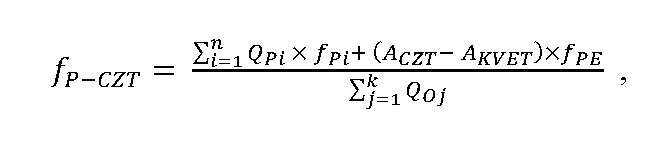

Príloha č. 1 k vyhláške č. 308/2016 Z. z.

- VÝPOČET FAKTORA PRIMÁRNEJ ENERGIE SYSTÉMU CENTRALIZOVANÉHO ZÁSOBOVANIA TEPLOM

  - 1. Faktor primárnej energie systému centralizovaného zásobovania teplom sa vypočíta podľa vzorca:

  - 

    - kde

    - fP-CZT – faktor primárnej energie systému centralizovaného zásobovania teplom,

    - QPi – množstvo energie v palive pre jednotlivé zariadenia na výrobu tepla, najmä pre kombinovanú výrobu, teplovodné kotly, horúcovodné kotly, parné kotly, alebo množstvo tepla dodávané z iných tepelne prepojených okruhov, vyjadrené v MWh,

    - fPi – združený faktor primárnej energie paliva podľa tabuľky alebo faktor primárnej energie systému centralizovaného zásobovania teplom pre teplo dodávané z iných tepelne prepojených okruhov,

    - QOj – množstvo tepla dodávané z rozvodov systému centralizovaného zásobovania teplom jednotlivým odberateľom tepla, vyjadrené v MWh,

    - AKVET – množstvo elektriny vyrobené kombinovanou výrobou, vypočítané podľa osobitného predpisu,1) vyjadrené v MWh,

    - ACZT – množstvo elektriny spotrebované na prevádzku zariadení centralizovaného zásobovania teplom, najmä čerpadiel, vyjadrené v MWh,

    - fPE – združený faktor primárnej energie elektriny podľa tabuľky,

    - n – počet všetkých zariadení na výrobu tepla použitých v systéme centralizovaného zásobovania teplom,

    - k – počet všetkých odberateľov tepla.

  - 2. Ak nie je možné samostatne určiť hodnoty AKVET a ACZT, použije sa namiesto rozdielu týchto hodnôt množstvo elektriny vyrobenej kombinovanou výrobou dodávané do regionálnej distribučnej sústavy.

  - 3. Faktor primárnej energie pre tepelne prepojené okruhy sa vypočíta podľa prvého bodu a druhého bodu.

  - 4. Faktor emisií oxidu uhličitého systému centralizovaného zásobovania teplom vyjadrený v kilogramoch na kilowatthodinu sa vypočíta podľa prvého bodu nahradením združeného faktora primárnej energie paliva a združeného faktora primárnej energie elektriny faktorom emisií fCO2 podľa tabuľky.

  - Tabuľka: Združený faktor primárnej energie a faktor emisií CO2

  - Palivo/forma energie | Celkový tepelný príkon zariadení na výrobu tepla – TP | Združený faktor primárnej energie | Faktor emisií CO2

  - | [MW] | [–] | [kg/kWh]

  - čierne uhlie | 50 ≤ TP | 0,602 | 0,394

  - | 0,3 ≤ TP < 50 | 0,709 |

  - | TP < 0,3 | 1,100 |

  - hnedé uhlie | 50 ≤ TP | 0,657 | 0,433

  - | 0,3 ≤ TP < 50 | 0,773 |

  - | TP < 0,3 | 1,200 |

  - zemný plyn | 50 ≤ TP | 0,523 | 0,277

  - | 0,3 ≤ TP < 50 | 0,550 |

  - | TP < 0,3 | 1,100 |

  - kvapalné fosílne palivá | 50 ≤ TP | 0,563 | 0,290

  - | 0,3 ≤ TP < 50 | 0,630 |

  - | TP < 0,3 | 1,100 |

  - biomasa, bioplyn | 50 ≤ TP | 0,138 | 0,020

  - | 0,3 ≤ TP < 50 | 0,142 |

  - | TP < 0,3 | 0,200 |

  - kvapalné obnoviteľné palivá | 50 ≤ TP | 0,335 | 0,020

  - | 0,3 ≤ TP < 50 | 0,375 |

  - | TP < 0,3 | 0,500 |

  - slnečná energia | bez obmedzenia | 0,000 | 0,000

  - geotermálna energia | bez obmedzenia | 0,000 | 0,000

  - banský plyn, vysokopecný plyn, koksárenský plyn a ostatné plyny z priemyselných procesov | bez obmedzenia | 0,000 | 0,578

  - jadrové palivo | bez obmedzenia | 0,726 | 0,016

  - elektrina | bez obmedzenia | 2,200 | 0,167
