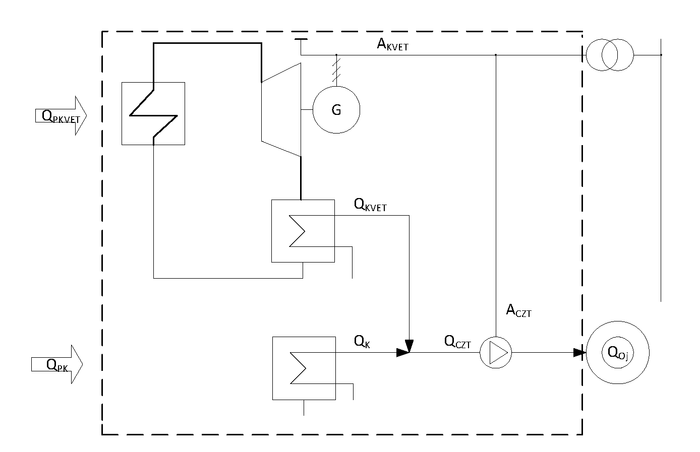

Príloha č. 2 k vyhláške č. 308/2016 Z. z.

- VZOR Bilančný okruh 

  - QPKVET – množstvo energie pre kombinovanú výrobu vypočítané ako súčin množstva paliva a výhrevnosti paliva, vyjadrené v MWh; množstvo energie spotrebovanej na výrobu elektriny v kondenzačnom režime sa do bilancie nezapočítava,

  - QPK – množstvo energie do kotla vypočítané ako súčin množstva paliva a výhrevnosti paliva, vyjadrené v MWh,

  - QKVET – množstvo tepla vyrobené kombinovanou výrobou, merané na výstupe zo zariadenia na kombinovanú výrobu, vyjadrené v MWh,

  - QK – množstvo tepla vyrobené kotlom, merané na výstupe z kotla, vyjadrené v MWh,

  - QCZT – množstvo tepla dodávané do rozvodov systému centralizovaného zásobovania teplom, vyjadrené v MWh,

  - QOj – množstvo tepla dodávané z rozvodov systému centralizovaného zásobovania teplom, vyjadrené v MWh,

  - AKVET – množstvo elektriny vyrobené kombinovanou výrobou, vypočítané podľa osobitného predpisu,1) vyjadrené v MWh,

  - ACZT – množstvo elektriny spotrebované na prevádzku zariadení centralizovaného zásobovania teplom, napríklad čerpadiel, vyjadrené v MWh.
