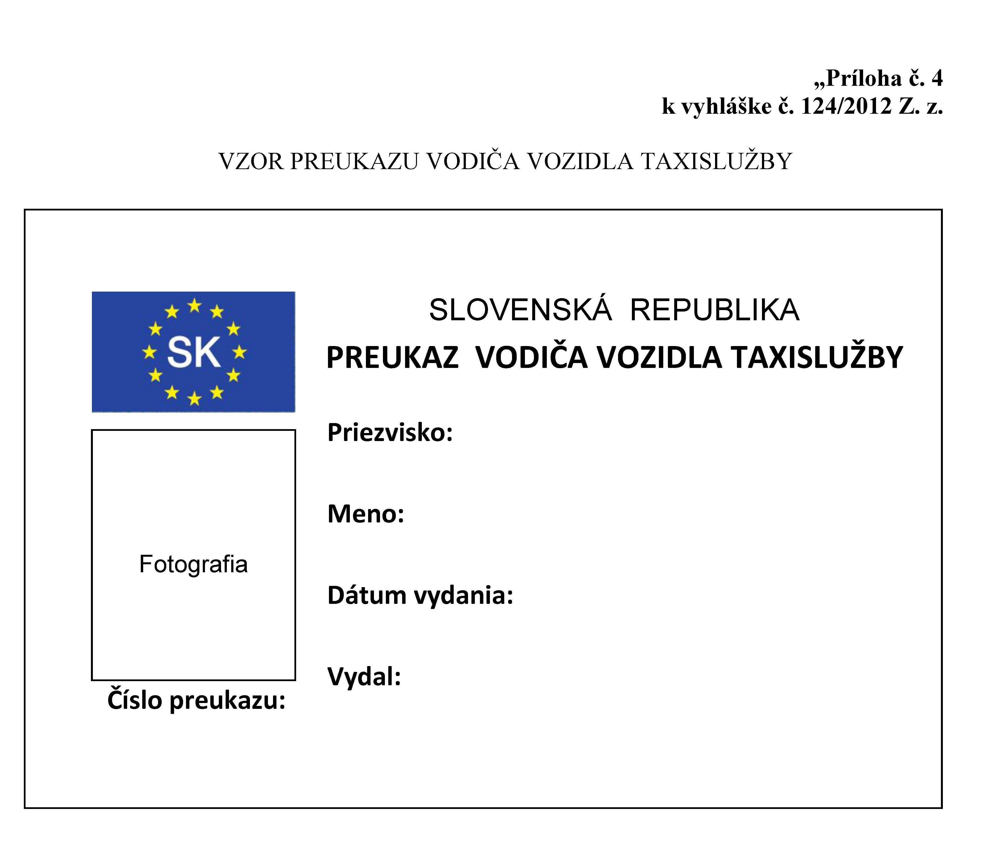
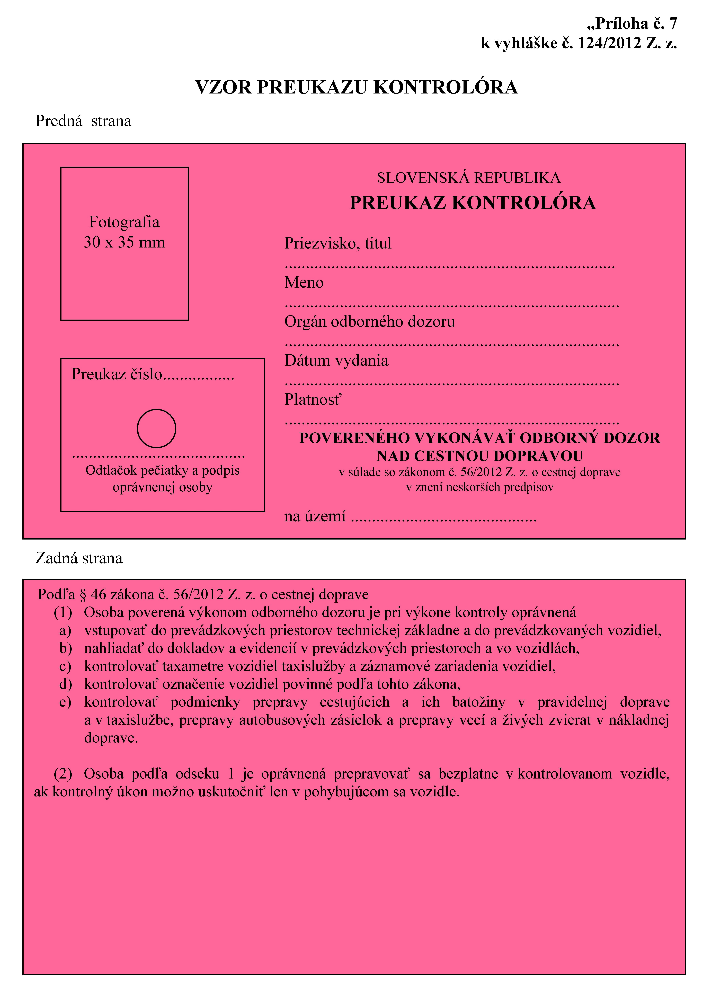
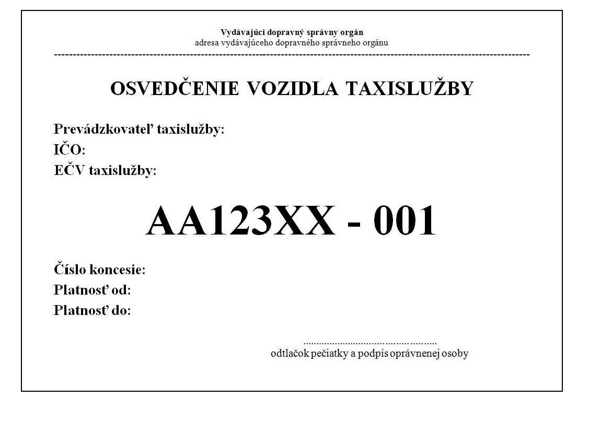

# Čl. I

Vyhláška Ministerstva dopravy, výstavby a regionálneho rozvoja Slovenskej republiky č. 124/2012 Z. z., ktorou sa vykonáva zákon č. 56/2012 Z. z. o cestnej doprave sa mení a dopĺňa takto:

- 1. V § 1 ods. 1 písm. c), § 4 vrátane nadpisu a nadpise prílohy č. 1 sa slová „odborná spôsobilosť v taxislužbe“ vo všetkých tvaroch nahrádzajú slovami „odborná spôsobilosť na vykonávanie taxislužby“ v príslušnom tvare.

- 2. V § 1 sa odsek 1 dopĺňa písmenami i) a j), ktoré znejú:

- „i)

- výročnej správe pri preprave nebezpečných vecí,

- j)

- podmienkach a rozsahu poverenia na výkon určitých činností podľa Európskej dohody o medzinárodnej cestnej preprave nebezpečných vecí (ďalej len „dohoda ADR“).“.

- 3. V § 1 sa odsek 2 dopĺňa písmenom d), ktoré znie:

- „d)

- vzor osvedčenia vozidla taxislužby.“.

- 4. V § 3 ods. 1 a § 8 ods. 1 sa slová „krajského úradu pre cestnú dopravu a pozemné komunikácie, obvodného úradu pre cestnú dopravu a pozemné komunikácie“ nahrádzajú slovami „okresného úradu v sídle kraja“.

- 5. V § 3 ods. 11 sa na začiatok vkladá nová prvá veta, ktorá znie:

- „Na ústnej skúške sa môže uchádzač zúčastniť, ak dosiahol z písomnej skúšky viac ako 50 % a menej ako 60 % z celkového počtu bodov.“.

- 6. V § 3 odsek 12 znie:

- „(12)

- Na hodnotenie stupňom „prospel“ je potrebné získať najmenej 60 % z celkového počtu bodov; uchádzač, ktorý získal už z písomnej skúšky najmenej 60 % z celkového počtu bodov, je hodnotený stupňom „prospel“ bez absolvovania ústnej skúšky. Opakovaná skúška je v celom rozsahu novou skúškou.“.

- 7. V § 4 ods. 1 sa za číslicu „7“ vkladá čiarka a slová „ods. 11 prvej vety a ods. 12“.

- 8. V § 4 ods. 2 sa slová „odbornej spôsobilosti potrebnej na výkon prevádzkovateľa cestnej dopravy v taxislužbe“ nahrádzajú slovami „odbornej spôsobilosti na vykonávanie taxislužby“.

- 9. V § 4 sa vypúšťa odsek 6.

- 10. V § 7 sa za odsek 1 vkladá nový odsek 2, ktorý znie:

- „(2)

- Cestovný poriadok obsahuje výlučne zastávky a spoje, ktoré dopravca začne obsluhovať do 30 dní odo dňa právoplatnosti rozhodnutia o udelení dopravnej licencie; to neplatí, ak ide o zmenu cestovného poriadku.“.

  - Doterajšie odseky 2 až 6 sa označujú ako odseky 3 až 7.

- 11. V § 7 odsek 3 znie:

- „(3)

- Číslo autobusovej linky sa určí v dopravnej licencii podľa jednotného celoštátneho číselníka Ministerstva dopravy, výstavby a regionálneho rozvoja Slovenskej republiky. Obsahuje v číselnom vyjadrení miesto východiskovej zastávky podľa správneho usporiadania Slovenskej republiky a poradové číslo autobusovej linky, v integrovanom dopravnom systéme poradové číslo integrovaného dopravného systému v príslušnom kraji a číslo linky v integrovanom dopravnom systéme. V mestskej autobusovej doprave číslo autobusovej linky vyjadruje jej poradové číslo v obci alebo číslo linky v integrovanom dopravnom systéme, a ak je v obci aj dráhová doprava, odlíšenie od čísel dráhových liniek.“.

- 12. V § 8 ods. 4 sa slová „osvedčenia o odbornej spôsobilosti“ nahrádzajú slovom „preukazu“.

- 13. V § 8 ods. 6 sa vypúšťa prvá veta a v druhej vete sa slová „o preukaz vodiča vozidla taxislužby“ nahrádzajú slovami „na získanie odbornej spôsobilosti vodiča vozidla taxislužby“.

- 14. V § 8 ods. 9 písm. a) sa slová „krajského úradu pre cestnú dopravu a pozemné komunikácie“ nahrádzajú slovami „okresného úradu v sídle kraja“.

- 15. V § 8 ods. 9 písm. j) sa slová „krajského úradu dopravy“ nahrádzajú slovami „okresného úradu v sídle kraja“.

- 16. V § 8 ods. 10 sa vypúšťa posledná veta.

- 17. V § 10 ods. 1 sa slová „Európskej dohody o medzinárodnej cestnej preprave nebezpečných vecí3) (ďalej len „dohoda ADR“)“ nahrádzajú slovami „dohody ADR“.

- 18. Poznámka pod čiarou k odkazu 3 sa vypúšťa.

- 19. Za § 11 sa vkladajú § 11a a 11b, ktoré vrátane nadpisov znejú:

- 㤠11a

- Výročná správa pri preprave nebezpečných vecí

- (1)

- Výročnú správu pri preprave nebezpečných vecí vypracováva bezpečnostný poradca podľa § 36 ods. 1 zákona. Vzor výročnej správy pri preprave nebezpečných vecí je uvedený v prílohe č. 6a.

- (2)

- Vypracovanie výročnej správy sa nevzťahuje na prepravu nebezpečných vecí alebo na balenie, nakládku, plnenie alebo vykládku súvisiacu s takouto prepravou, pri ktorej nevzniká povinnosť označovať dopravnú jednotku oranžovými tabuľami podľa dohody ADR.

- § 11b

- Podmienky poverenia na výkon určitých činností podľa dohody ADR

- (1)

- Prílohou písomnej žiadosti o poverenie podľa § 41 ods. 1 písm. v) zákona na výkon skúšok, prehliadok a kontrol zadržiavacích prostriedkov podľa časti 6 kapitoly 6.8 a kapitoly 6.10 dohody ADR na prepravu nebezpečných vecí iných ako triedy 7 a prepravovateľných tlakových zariadení sú:

- a)

- výpis z obchodného registra nie starší ako tri mesiace,

- b)

- doklad o organizačnej štruktúre žiadateľa a o zamestnávaní inšpektorov v trvalom pracovnom pomere, ktorí budú vykonávať inšpekčnú činnosť podľa časti 6 kapitoly 6.8 dohody ADR,

- c)

- doklady preukazujúce odbornú spôsobilosť inšpektorov podľa písmena b) a bezpečnostných poradcov,

- d)

- doklady o technickom a prístrojovom vybavení potrebnom na výkon požadovaných činností,

- e)

- preukázanie prístupu k technickým normám potrebným na výkon požadovaných činností,

- f)

- doklady preukazujúce poistenie na výkon požadovaných činností,

- g)

- vypracovaná dokumentácia s uvedením pracovných postupov,

- h)

- popis s uvedením spôsobu informovania Ministerstva dopravy, výstavby a regionálneho rozvoja Slovenskej republiky o výkone požadovaných činností.

- (2)

- V žiadosti podľa odseku 1 sa uvedie aj rozsah zariadení podľa dohody ADR, na ktoré sa poverenie žiada.“.

- 20. Za § 12 sa vkladá § 12a, ktorý vrátane nadpisu znie:

- 㤠12a

- Vzor osvedčenia vozidla taxislužby

- (1)

- Vzor osvedčenia vozidla taxislužby je uvedený v prílohe č. 7a.

- (2)

- Osvedčenie vozidla taxislužby je doklad bielej farby formátu A5 vyhotovený z papierovej buničiny s hmotnosťou minimálne 100 g/m2, ktorý môže byť zaliaty do plastovej fólie. Je vyrobený s ochranou proti falšovaniu použitím aspoň dvoch z nasledujúcich techník: hologram, špeciálne vlákna v papieri, ktoré sú viditeľné na ultrafialovom svetle, vodotlač alebo číslovanie dokladu.

- (3)

- Na prednej strane osvedčenia vozidla taxislužby v strede hornej časti je uvedený názov a adresa vydávajúceho orgánu a pod názvom vydávajúceho orgánu je veľkými písmenami uvedený nadpis v čiernej farbe „OSVEDČENIE VOZIDLA TAXISLUŽBY“, pod ktorým sú vyznačené riadky na uvedenie týchto údajov: prevádzkovateľ taxislužby, IČO, evidenčné číslo vozidla taxislužby, číslo koncesie a platnosť osvedčenia vozidla taxislužby. V pravej dolnej časti je odtlačok pečiatky a podpis oprávnenej osoby.

- (4)

- Osvedčenie vozidla taxislužby sa umiestňuje vo vnútri vozidla na viditeľnom mieste v blízkosti čelného skla; ak to nie je možné, osvedčenie vozidla taxislužby sa umiestňuje na inom vhodnom viditeľnom mieste vo vozidle tak, aby neobmedzovalo vodiča vo výhľade.“.

- 21. Za § 13 sa vkladá § 13a, ktorý vrátane nadpisu znie:

- 㤠13a

- Prechodné ustanovenia k úpravám účinným od 1. januára 2016

- (1)

- Preukazy vodiča vozidla taxislužby a preukazy kontrolóra vydané podľa predpisov účinných do 31. decembra 2015 zostávajú v platnosti.

- (2)

- Poverenia na výkon určitých činností podľa dohody ADR vydané do 31. decembra 2015 zostávajú v platnosti do času, ktorý je vyznačený v poverení, najneskôr do 31. decembra 2017.“.

- 22. Prílohy č. 4 a 5 vrátane nadpisov znejú:

- 

- 

- 23. Za prílohu č. 6 sa vkladá príloha č. 6a, ktorá vrátane nadpisu znie:

- 

- „[príloha](assets/d6e4d0a8a8961a3ac9562fc569c6fc27d2a4ac4b4e2ce14f9ef588f18217ad93.pdf)“.

- 24. Príloha č. 7 vrátane nadpisu znie:

- 

- 25. Za prílohu č. 7 sa vkladá príloha č. 7a, ktorá vrátane nadpisu znie:

- „Príloha č. 7a k vyhláške č. 124/2012 Z. z.

- VZOR OSVEDČENIA VOZIDLA TAXISLUŽBY“.

- 
