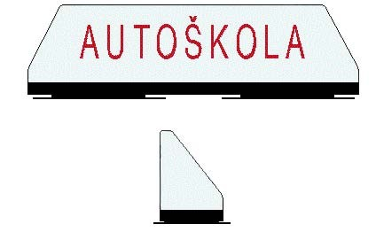
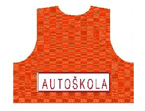

Príloha č. 1 k vyhláške č. 45/2016 Z. z.

- Požiadavky na označovanie výcvikových vozidiel

  - A. Vzory označovania výcvikových vozidiel

  - Odnímateľný transparent určený ma označenie výcvikových vozidiel

  - 

  - Vesta určená na označenie osôb pri výcviku v praktickej jazde v cestnej premávke na výcvikových motocykloch

  - 

  - Reflexná fólia určená na označenie výcvikových vozidiel

  - 

  - B. Umiestnenie označenia výcvikových vozidiel

    - Umiestnenie označenia podľa druhu výcvikových vozidiel musí spĺňať tieto požiadavky pre skupiny vodičských oprávnení:

    - a) B1 alebo B musí byť označené schváleným odnímateľným transparentom umiestneným priamo na streche v strede zadnej časti karosérie výcvikového vozidla; môže byť označené aj schválenou reflexnou fóliou s rozmermi 380 mm × 110 mm v tolerancii ±10 mm umiestnenou viditeľne na prednej časti a na zadnej časti výcvikového vozidla; odnímateľný transparent musí byť za zníženej viditeľnosti presvetlený,

    - b) BE výcvikové vozidlo podľa skupiny B a výcvikové prípojné vozidlo skupiny E musí byť označené reflexnou fóliou s rozmermi 380 mm × 110 mm v tolerancii ±10 mm alebo s rozmermi 800 mm × 231 mm v tolerancii ±10 mm umiestnenou viditeľne v strede zadnej časti výcvikového prípojného vozidla,

    - c) C1 alebo C musí byť označené reflexnou fóliou s rozmermi 800 mm × 231 mm v tolerancii ±10 mm umiestnenou viditeľne v strede na zadnej časti výcvikového vozidla a reflexnou fóliou s rozmermi 380 mm × 110 mm v tolerancii ±10 mm umiestnenou na prednej časti výcvikového vozidla; odnímateľný transparent musí byť za zníženej viditeľnosti presvetlený,

    - d) C1E alebo CE výcvikové vozidlo podľa skupiny C alebo C1 a výcvikové prípojné vozidlo skupiny E musí byť označené reflexnou fóliou s rozmermi 800 mm × 231 mm v tolerancii ±10 mm umiestnenou viditeľne v strede zadnej časti výcvikového vozidla,

    - e) D1 alebo D musí byť označené reflexnou fóliou s rozmermi 380 mm × 110 mm v tolerancii ±10 mm alebo s rozmermi 800 mm × 231 mm v tolerancii ±10 mm umiestnenou na prednej časti výcvikového vozidla a reflexnou fóliou s rozmermi 800 mm × 231 mm v tolerancii ±10 mm umiestnenou viditeľne v strede na zadnej časti výcvikového vozidla; odnímateľný transparent musí byť za zníženej viditeľnosti presvetlený,

    - f) D1E alebo DE výcvikové vozidlo podľa skupiny D alebo D1 a výcvikové prípojné vozidlo skupiny E musia byť označené reflexnou fóliou s rozmermi 800 mm × 231 mm v tolerancii ±10 mm umiestnenou viditeľne v strede na zadnej časti výcvikového prípojného vozidla,

    - g) T musí byť označené odnímateľným transparentom v strede na streche kabíny výcvikového vozidla a prípojné vozidlo musí byť označené reflexnou fóliou s rozmermi 800 mm × 231 mm v tolerancii ±10 mm umiestnenou viditeľne v strede na zadnej časti prípojného vozidla; odnímateľný transparent musí byť za zníženej viditeľnosti presvetlený.

  - C. Technické požiadavky odnímateľného transparentu, reflexnej fólie a vesty

    - (1) Odnímateľný transparent musí spĺňať tieto technické požiadavky:

      - a) základné rozmery - dĺžka 440 mm, šírka v základni 125 mm, výška 165 mm; v tolerancii ±10 mm,

      - b) kryt s nápisom môže byť vylisovaný z bieleho priesvitného plastu (ďalej len „plast“), nápis sa vyhotovuje obojstranne sieťotlačou na samolepiacu priesvitnú fóliu, pričom vrchný kryt môže byť na základňu pripevnený samoreznými skrutkami,

      - c) základňa musí byť vylisovaná z plastu alebo z iného vhodného materiálu čiernej farby a na základňu musí byť vhodným spôsobom pripevnený magnetický nosič a strešný diel,

      - d) rampa musí byť vylisovaná z plastu alebo z iného vhodného materiálu čiernej farby, pričom na rampu musia byť prichytené nosiče žiaroviek a rampa v spojení so základňou musí vytvárať aretačný okraj pre kryt,

      - e) presvetlenie musí byť zabezpečené napájacím napätím vozidla, pričom vyhotovenie elektrickej inštalácie odnímateľného transparentu musí umožňovať jednoduché odpojenie od elektrického zdroja,

      - f) z prednej strany nápis „AUTOŠKOLA” musí byť červenej farby Pantone 186 C s dĺžkou nápisu v základni 316 mm a dĺžkou nápisu v hornej časti 293 mm, pričom písmo musí byť typu Futura s výškou 64 mm; v tolerancii ±10 mm,

      - g) odnímateľný transparent musí mať z hľadiska priľnavosti so strechou vozidla také vlastnosti, aby jazdou vozidla nebola ohrozená bezpečnosť cestnej premávky.

    - (2) Reflexná fólia musí spĺňať tieto technické požiadavky:

      - (2a) Reflexná fólia veľká, formát 800 × 231 mm, v tolerancii ±10 mm:

        - 1. materiál: reflexná fólia a samolepiaca reflexná fólia Fasson bielej farby,

        - 2. písmo: typ Futura červenej farby Pantone 186 C s výškou písmen 140 mm v tolerancii ±10 mm,

        - 3. formát zarámovanej plochy vrátane rámika s dĺžkou 778 mm, výškou 209 mm v tolerancii ±10 mm a šírkou rámika 4 mm a vzdialenosťou rámika od okraja 11 mm,

        - 4. dĺžka nápisu v základni 702 mm a v hornej časti 650 mm v tolerancii ±10 mm.

      - (2b) Reflexná fólia malá, formát 380 × 110 mm, v tolerancii ±10 mm:

        - 1. materiál: reflexná fólia a samolepiaca reflexná fólia Fasson bielej farby,

        - 2. písmo: typ Futura červenej farby Pantone 186 C s výškou písmen 67 mm v tolerancii ±5 mm,

        - 3. formát zarámovanej plochy vrátane rámika s dĺžkou 370, výškou 100 mm v tolerancii ±10 mm a šírkou rámika 2 mm a vzdialenosťou rámika od okraja 5 mm,

        - 4. dĺžka nápisu v základni 340 mm a v hornej časti 320 mm v tolerancii ±10 mm.

    - (3) Vesta určená na označenie osôb pri výcviku praktickej jazdy v cestnej premávke na výcvikových motocykloch a reflexný nápis musia spĺňať tieto technické požiadavky:

      - a) materiál nápisu musí byť z reflexnej fólie Fasson bielej farby alebo z retroreflexného materiálu s dĺžkou nápisu v základni 335 mm a v hornej časti 310 mm v tolerancii ±10 mm,

      - b) písmo musí byť typu Futura červenej farby Pantone 186 C a výška písmen 67 mm v tolerancii ± 5 mm,

      - c) rozmery nápisu musia byť vo formáte 380 × 110 mm v tolerancii ±10 mm so zarámovanou plochou vrátane rámika s dĺžkou 370 mm a výškou 100 mm v tolerancii ±10 mm, pričom šírka rámika musí byť 2 mm a vzdialenosť rámika od okraja formátu 5 mm.
