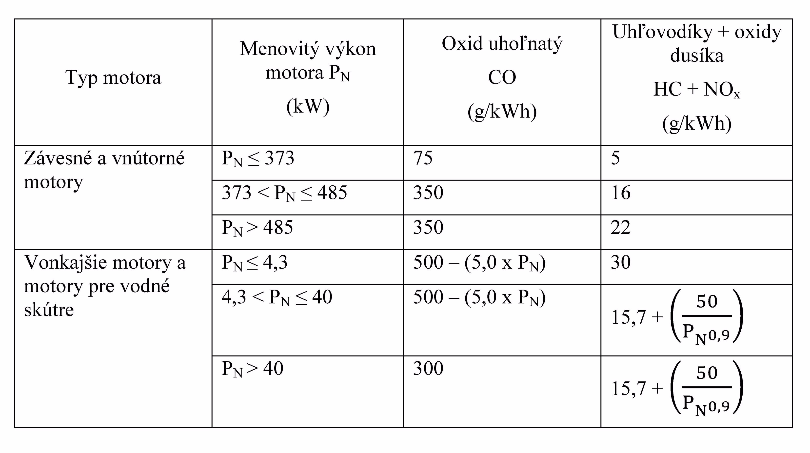
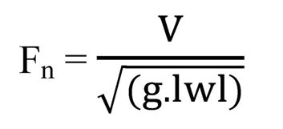

Príloha č. 1 k nariadeniu vlády č. 77/2016 Z. z.

- ZÁKLADNÉ POŽIADAVKY

  - A. Základné požiadavky na návrh a konštrukciu určených výrobkov uvedených v § 1 ods. 2

  - 1. KATEGÓRIE NÁVRHU PLAVIDIEL

  - Kategória návrhu | Sila vetra (stupeň Beaufortovej stupnice) | Prevládajúca výška vĺn (H 1∕3, meter)

  - A | viac ako 8 | viac ako 4

  - B | do 8 vrátane | do 4 vrátane

  - C | do 6 vrátane | do 2 vrátane

  - D | do 4 vrátane | do 0,3 vrátane

    - Vysvetlivky:

    - A. Rekreačné plavidlo zaradené do kategórie návrhu A sa považuje za plavidlo navrhnuté na zvládnutie vetra, ktorého sila môže presiahnuť hodnotu 8 stupňov B (Beaufortovej stupnice), a vĺn, ktorých prevládajúca výška môže presiahnuť 4 m, okrem extrémnych podmienok, ako napríklad búrka, silná búrka, hurikán, tornádo a extrémne podmienky na mori alebo mimoriadne vlny.

    - B. Rekreačné plavidlo zaradené do kategórie návrhu B sa považuje za plavidlo navrhnuté na zvládnutie vetra, ktorého sila dosahuje hodnotu 8 stupňov B a menej, a vĺn, ktorých prevládajúca výška dosahuje 4 m a menej.

    - C. Plavidlo zaradené do kategórie návrhu C sa považuje za plavidlo navrhnuté na zvládnutie vetra, ktorého sila dosahuje hodnotu 6 stupňov B a menej, a vĺn, ktorých prevládajúca výška dosahuje 2 m a menej.

    - D. Plavidlo zaradené do kategórie návrhu D sa považuje za plavidlo navrhnuté na zvládnutie vetra, ktorého sila dosahuje hodnotu 4 stupňov B a menej, a vĺn, ktorých prevládajúca výška dosahuje 0,3 m a menej s občasnými vlnami s maximálnou výškou 0,5 m.

    - lavidlo v každej kategórii návrhu musí byť navrhnuté a konštruované tak, aby si zachovalo parametre z hľadiska stability, plávateľnosti a iných relevantných základných požiadaviek uvedených v tejto prílohe, a aby malo dobrú ovládateľnosť.

  - 2. VŠEOBECNÉ POŽIADAVKY

    - a) Identifikácia plavidla

      - Každé plavidlo je označené identifikačným číslom obsahujúcim tieto informácie:

        - 1. kód krajiny výrobcu,

        - 2. jedinečný kód výrobcu,

        - 3. jedinečné sériové číslo,

        - 4. mesiac a rok výroby,

        - 5. rok, v ktorom bol model vytvorený.

      - Podrobné požiadavky na identifikačné číslo sú ustanovené v príslušnej harmonizovanej technickej norme.

    - b) Štítok výrobcu plavidla

      - Na každé plavidlo sa natrvalo pripevní štítok, ktorý sa umiestni oddelene od identifikačného čísla plavidla, na ktorom sú uvedené najmenej tieto informácie:

        - 1. obchodné meno výrobcu alebo registrovaná ochranná známka, ako aj kontaktná adresa,

        - 2. označenie CE podľa § 13,

        - 3. kategória návrhu plavidla,

        - 4. výrobcom odporučené maximálne zaťaženie bez hmotnosti obsahu pevných nádrží, keď sú naplnené,

        - 5. počet osôb odporučený výrobcom, na ktorých prepravu bolo plavidlo navrhnuté.

      - Pri posúdení po konštrukcii obsahuje štítok kontaktné údaje a požiadavky podľa prvého bodu a údaje o notifikovanej osobe, ktorá vykonala posúdenie zhody.

    - c) Ochrana pred pádom cez palubu a prostriedky na opätovné nalodenie

      - Plavidlá sú navrhnuté tak, aby sa minimalizovalo riziko pádu osoby cez palubu a uľahčil návrat na palubu. Prostriedky na opätovné nalodenie musia byť prístupné alebo osoba vo vode má mať možnosť ich bez pomoci použiť.

    - d) Viditeľnosť z hlavného kormidlového miesta

      - Hlavné kormidlové miesto (kokpit) rekreačných plavidiel umožňuje kormidelníkovi za normálnych podmienok používania (rýchlosť a zaťaženie) dobrú viditeľnosť na všetky strany.

    - e) Návod na použitie

      - Každý výrobok je vybavený návodom na použitie. Uvedený návod poskytuje všetky informácie potrebné na bezpečné používanie výrobku a upozorňuje najmä na nastavenie, údržbu, správnu prevádzku, prevenciu rizík a riadenie rizík.

  - 3. CELISTVOSŤ A KONŠTRUKČNÉ POŽIADAVKY

    - a) Konštrukcia

      - Výber a kombinácia materiálov a konštrukcia majú zabezpečiť dostatočnú pevnosť plavidla. Osobitná pozornosť sa musí venovať kategórii návrhu podľa prvého bodu a maximálnemu zaťaženiu odporučenému výrobcom podľa písmena f).

    - b) Stabilita a voľný bok

      - Plavidlo má dostatočnú stabilitu a voľný bok vzhľadom na svoju kategóriu návrhu podľa prvého bodu a na maximálne zaťaženie odporúčané výrobcom podľa písmena f).

    - c) Plávateľnosť a nadnášanie

      - Plavidlo je konštruované tak, aby sa zabezpečilo, že vlastnosti plávateľnosti zodpovedajú kategórii návrhu podľa prvého bodu a maximálnemu zaťaženiu odporučenému výrobcom podľa písmena f). Všetky obývateľné viactrupové rekreačné plavidlá, ktoré sa môžu prevrátiť, majú dostatočnú plávateľnosť na to, aby sa nadnášali aj v prevrátenej polohe.

      - Plavidlá kratšie ako 6 m, ktoré sú náchylné na zaplavenie, keď sa používajú vo svojej kategórii návrhu, sú vybavené primeranými prostriedkami na nadnášanie v takýchto podmienkach.

    - d) Otvory v trupe, palube a nadstavbe

      - Otvory v trupe, palube a nadstavbe nenarúšajú konštrukčnú celistvosť plavidla ani jeho odolnosť voči poveternostným podmienkam, keď sú uzavreté.

      - Okná, bočné okná, dvere a poklopy na otvoroch odolávajú tlaku vody, ktorému budú pravdepodobne vystavené vo svojej typickej polohe, ako aj bodovej záťaži spôsobenej hmotnosťou osôb pohybujúcich sa po palube.

      - Trupové priechodky, ktoré umožňujú vpúšťať vodu do trupu a vypúšťať ju z neho, umiestnené pod čiarou ponoru plavidla zodpovedajúceho maximálnemu zaťaženiu odporučenému výrobcom podľa písmena f), sú vybavené ľahko prístupnými uzávermi.

    - e) Zaplavenie

      - Všetky plavidlá sú navrhnuté tak, aby sa minimalizovalo riziko potopenia.

      - Osobitná pozornosť sa venuje

        - 1. hlavnému kormidlovému miestu (kokpitu) a šachtám, ktoré sú samoodvodňovacie alebo majú iné prostriedky na udržanie vody mimo vnútorných priestorov plavidla,

        - 2. vetracím zariadeniam,

        - 3. odvádzaniu vody čerpadlami alebo inými prostriedkami.

    - f) Maximálne zaťaženie odporučené výrobcom

      - Maximálne zaťaženie odporučené výrobcom [palivo, voda, zásoby, rôzne zariadenia a osoby (v kg)], pre ktoré bolo plavidlo navrhnuté, sa určí podľa kategórie návrhu uvedenej v prvom bode, stabilitou a voľným bokom podľa písmena b) a plávateľnosťou a nadnášaním podľa písmena c).

    - g) Uloženie záchranného člna

      - Všetky rekreačné plavidlá kategórií návrhu A a B uvedené v prvom bode a rekreačné plavidlá kategórií návrhu C a D uvedené v prvom bode dlhšie ako šesť metrov sú vybavené jedným alebo viacerými úložnými miestami pre záchranné člny alebo nafukovacie záchranné ostrovčeky dostatočne veľké na to, aby uniesli výrobcom odporučený počet osôb, pre ktorý je dané rekreačné plavidlo navrhnuté. Tieto úložné miesta sú vždy ľahko prístupné.

    - h) Únik

      - Všetky obývateľné viactrupové rekreačné plavidlá, ktoré sa môžu prevrátiť, sú vybavené vhodnými únikovými prostriedkami použiteľnými pri prevrátení. Ak sú k dispozícii únikové prostriedky, ktoré možno použiť v prevrátenej polohe, tieto prostriedky nemajú nepriaznivý vplyv na konštrukciu plavidla uvedenú v písmene a), stabilitu plavidla uvedenú v písmene b) ani plávateľnosť plavidla uvedenú v písmene c) v bežnej ani prevrátenej polohe.

      - Všetky obývateľné rekreačné plavidlá sú vybavené vhodnými únikovými prostriedkami pri požiari.

    - i) Kotvenie, uväzovanie a vlečenie

      - Všetky plavidlá s prihliadnutím na ich kategóriu návrhu a vlastnosti sú vybavené jedným pevným bodom alebo viacerými pevnými bodmi, alebo inými prostriedkami, ktoré sú schopné bezpečne zniesť kotevné, uväzovacie alebo vlečné zaťaženie.

  - 4. OVLÁDATEĽNOSŤ

    - Výrobca zabezpečí, aby ovládateľnosť plavidla vyhovovala najvýkonnejšiemu hnaciemu motoru, pre ktorý je plavidlo navrhnuté a konštruované. Maximálny menovitý výkon motora je pre všetky hnacie motory uvedený v návode na použitie.

  - 5. POŽIADAVKY NA MONTÁŽ

    - a) Motory a motorové priestory

      - 1. Vnútorný motor

        - Všetky vnútorne zabudované motory sa umiestnia v uzavretom priestore oddelenom od obytných priestorov a montujú sa tak, aby sa minimalizovalo riziko požiaru alebo rozšírenia požiaru, ako aj nebezpečenstvo toxických výparov, tepla, hluku alebo vibrácií v obytných priestoroch.

        - Časti motora a jeho príslušenstvo, ktoré si vyžadujú časté kontroly alebo údržbu, sú ľahko prístupné.

        - Izolačné materiály vnútri motorových priestorov sú nehorľavé.

      - 2. Vetranie

        - Motorový priestor je vetraný. Musí sa minimalizovať možnosť vniknutia vody do motorového priestoru cez otvory.

      - 3. Nechránené časti

        - Ak nie je motor chránený krytom ani vlastným uzavretým priestorom, nechránené pohybujúce sa časti motora alebo zahriate časti motora, ktoré môžu spôsobiť zranenie osôb, sa účinne zakrývajú.

      - 4. Štartovanie vonkajšieho hnacieho motora

        - Každý vonkajší hnací motor namontovaný na akomkoľvek plavidle má zariadenie, ktoré bráni naštartovaniu motora v zábere okrem toho, ak

        - 4a. motor vyvinie menší statický ťah ako 500 newtonov (N) alebo

        - 4b. motor má škrtiace zariadenie obmedzujúce ťah na 500 newtonov (N) v čase štartovania motora.

      - 5. Vodné skútre pohybujúce sa bez vodiča

        - Vodné skútre sú navrhnuté buď s automatickým vypnutím hnacieho motora, alebo s automatickým zariadením, ktoré uvedie plavidlo do pomalého krúživého pohybu dopredu, keď z neho vodič úmyselne vystúpi alebo vypadne.

      - 6. Vonkajšie hnacie motory ovládané kormidlovou pákou sú vybavené zariadením núdzového zastavenia, ktoré môže byť spojené s osobou riadiacou plavidlo.

    - b) Palivový systém

      - 1. Všeobecne

        - Plniace, skladovacie, vetracie a prívodné palivové systémy a zariadenia sú navrhnuté a montované tak, aby sa minimalizovalo riziko požiaru a výbuchu.

      - 2. Palivové nádrže

        - Palivové nádrže, potrubia a hadice sú zabezpečené a oddelené od významnejšieho zdroja tepla alebo pred takýmto zdrojom chránené. Materiál nádrží a ich konštrukcia zodpovedajú ich objemu a druhu paliva.

        - Priestory, kde sa nachádzajú palivové nádrže na benzín, sú vetrané.

        - Palivové nádrže na benzín nie sú súčasťou trupu a sú

          - 2a. chránené proti požiaru z akéhokoľvek motora a zo všetkých ostatných zdrojov vznietenia;

          - 2b. oddelené od obytných priestorov.

        - Palivové nádrže na naftu môžu byť súčasťou trupu.

    - c) Elektrický systém

      - Elektrické systémy sú navrhnuté a montované tak, aby sa zabezpečila správna prevádzka plavidla za normálnych podmienok používania a aby sa minimalizovalo riziko požiaru a zasiahnutia elektrickým prúdom.

      - Všetky elektrické obvody okrem štartovacích obvodov motora napájaných z akumulátora zostávajú pri preťažení bezpečné.

      - Obvody elektrického pohonu nesmú byť v interakcii s inými obvodmi tak, že niektorý z nich by nefungoval podľa určenia.

      - Zabezpečí sa vetranie, aby sa zabránilo nahromadeniu výbušných plynov, ktoré sa môžu uvoľniť z akumulátorov. Akumulátory sú pevne uchytené a chránené pred vniknutím vody.

    - d) Kormidlový systém

      - 1. Všeobecne

        - Kormidlový systém a systém riadenia pohonu sú navrhnuté, konštruované a montované tak, aby umožňovali prenos kormidlových zaťažení za predvídateľných prevádzkových podmienok.

      - 2. Núdzové prostriedky

      - Všetky rekreačné plavidlá poháňané plachtami a plavidlá s jedným hnacím motorom s diaľkovo riadenými kormidlovými systémami s kormidlovou plutvou sú vybavené núdzovými prostriedkami ovládania rekreačného plavidla pri zníženej rýchlosti.

    - e) Plynový systém

      - Plynové systémy na domáce použitie sú vybavené odsávaním výparov a navrhnuté a montované tak, aby sa zabránilo úniku plynu a riziku výbuchu, pričom majú umožniť vykonať skúšku ich tesnosti. Materiály a komponenty zodpovedajú konkrétnemu používanému plynu a odolávajú tlakom a vplyvom morského prostredia.

      - Každý plynový spotrebič používaný na účely, na ktoré je podľa výrobcu určený, sa montuje podľa pokynov výrobcu. Každý plynový spotrebič musí byť zásobovaný samostatnou vetvou rozvodného systému a každý spotrebič musí byť ovládaný samostatným uzavieracím zariadením. Musí sa zabezpečiť primerané vetranie, aby sa zabránilo nebezpečenstvu vyplývajúcemu z únikov plynu a splodín horenia.

      - Všetky plavidlá s trvalo montovaným plynovým systémom sú vybavené uzavretým priestorom na všetky plynové fľaše. Tento uzavretý priestor je oddelený od obytných priestorov, prístupný len zvonku a vetraný smerom von tak, že akýkoľvek unikajúci plyn bude prúdiť cez palubu.

      - Každý trvalo montovaný plynový systém sa po montáži skúša.

    - f) Protipožiarna ochrana

      - 1. Všeobecne

        - Pri type montovaného zariadenia a usporiadaní plavidla sa zohľadňuje riziko vzniku a rozšírenia požiaru. Osobitná pozornosť sa venuje okoliu zariadení s otvoreným plameňom, horúcim plochám alebo motorom a pomocným strojom, preliatiu oleja alebo paliva, nekrytým olejovým a palivovým potrubiam a smerovaniu elektrického vedenia, najmä aby sa montovalo mimo zdrojov tepla a horúcich plôch.

      - 2. Protipožiarne zariadenie

        - Rekreačné plavidlo je vybavené protipožiarnym zariadením primeraným nebezpečenstvu požiaru alebo sa označí umiestnenie a kapacita protipožiarneho zariadenia zodpovedajúceho nebezpečenstvu požiaru. Plavidlo sa neuvedie do prevádzky, kým nie je vybavené zodpovedajúcim protipožiarnym zariadením. Priestory zážihového motora sú chránené hasiacim systémom, vďaka ktorému nie je potrebné tento priestor pri požiari otvoriť. Keď je plavidlo vybavené prenosnými hasiacimi prístrojmi, tieto prístroje sú ľahko prístupné a jeden z nich je umiestnený tak, aby bol ľahko dosiahnuteľný z hlavného kormidlového miesta rekreačného plavidla.

    - g) Navigačné svetlá, znaky a zvukové signály

      - Keď je plavidlo vybavené navigačnými svetlami, znakmi a zvukovými signálmi, musia byť podľa dohovoru COLREG 1972 34) alebo Poriadku plavebnej bezpečnosti podľa osobitného predpisu.35)

    - h) Predchádzanie úniku znečisťujúcich látok a zariadenia na uľahčenie dovezenia odpadu na breh

      - Plavidlo je konštruované tak, aby sa zabránilo náhodnému úniku znečisťujúcich látok (oleja, paliva atď.) cez palubu.

      - Každá toaleta montovaná na rekreačnom plavidle je napojená na zberný systém alebo na systém úpravy vody.

      - Rekreačné plavidlá so zabudovanými zbernými nádržami sú vybavené štandardnou odpadovou prípojkou, ktorá umožní spojenie zberných zariadení s odpadovým potrubím rekreačného plavidla.

      - Okrem toho každé potrubie vedúce cez trup plavidla určené na ľudský odpad je vybavené ventilmi, ktoré sa dajú zaistiť v uzavretej polohe.

  - B. Základné požiadavky na výfukové emisie z hnacích motorov

    - Hnacie motory spĺňajú základné požiadavky na výfukové emisie ustanovené v tejto časti.

  - 1. IDENTIFIKÁCIA HNACIEHO MOTORA

    - a) Každý motor je zreteľne označený týmito údajmi:

      - 1. obchodné meno výrobcu motora alebo registrovaná ochranná známka a kontaktná adresa, ak je to potrebné, aj obchodné meno a kontaktná adresa osoby upravujúcej motor,

      - 2. typ motora alebo rodina motorov,

      - 3. jedinečné sériové číslo motora,

      - 4. označenie CE podľa § 13.

    - b) Označenia uvedené v písmene a) musia pretrvávať počas normálnej životnosti motora a musia byť zreteľne čitateľné a nezmazateľné. Ak sa použijú nálepky alebo štítky, musia byť pripevnené tak, aby bolo ich pripevnenie trvalé počas normálnej životnosti motora a aby sa tieto nálepky alebo štítky nedali odstrániť bez ich zničenia alebo poškodenia.

    - c) Označenia musia byť pripevnené na časť motora, ktorá je potrebná na normálnu prevádzku motora a ktorá si za normálnych okolností nevyžaduje počas životnosti motora výmenu.

    - d) Tieto označenia musia byť pripevnené tak, aby boli ľahko viditeľné po namontovaní všetkých komponentov motora potrebných na jeho prevádzku.

  - 2. POŽIADAVKY NA VÝFUKOVÉ EMISIE

    - Hnacie motory sú navrhnuté, konštruované a zmontované tak, aby po správnej montáži a pri normálnom používaní emisie nepresiahli limity uvedené v písmene a) tabuľke č. 1 a v písmene b) tabuľkách č. 2 a 3.

    - a) Hodnoty platné na účely § 21 ods. 2 a písmena b) tabuľky č. 2:

      - Tabuľka č. 1

    - Typ motora | Oxid uhoľnatý CO = A + B/PNn (g/kWh) | | | Uhľovodíky HC = A + B/ PNn (g/kWh) | | | Oxidy dusíka NOx (g/kWh) | Pevné častice PT

    - | A | B | n | A | B | n | |

    - Dvojtaktný zážihový | 150,0 | 600,0 | 1,0 | 30,0 | 100,0 | 0,75 | 10,0 | neuplatňuje sa

    - Štvortaktný zážihový | 150,0 | 600,0 | 1,0 | 6,0 | 50,0 | 0,75 | 15,0 | neuplatňuje sa

    - Vznetový | 5,0 | 0 | 0 | 1,5 | 2,0 | 0,5 | 9,8 | 1,0

      - Vysvetlivky:

      - A, B a n sú konštanty, ktorých hodnoty sú uvedené v tabuľke č. 1,

      - PN je menovitý výkon motora v kW.

    - b) Hodnoty platné odo dňa účinnosti tohto nariadenia:

      - Tabuľka č. 2

      - Výfukové emisné limity pre vznetové (CI) motory

    - Zdvihový objem SV (L/cyl) | Menovitý výkon motora PN (kW) | Tuhé častice PT (g/kWh) | Uhľovodíky + oxidy dusíka HC + NOx (g/kWh)

    - SV < 0,9 | PN < 37 | Hodnoty uvedené v tabuľke č. 1 |

    - | 37 ≤ PN < 75 | 0,30 | 4,7

    - | 75 ≤ PN < 3700 | 0,15 | 5,8

    - 0,9 ≤ SV < 1,2 | PN < 3700 | 0,14 | 5,8

    - 1,2 ≤ SV < 2,5 | | 0,12 | 5,8

    - 2,5 ≤ SV < 3,5 | | 0,12 | 5,8

    - 3,5 ≤ SV < 7,0 | | 0,11 | 5,8

      - Vznetový motor neprekročí emisný limit oxidu uhoľnatého (CO) 5,0 g/kWh.

      - Vznetové motory s menovitým výkonom motora 37 kW a viac a nižším ako 75 kW a so zdvihovým objemom nižším ako 0,9 l/cyl neprekročia emisný limit PT 0,20 g/kWh a kombinovaný emisný limit HC + NOx 5,8 g/kWh.

      - Tabuľka č. 3

      - Výfukové emisné limity pre zážihové (SI) motory

    - 

    - c) Skúšobné cykly

      - Uplatňované skúšobné cykly a váhové faktory:

      - S ohľadom na hodnoty uvedené v tabuľke č. 4 sa použijú požiadavky podľa osobitného predpisu.36)

      - Pri vznetových motoroch s premenlivými otáčkami sa uplatňuje skúšobný cyklus E1 alebo E5, pričom pri výkone presahujúcom 130 kW možno uplatňovať aj skúšobný cyklus E3. Pri zážihových motoroch s premenlivými otáčkami sa uplatňuje skúšobný cyklus E4.

      - Tabuľka č. 4

    - Cyklus E1, číslo režimu | 1 | 2 | 3 | 4 | 5

    - Rýchlosť | menovitá | | stredná | | nízka – voľnobeh

    - Krútiaci moment (%) | 100 | 75 | 75 | 50 | 0

    - Váhový faktor | 0,08 | 0,11 | 0,19 | 0,32 | 0,3

    - Rýchlosť | menovitá | | stredná | | nízka – voľnobeh

    - Cyklus E3, číslo režimu | 1 | 2 | 3 | 4 |

    - Rýchlosť (%) | 100 | 91 | 80 | 63 |

    - Výkon (%) | 100 | 75 | 50 | 25 |

    - Váhový faktor | 0,2 | 0,5 | 0,15 | 0,15 |

    - Cyklus E4, číslo režimu | 1 | 2 | 3 | 4 | 5

    - Rýchlosť (%) | 100 | 80 | 60 | 40 | voľnobeh

    - Krútiaci moment (%) | 100 | 71,6 | 46,50 | 25,3 | 0

    - Váhový faktor | 0,06 | 0,14 | 0,15 | 0,25 | 0,40

    - Cyklus E5, číslo režimu | 1 | 2 | 3 | 4 | 5

    - Rýchlosť (%) | 100 | 91 | 80 | 63 | voľnobeh

    - Krútiaci moment (%) | 100 | 75 | 50 | 25 | 0

    - Váhový faktor | 0,08 | 0,13 | 0,17 | 0,32 | 0,3

      - Notifikované osoby môžu akceptovať aj skúšky vykonané na základe iných skúšobných cyklov, ktoré sa uvádzajú v harmonizovanej technickej norme a ktoré sa vzťahujú na daný činiteľ plnenia motora.

    - d) Použitie rodiny hnacích motorov a výber základného hnacieho motora

      - Výrobca motora zodpovedá za určenie tých motorov zo svojho sortimentu, ktoré sa majú zahrnúť do rodiny motorov.

      - Základný motor sa vyberie z rodiny motorov tak, aby jeho emisné vlastnosti boli reprezentatívne pre všetky motory v danej rodine motorov. Zvyčajne sa za základný motor rodiny vyberá motor, ktorý má také charakteristiky, na základe ktorých sa dosahujú najvyššie konkrétne emisie (v g/kWh) merané pri príslušnom skúšobnom cykle.

    - e) Skúšobné palivá

      - Skúšobné palivo používané na výfukové emisné skúšky má tieto vlastnosti:

      - Benzínové palivá

      - Tabuľka č. 5

    - Benzín | | | |

    - Vlastnosť | RF-02-99 bezolovnatý | | RF-02-03 bezolovnatý |

    - | min. | max. | min. | max.

    - Oktánové číslo určené výskumnou metódou (RON) | 95 | – | 95 | –

    - Oktánové číslo určené motorovou metódou (MON) | 85 | – | 85 | –

    - Hustota pri 15 °C (kg/m3) | 748 | 762 | 740 | 754

    - Počiatočný bod varu (°C) | 24 | 40 | 24 | 40

    - Hmotnostný podiel síry (mg/kg) | – | 100 | – | 10

    - Obsah olova (mg/l) | – | 5 | – | 5

    - Tlak pár podľa Reida (kPa) | 56 | 60 | – | –

    - Tlak pár (DVPE) (kPa) | – | – | 56 | 60

    - Nafta | | | |

    - Vlastnosť | RF-06-99 | | RF-06-03 |

    - | min. | max. | min. | max.

    - Cetánové číslo | 52 | 54 | 52 | 54

    - Hustota pri 15 °C (kg/m3) | 833 | 837 | 833 | 837

    - Konečný bod varu (°C) | – | 370 | – | 370

    - Bod vzplanutia (°C) | 55 | – | 55 | –

    - Hmotnostný podiel síry (mg/kg) | poskytne sa neskôr | 300 (50) | – | 10

    - Hmotnostný podiel popolčeka (%) | poskytne sa neskôr | 0,01 | – | 0,01

      - Notifikované osoby môžu akceptovať aj skúšky vykonané na základe iných skúšobných palív, ako sa uvádza v harmonizovanej technickej norme.

  - 3. TRVÁCNOSŤ

    - Výrobca motora dodá pokyny na montáž a údržbu motora, ktorými sa pri ich dodržiavaní zabezpečuje, že motor bude pri normálnom používaní spĺňať limity uvedené v druhom bode písm. a) a b) počas normálnej životnosti motora a za normálnych podmienok používania.

    - Tieto informácie získa výrobca motora prostredníctvom skúšky výdrže založenej na normálnych prevádzkových cykloch a prostredníctvom výpočtu únavy komponentov, na ich základe vypracuje potrebné pokyny na údržbu a priloží ich k všetkým novým motorom pri ich prvom uvedení na trh.

    - Normálna životnosť motora je takáto:

    - a) vznetové motory: 480 hodín prevádzky alebo desať rokov, podľa toho, čo nastane skôr,

    - b) zážihové vnútorné motory alebo závesné motory so zabudovaným výfukovým systémom alebo bez neho:

      - 1. motory v kategórii PN ≤ 373 kW: 480 hodín prevádzky alebo desať rokov, podľa toho, čo nastane skôr,

      - 2. motory v kategórii 373 < PN ≤ 485 kW: 150 hodín prevádzky alebo tri roky, podľa toho, čo nastane skôr,

      - 3. kategória motorov PN > 485 kW: 50 hodín prevádzky alebo jeden rok, podľa toho, čo nastane skôr,

    - c) motory pre vodné skútre: 350 hodín prevádzky alebo päť rokov, podľa toho, čo nastane skôr,

    - d) vonkajšie motory: 350 hodín prevádzky alebo desať rokov, podľa toho, čo nastane skôr.

  - 4. NÁVOD NA POUŽITIE

    - Ku každému motoru je priložený návod na použitie v štátnom jazyku.

    - V návode na použitie sa uvádzajú

    - a) pokyny na montáž, použitie a údržbu potrebné na zaručenie správneho fungovania motora podľa požiadaviek tretieho bodu (Trvácnosť),

    - b) údaje o výkone motora meranom podľa harmonizovanej technickej normy.

  - C. Základné požiadavky na emisie hluku

    - Rekreačné plavidlá s vnútorným motorom alebo so závesným motorom bez zabudovaného výfukového systému, vodné skútre a vonkajšie motory a závesné motory so zabudovaným výfukovým systémom musia spĺňať základné požiadavky na emisie hluku uvedené v tejto časti.

  - 1. ÚROVNE EMISIÍ HLUKU

    - a) Rekreačné plavidlá s vnútorným motorom alebo so závesným motorom bez zabudovaného výfukového systému, vodné skútre a vonkajšie motory a závesné motory so zabudovaným výfukovým systémom sú navrhnuté, konštruované a montované tak, aby ich emisie hluku nepresiahli limity uvedené v tabuľke č. 6.

      - Tabuľka č. 6

    - Menovitý výkon motor (jeden motor) (kW) | Maximálna hladina akustického tlaku = LpASmax (dB)

    - PN ≤ 10 | 67

    - 10 < PN ≤ 40 | 72

    - PN > 40 | 75

      - Vysvetlivky:

      - PN je menovitý výkon jediného motora v kW pri menovitých otáčkach a LpASmax je maximálna hladina akustického tlaku v dB.

      - Pri dvojmotorových a viacmotorových jednotkách všetkých typov motorov sa môže limit zvýšiť o 3 dB.

    - b) Alternatívou skúšok merania hluku je, že rekreačné plavidlo s vnútorným motorom alebo so závesným motorom bez zabudovaného výfukového systému sa považuje za plavidlo, ktoré spĺňa požiadavky na hluk uvedené v písmene a), ak je jeho Froudovo číslo ≤ 1,1 a pomer medzi výkonom a výtlakom ≤ 40 a ak je motor a výfukový systém namontovaný podľa špecifikácií výrobcu motora.

    - c) „Froudovo číslo“ Fn sa vypočíta vydelením maximálnej rýchlosti rekreačného plavidla V (m/s) druhou odmocninou dĺžky čiary ponoru lwl (m), vynásobenou danou konštantou gravitačnej akcelerácie, g = 9,8 m/s2.

    - 

      - Pomer medzi výkonom a výtlakom sa vypočíta ako podiel menovitého výkonu motora PN (v kW) a výtlaku rekreačného plavidla D (v tonách).

      - Pomer medzi výkonom a výtlakom =PN /D

  - 2. NÁVOD NA POUŽITIE

    - Pri rekreačných plavidlách s vnútorným motorom alebo so závesným motorom bez zabudovaného výfukového systému a pri vodných skútroch obsahuje návod na použitie požadovaný podľa časti A druhého bodu písm. e) informácie potrebné na udržanie rekreačného plavidla a výfukového systému v stave, ktorý, ak možno, zabezpečí pri normálnom používaní dodržanie ustanovených limitov hluku.

    - Pri vonkajších motoroch a závesných motoroch so zabudovaným výfukovým systémom návod na použitie požadovaný podľa časti B štvrtého bodu obsahuje pokyny potrebné na udržanie motora v stave, ktorý, ak možno, zabezpečí pri normálnom používaní dodržanie ustanovených limitov hluku.

  - 3. TRVÁCNOSŤ

    - Ustanovenia o trvácnosti v časti B treťom bode sa primerane uplatňujú na splnenie požiadaviek na emisie hluku ustanovených v prvom bode tejto časti.
