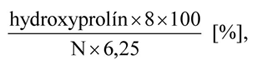

# § 2 Vymedzenie pojmov

Na účely tejto vyhlášky sa rozumie

- a) mäsovým dielom rozpracovaná náplň mäsového výrobku z mäsa a ostatných zložiek pred plnením do obalu,

- b) technologickým obalom obal, ktorý je v priamom styku s mäsovým výrobkom a v ktorom prebieha technologický proces výroby,

- c) prátom homogénne na jemno rozpracované teplé mäso po zabití jedného druhu jatočného zvieraťa po pridaní soliacich zmesí a vody určenej na ľudskú spotrebu (ďalej len „pitná voda“) alebo ľadu z pitnej vody,

- d) spojkou homogénny na jemno vypracovaný podiel mäsového diela v mäsovom výrobku pripravený z jedného druhu mäsa alebo viacerých druhov mäsa, pitnej vody a iných zložiek,

- e) vložkou krájaný alebo na hrubo zrnený podiel mäsového diela,

- f) mäkkým mäsovým výrobkom tepelne opracovaný mäsový výrobok vyrábaný zo spojky alebo prátu s mäsovou vložkou alebo nemäsovou vložkou alebo len z kúskov mäsa rôznej veľkosti jemne homogénnej až nehomogénnej štruktúry,

- g) párkom mäsový výrobok z jemne homogenizovaného mäsového diela alebo zo zrneného mäsového diela s veľkosťou častíc do 2 mm alebo spojky a vložky, spravidla plnený do technologického obalu s priemerom najviac 34 mm,

- h) klobásou mäsový výrobok z jemne homogenizovaného mäsového diela alebo zo zrneného mäsového diela alebo spojky a vložky plnený do technologického obalu s priemerom najviac 40 mm,

- i) salámou mäsový výrobok z mäsového diela, ktorý sa skladá z jemne homogenizovaného zrneného mäsového diela alebo zo spojky a vložky, plnený do technologického obalu,

- j) nátierkou pastovitý roztierateľný varený mäsový výrobok, do ktorého môže byť pridaná nemäsová vložka, alebo mäsová konzerva z jemne homogenizovaného mäsového diela, do ktorého môže byť pridaná nemäsová vložka,

- k) paštétou krájateľný varený mäsový výrobok, mäsová polokonzerva alebo mäsová konzerva,

- l) pečeným mäsom výrobok upečený z jedného kusa mäsa,

- m) pečeným mäsovým výrobkom výrobok tepelne opracovaný pečením alebo inou tepelnou úpravou v kombinácii s pečením

  - 1. z mäsového diela jemnej homogénnej až nehomogénnej štruktúry,

  - 2. z mletého mäsa alebo sekaného mäsa vyrobený zo zrneného mäsového diela menej homogénnej až nehomogénnej štruktúry,

- n) tepelným opracovaním použitie suchého tepla alebo vlhkého tepla, ktoré zabezpečuje denaturáciu bielkovín, usmrtenie a inaktiváciu mikroorganizmov a inaktiváciu enzýmov,

- o) tepelne opracovaným soleným mäsom výrobok z nasolených celých kusov mäsa; tepelne opracovaným soleným mäsom je aj tepelne opracovaná šunka,

- p) tepelne opracovanou slaninou výrobok vyrábaný tepelným opracovaním z nasolených celých kusov surovej chrbtovej slaniny alebo vykostených bokov; tepelne opracovanou slaninou je aj varený bravčový lalok,

- q) trvanlivým tepelne opracovaným mäsovým výrobkom tepelne opracovaný a sušený výrobok z mletého mäsového diela rôzneho stupňa zrnitosti a menej homogénnej alebo nehomogénnej štruktúry,

- r) tepelne neopracovaným mäsovým výrobkom výrobok vyrábaný pôsobením fermentácie, sušenia, údenia studeným dymom, solenia alebo okyslenia alebo kombináciou týchto technologických operácií,

- s) surovým soleným mäsom výrobok z nasolených celých kusov mäsa a vyúdený studeným dymom alebo teplým dymom do zlatohnedej až sýto gaštanovo hnedočervenej farby; surovým soleným mäsom je aj tepelne neopracovaná šunka,

- t) údenou slaninou vrátane údeného bravčového laloku výrobok z nasolených celých kusov surovej chrbtovej slaniny alebo vykostených bokov bez kože alebo s kožou údený teplým dymom alebo studeným dymom,

- u) sušeným mäsom mäsový výrobok z celistvého kusa mäsa, ktorého trvanlivosť a bezpečnosť je zabezpečená sušením,

- v) vareným mäsovým výrobkom mäsový výrobok z mäsového diela čiastočne zloženého z varenej alebo surovej mäsovej suroviny, ktorou je pečeň, krv, slanina, hydinové mechanicky separované mäso, a prísad, prídavných látok a technologických pomocných látok, ktorý sa pred skončením technologického procesu výroby tepelne opracuje,

- w) mäsovou polokonzervou pasterizovaný mäsový výrobok nepriedušne uzavretý v pevnom obale,

- x) mäsovou konzervou mäsový výrobok nepriedušne uzavretý v pevnom obale a sterilizovaný s hodnotou účinnosti sterilizácie (Fo) vyššou ako 3,

- y) nemäsovou bielkovinou bielkovina pridaná do mäsového výrobku, ktorá nepochádza z častí jatočného zvieraťa alebo hydiny,

- z) čistou svalovou bielkovinou rozdiel medzi množstvom celkovej bielkoviny a množstvom bielkoviny spojivového tkaniva a pridanej nemäsovej bielkoviny,

- aa) bielkovinou spojivového tkaniva bielkovina zo spojivového tkaniva zložená z kolagénu a elastínu,

- ab) celkovými bielkovinami všetky bielkoviny v mäsovom výrobku; množstvo sa vypočíta vynásobením množstva dusíka zisteného Kjeldahlovou metódou s faktorom 6,25,

- ac) množstvom kolagénu z celkových bielkovín analytická hodnota kolagénu v mäsovom výrobku vypočítaná podľa vzorca

- 

- pričom

- hydroxyprolín = množstvo analyticky zisteného hydroxyprolínu v mäsovom výrobku [% hmot.],

- N = množstvo dusíka určené Kjeldahlovou metódou [% hmot.],

- ad) množstvom bielkovín bez kolagénu z celkových bielkovín analytická hodnota v mäsovom výrobku vypočítaná podľa vzorca

- N x 6,25 – hydroxyprolín x 8 [%],

- ae) technologickým nepodarkom mäsového výrobku zdravotne neškodná a nutrične nezmenená výrobná surovina alebo mäsové dielo vznikajúce v priebehu technologického procesu výroby najmä poškodením obalu hotového mäsového výrobku, ktorý možno použiť na spracovanie do tepelne opracovaného mäsového výrobku,

- af) šunkou tepelne opracovaný alebo tepelne neopracovaný mäsový výrobok vyrábaný zo stehennej svaloviny jatočných zvierat, hydiny, králikov alebo zveri; ak ide o šunku z hydinového mäsa, môže byť vyrobená aj z pŕs,

- ag) tepelne opracovanou šunkou mäsový výrobok opracovaný údením horúcim dymom alebo varením a vyrábaný z nasoleného celistvého kusa stehennej svaloviny, a ak ide o šunku z hydinového mäsa, aj z pŕs; ak sa plní do technologického obalu, môže sa upraviť na menšie kusy,

- ah) tepelne neopracovanou šunkou mäsový výrobok opracovaný údením studeným dymom alebo teplým dymom a vyrábaný z nasoleného celého kusa stehna alebo jeho ucelenej časti, a ak ide o šunku z hydinového mäsa, aj z pŕs; možno ju sušiť,

- ai) jaternicou, krvavničkou, kašou, paštétou, mäsovou nátierkou, mäsovým krémom a mäsovou penou roztierateľné alebo krájateľné varené mäsové výrobky jemne homogénnej až nehomogénnej štruktúry vyrábané predovšetkým z varených mäsových surovín alebo vnútorností, do ktorých možno pridať obilie a výrobky z obilia, a chladenej krvi alebo sušenej krvi,

- aj) tlačenkou a aspikovým výrobkom varené mäsové výrobky z nehomogénneho mäsového diela zloženého z varenej mäsovej suroviny alebo mäsových výrobkov viazaných aspikom alebo gélom, ktoré sú krájateľné vo vychladenom stave,

- ak) štartovacou kultúrou mikroorganizmy v jednodruhových kultúrach alebo v zmesných kultúrach, ktoré sa aplikujú do mäsového diela alebo na povrch mäsového výrobku s cieľom vyvolať požadované zmeny,

- al) koncentrovaným mäsovým vývarom mäsový výrobok z hovädzích kostí alebo teľacích kostí, ktorý môže byť s prídavkom koreňovej zeleniny a ochutený jedlou soľou, koreninami, vínom alebo inými deklarovanými zložkami vrátane kúskov mäsa, a ktorý je pripravovaný redukciou objemu varom s cieľom dosiahnutia rôsolovitej konzistencie; na označenie koncentrovaného mäsového vývaru je možné použiť aj pojem demiglace,

- am) mäsovou polievkou mäsový výrobok z mäsa alebo kostí zvierat určených na produkciu potravín, ktorý môže byť ochutený jedlou soľou, koreninami alebo inými deklarovanými zložkami.
