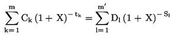
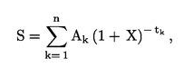

Príloha č. 2 k zákonu č. 90/2016 Z. z.

- VÝPOČET ROČNEJ PRECENTUÁLNEJ MIERY NÁKLADOV

  - I. Základná rovnica vyjadrujúca rovnosť poskytnutého úveru na bývanie na jednej strane a splátok a poplatkov na strane druhej

    - Základnou rovnicou, ktorá vyjadruje ročnú percentuálnu mieru nákladov, kladie do rovnováhy na ročnom základe celkovú súčasnú hodnotu čerpaných prostriedkov na jednej strane a celkovú súčasnú hodnotu splátok a platieb poplatkov na strane druhej, je

    - 

    - kde:

  - - X je ročná percentuálna miera nákladov,

  - - m je číslo posledného čerpania,

  - - k je číslo čerpania, preto 1 ≤ k ≤ m,

  - - Ck je výška čerpania k,

  - - tk je interval vyjadrený v rokoch a zlomkoch roka medzi dátumom prvého čerpania a dátumom každého nasledujúceho čerpania, preto t1 = 0,

  - - m’ je číslo poslednej splátky alebo platby poplatkov,

  - - l je číslo splátky alebo platby poplatkov,

  - - Dl je výška splátky alebo platby poplatkov,

  - - sl je interval vyjadrený v rokoch a zlomkoch roka medzi dátumom prvého čerpania a dátumom každej splátky alebo platby poplatkov.

  - Poznámky:

  - a)

  - čiastky zaplatené obidvoma zmluvnými stranami v rôznom čase nemusia byť nevyhnutne rovnaké a nemusia byť nevyhnutne zaplatené v rovnakých intervaloch,

  - b)

  - začiatočný dátum je dátum prvého čerpania,

  - c)

  - intervaly medzi dátumami použitými pri výpočtoch sú vyjadrené v rokoch alebo v zlomkoch roka

  - 1.

  - rokom sa rozumie 365 dní (alebo 366 dní pri priestupných rokoch), 52 týždňov alebo 12 rovnakých mesiacov,

  - 2.

  - rovnakým mesiacom sa rozumie mesiac, ktorý má 30,41666 dní (t. j. 365/12), bez ohľadu na to, či je rok priestupný.

  - Ak intervaly medzi dátumami použitými pri výpočtoch nemožno vyjadriť ako celý počet týždňov, mesiacov alebo rokov, intervaly sa vyjadria ako celý počet jedného z týchto období v kombinácii s počtom dní. Ak sa použijú dni

  - i)

  - počíta sa každý deň vrátane víkendov a sviatkov,

  - ii)

  - rovnaké obdobia a potom dni sa počítajú spätne k dátumu počiatočného čerpania,

  - iii)

  - dĺžka obdobia vyjadreného v dňoch sa získa vylúčením prvého dňa a započítaním posledného dňa a vyjadrí sa v rokoch vydelením tohto obdobia počtom dní (365 alebo 366 dní) úplného roka počítaného spätne od posledného dňa po rovnaký deň predchádzajúceho roka,

  - d)

  - výsledok výpočtu sa vyjadruje s presnosťou aspoň na jedno desatinné miesto. Ak sa hodnota číslice na nasledujúcom desatinnom mieste rovná alebo je väčšia ako 5, číslica na predchádzajúcom desatinnom mieste sa zvýši o jeden,

  - e)

  - táto rovnica sa dá prepísať pomocou jedného súčtu a tokovej veličiny (Ak), ktorý bude kladný alebo záporný podľa toho, či vyjadruje výbery alebo vklady v obdobiach 1 až k, a vyjadrený v rokoch, t. j.

  - 

  - S je súčasný stav tokov; ak je cieľom zachovať rovnováhu tokov, táto hodnota bude nulová.

  - II. Dodatočné predpoklady na výpočet ročnej percentuálnej miery nákladov

    - a) ak zmluva o úvere na bývanie umožňuje spotrebiteľovi čerpať úver na bývanie ľubovoľne, celková výška úveru na bývanie sa považuje za vyčerpanú okamžite a v plnom rozsahu,

    - b) ak zmluva o úvere na bývanie stanovuje čerpanie úveru na bývanie rôznymi spôsobmi s rôznymi poplatkami alebo rôznymi úrokovými sadzbami úveru na bývanie, celková výška úveru na bývanie sa považuje za vyčerpanú s najvyšším poplatkom a najvyššou úrokovou sadzbou úveru na bývanie, ktoré sa vzťahujú na najpoužívanejší spôsob čerpania úveru na bývanie pri tomto type zmluvy úveru na bývanie,

    - c) ak zmluva o úvere na bývanie umožňuje spotrebiteľovi čerpať úver na bývanie ľubovoľne, ale ukladá medzi rôznymi spôsobmi čerpania úveru na bývanie obmedzenia, ak ide o výšku a čas, suma úveru na bývanie sa považuje za vyčerpanú k najskoršiemu dňu dohodnutému v zmluve o úvere na bývanie a v súlade s týmito obmedzeniami čerpania,

    - d) ak sa na obmedzený čas alebo pre obmedzenú sumu ponúkajú rôzne úrokové sadzby úveru na bývanie a poplatky, za úrokovú sadzbu úveru na bývanie a poplatky počas celej doby trvania zmluvy o úvere na bývanie sa považuje najvyššia úroková sadzba úveru na bývanie a poplatky,

    - e) ak ide o zmluvu o úvere na bývanie, pri ktorej sa dohodla fixná úroková sadzba úveru na bývanie na počiatočné obdobie, na konci ktorého sa určí nová úroková sadzba úveru na bývanie a tá sa bude následne pravidelne upravovať v súlade s dohodnutým ukazovateľom alebo internou referenčnou sadzbou, vychádza výpočet ročnej percentuálnej miery z predpokladu, že na konci obdobia s fixnou úrokovou sadzbou úveru na bývanie je úroková sadzba úveru na bývanie rovnaká ako v čase výpočtu ročnej percentuálnej miery nákladov na základe hodnoty dohodnutého ukazovateľa alebo internej referenčnej sadzby v tomto čase, avšak nie nižšia ako fixná úroková sadzba úveru na bývanie,

    - f) ak sa ešte nedohodla maximálna výška úveru na bývanie, za maximálnu výšku sa považuje suma 170 000 eur. Pri iných zmluvách o úvere na bývanie ako podmienených záväzkov alebo záruk, ktorých účelom nie je nadobudnúť alebo zachovať právo k nehnuteľnosti určenej na bývanie alebo pozemku, povoleného prečerpania, debetných kariet s jednorazovým odloženým zúčtovaním alebo kreditných kariet sa predpokladá, že táto maximálna výška je 1 500 eur,

    - g) ak ide o zmluvu o úvere na bývanie inú ako povolené prečerpanie, preklenovací úver, inú ako zmluvu o úvere so zdieľaním majetku, podmienených záväzkov alebo záruk a inú ako zmluvu o úvere na dobu neurčitú, ako sa uvádza v predpokladoch určených v písmenách i), j), k), l) a m), použijú sa tieto predpoklady, ak

      - 1. dátum alebo suma splátky istiny, ktorú má spotrebiteľ uskutočniť, sa nedá zistiť, predpokladá sa, že splátka sa uskutoční k najskoršiemu dátumu určenému v zmluve o úvere na bývanie a vo výške najnižšej sumy, ktorá je uvedená v zmluve o úvere na bývanie,

      - 2. interval medzi dátumom počiatočného čerpania a dátumom prvej platby spotrebiteľa, sa nedá zistiť, predpokladá sa, že ide o najkratší interval medzi dátumom počiatočného čerpania a dátumom prvej platby, ktorú má spotrebiteľ uskutočniť,

    - h) ak sa dátum alebo suma platby, ktorú má spotrebiteľ uskutočniť, nedá zistiť na základe zmluvy o úvere na bývanie alebo predpokladov určených v písmenách g), i), j), k), l) a m), predpokladá sa, že platba sa uskutoční v súlade s dátumami a podmienkami požadovanými veriteľom, a ak tieto údaje nie sú známe

      - 1. úrokové poplatky sa platia spoločne so splátkami istiny,

      - 2. neúrokové poplatky vyjadrené jedinou sumou sa platia k dátumu uzavretia zmluvy o úvere na bývanie,

      - 3. neúrokové poplatky vyjadrené ako niekoľko platieb sa platia v pravidelných intervaloch počnúc dňom prvej splátky istiny, a ak výška takýchto platieb nie je známa, predpokladá sa, že ide o rovnaké sumy,

      - 4. posledná platba vyrovná zostatok istiny, úrokov a možných ďalších poplatkov,

    - i) ak ide o povolené prečerpanie, celková výška úveru sa čerpá naraz v plnej výške a na celú dobu trvania zmluvy o úvere na bývanie; ak doba trvania povoleného prečerpania nie je známa, ročná percentuálna miera nákladov sa vypočíta na základe predpokladu, že trvanie úveru na bývanie je tri mesiace,

    - j) ak ide o preklenovací úver na bývanie, celková výška úveru sa čerpá naraz v plnej výške a na celú dobu trvania zmluvy o úvere na bývanie; ak doba trvania zmluvy o úvere na bývanie nie je známa, ročná percentuálna miera nákladov sa vypočíta na základe predpokladu, že trvanie úveru na bývanie je 12 mesiacov,

    - k) ak ide o zmluvu o úvere na bývanie na dobu neurčitú, inú ako povolené prečerpanie a preklenovací úver, sa predpokladá, že

      - 1. ak ide o zmluvu o úvere na bývanie, ktorej účelom je nadobudnúť alebo zachovať práva k nehnuteľnosti určenej na bývanie, sa úver na bývanie poskytuje na dobu 20 rokov so začiatkom v deň prvého čerpania, a poslednou platbou spotrebiteľa sa vyrovná zostatok istiny, úrokov a možných iných poplatkov; ak ide o zmluvy o úvere na bývanie, ktorých účelom nie je nadobudnúť alebo zachovať práva k nehnuteľnosti určenej na bývanie alebo ktoré sa čerpajú debetnými kartami s jednorazovým odloženým zúčtovaním alebo kreditnými kartami, je touto dobou jeden rok,

      - 2. spotrebiteľ spláca istinu v rovnakých mesačných splátkach, s ktorých vykonávaním sa začne jeden mesiac po dátume prvého čerpania, ak sa istina musí splatiť naraz len jednou platbou v rámci každého obdobia splatnosti, sa predpokladá, že k čerpaniam a splátkam celej istiny zo strany spotrebiteľa, ktoré nasledujú po sebe, dochádza počas jedného roka; úroky a iné poplatky sa uplatňujú v súlade s týmito čerpaniami a splátkami istiny tak, ako je uvedené v zmluve o úvere na bývanie.

    - Na účely tohto písmena je zmluva o úvere na bývanie na dobu neurčitú zmluvou o úvere na bývanie bez pevne určenej doby trvania a zahŕňa úvery na bývanie, ktoré sa musia splatiť v celosti v rámci určitého obdobia alebo po ňom, ale po splatení možno tieto úvery opäť čerpať.

    - l) ak ide o podmienené záväzky alebo záruky predpokladá sa, že celková výška úveru na bývanie sa čerpá v celosti ako jedna suma ku skoršiemu z týchto dátumov

      - 1. k najneskoršiemu dátumu čerpania povolenému podľa zmluvy o úvere na bývanie, ktorá je potenciálnym zdrojom podmieneného záväzku alebo záruky, alebo

      - 2. na konci počiatočného obdobia pred predĺžením platnosti zmluvy o úvere na bývanie, ak ide o predĺženú platnosť zmluvy o úvere na bývanie.

    - m) ak ide o zmluvu o úvere na bývanie so zdieľaním majetku

      - 1. k platbám zo strany spotrebiteľov dochádza k najneskoršiemu dátumu alebo dátumom povoleným podľa zmluvy o úvere na bývanie,

      - 2. percentuálne zvýšenia hodnoty nehnuteľnosti určenej na bývanie, ktorou je zabezpečená zmluva o úvere na bývanie so zdieľaním majetku, a miera akéhokoľvek indexu inflácie uvedeného v zmluve o úvere na bývanie sú percentuálnou hodnotou rovnajúcou sa vyššej z hodnôt, ktorými sú aktuálna cieľová miera inflácie centrálnej banky alebo úroveň inflácie v členskom štáte, v ktorom sa nehnuteľnosť určená na bývanie nachádza, v čase uzavretia zmluvy o úvere na bývanie, alebo 0 %, ak sú tieto percentuálne hodnoty záporné.
