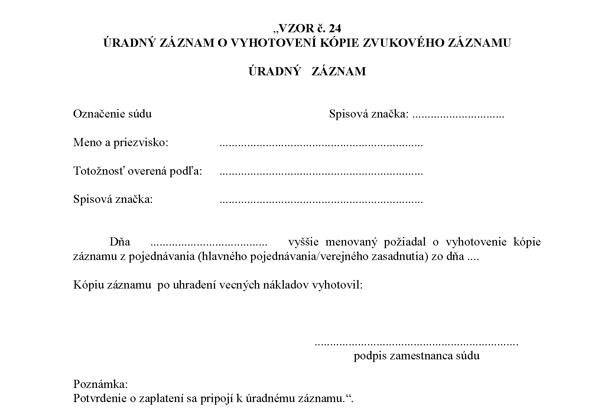

# Čl. I

Vyhláška Ministerstva spravodlivosti Slovenskej republiky č. 543/2005 Z. z. o Spravovacom a kancelárskom poriadku pre okresne súdy, krajské súdy, Špeciálny súd a vojenské súdy v znení vyhlášky č. 417/2006 Z. z., vyhlášky č. 120/2007 Z. z., vyhlášky č. 389/2008 Z. z., vyhlášky č. 11/2009 Z. z., vyhlášky č. 95/2009 Z. z., vyhlášky č. 450/2009 Z. z., vyhlášky č. 148/2011 Z. z., vyhlášky č. 94/2012 Z. z., vyhlášky č. 327/2012 Z. z., vyhlášky č. 105/2013 Z. z., vyhlášky č. 428/2013 Z. z., vyhlášky č. 334/2014 Z. z., vyhlášky č. 366/2014 Z. z., vyhlášky č. 84/2015 Z. z., vyhlášky č. 222/2015 Z. z., vyhlášky č. 449/2015 Z. z., vyhlášky č. 206/2016 Z. z. a vyhlášky č. 8/2017 Z. z. sa mení a dopĺňa takto:

- 1. V druhej časti tretej hlave sa za štvrtý oddiel vkladá nový piaty oddiel, ktorý znie:

- „Piaty oddiel

- Príkazy v oblasti dozoru nad poskytovaním zakázaných ponúk

- § 34a

- (1)

- O príkaze podľa osobitného predpisu17c) rozhodujú sudcovia príslušného súdu určení predsedom tohto súdu. Predseda súdu určí potrebný počet sudcov tak, aby bola zabezpečená neodkladnosť vybavovania tejto súdnej agendy; ustanovenia § 27 a 28 sa použijú primerane.

- (2)

- Mená a priezviská určených sudcov oznámi predseda súdu Finančnému riaditeľstvu Slovenskej republiky.

- (3)

- Žiadosť okrem zákonom ustanovených náležitostí obsahuje aj údaj o tom, akým spôsobom sa má rozhodnutie súdu doručiť žiadateľovi. Ak je v žiadosti uvedených viac osôb, ktoré poskytujú elektronické komunikačné siete a elektronické komunikačné služby, alebo viac webových sídiel, ku ktorým sa má zamedziť prístup, vo veci samej sa rozhoduje jedným príkazom.“.

  - Poznámka pod čiarou k odkazu 17c znie:

  - „17c) § 15b zákona č. 171/2005 Z. z. o hazardných hrách a o zmene a doplnení niektorých zákonov v znení zákona č. 386/2016 Z. z.“.

  - Doterajší piaty oddiel až deviaty oddiel sa označujú ako šiesty oddiel až desiaty oddiel.

- 2. V § 51 ods. 5 sa vypúšťa čiarka a slová „ak na výzvu súdu v určenej lehote nie je zabezpečený ich preklad“.

- 3. V § 56 odsek 4 znie:

- „(4)

- Ak sa na žiadosť účastníka konania alebo strany v konaní vyhotovuje kópia záznamu podľa odseku 1, vyhotoví poverený zamestnanec súdu úradný záznam podľa vzoru č. 24 uvedeného v prílohe č. 4; úradný záznam sa nevyhotovuje, ak sa záznam sprístupňuje postupom podľa § 168a ods. 7.“.

- 4. V § 59 ods. 4 prvej vete sa slová „spisová značka a identifikačné číslo spisu“ nahrádzajú slovami „spisová značka, identifikačné číslo spisu a európsky identifikátor judikatúry (ECLI)“.

- 5. V § 62 odsek 3 znie:

- „(3)

- Spolu s vyznačením právoplatnosti v aplikácii súd vyhotoví doložku právoplatnosti ako elektronický úradný dokument postupom podľa osobitného predpisu,22aa) ktorý obsahuje európsky identifikátor judikatúry (ECLI) toho rozhodnutia, ktorého právoplatnosť sa vyznačuje. Súd vyhotovenú doložku právoplatnosti doručí spolu s rozhodnutím do elektronickej schránky účastníka konania. Ak účastník konania nemá elektronickú schránku aktivovanú na doručovanie, doložka právoplatnosti sa mu nedoručuje.“.

  - Poznámka pod čiarou k odkazu 22aa znie:

  - „22aa) § 82l ods. 6 zákona č. 757/2004 Z. z. v znení zákona č. 152/2017 Z. z.“.

- 6. V § 62a sa odkaz „22aa)“ nad slovom „predpisu“ nahrádza odkazom „22ab)“, odkaz „22ab)“ nad slovom „predpisu“ sa nahrádza odkazom „22ac)“ a odkaz „22ac)“ nad slovom „predpisu“ sa nahrádza odkazom „22ad)“.

- 7. Poznámky pod čiarou k odkazom 22ab až 22ad znejú:

- „22ab) § 325 ods. 2 písm. e) Civilného sporového poriadku.

- § 365 a 367 Civilného mimosporového poriadku.

- 22ac) § 368 Civilného mimosporového poriadku.

- 22ad) § 368 ods. 3 Civilného mimosporového poriadku.“.

- 8. § 63 sa dopĺňa odsekom 5, ktorý znie:

- „(5)

- Ak sa vyznačuje právoplatnosť alebo vykonateľnosť elektronického úradného dokumentu, doložka právoplatnosti a doložka vykonateľnosti vyhotovená podľa § 62 ods. 3 sa spolu s rozhodnutím doručuje do elektronickej schránky toho, kto o vyznačenie právoplatnosti alebo vykonateľnosti žiada.“.

- 9. Za § 63 sa vkladá § 63a, ktorý vrátane nadpisu znie:

- 㤠63a

- Vydávanie ďalších rovnopisov rozhodnutí súdu

- (1)

- Ak o to účastník konania požiada, súd mu vydá po zaplatení súdneho poplatku22ae) ďalší rovnopis rozhodnutia súdu. Ďalší rovnopis rozhodnutia súdu možno vydať v listinnej podobe alebo v elektronickej podobe.

- (2)

- Ak účastník konania požiada o vydanie elektronickej podoby rovnopisu rozhodnutia súdu, ktorého prvopis bol vyhotovený v listinnej podobe, súd pripojí k prvopisu doložku, ktorou osvedčuje, že rovnopis bol vyhotovený z prvopisu uloženého v súdnom spise, a prevedie prvopis spolu s doložkou do elektronickej podoby postupom podľa osobitného predpisu22af) a takto vzniknutý elektronický úradný dokument autorizuje.

- (3)

- Ak účastník konania požiada o vydanie listinnej podoby rovnopisu rozhodnutia súdu, ktorého prvopis bol vyhotovený v elektronickej podobe, súd prevedie rozhodnutie uložené v aplikácii do listinnej podoby postupom podľa osobitného predpisu;22af) ustanovenie § 61 ods. 2 sa použije rovnako.“.

  - Poznámky pod čiarou k odkazom 22ae a 22af znejú:

  - „22ae) Položka 28 sadzobníka súdnych poplatkov zákona Slovenskej národnej rady č. 71/1992 Zb. v znení neskorších predpisov.

  - 22af) § 82l ods. 5 zákona č. 757/2004 Z. z. v znení zákona č. 152/2017 Z. z.“.

- 10. § 64 sa dopĺňa odsekom 3, ktorý znie:

- „(3)

- Ustanovenie § 62a sa použije primerane aj na vydávanie rovnopisov písomností zo súdneho spisu, ktoré nie sú rozhodnutím súdu.“.

- 11. V § 132a sa vypúšťa odsek 2 a súčasne sa zrušuje označenie odseku 1.

- 12. Za § 139c sa vkladá § 139d, ktorý vrátane nadpisu znie:

- 㤠139d

- Osobitné ustanovenie pre spracovanie niektorých podaní

- Úkony spojené s vyrubením súdneho poplatku58d) za spracovanie podania a jeho príloh v listinnej podobe, ak osobitný predpis58e) ustanovuje povinnosť doručovať podanie do elektronickej schránky súdu, a za spracovanie podania a jeho príloh v elektronickej podobe doručeného súdu inak ako do elektronickej schránky súdu, ak osobitný predpis58e) ustanovuje povinnosť doručovať podanie do elektronickej schránky súdu, sa evidujú v súdnom spise, ktorého sa podanie týka.“.

  - Poznámky pod čiarou k odkazom 58d a 58e znejú:

  - „58d) Položka 20a sadzobníka súdnych poplatkov zákona Slovenskej národnej rady č. 71/1992 Zb. v znení neskorších predpisov.

  - 58e) § 82l ods. 3 zákona č. 757/2004 Z. z. v znení zákona č. 152/2017 Z. z.“.

- 13. V § 164 ods. 2 písm. c) sa za slovo „Ntt,“ vkladá slovo „Ntn“.

- 14. § 173 sa dopĺňa odsekom 3, ktorý znie:

- „(3)

- Ustanovenia odsekov 1 a 2 sa nepoužijú, ak sa súdny spis vedie v elektronickej podobe a na písomnosti v elektronickej podobe.“.

- 15. Za § 263i sa vkladá § 263j, ktorý vrátane nadpisu znie:

- 㤠263j

- Prechodné ustanovenie k úpravám účinným od 1. júla 2017

- Veci zapísané do súdneho registra Pc pred 1. júlom 2017, ktoré sa od 1. júla 2017 zapisujú do súdneho registra C, sa vedú v súdnom registri Pc aj po 1. júli 2017.“.

- 16. V prílohe č. 1 časti I „Prehľad súdnych registrov a používané skratky súdnych registrov“ v prehľade súdnych registrov okresného súdu sa vypúšťa označenie „Od“.

- 17. V prílohe č. 1 v časti I „Prehľad súdnych registrov a používané skratky súdnych registrov“ prehľad súdnych registrov krajského súdu – prvostupňová agenda znie:

- „

- Civilná | Obchodná | Konkurz | Iná obchodná | Trestná | Justičná pokladnica

- C | Cbi | K | NcCb | T | JP

- Cd | | V | Cbnl | Ntok |

- Cudz | | NcKV | | Ntol |

- | | | | Ntod |

- | | | | Ntc |

- | | | | Ntt |

- | | | | Ntn |

- | | | | Td |

- “.

- 18. V prílohe č. 1 časti II „Zapisovanie do súdnych registrov okresného súdu“ písmene B prvom bode sa za písmeno b) vkladá nové písmeno c), ktoré znie:

- „c)

- návrh na zrušenie a na vyporiadanie bezpodielového spoluvlastníctva manželov,“.

  - Doterajšie písmená c) až t) sa označujú ako písmená d) až u).

- 19. V prílohe č. 1 časti II „Zapisovanie do súdnych registrov okresného súdu“ písmene E treťom bode sa vypúšťa písmeno b).

  - Doterajšie písmená c) až h) sa označujú ako písmená b) až g).

- 20. V prílohe č. 1 časti III „Zapisovanie do súdnych registrov krajského súdu – Súdne registre prvostupňovej agendy“ písmene E siedmy bod znie:

- „7.

- Do súdneho registra „Ntt“, ktorý sa vedie ručne mimo elektronickej podateľne, sa zapisujú návrhy a podania podľa zákona Národnej rady Slovenskej republiky č. 46/1993 Z. z. o Slovenskej informačnej službe v znení neskorších predpisov, zákona Národnej rady Slovenskej republiky č. 198/1994 Z. z. o Vojenskom spravodajstve v znení neskorších predpisov, zákona č. 166/2003 Z. z. o ochrane súkromia pred neoprávneným použitím informačno-technických prostriedkov a o zmene a doplnení niektorých zákonov (zákon o ochrane pred odpočúvaním) v znení neskorších predpisov a zákona č. 351/2011 Z. z. o elektronických komunikáciách v znení neskorších predpisov.“.

- 21. V prílohe č. 1 časti III „Zapisovanie do súdnych registrov krajského súdu – Súdne registre prvostupňovej agendy“ písmene E sa za siedmy bod vkladá nový ôsmy bod, ktorý znie:

- „8.

- Do súdneho registra „Ntn“ sa zapisujú návrhy na vydanie príkazov podľa zákona č. 171/2005 Z. z. o hazardných hrách a o zmene a doplnení niektorých zákonov v znení neskorších predpisov.“.

  - Doterajší ôsmy bod sa označuje ako deviaty bod.

- 22. V prílohe č. 4 vzor č. 24 znie:

- 
