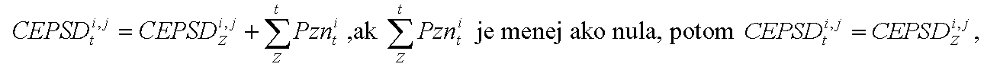
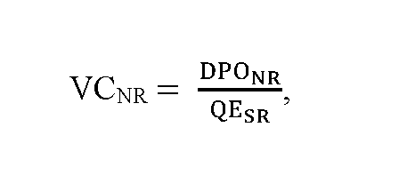
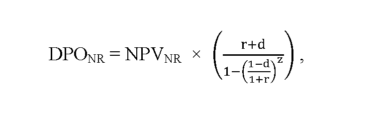
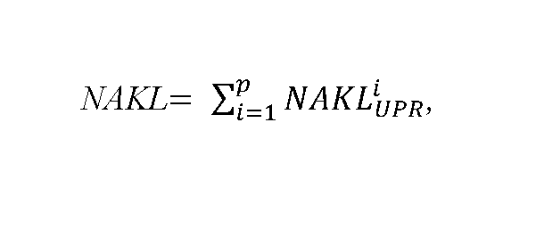
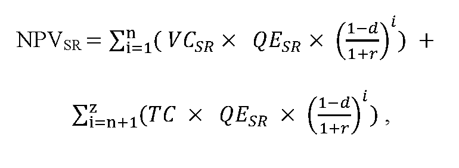
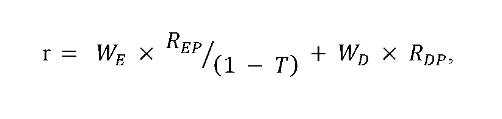
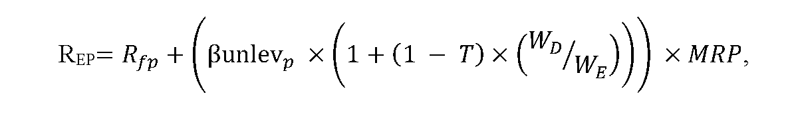
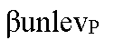
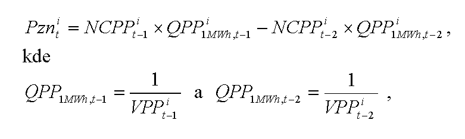

# § 8

(1) Cena elektriny pre stanovenie doplatku na rok t v eurách na jednotku množstva elektriny za elektrinu vyrobenú i-tou technológiou j-tého zariadenia výrobcu elektriny CEPSDi,jt sa pre výrobcu elektriny vypočíta podľa vzorca

to neplatí pre zariadenia výrobcov elektriny uvedené do prevádzky od 1. marca 2013,

kde

- a) CEPSDi,jZ je určená alebo schválená cena elektriny pre stanovenie doplatku na rok Z predchádzajúci roku t vyrobenej i-tou technológiou j-tého zariadenia výrobcu elektriny na základe roku uvedenia zariadenia výrobcu elektriny do prevádzky alebo poslednej uplatnenej rekonštrukcie alebo modernizácie v eurách na jednotku množstva elektriny,

- b) Pznt na i je korekcia48) v eurách na jednotku množstva elektriny na rok t uplatňovaná v hodnote podľa odseku 6; Pznt na i sa vypočíta podľa odseku 13,

- c) rok Z je rok uvedenia zariadenia výrobcu elektriny do prevádzky alebo rok poslednej uplatnenej rekonštrukcie alebo modernizácie.

(2) Cena elektriny pre stanovenie príplatku na rok t v eurách na jednotku množstva elektriny za elektrinu vyrobenú i-tou technológiou j-tého zariadenia výrobcu elektriny CEPSPt na i, j sa pre výrobcu elektriny vypočíta podľa vzorca

CEPSPt na i, j = CEPSPZ na i, j + suma Pznt na i, ak suma PZnt na i je menej ako nula, potom CEPSPt na i, j = CEPSPZ na i, j,

kde

- a) CEPSPZ na i, j je cena elektriny pre stanovenie príplatku na rok Z predchádzajúci roku t vyrobenej i-tou technológiou j-tého zariadenia výrobcu elektriny na základe roku uvedenia zariadenia výrobcu elektriny do prevádzky alebo poslednej uplatnenej rekonštrukcie alebo modernizácie v eurách na jednotku množstva elektriny,

- b) Pznt na i je korekcia48) v eurách na jednotku množstva elektriny na rok t uplatňovaná v hodnote podľa odseku 6; Pznt na i sa vypočíta podľa odseku 4,

- c) rok Z je rok uvedenia zariadenia výrobcu elektriny do prevádzky alebo rok poslednej uplatnenej rekonštrukcie alebo modernizácie.

(3) Cena elektriny pre stanovenie hodnoty podpory v eurách za MWh za elektrinu vyrobenú z obnoviteľných zdrojov energie pri predĺžení podpory doplatkom podľa osobitného predpisu1a) sa vypočíta podľa vzorca

kde

- a) VCNR je výkupná cena elektriny pre zariadenie výrobcu elektriny s predĺženou podporou podľa osobitného predpisu1a) v eurách za MWh,

- b) DPONR je plánovaný objem podpory pre zariadenie výrobcu elektriny v eurách počas prvého roka trvania predĺženej podpory podľa osobitného predpisu;1a) DPONR sa vypočíta podľa odseku 4,

- c) QESR je množstvo vyrobenej elektriny s nárokom na podporu doplatkom elektriny a prevzatím zodpovednosti za odchýlku v MWh za rok, ktoré sa vypočíta ako aritmetický priemer za posledných päť ucelených rokov prevádzky zariadenia na výrobu elektriny pred rokom vstupu do predĺženej podpory podľa osobitného predpisu.1a)

(4) Plánovaný objem podpory doplatkom pre zariadenie výrobcu elektriny v eurách počas prvého roka trvania predĺženej podpory doplatkom podľa osobitného predpisu1a) DPONR sa vypočíta podľa vzorca

kde

- a) NPVNR je čistá súčasná hodnota podpory v eurách za elektrinu vyrobenú z obnoviteľných zdrojov energie s predĺžením podpory podľa osobitného predpisu;1a) NPVNR sa vypočíta podľa odseku 5,

- b) r je ročná úroková miera vyjadrená v percentách, vypočíta sa podľa odseku 8,

- c) d je koeficient ročnej degradácie technológie zariadenia na výrobu elektriny; pre zariadenie na výrobu elektriny zo slnečnej energie je maximálna hodnota koeficientu 0,5 % a pre zariadenia na výrobu elektriny z vodnej energie, biomasy, bioplynu, skládkového plynu alebo plynu z čističiek odpadových vôd je hodnota koeficientu nula,

- d) z je zostávajúca doba predĺženej podpory podľa osobitného predpisu,1a) zaokrúhlená na šesť desatinných miest, pričom

- z = n + p ,

- kde

  - 1. n je zostávajúca doba trvania súčasného režimu podpory pre zariadenie výrobcu elektriny z obnoviteľných zdrojov energie,

  - 2. p je doba predĺženia podpory podľa osobitného predpisu1a) rovnajúca sa piatim rokom.

(5) Čistá súčasná hodnota podpory doplatkom v eurách za elektrinu vyrobenú z obnoviteľných zdrojov energie s predĺžením podpory podľa osobitného predpisu1a) NPVNR sa vypočíta podľa vzorca

NPVNR= NPVSR × k + NAKL,

kde

- a) NPVSR je čistá súčasná hodnota podpory v eurách za elektrinu vyrobenú z obnoviteľných zdrojov energie v súčasnom režime podpory, ktorá sa vypočíta podľa odseku 6,

- b) k je koeficient zohľadňujúci rok vstupu zariadenia výrobcu elektriny do predĺženia podpory podľa osobitného predpisu,1a) ktorý sa na roky 2021 a 2022 rovná 1,02 a na rok 2023 a nasledujúce roky sa rovná 1,00,

- c) NAKL je suma ekonomicky oprávnených nákladov na opravu alebo úpravu technologickej časti zariadenia výrobcu elektriny na účel predĺženia jeho prevádzkyschopnosti v eurách vynaložených najneskôr v prvých piatich rokoch po roku vstupu do predĺženej podpory, ktorá sa vypočíta podľa vzorca

kde

- 1. NAKLiUPR sú ekonomicky oprávnené náklady na nevyhnutnú opravu alebo úpravu technologickej časti zariadenia výrobcu elektriny v eurách na účel predĺženia jeho prevádzkyschopnosti počas zostávajúcej a predĺženej doby podpory vynaložené v i-tom roku nasledujúcom po roku vstupu do predĺženej podpory podľa osobitného predpisu,1a) pričom

- NAKL ≤ S × INV,

- kde

  - 1.1 S je hodnota investičných nákladov na obstaranie novej porovnateľnej technologickej časti zariadenia výrobcu elektriny najviac vo výške 15 %,

  - 1.2 INV je hodnota investičných nákladov novej porovnateľnej technológie časti zariadenia výrobcu elektriny v eurách zverejnená pre nasledujúci rok na webovom sídle úradu a aktualizovaná najneskôr do 31. augusta kalendárneho roka.

(6) Čistá súčasná hodnota podpory v eurách za elektrinu vyrobenú z obnoviteľných zdrojov energie v súčasnom režime podpory NPVSR sa vypočíta podľa vzorca

kde

- a) VCSR je výkupná cena elektriny vyrobenej z obnoviteľných zdrojov energie, ktorá je určená úradom v súčasnom režime podpory v eurách za MWh,

- b) QESR je množstvo vyrobenej elektriny s nárokom na podporu výkupom elektriny a prevzatím zodpovednosti za odchýlku v režime prenesenej zodpovednosti za odchýlku v MWh za rok, ktoré sa vypočíta ako aritmetický priemer za posledných päť ucelených rokov prevádzky zariadenia výrobcu elektriny pred rokom vstupu do predĺženej podpory podľa osobitného predpisu,1a)

- c) TC je trhová cena elektriny v eurách za MWh vypočítaná ako aritmetický priemer cien ročných forwardov elektriny F PXE SK BL na najbližšie tri ucelené kalendárne roky predĺženej podpory podľa osobitného predpisu,1a) zobchodovaných na burze PXE (POWER EXCHANGE CENTRAL EUROPE) za obdobie posledných ucelených 12 kalendárnych mesiacov pred začatím cenového konania, ktorá sa zverejní pre nasledujúci rok na webovom sídle úradu do 31. augusta kalendárneho roka.

(7) Cena elektriny sa zníži, ak po preverení skutočne vynaložených nákladov na nevyhnutnú opravu alebo úpravu technologickej časti zariadenia výrobcu elektriny v eurách na účel predĺženia jeho prevádzkyschopnosti počas zostávajúcej a predĺženej doby podpory, ktoré mali byť vynaložené najneskôr v prvých piatich rokoch po roku vstupu do predĺženej podpory, nedošlo k ich investovaniu vo výške podľa cenového rozhodnutia.

(8) Ročná úroková miera r sa vypočíta podľa vzorca

kde

- a) T je sadzba dane z príjmov pre právnické osoby; T sa ustanovuje vo výške 21 % pre cenové konania v roku 2021,

- b) WE je podiel vlastného kapitálu na celkovej kapitalizácii regulovaného subjektu v percentách; WE sa ustanovuje vo výške 40 %,

- c) WD je podiel cudzieho kapitálu na celkovej kapitalizácii regulovaného subjektu v percentách; WD sa ustanovuje vo výške 60 %,

- d) RDP sú náklady na cudzí kapitál vyjadrené priemernou výškou úverov nad 1 000 000 eur poskytnutých nefinančným spoločnostiam za obdobie rokov 2010 až 2020; RDP sa ustanovuje vo výške 2,89 %,

- e) REP sú náklady na vlastný kapitál, ktoré sa vypočítajú podľa vzorca

- 

- kde

  - 1. RfP je bezriziková výnosová miera vyjadrená ako základná sadzba pre výpočet referenčnej a diskontnej sadzby určená Európskou komisiou od 1. januára 2021 vo výške - 0,45 % zvýšená o 100 bázických bodov; RfP sa ustanovuje vo výške 0,55 %,

  - 2.  je beta koeficient vyjadrujúci systematické riziko a citlivosť odvetvia výroby elektriny z obnoviteľných zdrojov na zmenu trhu;

  -  sa ustanovuje vo výške 0,69,

  - 3. MRP je trhová riziková prirážka za trhové riziko, ktoré udáva o koľko je očakávaná výnosnosť vlastného kapitálu vyššia ako výnos z bezrizikovej investície; MRP sa ustanovuje vo výške 5,54 %.

(9) Ročná úroková miera r je vo výške 6,24 %. Ak bude odchýlka v jednotlivých parametroch r vyššia ako 10 %, určí sa nová ročná úroková miera, ktorá sa zverejní pre nasledujúci rok na webovom sídle úradu do 31. augusta kalendárneho roka.

(10) Pri určení ceny elektriny pre stanovenie doplatku pri predĺžení podpory doplatkom so zníženou cenou elektriny na kalendárny rok nasledujúci po kalendárnom roku, v ktorom sa rozhoduje o znížení ceny elektriny, sa zohľadnia hodnoty podľa odseku 5 písm. c) bodu 1.2, odseku 6 písm. c) a odseku 9 uverejnené na webovom sídle úradu v kalendárnom roku, v ktorom sa rozhoduje o určení ceny elektriny.

(11) Pri určení ceny elektriny pre stanovenie doplatku pre výrobcu elektriny, ktorému sa skončí podpora výkupom elektriny výkupcom elektriny za cenu vykupovanej elektriny a podpora prevzatím zodpovednosti za odchýlku výkupcom elektriny pred uplynutím predĺženej podpory doplatkom so zníženou cenou elektriny sa odseky 3 až 10 použijú primerane.

(12) Ak má výrobca elektriny na rok predchádzajúci roku t určenú alebo schválenú cenu elektriny pre stanovenie doplatku CEPSDi,jZ a ak si uplatňuje na rok t cenu elektriny pre stanovenie doplatku na základe rekonštrukcie alebo modernizácie, táto cena elektriny pre stanovenie doplatku na rok t sa určí podľa § 7 ods. 12 alebo 13.

(13) Korekcia Pznit v eurách na jednotku množstva elektriny na rok t pre i-té technológie výroby elektriny s primárnymi palivami podľa odseku 6 zohľadňujúca výrazné zvýšenie alebo zníženie ceny vstupných surovín, ktoré sa použili na výrobu elektriny i-tou technológiou na výrobu elektriny z obnoviteľných zdrojov energie alebo výrazné zvýšenie alebo zníženie ceny vstupných surovín, ktoré sa použili na výrobu elektriny z neobnoviteľných zdrojov energie i-tou technológiou na výrobu elektriny vysoko účinnou kombinovanou výrobou sa vypočíta podľa vzorca

kde

- a) NCPPit-1 je určená nákupná cena primárneho paliva pre i-tú technológiu výroby elektriny v eurách na jednotku množstva v roku t-1,

- b) QPPi1MWh,t-1 je množstvo primárneho paliva zodpovedajúceho 1 MWh i-tej technológie výroby elektriny v jednotkách množstva na megawatthodinu v roku t-1,

- c) VPPit-1 je určená výhrevnosť primárneho paliva pre i-tú technológiu výroby elektriny v megawatthodinách na jednotku množstva v roku t-1,

- d) NCPPit-2 je určená nákupná cena primárneho paliva pre i-tú technológiu výroby elektriny v eurách na jednotku množstva v roku t-2,

- e) QPPi1MWh,t-2 je množstvo primárneho paliva zodpovedajúceho 1 MWh i-tej technológie výroby elektriny v jednotkách množstva na megawatthodinu v roku t-2,

- f) VPPit-2 je určená výhrevnosť primárneho paliva pre i-tú technológiu výroby elektriny v megawatthodinách na jednotku množstva v roku t-2.

(14) Pznit sa uplatní na jeden rok, ak je hodnota zmeny väčšia ako 8 % zo súčinu nákupnej ceny NCPPit-2 a množstva primárneho paliva QPPi1 MWh,t-2 určených podľa odseku 4.

(15) Hodnotou Pznt na i v eurách na jednotku množstva elektriny na rok t pre i-té technológie výroby elektriny je hodnota zohľadňujúca výrazné zvýšenie alebo zníženie ceny vstupných surovín, ktoré sa použili na výrobu elektriny i-tou technológiou na výrobu elektriny z obnoviteľných zdrojov energie alebo výrazné zvýšenie alebo zníženie ceny vstupných surovín, ktoré sa použili na výrobu elektriny z neobnoviteľného zdroja energie i-tou technológiou na výrobu elektriny vysoko účinnou kombinovanou výrobou zverejnená na webovom sídle úradu najneskôr do 30. júna kalendárneho roku t-1.
