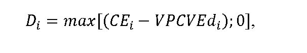
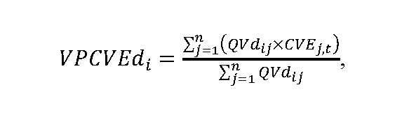
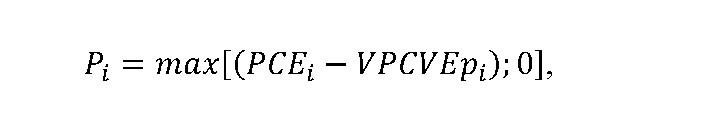
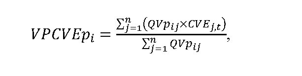
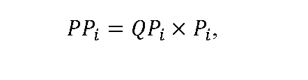

# § 8a Výpočet rozsahu podpory doplatkom a príplatkom

(1) Doplatok Di v eurách/MWh za základný časový úsek48a) pre i-té zariadenie výrobcu elektriny s nárokom na podporu doplatkom48b) sa vypočíta podľa vzorca

kde

CEije cena elektriny podľa osobitného predpisu,48c)

VPCVEdi je vážený priemer cien vykupovanej elektriny pre i-té zariadenie výrobcu elektriny s nárokom na podporu doplatkom48b) za základný časový úsek v eurách/MWh vypočítaný podľa vzorca

kde

QVdij je množstvo elektriny vyrobené i-tým zariadením výrobcu elektriny s nárokom na podporu doplatkom48b) v j-tej hodine základného časového úseku v MWh,

CVEj,t je cena vykupovanej elektriny v j-tej hodine základného časového úseku v eurách/MWh podľa § 10a ods. 4,

n je počet hodín základného časového úseku.

(2) Doplatok za elektrinu vyrobenú v i-tom zariadení výrobcu elektriny s nárokom na podporu doplatkom48b) za základný časový úsek PDi v eurách uhrádzaný výrobcovi elektriny organizátorom krátkodobého trhu s elektrinou sa vypočíta podľa vzorca

kde

QDi je množstvo elektriny, na ktoré je možné uplatniť doplatok v i-tom zariadení výrobcu elektriny s nárokom na podporu doplatkom48b) za základný časový úsek určené podľa osobitného predpisu48d) v MWh,

Di je doplatok pre i-té zariadenie výrobcu elektriny s nárokom na podporu doplatkom48b) vypočítaný podľa odseku 1 v eurách/MWh.

(3) Príplatok Pi v eurách/MWh za základný časový úsek48e) pre i-té zariadenie výrobcu elektriny s nárokom na podporu príplatkom48f) sa vypočíta podľa vzorca

kde

PCEi je ponúknutá cena elektriny,48g)

VPCVEpi je vážený priemer cien vykupovanej elektriny pre i-té zariadenie výrobcu elektriny s nárokom na podporu príplatkom48f) za základný časový úsek v eurách/MWh vypočítaný podľa vzorca

kde

QVpij je množstvo elektriny vyrobenej i-tým zariadením výrobcu elektriny s nárokom na podporu príplatkom48f) v j-tej hodine základného časového úseku v MWh,

CVEj,t je cena vykupovanej elektriny v j-tej hodine základného časového úseku v eurách/MWh podľa § 10a ods. 4,

n je počet hodín základného časového úseku.

(4) Príplatok za elektrinu vyrobenú v i-tom zariadení výrobcu elektriny s nárokom na podporu príplatkom48f) za základný časový úsek PPi v eurách uhrádzaný výrobcovi elektriny organizátorom krátkodobého trhu s elektrinou sa vypočíta podľa vzorca

kde

QPi je množstvo elektriny, na ktoré je možné uplatniť príplatok v i-tom zariadení výrobcu elektriny s nárokom na podporu príplatkom48f) za základný časový úsek určené podľa osobitného predpisu48d) v MWh,

Pi je príplatok pre i-té zariadenie výrobcu elektriny s nárokom na podporu príplatkom48f) vypočítaný podľa odseku 3 v eurách/MWh.
