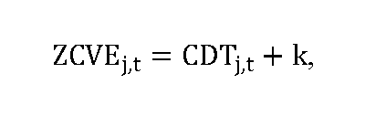
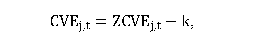
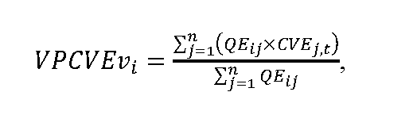
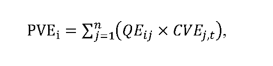
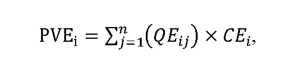
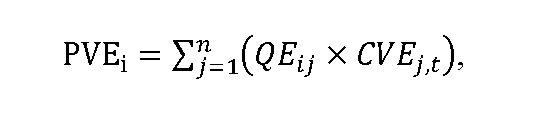
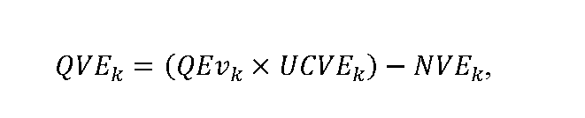
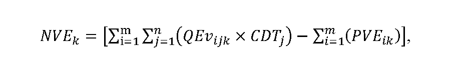

# § 10a Spôsob výpočtu ceny vykupovanej elektriny, postup a podmienky uplatňovania cien

(1) Základ pre výpočet ceny vykupovanej elektriny50a) v j-tej hodine roku t v eurách/MWh sa vypočíta podľa vzorca

kde

CDTj,tje cena elektriny slovenskej obchodnej oblasti na dennom trhu organizovanom organizátorom krátkodobého trhu s elektrinou v j-tej hodine roku t v eurách/MWh,

k je koeficient podľa osobitného predpisu50a) určený podľa odsekov 2 a 3 eurách/MWh.

(2) Ak bol výkupca elektriny vybratý ministerstvom hospodárstva formou aukcie, koeficient k sa rovná výške úhrady za činnosť výkupcu elektriny požadovanej výkupcom elektriny v aukcii vyhlásenej ministerstvom hospodárstva.50b)

(3) Ak bol výkupca elektriny určený ministerstvom hospodárstva50c) alebo ak činnosť výkupcu elektriny vykonáva dodávateľ poslednej inštancie,50d) koeficient k sa rovná výške úhrady za činnosť výkupcu elektriny podľa § 10b.

(4) Cena vykupovanej elektriny v j-tej hodine roku t v eurách/MWh CVEj,t sa vypočíta podľa vzorca

kde

ZCVEj,t je základ pre výpočet ceny vykupovanej elektriny v j-tej hodine roku t v eurách/MWh vypočítaný podľa odseku 1,

k je koeficient podľa odsekov 2 a 3 v eurách/MWh.

(5) Po uplynutí základného časového úseku48a) sa pre i-té zariadenie výrobcu elektriny, ktorý využil právo na podporu výkupom elektriny50e) a prevzatím zodpovednosti za odchýlku,50f) vypočíta vážený priemer cien vykupovanej elektriny VPCVEvi v eurách/MWh za základný časový úsek podľa vzorca

kde

QEij je množstvo elektriny s nárokom na podporu výkupom elektriny50e) a prevzatím zodpovednosti za odchýlku50f) vyrobenej v i-tom zariadení výrobcu elektriny a vykúpenej výkupcom elektriny v režime prenesenej zodpovednosti za odchýlku v j-tej hodine základného časového úseku v MWh,

CVEj,t je cena vykupovanej elektriny v j-tej hodine základného časového úseku v eurách/MWh vypočítaná podľa odseku 4,

n je počet hodín základného časového úseku.

(6) Ak je VPCVEvi nižší alebo sa rovná cene elektriny podľa osobitného predpisu,48c) výška platby za vykúpenú elektrinu vyrobenú v i-tom zariadení výrobcu elektriny, ktorý využil právo na podporu výkupom elektriny50e) a prevzatím zodpovednosti za odchýlku,50f) za základný časový úsek PVEi v eurách sa vypočíta podľa vzorca

kde

QEijje množstvo elektriny s nárokom na podporu výkupom elektriny50e) a prevzatím zodpovednosti za odchýlku50f) vyrobenej v i-tom zariadení výrobcu elektriny a vykúpenej výkupcom elektriny v režime prenesenej zodpovednosti za odchýlku v j-tej hodine základného časového úseku v MWh,

CVEj,t je cena vykupovanej elektriny v j-tej hodine základného časového úseku v eurách/MWh vypočítaná podľa odseku 4,

n je počet hodín základného časového úseku.

(7) Ak je VPCVEvi vyšší ako cena elektriny podľa osobitného predpisu,48c) výška platby za vykúpenú elektrinu vyrobenú v i-tom zariadení výrobcu elektriny, ktorý využil právo na podporu výkupom elektriny50e) a prevzatím zodpovednosti za odchýlku,50f) za základný časový úsek PVEi v eurách sa vypočíta podľa vzorca

kde

QEijje množstvo elektriny s nárokom na podporu výkupom elektriny50e) a prevzatím zodpovednosti za odchýlku,50f) vyrobenej v i-tom zariadení výrobcu elektriny a vykúpenej výkupcom elektriny v režime prenesenej zodpovednosti za odchýlku v j-tej hodine základného časového úseku v MWh,

CEi je cena elektriny podľa osobitného predpisu,48c)

n je počet hodín základného časového úseku.

(8) Ak výrobca elektriny využil pre i-té zariadenie výrobcu elektriny právo na podporu výkupom elektriny50e) bez prevzatia zodpovednosti za odchýlku,50f) výška platby za vykúpenú elektrinu vyrobenú v i-tom zariadení výrobcu elektriny, ktorý využil právo na podporu výkupom elektriny,50e) za základný časový úsek PVEi v eurách sa vypočíta podľa vzorca

kde

QEijje množstvo elektriny s nárokom na podporu výkupom elektriny,50e) vyrobenej v i-tom zariadení výrobcu elektriny a vykúpenej výkupcom elektriny v j-tej hodine základného časového úseku v MWh,

CVEj,t je cena vykupovanej elektriny v j-tej hodine základného časového úseku v eurách/MWh vypočítaná podľa odseku 4,

n je počet hodín základného časového úseku.

(9) Odmena k-teho výkupcu elektriny v eurách za základný časový úsek QVEk sa vypočíta podľa vzorca

kde

QEvk je množstvo elektriny s nárokom na podporu výkupom elektriny50e) a prevzatím zodpovednosti za odchýlku50f) vykúpenej k-tym výkupcom elektriny v režime prenesenej zodpovednosti za odchýlku v základnom časovom úseku v MWh,

UCVEk je úhrada za činnosť k-teho výkupcu elektriny za základný časový úsek v eurách/MWh vo výške koeficientu určeného podľa odsekov 2 a 3,

NVEk sú nadvýnosy k-teho výkupcu elektriny z vykúpenej elektriny v základnom časovom úseku v eurách, ktorých výška sa vypočíta podľa vzorca

kde

QEvijk je množstvo elektriny s nárokom na podporu výkupom elektriny50e) a prevzatím zodpovednosti za odchýlku50f) vyrobenej v i-tom zariadení výrobcu elektriny a vykúpenej k-tym výkupcom elektriny v režime prenesenej zodpovednosti za odchýlku v j-tej hodine základného časového úseku v MWh,

CDTj je cena elektriny slovenskej obchodnej oblasti na dennom trhu organizovanom organizátorom krátkodobého trhu s elektrinou v j-tej hodine základného časového úseku v eurách/MWh,

PVEikje platba za vykúpenú elektrinu vyrobenú v i-tom zariadení výrobcu elektriny, ktorý využil právo na podporu výkupom elektriny50e) a prevzatím zodpovednosti za odchýlku50f) k-tym výkupcom elektriny za základný časový úsek v eurách vypočítaná podľa odsekov 6 a 7,

m je počet zariadení výrobcu elektriny, pre ktoré výrobca elektriny využil právo na podporu výkupom elektriny50e) a prevzatím zodpovednosti za odchýlku,50f) z ktorých vykupuje elektrinu k-ty výkupca elektriny, ktoré sú zahrnuté do vyhodnotenia podľa tohto odseku za príslušný základný časový úsek,

n je počet hodín základného časového úseku.
