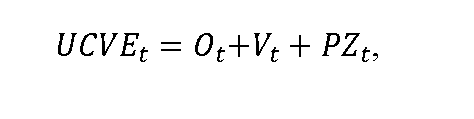

# § 10b Cenová regulácia výkonu činnosti výkupcu elektriny

Cenová regulácia sa vzťahuje na výkon činnosti výkupcu elektriny, ktorý bol určený ministerstvom hospodárstva,50c) a na výkon činnosti výkupcu elektriny dodávateľom poslednej inštancie,50d) pričom úhrada za činnosť výkupcu elektriny UCVEt v eurách/MWh sa vypočíta podľa vzorca

kde

Otsú určené náklady regulovaného subjektu na odchýlku súvisiace s výkupom elektriny od výrobcov elektriny s nárokom na podporu výkupom elektriny50e) a prevzatím zodpovednosti za odchýlku50f) v eurách na jednotku množstva elektriny vykúpenej v režime prenesenej zodpovednosti za odchýlku v roku t,

Vt sú určené náklady regulovaného subjektu na obsluhu výrobcov elektriny s nárokom na podporu výkupom elektriny50e) v eurách na jednotku množstva elektriny vykúpenej v režime prenesenej zodpovednosti za odchýlku v roku t,

PZtje primeraný zisk v eurách na jednotku množstva elektriny vykúpenej v režime prenesenej zodpovednosti za odchýlku v roku t, ktorý je možné zahrnúť do úhrady za činnosť výkupcu elektriny.
