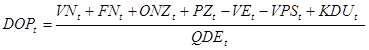
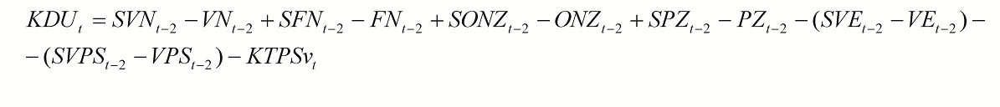
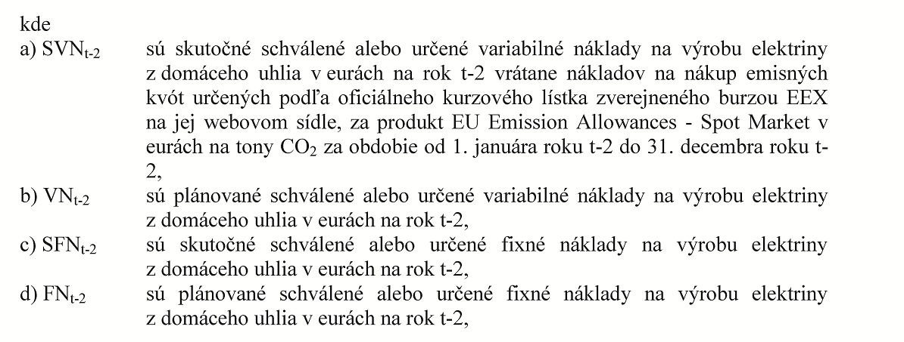
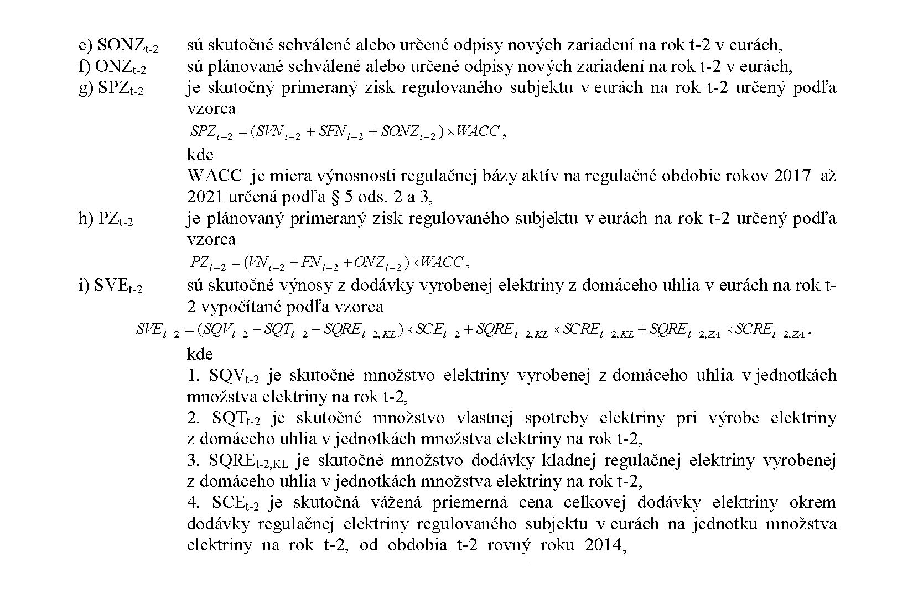
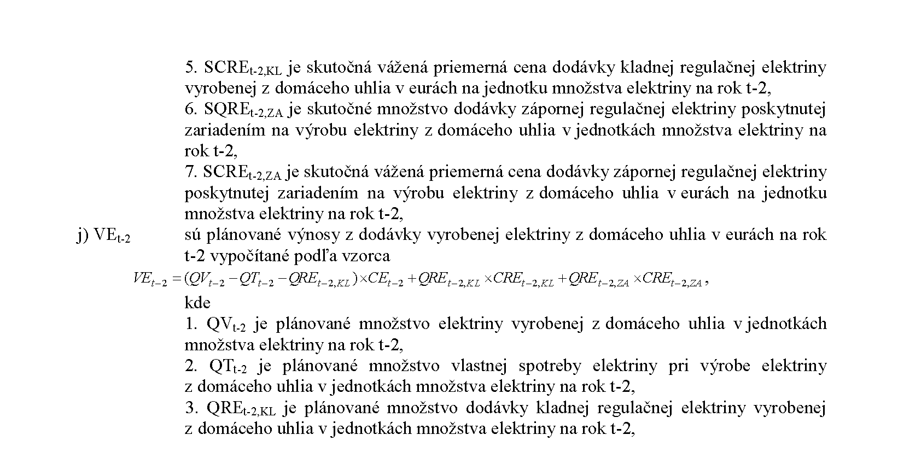
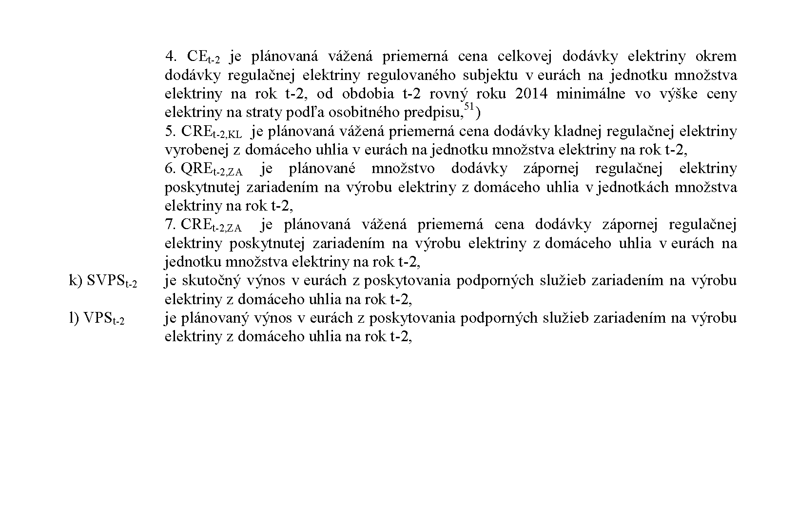

# § 11

(1) Súčasťou návrhu ceny sú:

- a) návrh cien alebo taríf za výrobu elektriny z domáceho uhlia vrátane ich štruktúry pre rok t, ktoré sa budú uplatňovať pre účastníkov trhu s elektrinou, vrátane podmienok ich pridelenia,

- b) údaje potrebné na preverenie cien za rok t-2,

- c) plán investícií a plán odpisov za regulovanú činnosť v rokoch t, t+1 a t+2,

- d) výpočty a údaje podľa tohto paragrafu týkajúce sa výroby elektriny z domáceho uhlia,

- e) znaleckým posudkom potvrdené údaje preukazujúce inštalovaný výkon zariadení na výrobu elektriny, ktoré môžu vyrábať elektrinu spaľovaním domáceho uhlia s uvedením potenciálneho množstva elektriny, ktorú je možné na tomto zariadení vyrobiť,

- f) doklad preukazujúci schválenie návrhu ceny najvyšším orgánom obchodnej spoločnosti alebo družstva alebo spoločníkmi verejnej obchodnej spoločnosti alebo spoločníkmi komanditnej spoločnosti regulovaného subjektu,

- g) údaje o inštalovanom výkone technologického zariadenia, ktoré je určené na výrobu elektriny z domáceho uhlia,

- h) ďalšie podklady potrebné na správne posúdenie návrhu ceny.

(2) Podklady podľa odseku 1 písm. a), b) a d) sa predkladajú aj v elektronickej podobe.

(3) Ustanovenia o návrhu ceny sa primerane vzťahujú aj na návrh na zmenu cenového rozhodnutia.

(4) Na základe rozhodnutia ministerstva hospodárstva o uložení povinnosti vo všeobecnom hospodárskom záujme vyrábať elektrinu z domáceho uhlia sa u výrobcu elektriny uplatní za každú megawatthodinu elektriny dodanej do sústavy, ktorá bola preukázateľne vyrobená z domáceho uhlia, pevná cena DOPt v eurách za megawatthodinu vypočítaná podľa vzorca

kde

- a) VNt sú plánované schválené alebo určené variabilné náklady na výrobu elektriny z domáceho uhlia v eurách na rok t; VNt sa vypočítajú podľa vzorca

[§ 11 ods. 4](assets/e934121be82eff079589877dcbddfc52788859a93964b9fbef8b9eee66c2cf55.pdf)

kde

- 1. QVt je plánované množstvo elektriny vyrobenej z domáceho uhlia v jednotkách množstva elektriny na rok t,

- 2. QTt je plánované množstvo vlastnej spotreby elektriny pri výrobe elektriny z domáceho uhlia v jednotkách množstva elektriny na rok t,

- 3. QREt,KL je plánované množstvo dodávky kladnej regulačnej elektriny vyrobenej z domáceho uhlia v jednotkách množstva elektriny na rok t,

- 4. CEt je plánovaná vážená priemerná cena celkovej dodávky elektriny, minimálne však vo výške ceny elektriny na straty podľa osobitného predpisu,51) okrem dodávky regulačnej elektriny regulovaného subjektu v eurách na jednotku množstva elektriny na rok t,

- 5. CREt,KL je plánovaná vážená priemerná cena dodávky kladnej regulačnej elektriny vyrobenej z domáceho uhlia v eurách na jednotku množstva elektriny na rok t,

- 6. QREt,ZA je plánované množstvo dodávky zápornej regulačnej elektriny poskytnutej zariadením na výrobu elektriny z domáceho uhlia v jednotkách množstva elektriny na rok t,

- 7. CREt,ZA je plánovaná vážená priemerná cena dodávky zápornej regulačnej elektriny poskytnutej zariadením na výrobu elektriny z domáceho uhlia v eurách na jednotku množstva elektriny na rok t,

- f) VPSt je plánovaný výnos v eurách z poskytovania podporných služieb zariadením na výrobu elektriny z domáceho uhlia na rok t,

- g) QDEt je plánovaný objem elektriny určený rozhodnutím ministerstva hospodárstva o uložení povinnosti vo všeobecnom hospodárskom záujme vyrábať elektrinu z domáceho uhlia a dodávať elektrinu vyrobenú z domáceho uhlia na rok t,

- h) KDUt je faktor vyrovnania nákladov a výnosov výroby elektriny z domáceho uhlia regulovaného subjektu v eurách na rok t vypočítaný podľa odseku 5.

(5) Faktor vyrovnania nákladov a výnosov výroby elektriny z domáceho uhlia KDUt v eurách na rok t sa vypočíta podľa vzorca

- m) KTPSvt je korekcia výnosov z platieb na základe tarify za prevádzkovanie systému výrobcu elektriny, ktorý na základe rozhodnutia ministerstva hospodárstva o uložení povinnosti vo všeobecnom hospodárskom záujme vyrába elektrinu z domáceho uhlia v eurách v roku t-2, ktorá sa vypočíta podľa vzorca

- 

- K

- T

- P

- S

- v

- t

- =

- S

- V

- T

- P

- S

- v

- t

- -

- 2

- -

- P

- V

- T

- P

- S

- v

- t

- -

- 2

- ,

- kde

  - 1. SVTPSvt-2 sú skutočné výnosy z uplatňovania tarify za prevádzkovanie systému určenej rozhodnutím úradu pre výrobcu elektriny, ktorý na základe rozhodnutia ministerstva hospodárstva o uložení povinnosti vo všeobecnom hospodárskom záujme vyrába elektrinu z domáceho uhlia v roku t-2,

  - 2. PVTPSvt-2 sú plánované výnosy z uplatňovania tarify za prevádzkovanie systému určenej rozhodnutím úradu pre výrobcu elektriny, ktorý na základe rozhodnutia ministerstva hospodárstva o uložení povinnosti vo všeobecnom hospodárskom záujme vyrába elektrinu z domáceho uhlia v roku t-2.
