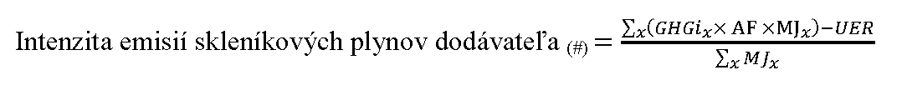

# Čl. I

Vyhláška Ministerstva životného prostredia Slovenskej republiky č. 271/2011 Z. z., ktorou sa ustanovujú kritériá trvalej udržateľnosti a ciele na zníženie emisií skleníkových plynov z pohonných látok sa mení a dopĺňa takto:

- 1. V § 1 písm. i) sa slová „poverená organizácia“ nahrádzajú slovami „organizácia podľa § 14c ods. 12 zákona“.

- 2. V § 1 písmeno k) znie:

- „k)

- priebežné ciele týkajúce sa záväzku zníženia emisií skleníkových plynov počas životného cyklu na jednotku energie z pohonných látok a dodávanej energie využívanej v cestných vozidlách a možnosť spoločného plnenia tohto záväzku podľa § 14c ods. 6 a 8 zákona,“.

- 3. V § 1 písm. l) sa slová „§ 14c ods. 2 zákona“ nahrádzajú slovami „§ 14c ods. 3 zákona“.

- 4. § 1 sa dopĺňa písmenom n), ktoré znie:

- „n)

- podrobnosti týkajúce sa metodiky výpočtu a predkladania správy o úrovni tvorby emisií skleníkových plynov počas životného cyklu na jednotku energie z pohonnej látky a dodávanej energie využívanej v cestných vozidlách (ďalej len „správa“).“.

- 5. V § 2 písmená a) a b) znejú:

- „a)

- pohonnou látkou motorové palivo, ktoré je používané na pohon cestných vozidiel, dráhových vozidiel, necestných strojov, plavidiel vnútrozemskej vodnej dopravy, poľnohospodárskych traktorov, lesných traktorov a rekreačných plavidiel, ktorým je motorový benzín, motorová nafta alebo plynový olej, skvapalnený ropný plyn (LPG), stlačený zemný plyn (CNG) alebo skvapalnený zemný plyn (LNG), pohonná látka vyrobená z obnoviteľných zdrojov energie podľa § 2 ods. 4 zákona, vodík a ich zmesi,

- b)

- biopalivom kvapalná alebo plynná pohonná látka vyrobená z obnoviteľných zdrojov energie podľa § 2 ods. 4 zákona,“.

- 6. V § 2 písmeno d) znie:

- „d)

- pohonnou látkou inou ako biopalivo každá pohonná látka podľa písmena a) okrem biopaliva,“.

- 7. § 2 sa dopĺňa písmenami l) až q), ktoré znejú:

- „l)

- emisiami v predvýrobnej fáze všetky emisie skleníkových plynov vznikajúce pred vstupom suroviny do rafinérie alebo spracovateľského zariadenia, v ktorom sa vyrába pohonná látka iná ako biopalivo,

- m)

- surovým prírodným bitúmenom akýkoľvek zdroj surovín pre rafinérie, ktorý

- 1.

- dosahuje hustotu podľa medzinárodného štandardu (ďalej len „hustota API“) 10° alebo menej, ak sa nachádza vo formácii ložiska na mieste extrakcie, meranú podľa technickej normy1a) alebo iným obdobným spôsobom,

- 2.

- má ročnú priemernú viskozitu pri teplote ložiska vyššiu, ako je viskozita vypočítaná pomocou rovnice: Viskozita = 518,98e–0,038T, kde T je teplota v °C,

- 3.

- spadá do definície pre dechtové piesky podľa kódu kombinovanej nomenklatúry 27141) a

- 4.

- pri ktorom sa mobilizácia zdroja surovín dosahuje banskou ťažbou alebo ťažbou s použitím tepelnej energie, kde tepelná energia pochádza prevažne z iných zdrojov, ako je samotný zdroj surovín,

- n)

- roponosnou bridlicou zdroj surovín pre rafinérie vo forme skalného útvaru obsahujúceho pevný kerogén, ktorý spadá do definície olejovej bridlice podľa kódu kombinovanej nomenklatúry 2714,1) a mobilizácia zdroja surovín sa dosahuje banskou ťažbou alebo ťažbou s použitím tepelnej energie,

- o)

- základnou normou platnou pre pohonné látky referenčná hodnota platná pre pohonné látky na základe emisií skleníkových plynov počas životného cyklu na jednotku energie z pohonných látok iných ako biopalivo v roku 2010,

- p)

- konvenčnou ropou surovina pre rafinérie s hustotou API viac ako 10°, ak sa nachádza vo formácii ložiska na mieste svojho pôvodu, nespadá do definície podľa kódu kombinovanej nomenklatúry 27141) a je meraná testovacou metódou podľa technickej normy1a) alebo iným obdobným spôsobom,

- q)

- biopalivo s nízkym rizikom nepriamej zmeny využívania pôdy biopalivo, ktorého suroviny sú vyrobené v rámci schém, ktoré znižujú vytláčanie produkcie na iné účely ako výrobu biopalív a ktoré sú vyrobené v súlade s kritériami trvalej udržateľnosti pre biopalivá a biokvapaliny podľa § 3.“.

  - Poznámky pod čiarou k odkazom 1 a 1a znejú:

  - „1) Nariadenie Rady (EHS) č. 2658/87 z 23. júla 1987 o colnej a štatistickej nomenklatúre a o Spoločnom colnom sadzobníku (Ú. v. ES L 256, 7. 9. 1987).

  - 1a) ASTM D287 Skúšobná metóda na meranie hustoty API v surovej rope a výrobkoch z ropy (meranie hydrometrom) (Standard Test Method for API Gravity of Crude Petroleum and Petroleum Products (Hydrometer Method).“.

- 8. V § 3 odsek 3 znie:

- „(3)

- Biopalivá alebo biokvapaliny spĺňajú kritériá trvalej udržateľnosti podľa odseku 1, ak

- a)

- od 1. januára 2018 predstavuje úspora emisií skleníkových plynov najmenej 50 % pre biopalivá a biokvapaliny vyrobené v zariadeniach, v ktorých sa začala fyzická výroba biopalív alebo biokvapalín pred 5. októbrom 2015,

- b)

- predstavuje úspora emisií skleníkových plynov najmenej 60 % pre biopalivá a biokvapaliny vyrobené v zariadeniach, v ktorých sa začala fyzická výroba biopalív alebo biokvapalín po

- 5. októbri 2015.“.

- 9. V § 3 ods. 5 písm. b) sa odkaz 1 vrátane poznámky pod čiarou vypúšťa.

- 10. V § 4 ods. 8 písm. h) sa slová „poverenou organizáciou“ nahrádza slovom „organizáciou podľa

- § 14c ods. 12 zákona“.

- 11. V § 4 ods. 8 písm. k) sa na konci pripájajú tieto slová: „ak je potvrdenie vydávané právnickou osobou alebo fyzickou osobou, ktorá je výrobcom biopaliva alebo biokvapaliny alebo je zapojená do životného cyklu výroby biopaliva alebo biokvapaliny pred výrobcom.“.

- 12. V § 4 ods. 9 sa na konci pripájajú tieto slová: „podľa § 14b ods. 4 zákona.“.

- 13. V § 4 ods. 10 sa na konci pripájajú tieto slová: „odborne spôsobilou osobou okrem kontroly výpočtu alebo započítania emisií skleníkových plynov, ktoré vznikli v ďalších etapách životného cyklu biopaliva alebo biokvapaliny a hmotnostnej bilancie.“.

- 14. V § 5 ods. 2 písmeno b) znie:

- „b)

- pestované v členských štátoch v oblastiach schválených Európskou komisiou, v ktorých možno očakávať, že bežné emisie skleníkových plynov z pestovania poľnohospodárskych surovín sa rovnajú alebo sú nižšie ako emisie uvedené pod nadpisom „Roztriedenie určených hodnôt pre pestovanie“ v prílohe č. 2 časti D,“.

- 15. § 6 sa dopĺňa odsekom 6, ktorý znie:

- „(6)

- Hmotnostná bilancia sa overuje najmenej jedenkrát ročne; ak je energetický obsah pohonnej látky započítaný dvojnásobne, hmotnostná bilancia u osôb, ktoré sú prvým miestom zhromažďovania, skladovania alebo vytrieďovania, sa overuje najmenej dvakrát ročne.“.

- 16. § 8 vrátane nadpisu znie:

- 㤠8

- Organizácia podľa § 14c ods. 12 zákona

- Organizácia podľa § 14c ods. 12 zákona kontroluje činnosť odborne spôsobilých osôb, pracovné postupy, metódy a plnenie ustanovení zákona a tejto vyhlášky najmenej jedenkrát ročne a z vykonanej kontroly vyhotoví zápisnicu.“.

- 17. § 9 vrátane nadpisu znie:

- 㤠9

- Znižovanie emisií skleníkových plynov z pohonnej látky a dodávanej energie

- (1)

- Právnická osoba alebo fyzická osoba, ktorá uvádza pohonnú látku na trh, plní pri znižovaní emisií skleníkových plynov počas životného cyklu na jednotku energie z pohonnej látky tieto ciele platné pre kalendárny rok:

- a)

- 6 % do 31. decembra 2020,

- b)

- priebežné ciele 2 % do 31. decembra 2017, 3 % od 1. januára 2018 a 3,8 % od 1. januára 2019.

- (2)

- Ciele, ktoré sú uvedené v odseku 1, môže plniť aj dodávateľ elektriny využívanej v cestných vozidlách podľa § 14c ods. 9 zákona.

- (3)

- Zníženie emisií skleníkových plynov počas životného cyklu pohonnej látky inej ako biopalivo možno dosiahnuť

- a)

- primiešavaním biopalív alebo uvedením biopalív na trh,

- b)

- uvedením pohonných látok s nižšími emisiami skleníkových plynov, napríklad skvapalneného ropného plynu, stlačeného alebo skvapalneného zemného plynu, alebo vodíka, na trh,

- c)

- dodaním elektriny pre cestné vozidlá,

- d)

- znižovaním emisií skleníkových plynov v predvýrobnej fáze (ďalej len „znižovanie emisií v predvýrobnej fáze“),

- e)

- zachytávaním a využívaním uhlíka na dopravu.“.

- 18. Za § 9 sa vkladá § 9a, ktorý vrátane nadpisu znie:

- 㤠9a

- Znižovanie emisií v predvýrobnej fáze

- (1)

- Znižovanie emisií v predvýrobnej fáze sa započítava, ak

- a)

- je spojené s projektom, ktorý začal generovať úspory emisií skleníkových plynov po 1. januári 2011, pričom schéma na dosiahnutie znižovania emisií v predvýrobnej fáze sa tiež považuje za projekt,b)

- b)

- je množstvo zníženia emisií skleníkových plynov overené autorizovanou osobou alebo osobou s akreditáciou, či iným oprávnením podľa práva členských štátov podľa odseku 4 a

- c)

- nie je množstvo zníženia emisií skleníkových plynov7a) zohľadnené na plnenie záväzkov7b) v žiadnom štáte.

- (2)

- Znižovanie emisií v predvýrobnej fáze sa môže uplatniť len na tú časť priemerných určených hodnôt, ktorá náleží emisiám v predvýrobnej fáze:

- a) | motorový benzín (MB) | 11,0 g CO2eq/MJ,

- b) | motorová nafta a plynový olej (NM) | 11,3 g CO2eq/MJ,

- c) | stlačený zemný plyn (CNG) | 9,1 g CO2eq/MJ,

- d) | skvapalnený zemný plyn (LNG) | 15,0 g CO2eq/MJ,

- e) | skvapalnený ropný plyn (LPG) | 6,2 g CO2eq/MJ,

- f) | maximálne použiteľný objem pri reťazci výroby pohonných látok z ropy = MJMB × 11,0 + MJNM × 11,3 + MJLPG × 6,2 [g CO2eq/MJ] |

- g) | maximálne použiteľný objem pri reťazci výroby pohonných látok zo zemného plynu = MJCNG × 9,1 + MJLNG × 15,0 + MJLPG × 6,2 [g CO2eq/MJ]. |

- (3)

- Na započítavanie znižovania emisií v predvýrobnej fáze nie je potrebné preukázať, že by k znižovaniu emisií v predvýrobnej fáze nedošlo bez požiadaviek na predkladanie správ pod

- § 14c ods. 3 zákona a požiadaviek na znižovanie emisií skleníkových plynov podľa § 14c ods. 6 zákona.

- (4)

- Znižovanie emisií v predvýrobnej fáze sa odhaduje a potvrdzuje v súlade s medzinárodnými zásadami a medzinárodnými štandardmi určenými napríklad v technickej norme7c) alebo iným obdobným spôsobom. Znižovanie emisií v predvýrobnej fáze a základné emisie sa monitorujú, nahlasujú a overujú podľa medzinárodných štandardov najmä podľa technickej normy7d) alebo iným obdobným spôsobom. Metódy odhadovania znižovania emisií v predvýrobnej fáze sa musia overovať podľa medzinárodných štandardov najmä podľa technickej normy7e) alebo iným obdobným spôsobom a organizácia, ktorá vykonáva overenie, musí byť akreditovaná podľa medzinárodných štandardov najmä podľa technickej normy7f) alebo iným obdobným spôsobom.

- (5)

- Jednotky znižovania emisií v predvýrobnej fáze sa zasielajú

- a)

- na holdingový účet Slovenskej republiky vedený v registri Únie podľa osobitého predpisu,7g) ak ide o jednotky Mechanizmu čistého rozvoja alebo Spoločnej implementácie;7a) ministerstvo zverejní identifikačné údaje holdingového účtu Slovenskej republiky na svojom webovom sídle,

- b)

- ministerstvu, ak nejde o jednotky podľa písmena a).

- (6)

- Potvrdenie o prevode jednotiek znižovania emisií v predvýrobnej fáze v registri Únie podľa odseku 5 písm. a) sa prikladá k správe podľa § 14c ods. 3 zákona.“.

- Poznámky pod čiarou k odkazom 7a až 7g znejú:

- „7a) § 2 písm. i) a j) zákona č. 414/2012 Z. z. o obchodovaní s emisnými kvótami a o zmene a doplnení niektorých zákonov v znení zákona č. 399/2014 Z. z.

- 7b) Oznámenie Ministerstva zahraničných vecí Slovenskej republiky o uzavretí Kjótskeho protokolu k Rámcovému dohovoru Organizácie Spojených národov o zmene klímy (oznámenie č. 139/2005 Z. z.).

- 7c) Súbor STN EN ISO 14064 Skleníkové plyny (83 9064), STN EN ISO 14065 Skleníkové plyny. Požiadavky na validačné a overovacie orgány na účely ich akreditácie alebo iných foriem uznávania (ISO 14065: 2013) (83 9065) a ISO 14066 Greenhouse gases - Competence requirements for greenhouse gas validation teams and verification teams (Skleníkové plyny. Požiadavky na kompetentnosť validačných a overovacích tímov (pri validácii a overovaní vyhlásení o skleníkových plynoch).

- 7d) Súbor STN EN ISO 14064 Skleníkové plyny (83 9064).

- 7e) STN EN ISO 14064-3 Skleníkové plyny. Časť 3: Pokyny na validáciu a overovanie výrokov o skleníkových plynoch (ISO 14064-3: 2006) (83 9064).

- 7f) STN EN ISO 14065 Skleníkové plyny. Požiadavky na validačné a overovacie orgány na účely ich akreditácie alebo iných foriem uznávania (ISO 14065: 2013) (83 9065), Nariadenia Komisie (EÚ) č. 600/2012 a 601/2012.

- 7g) Nariadenie Komisie (EÚ) č. 389/2013 z 2. mája 2013, ktorým sa zriaďuje register Únie podľa smernice Európskeho parlamentu a Rady 2003/87/ES a rozhodnutí Európskeho parlamentu a Rady č. 280/2004/ES a č. 406/2009/ES a ktorým sa zrušujú nariadenia Komisie (EÚ) č. 920/2010 a č. 1193/2011 (Ú. v. EÚ L 122, 3. 5. 2013).“.

- 19. § 10 vrátane nadpisu znie:

- 㤠10

- Výpočet emisií skleníkových plynov počas životného cyklu pohonných látok a dodávanej energie, zasielanie správ a rozhodovanie v sporných prípadoch

- (1)

- Právnická osoba alebo fyzická osoba, ktorá uvádza pohonnú látku a elektrinu pre cestné vozidlá na trh, vypracuje a podá správu každoročne do 31. mája nasledujúceho kalendárneho roka.

- (2)

- Právnická osoba alebo fyzická osoba, ktorá uvádza pohonnú látku a elektrinu pre cestné vozidlá na trh, používa pri vykazovaní plnenia cieľov znižovania emisií skleníkových plynov počas životného cyklu na jednotku energie z pohonnej látky a dodávanej energie metodiku výpočtu emisií skleníkových plynov počas životného cyklu na jednotku energie z pohonnej látky a elektriny v prílohe č. 4.

- (3)

- Právnická osoba alebo fyzická osoba, ktorá uvádza pohonnú látku a elektrinu pre cestné vozidlá na trh, používa pri vykazovaní plnenia cieľov podľa § 9 ods. 1 základnú normu platnú pre pohonné látky 94,1 g CO2eq/MJ.

- (4)

- Zjednodušená metodika podľa § 19b ods. 1 písm. f) zákona je uvedená v prílohe č. 4 druhej časti piatom bode.

- (5)

- Právnická osoba alebo fyzická osoba v správe uvedie okrem údajov podľa prílohy č. 4 aj tieto údaje:

- a)

- obchodné meno alebo meno a priezvisko,

- b)

- sídlo alebo bydlisko,

- c)

- identifikačné číslo (IČO),

- d)

- daňové identifikačné číslo (DIČ),

- e)

- registračné číslo v schéme kontroly trvalej udržateľnosti, ako napríklad SK-BIO,

- f)

- údaje o osobe, ktorá je zodpovedná za podanie správy:

- 1.

- meno a priezvisko,

- 2.

- telefónne číslo,

- 3.

- e-mailovú adresu,

- g)

- vyhlásenie, že je malým podnikom7h) alebo stredným podnikom7i) a využíva zjednodušenú metodiku podľa odseku 4.

- (6)

- Formát správ sa harmonizuje na úrovni Európskej únie. Po oznámení formátu ho ministerstvo zverejňuje na svojom webovom sídle. Právnická osoba alebo fyzická osoba, ktorá uvádza pohonnú látku a elektrinu pre cestné vozidlá na trh, použije nový formát správy v nasledujúcom roku po jeho zverejnení vrátane príslušnej webovej aplikácie.

- (7)

- Harmonizovaný formát správ obsahuje aj predbežné stredné hodnoty odhadovaných emisií skleníkových plynov vyplývajúcich z nepriamej zmeny využívania pôdy, ktoré sú uvedené v prílohe č. 5. Hodnoty nemajú žiadny vplyv na výpočet emisií skleníkových plynov počas životného cyklu biopalív a biokvapalín podľa § 5 a ani na výpočet emisií skleníkových plynov počas životného cyklu pohonných látok a dodávanej energie podľa odsekov 2 a 3.“.

  - Poznámky pod čiarou k odkazom 7h a 7i znejú:

  - „7h) Čl. 2 ods. 2 Prílohy I nariadenia Komisie (EÚ) č. 651/2014 zo 17. júna 2014 o vyhlásení určitých kategórií pomoci za zlučiteľné s vnútorným trhom podľa článkov 107 a 108 Zmluvy (Ú. v. EÚ L 187, 26. 6. 2014).

  - 7i) Čl. 2 Prílohy I nariadenia (EÚ) č. 651/2014.“.

- 20. Za § 10 sa vkladá § 10a, ktorý vrátane nadpisu znie:

- 㤠10a

- Správy predkladané Slovenskou republikou Európskej komisii

- (1)

- Údaje podľa odsekov 2 a 3 sa oznamujú Európskej komisii každoročne do 31. augusta. Tieto údaje sa oznamujú za všetky pohonné látky a dodanú energiu uvedené na trh. Ak sa s pohonnými látkami inými ako biopalivo zmiešavajú rôzne druhy biopalív alebo biopalivá s rozdielnymi vlastnosťami trvalej udržateľnosti, predkladajú sa údaje za každé biopalivo.

- (2)

- Pre každý typ pohonnej látky a dodanej energie sa oznamujú súhrnne tieto údaje:

- a)

- druh pohonnej látky alebo dodanej energie,

- b)

- objem alebo množstvo pohonnej látky alebo elektrickej energie,

- c)

- intenzita emisií skleníkových plynov,

- d)

- znižovanie emisií v predvýrobnej fáze,

- e)

- pôvod,

- f)

- miesto nákupu.

- (3)

- Údaje uvedené v odseku 2 sa oznamujú súhrnne pre každý typ pohonnej látky a dodanej energie bez ohľadu na obchodný názov a základné vlastnosti, ako napríklad oktánové alebo cetanové číslo. Zmesi motorového benzínu a etanolu E85 sa uvádzajú ako samostatná pohonná látka.“.

- 21. Príloha č. 1 znie:

- „Príloha č. 1

- k vyhláške č. 271/2011 Z. z.

- ENERGETICKÝ OBSAH POHONNÝCH LÁTOK V DOPRAVE

- Palivo | Energetický obsah na základe hmotnosti (dolná výhrevnosť) [MJ/kg] | Energetický obsah na základe objemu (dolná výhrevnosť) [MJ/l]

- bioetanol (etanol vyrobený z biomasy) | 27 | 21

- bio-ETBE (etyl-terc-butyl-éter vyrobený na báze bioetanolu) | 36 (z čoho 37 % pochádza z obnoviteľných zdrojov energie - [OZE]) | 27 (z čoho 37 % pochádza z OZE)

- biometanol (metanol vyrobený z biomasy,) | 20 | 16

- bio-MTBE (metyl-terc-butyl-éter vyrobený na báze biometanolu) | 35 (z čoho 22 % pochádza z OZE) | 26 (z čoho 22 % pochádza z OZE)

- bio-DME (dimetyléter vyrobený z biomasy, používaný ako biopalivo) | 28 | 19

- bio-TAEE (terciárny amyl-etyl-éter vyrobený na báze bioetanolu) | 38 (z čoho 29 % pochádza z OZE) | 29 (z čoho 29 % pochádza z OZE)

- biobutanol (butanol vyrobený z biomasy) | 33 | 27

- bionafta (metyl-ester vyrobený z rastlinného alebo živočíšneho oleja s kvalitou nafty) | 37 | 33

- nafta vyrobená technológiou Fischer-Tropsch (syntetický uhľovodík alebo zmes syntetických uhľovodíkov vyrobených z biomasy) | 44 | 34

- hydrogenačne rafinovaný rastlinný olej (rastlinný olej termochemicky spracovaný vodíkom) | 44 | 34

- čistý rastlinný olej (olej vyrobený z olejnatých rastlín lisovaním, extrahovaním alebo podobnými postupmi, surový alebo rafinovaný, ale chemicky nemodifikovaný) | 37 | 34

- bioplyn (palivový plyn vyrobený z biomasy a/alebo z biologicky odbúrateľného podielu odpadu, ktorý môže čistením dosiahnuť kvalitu zemného plynu) | 50 | —

- automobilový benzín | 43 | 32

- motorová nafta | 43 | 36

- skvapalnený ropný plyn (LPG), | 46,0 | —

- zemný plyn (CNG alebo LNG) – EU mix | 45,1 | —

- zemný plyn (CNG alebo LNG) – Rusko | 49,2 | —

- vodík | 120,1 | —

- metán | 50,0 | —

- metylpropán (izobután) | 45,6 | —

- izobutylén (izobutén) | 45,1 | —

- propylén (propén) | 45,7 | —

- “.

- 22. V prílohe č. 2 časti C siedmy bod znie:

- „7.

- Množstvo emisií za rok vyplývajúcich zo zmien zásob uhlíka spôsobených zmenami vo využívaní pôdy, el, sa vypočítava rovnomerným rozdelením celkových emisií za obdobie 20 rokov. Na výpočet týchto emisií sa používa tento vzorec:

- el = (CSR - CSA) × 3,664 × 1⁄20 × 1⁄P - eB*),

- kde

- el je množstvo emisií skleníkových plynov na rok vyplývajúcich zo zmien zásob uhlíka spôsobených zmenou využívania pôdy [g CO2eq/MJ]; orná pôda **) a pôda pre trváce plodiny***) sa považujú za jedno využitie pôdy,

- CSR je zásoba uhlíka na jednotku plochy súvisiaca s referenčným využívaním pôdy (vyjadrená v hmotnosti uhlíka [t] na jednotku plochy vrátane pôdy a vegetácie). Za referenčné využívanie pôdy sa považuje využívanie pôdy v januári 2008 alebo využívanie pôdy 20 rokov pred tým, ako sa získali suroviny, podľa toho, ktoré využívanie sa realizovalo neskôr,

- CSA je zásoba uhlíka na jednotku plochy súvisiaca so skutočným využívaním pôdy (vyjadrená v hmotnosti uhlíka [t] na jednotku plochy vrátane pôdy a vegetácie). Ak sa zásoba uhlíka zhromažďuje viac ako jeden rok, hodnotou CSA je odhadovaná zásoba na jednotku plochy po dvadsiatich rokoch alebo po dozretí plodín, podľa toho, ktoré obdobie nastane skôr,

- P je produktivita plodín (meraná ako energia získaná z biopaliva a biokvapaliny na jednotku plochy za rok) a

- eB je bonus vo výške 29 g CO2eq/MJ biopalív alebo biokvapalín, ak sa biomasa získava z obnovenej znehodnotenej pôdy za podmienok ustanovených v ôsmom bode.

- Vysvetlivky:

- *) Konštanta získaná vydelením molekulovej hmotnosti CO2 (44,01 g/mol) molekulovou hmotnosťou uhlíka (12,011 g/mol) sa rovná 3,664.

- **) Orná pôda tak, ako ju vymedzil IPCC.

- ***) Trvácne plodiny sa vymedzujú ako viacročné plodiny, ktorých kmene sa väčšinou každoročne nezberajú, ako napríklad rýchlorastúce výmladkové porasty a palma olejná.

- Hodnoty CSR a CSA možno vypočítať podľa osobitného predpisu.8)“.

  - Poznámka pod čiarou k odkazu 8 znie:

  - „8) Rozhodnutie Komisie z 10. júna 2010 o usmerneniach na výpočet zásob uhlíka v pôde na účely prílohy V k smernici 2009/28/ES (Ú. V. EÚ L 151/19, 17. 6. 2010).“.

- 23. Príloha č. 3 sa dopĺňa bodmi 3 a 4, ktoré znejú:

- „3.

- Smernica Rady (EÚ) 2015/652 z 20. apríla 2015, ktorou sa stanovujú metodiky výpočtu a požiadavky na predkladanie správ podľa smernice Európskeho parlamentu a Rady 98/70/ES týkajúcej sa kvality benzínu a naftových palív (Ú. v. EÚ L 107, 25. 4. 2015).

- 4.

- Smernica Európskeho parlamentu a Rady (EÚ) 2015/1513 z 9. septembra 2015, ktorou sa mení smernica 98/70/ES týkajúca sa kvality benzínu a naftových palív a ktorou sa mení smernica 2009/28/ES o podpore využívania energie z obnoviteľných zdrojov energie (Ú. v. EÚ L 239, 15. 9. 2015).“.

- 24. Vyhláška sa dopĺňa prílohami č. 4 a 5, ktoré znejú:

- „Príloha č. 4

- k vyhláške č. 271/2011 Z. z.

- METODIKA VÝPOČTU A PREDKLADANIA SPRÁV

- Časť 1

- Výpočet intenzity emisií skleníkových plynov počas životného cyklu na jednotku energie z pohonnej látky a dodávanej energie:

- 1.

- Skleníkové plyny zohľadnené pri výpočte intenzity emisií skleníkových plynov z pohonných látok iných ako biopalivo a elektriny sú oxid uhličitý (CO2), oxid dusný (N2O) a metán (CH4). Na účely výpočtu ekvivalentu CO2 majú emisie týchto plynov vzhľadom na ekvivalentné emisie CO2 túto hodnotu:

- CO2: 1; | CH4: 25; | N2O: 298.

- 2.

- Emisie z výroby strojov a zariadení používaných pri ťažbe, výrobe, rafinovaní a spotrebe pohonných látok sa pri výpočte emisií skleníkových plynov nezohľadňujú.

- 3.

- Intenzita emisií skleníkových plynov zo všetkých pohonných látok a dodávanej energie [g CO2eq/MJ] uvedených na trh jednou právnickou alebo fyzickou osobou počas životného cyklu pohonných látok a dodávanej energie sa vypočíta podľa vzorca:

- ,

- kde:

- a)

- „#“ je identifikácia právnickej osoby alebo fyzickej osoby, ktorá plní povinnosť podľa § 10 ods. 1. Požadované identifikačné údaje sú špecifikované v § 10 ods. 6.

- b)

- „x“ sú druhy pohonných látok podľa § 2 písm. a) a elektrina pre cestné vozidlá;

- c)

- „MJx“ je celková energia uvedená na trh v pohonných látkach a elektrine [MJ]. Vypočíta sa takto:

- 1.

- Celková energia každého druhu pohonnej látky

- Množstvá pohonných látok uvedených na trh sa prevedú na svoj energetický obsah (dolnú výhrevnosť) podľa energetického obsahu stanoveného v prílohe č. 1 ako súčin množstva každého druhu pohonnej látky v litroch alebo kilogramoch a jeho energetického obsahu na jednotku objemu alebo hmotnosti. Množstvá pohonných látok neuvedených v prílohe č. 1 sa prevedú na energetický obsah (dolnú výhrevnosť) podľa usmernenia, ktoré ministerstvo zverejní na svojom webovom sídle. Pri zmiešavaní viacerých biopalív s pohonnou látkou inou ako biopalivo sa pri výpočtoch zohľadňujú množstvá a druhy všetkých biopalív.

- Množstvo biopalív, ktoré nie sú v súlade s kritériami trvalej udržateľnosti podľa § 3, sa započítava ako pohonná látka iná ako biopalivo, do ktorej sú primiešané alebo ktorú nahrádzajú.

- 2.

- Celková energia pri súčasnom (kombinovanom) spracovaní pohonných látok iných ako biopalivo a biopalív

- Súčasné spracovanie je definované ako úprava počas životného cyklu pohonnej látky alebo energie, ktorá spôsobuje zmeny v molekulárnej štruktúre produktu. Pridanie denaturačnej látky nepatrí do tohto spracovania. Množstvo biopalív spracúvaných súčasne s pohonnými látkami inými ako biopalivo odráža stav biopaliva po spracovaní. Množstvo súčasne spracúvaného biopaliva sa určuje v súlade s energetickou bilanciou a účinnosťou procesu spoločného spracovania, ako sa uvádza v prílohe č. 2 časť C 16. a 17. bode.

- 3.

- Celková energia z dodanej elektriny je množstvo elektriny spotrebovanej v cestných vozidlách, motocykloch alebo elektrických bicykloch, pričom sa toto množstvo určuje takto:

- 3.1

- spotrebovaná elektrina je súčinom prejdenej vzdialenosti cestnými vozidlami [km] a účinnosti spotreby elektrickej energie [MJ/km], ak sú požadované údaje k dispozícii alebo

- 3.2

- namerané množstvo elektriny spotrebovanej v cestných vozidlách.

- d)

- „UER“ – zníženie emisií v predvýrobnej fáze

- UER je zníženie emisií skleníkových plynov v predvýrobnej fáze [g CO2eq], ak je kvantifikované a oznámené v súlade s požiadavkami podľa § 9a.

- e)

- „GHGix“ je intenzita emisií skleníkových plynov z pohonnej látky alebo dodávanej energie [g CO2eq/MJ]. Intenzita emisií skleníkových plynov z pohonnej látky alebo dodávanej energie sa určí alebo vypočíta takto:

- 1.

- pre pohonné látky iné ako biopalivo sa použije vážená intenzita emisií skleníkových plynov počas životného cyklu podľa druhu pohonnej látky uvedená v poslednom stĺpci tabuľky v časti 2 šiestom bode,

- 2.

- pre elektrickú energiu je hodnota intenzity emisií skleníkových plynov výroby elektriny v Slovenskej republike zverejňovaná podľa časti 2 siedmy bod,

- 3.

- pre biopalivo, ktoré spĺňa kritériá trvalej udržateľnosti podľa § 3, sa vypočíta v súlade s § 5. Ak sa údaje o emisiách skleníkových plynov počas životného cyklu biopaliva získajú v súlade s § 14c ods. 13 zákona, tieto údaje sa použijú aj na stanovenie intenzity emisií skleníkových plynov z biopaliva. Intenzita emisií skleníkových plynov z biopaliva, ktoré nespĺňa kritériá trvalej udržateľnosti uvedené v § 3, sa rovná intenzite emisií skleníkových plynov z príslušnej pohonnej látky inej ako biopalivo, do ktorej je primiešané alebo ktorú nahrádza,

- 4.

- pri súčasnom kombinovanom spracovaní pohonných látok iných ako biopalivo a biopalív musí intenzita emisií skleníkových plynov z biopalív odrážať stav biopaliva po spracovaní.

- f)

- „AF“ sú korekčné faktory podľa účinnosti pohonu:

- Prevládajúca konverzná technológia | Faktor účinnosti

- Spaľovací motor | 1

- Elektrická hnacia sústava s batériou | 0,4

- Elektrická hnacia sústava s vodíkovými palivovými článkami | 0,4

- Časť 2

- Predkladanie správ podľa § 10 ods. 1

- 1. Obsah správy

- Za každú pohonnú látku a dodanú energiu sa oznamujú tieto súhrnné údaje:

- a)

- Druh pohonnej látky alebo dodanej energie

- Uvádza sa každý druh pohonnej látky a dodanej energie, ktorý bol uvedený na trh Slovenskej republiky v roku, za ktorý sa podáva správa.

- b)

- Objem alebo množstvo pohonnej látky alebo elektrickej energie

- Údaje sa uvádzajú súhrnne za pohonné látky a dodanú energiu, ktoré majú rovnaký pôvod, miesto nákupu a pri biopalivách aj rovnaké vlastnosti trvalej udržateľnosti (zhodná východisková surovina, krajina vypestovania a rovnaké emisie skleníkových plynov za životný cyklus biopaliva). Údaje za pohonné látky sa uvádzajú osobitne za pohonné látky iné ako biopalivo a za biopalivo bez ohľadu na to, či boli uvedené na trh v zmesi alebo samostatne. Samostatne sa uvádza doplnkový údaj o tom, koľko z uvedených pohonných látok bolo uvedené na trh ako zmes motorového benzínu a etanolu E85.

- c)

- Intenzita emisií skleníkových plynov

- Uvádza sa určená alebo vypočítaná hodnota podľa časti 1 tretí bod písm. e).

- d)

- Znižovanie emisií v predvýrobnej fáze (UER)

- Uvádzajú sa údaje podľa druhého bodu.

- e)

- Pôvod

- Uvádzajú sa údaje podľa tretieho bodu.

- f)

- Miesto nákupu

- Uvádzajú sa údaje podľa štvrtého bodu.

- 2. UER týkajúce sa pohonných látok iných ako biopalivo

- Aby UER boli oprávnené na účely metodiky výpočtu a podávania správ, je potrebné oznámiť tieto údaje:

- a)

- dátum začatia projektu,

- b)

- ročné zníženia emisií [g CO2eq],

- c)

- trvanie oznamovaného zníženia,

- d)

- miesto projektu nachádzajúce sa najbližšie k zdroju emisií určené zemepisnou šírkou a zemepisnou dĺžkou v stupňoch na štyri desatinné miesta,

- e)

- základné ročné emisie vyrobených surovín pred zavedením opatrení na ich zníženie a ročné emisie po zavedení opatrení na ich zníženie [g CO2eq/MJ],

- f)

- neprenosné číslo dokladu (certifikátu), ktoré jedinečným spôsobom identifikuje vykázané zníženie emisií skleníkových plynov; v prípade UER podľa § 9a ods. 5, písm. b) číslo prideľuje ministerstvo, ak nebolo organizáciou podľa § 14c ods. 12 zákona, ktorá vykonáva overenie podľa § 9a ods. 4,

- g)

- neprenosné číslo, ktoré jedinečným spôsobom identifikuje metodiku výpočtu a príslušnú schému, ak bolo pridelené; číslo prideľuje alebo oznamuje organizácia podľa § 14c ods. 12 zákona, ktorá vykonáva overenie podľa § 9a ods. 4,

- h)

- ak sa projekt týka ťažby ropy, pomer medzi plynom a ropou (Gas-to-oil ratio – GOR) v roztoku ako priemerná ročná historická hodnota a hodnota za sledovaný rok, tlak v nádrži, hĺbka a výnosnosť pri ťažbe surovej ropy podľa vrtov.

- 3. Pôvod

- „Pôvod“ je krajina, kde bola východisková surovina na výrobu pohonnej látky vyťažená, získaná alebo vypestovaná a jej obchodný názov, ak existuje.

- Pri pohonných látkach iných ako biopalivo je pôvod uvedený v časti 2 ôsmom bode. Údaj sa uvádza, ak je právnická osoba alebo fyzická osoba držiteľom potrebných informácií na základe

- a)

- skutočnosti, že je právnickou osobou alebo fyzickou osobou, ktorá dováža ropu z krajiny mimo Európsku úniu alebo prijíma dodávky ropy z iného členského štátu podľa osobitného predpisu9), alebo

- b)

- dohody o poskytnutí informácií inou právnickou osobou alebo fyzickou osobou, ktorá je zapojená do životného cyklu výroby pohonnej látky podľa § 14c ods. 11 zákona.

- Vo všetkých ostatných prípadoch sa za pôvod považuje údaj, či východisková surovina pochádza z členského štátu alebo z krajiny mimo Európskej únie.

- Pri použití viacerých východiskových surovín v jednom spracovateľskom zariadení počas roka, za ktorý sa podáva správa, oznamuje právnická osoba alebo fyzická osoba údaje o množstve pohonnej látky inej ako biopalivo uvedenej na trh podľa jednotlivých krajín pôvodu, druhov východiskových surovín a ich obchodných názvov.

- Pri biopalivách je pôvodom reťazec výroby biopalív uvedený v prílohe č. 2, napríklad etanol z kukurice, bionafta z repky olejnej a krajina vypestovania východiskovej suroviny.

- 4. Miesto nákupu

- „Miesto nákupu“ je krajina a názov spracovateľského zariadenia alebo rafinérie, v ktorej pohonná látka alebo dodávaná energia prešli posledným podstatným spracovaním, pričom týmto označením sa uvádza pôvod pohonnej látky alebo dodávanej energie v súlade s osobitným predpisom.10) Ak právnická osoba a fyzická osoba preukáže, že sa jej ani s vynaložením všetkého úsilia nepodarilo miesto nákupu zistiť, uvedie sa, či pohonná látka a dodávaná energia pochádza z členského štátu alebo z krajiny mimo Európsku úniu.

- 5. Zjednodušená metodika podávania správy

- Právnická osoba alebo fyzická osoba podľa § 14c ods. 5 zákona môže pri pohonných látkach iných ako biopalivo uviesť namiesto údajov v druhom a treťom bode 3 informáciu, či východisková surovina a pohonná látka iná ako biopalivo pochádza z členského štátu alebo z krajiny mimo Európskej únie bez ohľadu na to, či dováža ropu alebo dodáva pohonné látky z ropy alebo získané z bitúmenových materiálov.

- 6. Priemerné určené hodnoty intenzity emisií skleníkových plynov z pohonných látok iných ako biopalív a elektrickej energie počas ich životného cyklu

- Zdroj surovín a proces | Pohonné látky uvádzané na trh | Intenzita emisií skleníkových plynov počas životného cyklu [g CO2eq/MJ] | Vážená intenzita emisií skleníkových plynov počas životného cyklu [g CO2eq/MJ]

- Konvenčná ropa | benzín | 93,2 | 93,3

- Skvapalnený zemný plyn | | 94,3 |

- Skvapalnené uhlie | | 172 |

- Prírodný bitúmen | | 107 |

- Roponosná bridlica | | 131,3 |

- Konvenčná ropa | motorová nafta alebo plynový olej | 95 | 95,1

- Skvapalnený zemný plyn | | 94,3 |

- Skvapalnené uhlie | | 172 |

- Prírodný bitúmen | | 108,5 |

- Roponosná bridlica | | 133,7 |

- Akékoľvek fosílne zdroje | skvapalnený ropný plyn (LPG) v zážihovom motore | 73,6 | 73,6

- Zemný plyn, EÚ mix | stlačený zemný plyn v zážihovom motore | 69,3 | 69,3

- Zemný plyn, EÚ mix | skvapalnený zemný plyn v zážihovom motore | 74,5 | 74,5

- Sabatierova reakcia elektrolýzou vodíka z nebiologického obnoviteľného zdroja energie | stlačený syntetický metán v zážihovom motore | 3,3 | 3,3

- Zemný plyn využívajúci parnú reformáciu | stlačený vodík v palivovom článku | 104,3 | 104,3

- Elektrolýza plne napájaná z nebiologického obnoviteľného zdroja energie | stlačený vodík v palivovom článku | 9,1 | 9,1

- Uhlie | stlačený vodík v palivovom článku | 234,4 | 234,4

- Uhlie so zachytávaním a ukladaním uhlíka z emisií vzniknutých počas spracovania | stlačený vodík v palivovom článku | 52,7 | 52,7

- Odpadové plasty pochádzajúce z fosílnych surovín | benzín, motorová nafta alebo plynový olej | 86 | 86

- 7. Elektrická energia

- Na predkladanie správ o dodanej elektrine, ktorú spotrebúvajú elektrické vozidlá, motocykle alebo elektrické bicykle, ministerstvo zverejní na svojom webovom sídle vnútroštátnu priemernú určenú hodnotu intenzity emisií skleníkových plynov za životný cyklus elektriny. Ministerstvo zverejňuje zmenu určenej hodnoty, ak nastane významná zmena energetického mixu výroby elektriny.

- 8. Obchodný názov východiskovej suroviny

- [tabuľka](assets/9932a2cd1cd357cae9d5202eded9989dec021e40194ec241bfc388df2073090e.pdf)

- Príloha č. 5

- k vyhláške č. 271/2011 Z. z.

- PREDBEŽNÉ ODHADOVANÉ EMISIE SKLENÍKOVÝCH PLYNOV

- Časť A

- Predbežné odhadované emisie zo surovín pre výrobu biopalív a biokvapalín vyplývajúce z nepriamej zmeny využívania pôdy [gCO2eq/MJ]*)

- Skupina surovín | Stred*) | Percentuálny rozsah odvodený od analýzy citlivosti**)

- Obilniny a iné plodiny bohaté na škrob | 12 | 8 až 16

- Cukornaté plodiny | 13 | 4 až 17

- Olejniny | 55 | 33 až 66

- *) Stredné hodnoty, ktoré sú tu zahrnuté, predstavujú vážený priemer individuálne modelovaných hodnôt surovín.

- **) Rozsah, ktorý je tu zahrnutý, odráža 90 % výsledkov pri použití hodnôt piaty a dvadsiaty piaty percentil vyplývajúcich z analýzy. Piaty percentil znamená hodnotu, pod ktorou sa nachádzalo 5 % pozorovaní (t. j. 5 % celkových použitých údajov malo výsledky pod dolnými hodnotami 8, 4 a 33 g CO2eq/MJ). Deväťdesiaty piaty percentil znamená hodnotu, pod ktorou sa nachádzalo 95 % pozorovaní (t. j. 5 % celkových použitých údajov malo výsledky nad hornými hodnotami 16, 17 a 66 g CO2eq/MJ).

- Časť B

- Biopalivá, pri ktorých sa odhadnuté emisie vyplývajúce z nepriamej zmeny využívania pôdy považujú za nulové.

- Pri biopalivách a biokvapalinách vyrábaných z nasledujúcich kategórií surovín sa odhad emisií vyplývajúcich z nepriamej zmeny využívania pôdy považuje za nulový, ak suroviny

- 1.

- nie sú uvedené v časti A,

- 2.

- ktorých výroba viedla k priamej zmene využívania pôdy, t. j. k zmene jednej z týchto kategórií pôdnej pokrývky podľa IPCC: lesná pôda, trávnatý porast, mokrade, sídla alebo iná pôda na ornú pôdu alebo pôdu pre trvácne plodiny***). Vtedy sa hodnota emisií (el) vyplývajúcich z priamej zmeny využívania pôdy vypočíta v súlade s prílohou č. 2 časť C siedmy bod.

- ***) Trvácne plodiny sa vymedzujú ako viacročné plodiny, ktorých kmene sa väčšinou každoročne nezberajú, ako napríklad rýchlo rastúce výmladkové porasty a palma olejná.“.

  - Poznámky pod čiarou k odkazom 9 až 11 znejú:

  - „9)Nariadenie Rady (ES) č. 2964/95 z 20. decembra 1995, ktorým sa zavádza evidencia dovozov a dodávok ropy v Spoločenstve (Ú. v. ES L 310, 22.12.1995).

  - 10) Delegované nariadenie Komisie (EÚ) 2015/2446 z 28. júla 2015, ktorým sa dopĺňa nariadenie Európskeho parlamentu a Rady (EÚ) č. 952/2013, pokiaľ ide o podrobné pravidlá, ktorými sa bližšie určujú niektoré ustanovenia Colného kódexu únie (Ú. v. EÚ L 343, 29.12. 2015).

  - 11) Vykonávacie nariadenie Komisie (EÚ) 2015/2447 z 24. novembra 2015, ktorým sa ustanovujú podrobné pravidlá vykonávania určitých ustanovení nariadenia Európskeho parlamentu a Rady (EÚ) č. 952/2013, ktorým sa ustanovuje Colný kódex Únie (Ú. v. EÚ L 343, 29.12. 2015).“.
