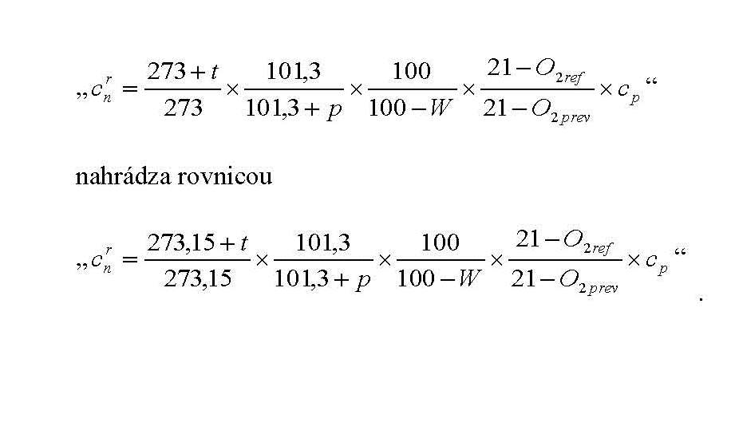

# Čl. I

Vyhláška Ministerstva životného prostredia Slovenskej republiky č. 410/2012 Z. z., ktorou sa vykonávajú niektoré ustanovenia zákona o ovzduší v znení vyhlášky č. 270/2014 Z. z. a vyhlášky č. 252/2016 Z. z. sa mení a dopĺňa takto:

- 1. V § 2 písm. g) sa za slovo „čas“ vkladajú slová „vyjadrený v hodinách“ a za slovo „emisie“ sa vkladajú slová „do ovzdušia“.

- 2. § 4 písm. b) sa nad slovom „odpadov“ dopĺňa odkaz 1a.

  - Poznámka pod čiarou k odkazu 1a znie:

  - „1a) § 2 zákona č. 79/2015 Z. z. o odpadoch a o zmene a doplnení niektorých zákonov v znení neskorších predpisov.“.

- 3. Doterajší text § 4 sa označuje ako odsek 1 a dopĺňa sa odsekmi 2 a 3, ktoré znejú:

- „(2)

- Na vymedzenie zariadenia sa vzťahujú agregačné pravidlá, ak sú pre daný druh zariadenia ustanovené.

- (3)

- Agregačné pravidlo je pravidlo na sčítanie jednotlivých častí a súčastí zdroja na určenie celkovej kapacity zariadenia na uplatnenie emisných limitov.“.

- 4. V § 8 sa za odsek 1 vkladajú nové odseky 2 a 4, ktoré znejú:

- „(3)

- Špecifické požiadavky ustanovené pre väčšie stredné spaľovacie zariadenia, menšie stredné spaľovacie zariadenia a malé spaľovacie zariadenia sa neuplatňujú na

- a)

- spaľovne odpadov a zariadenia na spoluspaľovanie odpadov,

- b)

- spaľovacie zariadenia, ktoré spaľujú výlučne rafinérske palivá alebo rafinérske palivá s inými palivami na výrobu energie v rafinériách minerálnych olejov a plynu,

- c)

- regeneračné kotle v prevádzkach na výrobu celulózy,

- d)

- spaľovacie zariadenia, v ktorých sa spaliny využívajú na priame vykurovanie vnútorných priestorov na zlepšenie podmienok na pracovisku,

- e)

- krematóriá,

- f)

- poľnohospodárske spaľovacie zariadenia s celkovým menovitým tepelným príkonom 5 MW alebo menším, ktoré ako palivo využívajú výlučne nespracovaný trus hydiny,2aa)

- g)

- spaľovacie zariadenia, ako sú necestné pojazdné stroje podľa osobitného predpisu.2ab)

- (3)

- Špecifické požiadavky ustanovené pre väčšie stredné spaľovacie zariadenia sa neuplatňujú na spaľovacie zariadenia, ktoré sa podľa agregačných pravidiel začleňujú ako veľké spaľovacie zariadenia.

- (4)

- Požiadavky na veľké spaľovacie zariadenia, väčšie stredné spaľovacie zariadenia a menšie stredné spaľovacie zariadenia sa neuplatňujú na činnosti v oblasti výskumu, vývoja a testovania týkajúce sa týchto zariadení.“.

  - Poznámky pod čiarou k odkazom 2aa a 2ab znejú:

  - „2aa) Čl. 9 písm. a) nariadenia Európskeho parlamentu a Rady (ES) č. 1069/2009.

  - 2ab) Nariadenie Európskeho parlamentu a Rady (EÚ) 2016/1628 zo 14. septembra 2016 o požiadavkách na emisné limity plynných a pevných znečisťujúcich látok a typové schválenie spaľovacích motorov necestných pojazdných strojov, ktorým sa menia nariadenia (EÚ) č. 1024/2012 a (EÚ) č. 167/2013 a ktorým sa mení a zrušuje smernica 97/68/ES (Ú. v. EÚ L 252, 16. 9. 2016).“.

  - Doterajší odsek 2 sa označuje ako odsek 4.

- 5. V § 8 ods. 4 písm. b) sa na konci pripájajú tieto slová:

- „vrátane plynových turbín s otvoreným cyklom, ako aj kombinovaným cyklom a plynových turbín v režime kombinovanej výroby, a to všetky typy, či už s dodatočným spaľovaním, alebo bez neho,“.

- 6. V § 8 sa odsek 4 dopĺňa písmenami n) až s), ktoré znejú:

- „n)

- plynovým olejom

- 1.

- kvapalné palivo získané z ropy, na ktoré sa vzťahujú číselné znaky KN 2710 19 25, 2710 19 29, 2710 19 47, 2710 19 48, 2710 20 17 alebo 2710 20 19, alebo

- 2.

- kvapalné palivo získané z ropy, z ktorého sa pri teplote 250 °C vydestiluje metódou ASTM D86 menej ako 65 % objemu vrátane strát a pri teplote 350 °C najmenej 85 % objemu vrátane strát,

- o)

- ťažkým vykurovacím olejom

- 1.

- kvapalné palivo získané z ropy, na ktoré sa vzťahujú číselné znaky KN 2710 19 51 až 2710 19 68, 2710 20 31, 2710 20 35 alebo 2710 20 39, alebo

- 2.

- kvapalné palivo získané z ropy, iné ako plynový olej vymedzený v bode 19, ktoré z dôvodu svojho destilačného rozsahu patrí do kategórie ťažkých olejov určených na použitie ako palivo, z ktorého sa pri teplote 250 °C vydestiluje metódou ASTM D86 menej ako 65 % objemu vrátane strát. Ak nemožno vykonať destiláciu pomocou metódy ASTM D86, pokladá sa ropný produkt rovnako za ťažký vykurovací olej,

- p)

- rafinérskym palivom tuhý, kvapalný alebo plynný horľavý materiál získaný z destilácie a konverzie pri rafinácii ropy vrátane rafinérskeho vykurovacieho plynu, syntéznych plynov, rafinérskych olejov a ropného koksu,

- r)

- motorom zážihový motor, vznetový motor alebo dvojpalivový motor,

- s)

- dvojpalivovým motorom spaľovací motor, ktorý používa vznetové zapaľovanie a pri spaľovaní kvapalných palív pracuje na základe Dieselovho cyklu a pri spaľovaní plynných palív pracuje na základe Ottovho cyklu.“.

- 7. § 8 sa dopĺňa odsekom 5, ktorý znie:

- „(5)

- Podľa agregačných pravidiel uvedených v prílohe č. 4 prvej časti sa spaľovacie zariadenia členia na

- a)

- veľké spaľovacie zariadenia,

- b)

- väčšie stredné spaľovacie zariadenia,

- c)

- menšie stredné spaľovacie zariadenia,

- d)

- malé spaľovacie zariadenia.“.

- 8. V § 9 odseky 2 až 5 znejú:

- „(2)

- Celkový menovitý tepelný príkon sa určí podľa agregačných pravidiel uvedených v prílohe č. 4 prvej časti.

- (3)

- Pre viacpalivové spaľovacie zariadenie platia emisné limity určené ako modifikovaný vážený priemer podľa podmienok prílohy č. 4 druhej časti.

- (4)

- Špecifické emisné limity, špecifické technické požiadavky a špecifické podmienky prevádzkovania pre spaľovacie zariadenia sú uvedené v prílohe č. 4 v

- a)

- tretej časti pre veľké spaľovacie zariadenia,

- b)

- štvrtej časti pre väčšie stredné spaľovacie zariadenia,

- c)

- piatej časti pre spaľovacie zariadenia s celkovým menovitým tepelným príkonom 0,3 MW alebo väčším okrem veľkých spaľovacích zariadení; zahŕňa požiadavky na menšie stredné spaľovacie zariadenia, ako aj požiadavky na väčšie stredné spaľovacie zariadenia – jestvujúce zariadenia počas prechodného obdobia do termínov uvedených v § 17 ods. 3,

- d)

- šiestej časti pre malé spaľovacie zariadenia.

- (5)

- Špecifický emisný limit, špecifické technické požiadavky a špecifické podmienky prevádzkovania ustanovené v prílohe č. 4 šiestej časti bode 2 platia pre spaľovacie zariadenie, aj ak dané zariadenie je podľa § 3 ods. 1 malým zdrojom alebo jeho časťou.“.

- 9. V § 9 sa vypúšťa odsek 6.

- 10. § 10 sa dopĺňa odsekmi 7 a 8, ktoré znejú:

- „(7)

- Pri rozšírení veľkého spaľovacieho zariadenia alebo zariadenia, ktoré sa rozšírením stane veľkým spaľovacím zariadením, platia pre rozšírenú časť zariadenia emisné limity podľa odseku 3 podľa celkového menovitého tepelného príkonu celého spaľovacieho zariadenia.

- (8)

- Ak ide o zmenu veľkého spaľovacieho zariadenia, ktorá môže mať vplyv na životné prostredie a ktorá sa týka časti zariadenia s menovitým tepelným príkonom 50 MW a viac, platia pre zmenenú časť emisné limity podľa odseku 3 podľa celkového menovitého tepelného príkonu celého spaľovacieho zariadenia.“.

- 11. V nadpise § 13 sa na konci pripájajú tieto slová „pre veľké spaľovacie zariadenia“.

- 12. § 17 vrátane nadpisu znie:

- 㤠17

- Emisné limity, technické požiadavky a podmienky prevádzkovania pre väčšie stredné spaľovacie zariadenia

- (1)

- Členenie väčších stredných spaľovacích zariadení podľa dátumu vydania povolenia na uplatnenie emisných limitov je uvedené v prílohe č. 4 štvrtej časti bode 1.

- (2)

- Emisné limity sa na väčšie stredné spaľovacie zariadenia uplatňujú podľa § 9. Prípady, na ktoré sa vzťahuje osobitný predpis,1) tým nie sú dotknuté.

- (3)

- Pre väčšie stredné spaľovacie zariadenia začlenené ako jestvujúce zariadenia platia emisné limity, technické požiadavky a podmienky prevádzkovania uvedené

- a)

- v prílohe č. 4 piatej časti pre jestvujúce zariadenia do dátumov uvedených v písmene b),

- b)

- v prílohe č. 4 štvrtej časti bodoch 2 až 4 tabuľkách A pre väčšie stredné spaľovacie zariadenia začlenené ako jestvujúce zariadenia s celkovým menovitým tepelným príkonom

- 1.

- väčším ako 5 MW, od 1. januára 2025,

- 2.

- 5 MW alebo menším, od 1. januára 2030.

- (4)

- Pre väčšie stredné spaľovacie zariadenia začlenené ako nové zariadenia platia emisné limity uvedené v prílohe č. 4 štvrtej časti bodoch 2 až 4 tabuľkách B.“.

- 13. Za § 17 sa vkladajú § 17a až 17c, ktoré vrátane nadpisov znejú:

- 㤠17a

- Obmedzený prevádzkový režim pre väčšie stredné spaľovacie zariadenia

- (1)

- Do obmedzeného prevádzkového režimu možno zaradiť väčšie stredné spaľovacie zariadenie s prevádzkou do 500 h ročne, pričom, ak ide o

- a)

- jestvujúce zariadenie, prevádzkové hodiny sa počítajú ako päťročný plávajúci priemer,

- b)

- nové zariadenie, prevádzkové hodiny sa počítajú ako trojročný plávajúci priemer.

- (2)

- Pre väčšie stredné spaľovacie zariadenie, ktoré je jestvujúcim zariadením, možno obmedzený prevádzkový režim predĺžiť na 1 000 h ročne v núdzi a za mimoriadnych okolností pre zariadenia používané na výrobu tepla pri výnimočne chladnom počasí.

- (3)

- Na zariadenia v obmedzenom prevádzkovom režime sa emisné limity neuplatňujú, okrem emisného limitu pre TZL pri spaľovaní tuhých palív, vrátane biomasy.

- (4)

- Osobitne sa ustanovuje obmedzený prevádzkový režim pre motory, do ktorého možno zaradiť dieselové motory alebo dvojpalivové motory začlenené ako nové zariadenia s prevádzkou od 500 h do 1500 h ročne. Na zariadenia v tomto prevádzkovom režime platí osobitný emisný limit pre NOx podľa prílohy č. 4 štvrtej časti bodu 4. 2 tabuľky B.

- § 17b

- Prechodné opatrenia pre väčšie stredné spaľovacie zariadenia

- (1)

- Pre väčšie stredné spaľovacie zariadenie, ktoré je jestvujúcim zariadením s celkovým menovitým tepelným príkonom väčším ako 5 MW a používa ako hlavné palivo biomasu, možno do 1. januára 2030 uplatniť osobitný emisný limit pre TZL ustanovený v prílohe č. 4 štvrtej časti bode 2.2 tabuľke A, ak predmetné zariadenie je umiestnené v zóne, ktorá spĺňa limitné hodnoty určujúce dobrú kvalitu ovzdušia podľa § 5 zákona. Uplatnenie osobitného emisného limitu nesmie spôsobiť žiadne významné znečistenie ovzdušia a musí byť dosiahnutá vysoká úroveň ochrany životného prostredia ako celku.

- (2)

- Pre väčšie stredné spaľovacie zariadenie, ktoré je jestvujúcim zariadením s celkovým menovitým tepelným príkonom väčším ako 5 MW a využíva sa na pohon plynovej kompresorovej stanice potrebnej na zaistenie bezpečnosti vnútroštátnej plynárenskej prepravnej sústavy, možno do 1. januára 2030 uplatniť osobitný emisný limit pre NOx podľa prílohy č. 4 štvrtej časti bodov 3.2 a 4.2 tabuľky A.

- § 17c

- Osobitný režim pre zariadenia centrálneho zásobovania teplom pre väčšie stredné spaľovacie zariadenia

- Pre väčšie stredné spaľovacie zariadenie, ktoré je jestvujúcim zariadením s celkovým menovitým tepelným príkonom väčším ako 5 MW, možno od 1. januára 2025 do 1. januára 2030 na základe písomnej žiadosti prevádzkovateľa využívať osobitný režim pre zariadenia centrálneho zásobovania teplom, ak najmenej 50 % z výroby využiteľného tepla vyjadreného ako plávajúci päťročný priemer sa zo spaľovacieho zariadenia odvádza ako para alebo horúca voda do verejnej siete na diaľkové vykurovanie. Počas využívania osobitného režimu pre centrálne zásobovanie teplom sa na spaľovacie zariadenia uplatňujú emisné limity podľa prílohy č. 4 štvrtej časti bodu 2.2 tabuľky A ustanovené pre tento režim.“.

- 14. V § 18 ods. 1 písm. a) sa slová „§ 17, ktorého súčasťou je nové zariadenie aj jestvujúce zariadenie,“ nahrádzajú slovami „§ 10 ods. 7 a 8 alebo väčšie stredné spaľovacie zariadenie“.

- 15. V § 18 ods. 5 písm. b) sa za prvý bod vkladá nový druhý bod, ktorý znie:

- „2.

- ak ide o väčšie stredné spaľovacie zariadenia, počas celého nábehu a odstavovania, pričom treba zabezpečiť, aby čas nábehu a odstavovania bol čo najkratší,“.

  - Doterajší druhý bod sa označuje ako tretí bod.

- 16. V § 18 ods. 5 písm. d) sa slová „písmena b)“ nahrádzajú slovami „písmena f)“.

- 17. V § 24 odsek 1 znie:

- „(1)

- Špecifické požiadavky ustanovené v tejto časti sa uplatňujú na zariadenie používajúce organické rozpúšťadlá. Zariadenie používajúce organické rozpúšťadlá sa vymedzuje ako súhrn všetkých častí a súčastí zdroja, v ktorých sa vykonáva jedna činnosť alebo viac činností uvedených v zozname podľa prílohy č. 6 prvej časti vrátane všetkých pridružených činností, ktoré technicky súvisia s činnosťami vykonávanými na určenom mieste a ktoré môžu mať vplyv na emisie.“.

- 18. Za § 34 sa vkladá § 34a , ktorý vrátane nadpisu znie:

- „§ 34a“

- Záverečné ustanovenie k úprave účinnej od 19. decembra 2017

- Tento predpis bol prijatý v súlade s právne záväzným aktom Európskej únie v oblasti technických noriem a technických predpisov.27c)“.

  - Poznámka pod čiarou k odkazu 27c znie:

  - „27c) Smernica Európskeho parlamentu a rady 98/34/ES z 22. júna 1998, ktorou sa stanovuje postup pri poskytovaní informácií v oblasti technických noriem a predpisov, ako aj pravidiel vzťahujúcich sa na služby informačnej spoločnosti (Mimoriadne vydanie Ú. v. EÚ, kap. 13/zv. 20) v platnom znení.“.

- 19. V prílohe č. 4 prvej časti body 2 až 4 znejú:

- „2.

- Väčšie stredné spaľovacie zariadenie

- 2.1

- Väčším stredným spaľovacím zariadením je spaľovacie zariadenie bez ohľadu na typ spaľovaného paliva s celkovým

- a)

- MTP ≥ 1 MW a < 50 MW,

- b)

- MTP ≥ 50 MW, ak nejde o veľké spaľovacie zariadenie.

- 2.2

- Za väčšie stredné spaľovacie zariadenie sa tiež považuje zariadenie zložené z dvoch alebo viacerých nových spaľovacích jednotiek bez ohľadu na typ spaľovaného paliva, ak

- a)

- ich emisie sú vypúšťané cez spoločný komín alebo

- b)

- ak podľa posúdenia príslušného správneho orgánu po zohľadnení technických a ekonomických faktorov môžu byť vypúšťané odpadové plyny spoločným komínom.

- 3.

- Menšie stredné spaľovacie zariadenie

- 3.1

- Menším stredným spaľovacím zariadením je spaľovacie zariadenie s celkovým

- a)

- MTP ≥ 0,3 MW < 1 MW a

- a)

- MTP ≥ 1 MW, ak nejde o väčšie stredné spaľovacie zariadenie.

- 3.2

- Pre menšie stredné spaľovacie zariadenia platia tieto agregačné pravidlá:

- 1)

- spočítavajú sa MTP všetkých spaľovacích jednotiek s MTP ≥ 0,3 MW, ktorých odpadové plyny sú odvádzané do jedného komína alebo výduchu a ktoré spaľujú palivo rovnakého typu: tuhé, kvapalné, plynné,

- 2)

- pri viacpalivovom systéme sa pripočítava príkon spaľovacej jednotky k ostatným spaľovacím jednotkám podľa prevládajúceho paliva,

- 3)

- ak sú do jedného komína zaústené len spaľovacie jednotky s viacpalivovým systémom, spočítajú sa ich príkony bez ohľadu na prevládajúce palivo,

- 4)

- osobitne sa spočítavajú príkony kotlov s cirkulujúcou fluidnou vrstvou a pretlakovou fluidnou vrstvou a osobitne príkony kotlov s výtavným ohniskom,

- 5)

- osobitne sa spočítavajú plynové turbíny a osobitne piestové spaľovacie motory.

- 4.

- Malé spaľovacie zariadenie

- Spaľovacia jednotka s MTP < 0,3 MW je samostatným spaľovacím zariadením a nespočítava sa s ostatnými spaľovacími jednotkami. Platia preň požiadavky šiestej časti.“.

- 20. V prílohe č. 4 druhej časti bod 2 znie:

- „2.

- Ak podiel tepelného vstupu dodaného jedným palivom ≥ 70 %, možno uplatniť emisný limit podľa prevládajúceho paliva pre spaľovacie zariadenia začlenené ako

- a)

- menšie stredné spaľovacie zariadenia,

- b)

- väčšie stredné spaľovacie zariadenia začlenené ako jestvujúce zariadenia s celkovým

- 1.

- MTP > 5 MW do 31. decembra 2024,

- 2.

- MTP > 5 MW, ak ide o spaľovacie zariadenia zaradené do osobitného režimu CZT do 31. decembra 2029 za osobitných podmienok,

- 3.

- MTP ≤ 5 MW do 31. decembra 2029.“.

- 21. V prílohe č. 4 štvrtá časť vrátane nadpisu znie:

- „[príloha 4 štvrtá časť](assets/0131ce5c1f574a9129eec2aaabec494c3406d1bfc190cd57a69ea0a9e820ad3b.pdf)“.

  - Doterajšia štvrtá časť a piata časť prílohy č. 4 sa označuje ako piata časť a šiesta časť.

- 22. V prílohe č. 4 piatej časti úvodný text pod nadpisom znie:

- „Platí pre

- a)

- väčšie stredné spaľovacie zariadenia začlenené ako jestvujúce zariadenia s celkovým

- 1.

- MTP > 5 MW do 31. decembra 2024,

- 2.

- MTP > 1 MW a ≤ 5 MW do 31. decembra 2029,

- b)

- menšie stredné spaľovacie zariadenia.“.

- 23. V prílohe č. 4 piatej časti bode 1 bod 1.1 znie:

- „1.1

- Technické požiadavky a podmienky prevádzkovania

- 1.1.1

- Emisie zo spaľovacieho zariadenia, ktoré je podľa povolenia alebo dokumentácie používané na núdzovú prevádzku, musia zodpovedať požiadavkám a podmienkam prevádzkovania podľa súčasného stavu techniky; tieto sa považujú za splnené, ak sú vykonané v rozsahu a spôsobom najmenej podľa technických noriem alebo iných obdobných technických špecifikácií, ktoré sa na príslušné zariadenia vzťahujú podľa osobitného predpisu.21)

- 1.1.2

- Pri spaľovaní biomasy nesmie sa spaľovať palivo, ktoré prekračuje vlhkosť určenú orgánom ochrany ovzdušia a podľa odporúčania výrobcu zariadenia.“.

- 24. V prílohe č. 5 piatej časti tabuľke 5.2 v stĺpci pre emisný limit pre NOx sa vypúšťajú slová: „95,10)“.

  - Vypúšťa sa aj poznámka č. 10 pod tabuľkou.

- 25. V prílohe č. 4 šiestej časti nadpis znie:

- „VI.

- MALÉ SPAĽOVACIE ZARIADENIA“.

- 26. V prílohe č. 6 piatej časti body 2 a 3 znejú:

- „2.

- Návrh na vypracovanie redukčného plánu pri aplikácii náterov, lakov, lepidiel a tlačiarenských farieb

- Redukčný plán je určený pre zariadenia a činnosti, pri ktorých možno predpokladať konštantný obsah sušiny, tzn. neprchavého podielu v náterovej látke alebo zmesi, ktorý možno využiť na definovanie referenčného množstva.

- Redukciu emisií možno dosiahnuť znížením priemerného obsahu organických rozpúšťadiel v celkovom vstupe alebo zvýšením účinnosti nanášania sušiny náterových látok, čím sa dosiahne zníženie celkových emisií prchavých organických zlúčenín za rok na úroveň cieľových emisií.

- 3.

- Výpočet cieľových emisií

- 3.1

- Výpočet cieľových emisií podľa emisného faktora EFRP

- Cieľové emisie sa vypočítajú ako celkové množstvo sušiny v použitých náterových látkach za rok vynásobené emisným faktorom EFRP podľa uvedeného vzťahu:

- T = EFRP ∙ S | |

- T | cieľové emisie | [kg]

- S | celkové množstvo nanesenej sušiny za rok | [kg]

- EFRP | emisný faktor pre RP uvedený v časti IV pre predmetnú výrobu | [kg/kg sušiny]

- Ak nasledujúca metóda nie je vhodná, správny orgán môže pre dané zariadenia povoliť alternatívny redukčný plán, ktorý spĺňa princípy podľa bodu 1.

- 3.2

- Výpočet cieľových emisií na základe referenčných ročných emisií

- a)

- Určí sa celková hmotnosť sušiny nanesenej náterom, tlačiarenskou farbou, lakom alebo lepidlom za rok.

- b)

- Referenčné ročné množstvo emisií sa vypočíta vynásobením celkového množstva sušiny príslušným faktorom K1. Faktor K1 možno pre konkrétne zariadenie upraviť tak, aby odrážal preukázateľné zvýšenie účinnosti pri nanášaní sušiny.

- Činnosť | Faktor K1

- Rotačná hĺbkotlač, flexografická tlač, laminovanie ako súčasť tlačiarenskej činnosti, lakovanie ako súčasť tlačiarenskej činnosti, impregnácia dreva, povrchová úprava textílií, tkanín, fólií a papiera, nanášanie lepidla | 4

- Nanášanie náterov na pásy a zvitky; následná povrchová úprava vozidiel | 3

- Nanášanie náterov na povrchy v kontakte s potravinami; nanášanie ochranných vrstiev na lietadlá a kozmické lode | 2,33

- Rotačná sieťotlač, ostatné druhy povrchovej úpravy | 1,5

- c)

- Cieľové množstvo emisií sa získa vynásobením referenčného ročného množstva emisií faktorom K2 vyjadrenom v percentách

- Činnosť | Faktor K2 [%]

- Pre zariadenia podľa bodu 5.2 a na úrovni nižšej prahovej hodnoty bodu 4 pre činnosti IVa a IVb | ELFE + 15

- Všetky ostatné zariadenia | ELFE + 5

- ELFE - emisný limit pre fugitívne emisie

- 3.3

- Podmienka splnenia redukčného plánu

- Redukčný plán je splnený, keď skutočné množstvo celkových emisií podľa ročnej bilancie rozpúšťadiel je menšie alebo sa rovná hodnote cieľovej emisie. Metodika výpočtu ročnej bilancie rozpúšťadiel je uvedená v prílohe č. 4.“.

- 27. V prílohe č. 6 šiestej časti bod 4 znie:

- „4.

- Preukázanie plnenia požiadaviek na zníženie emisií na základe bilancie rozpúšťadiel

- Na preukázanie plnenia požiadaviek na zníženie emisií sa vychádza z bilancie rozpúšťadiel pre danú činnosť, ktorá sa vypracuje podľa aktuálnych údajov každoročne.

- 4.1

- Emisný podiel fugitívnych emisií EHFE [%] sa vypočíta ako percentuálny podiel množstva fugitívnych emisií a vstupného množstva organických rozpúšťadiel I podľa vzťahu:

- EHFE = (F/I) ∙ 100 [%]

- EHFE – emisná hodnota fugitívnych emisií

- F – fugitívne emisie sa zistia

- a)

- výpočtom:

- fugitívne emisie sa zistia priamo alebo nepriamo podľa vzťahov uvedených v bode 3, pričom F sa určí priamym meraním množstiev, ekvivalentnou metódou alebo ekvivalentným výpočtom, napr. použitím účinnosti zachytávania v rámci procesu, alebo

- b)

- krátkym, ale zato kompletným súborom meraní, ktoré netreba opakovať, ak nedôjde k zmene alebo úprave technického vybavenia.

- I – celkový vstup; zistí sa podľa vzťahu v bode 3

- 4.2

- Emisný podiel celkových emisií sa vypočíta ako percentuálny podiel množstva celkových emisií a množstva organických rozpúšťadiel ako celkový vstup alebo ako podiel množstva celkových emisií a množstva alebo veľkosti produkcie podľa toho, ako je ustanovený.

- EHCE= E/I ∙ 100 [%] alebo EHCE= E/P [g/kg, g/m2, kg/m3, kg/t alebo g/pár]

- EHCE – emisná hodnota celkových emisií

- E – množstvo celkových emisií

- I – celkový vstup; zistí sa podľa vzťahu v bode 3

- P – množstvo produktu, napr. párov obuvi

- 4.3

- Plnenie redukčného plánu sa preukazuje porovnaním vypusteného množstva celkových emisií s cieľovými emisiami.“.

- 28. V prílohe č. 7 druhej časti písm. D bode 9 písm. D sa za slovo „spaľovanie“ dopĺňajú slová „okrem časového úseku vymedzeného v povolení potrebného na ustálenie bezdymového spaľovania“.

- 29. V prílohe č. 7 druhej časti písm. D bod 10.2 znie:

- „10. 2

- Emisné limity

- Podmienky platnosti EL | Štandardné stavové podmienky, suchý plyn, O2ref: 11 % objemu Pomocný kotol: – spaľovanie tuhých palív 6 % objemu – spaľovanie kvapalných palív 3 % objemu | | | |

- Výroba buničiny–regeneračné kotly | Emisné limity [mg/m3] | | | |

- | TZL | SO2 | NOX | H2S | ClO2

- Sódno-antrachinónový spôsob výroby | 50 | 35 | 300 | |

- Sulfitový spôsob a neutrálsulfitový spôsob výroby | 50, 1001) | 700 | 400 | 40 |

- Sulfátový spôsob výroby | 50, 1001) | 450 | 300 | 202) |

- Pomocný kotol | 303), 404) | | | |

- Výroba vápna a zrážanie CaCO3 | 5) | | | |

- Bielenie celulózy vrátane výroby ClO2 | | | | | 20

- 1) Platí do 31. decembra 2019 pre zariadenia povolené do 31. decembra 2013.

- 2) Platí pre zlúčeniny obsahujúce redukovanú síru vyjadrené ako H2S.

- 3) Platí pre spaľovanie tuhých palív; pre zariadenia povolené do 31. decembra 2013 platí od 1. januára 2020.

- 4) Platí pre spaľovanie kvapalných palív; pre zariadenia povolené do 31. decembra 2013 platí od

- 1. januára 2020.

- 5) Emisné limity pre výrobu vápna a zrážanie CaCO3 sú uvedené v tejto prílohe druhej časti bode 2 písm. C.“.

- 30. V prílohe č. 7 druhej časti písm. F bode 3. 2 tabuľke B sa vypúšťajú riadky:

- „

- Sušenie | Limitný emisný faktor TOC2)

- | 0,25 kg/t emisií odparenej vody

- “.

- 31. V prílohe č. 7 druhej časti písm. F bode 9.2.4.2 druhej vete sa slovo „zaorať“ nahrádza slovom „zapracovať“.

- 32. V prílohe č. 8 tabuľke štvrtom bode sa rovnica

- 

- 33. Príloha č. 10 znie:

- „Príloha č. 10

- k vyhláške č. 410/2012 Z. z.

- ZOZNAM PREBERANÝCH PRÁVNE ZÁVÄZNÝCH AKTOV EURÓPSKEJ ÚNIE

- 1.

- Smernica Európskeho parlamentu a Rady 2010/75/EÚ z 24. novembra 2010 o priemyselných emisiách (integrovaná prevencia a kontrola znečisťovania životného prostredia) (Ú. v. EÚ L 334, 17. 12. 2010).

- 2.

- Smernica Európskeho parlamentu a Rady (EÚ) 2015/2193/EÚ z 25. novembra 2015 o obmedzení emisií určitých znečisťujúcich látok do ovzdušia zo stredne veľkých spaľovacích zariadení (Ú. v. EÚ L 313, 28.11. 2015).“.
