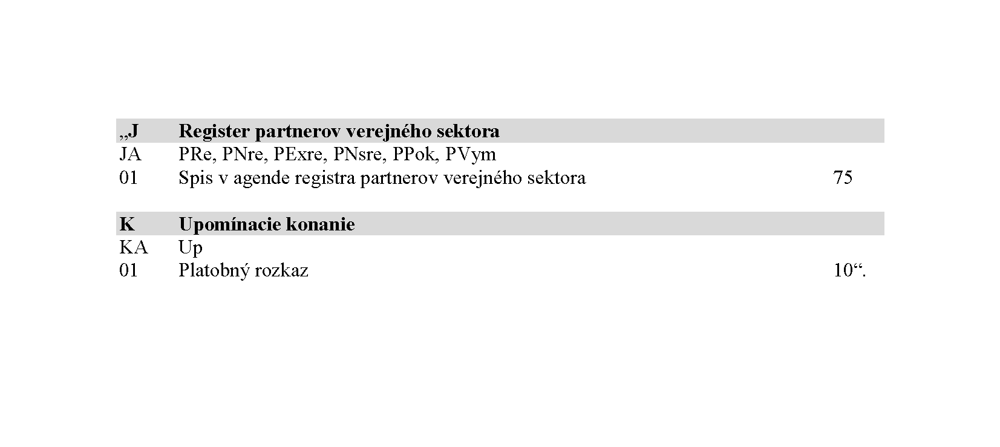

# Čl. I

Vyhláška Ministerstva spravodlivosti Slovenskej republiky č. 543/2005 Z. z. o Spravovacom a kancelárskom poriadku pre okresne súdy, krajské súdy, Špeciálny súd a vojenské súdy v znení vyhlášky č. 417/2006 Z. z., vyhlášky č. 120/2007 Z. z., vyhlášky č. 389/2008 Z. z., vyhlášky č. 11/2009 Z. z., vyhlášky č. 95/2009 Z. z., vyhlášky č. 450/2009 Z. z., vyhlášky č. 148/2011 Z. z., vyhlášky č. 94/2012 Z. z., vyhlášky č. 327/2012 Z. z., vyhlášky č. 105/2013 Z. z., vyhlášky č. 428/2013 Z. z., vyhlášky č. 334/2014 Z. z., vyhlášky č. 366/2014 Z. z., vyhlášky č. 84/2015 Z. z., vyhlášky č. 222/2015 Z. z., vyhlášky č. 449/2015 Z. z. a vyhlášky č. 206/2016 Z. z. sa mení a dopĺňa takto:

- 1. V § 2 odsek 11 znie:

- „(11)

- Na účely tejto vyhlášky sa rozumie

- a)

- prvopisom písomnosť súdu vyhotovená ako elektronický úradný dokument, ktorý je autorizovaný,

- b)

- rovnopisom listinné vyhotovenia prvopisu, najmä na účely podľa osobitného predpisu,1)

- c)

- odpisom exemplár písomnosti súdu získaný prepísaním prvopisu použitím výpočtovej techniky,

- d)

- kópiou exemplár písomnosti súdu, ktorý nie je rovnopisom ani odpisom, vyhotovený použitím reprografickej techniky.“.

  - Poznámka pod čiarou k odkazu 1 znie:

  - „1) § 31 ods. 3 zákona č. 305/2013 Z. z. o elektronickej podobe výkonu pôsobnosti orgánov verejnej moci a o zmene a doplnení niektorých zákonov (zákon o e-Governmente) v znení zákona č. 272/2016 Z. z.“.

- 2. § 2 sa dopĺňa odsekom 12, ktorý znie:

- „(12)

- Ak ide o veci, na ktoré sa nevzťahujú predpisy o elektronickom výkone verejnej moci,1a) prvopisom sa na účely tejto vyhlášky rozumie prvý výtlačok písomnosti súdu vyhotovený použitím výpočtovej techniky zviazaný v súdnom spise a rovnopisom sa rozumejú ďalšie výtlačky tejto písomnosti súdu.“.

  - Poznámka pod čiarou k odkazu 1a znie:

  - „1a) Zákon č. 305/2013 Z. z. v znení neskorších predpisov.“.

- 3. Doterajšie odkazy a poznámky pod čiarou 1 a 1a sa označujú ako 1b a 1c.

- 4. V § 48 ods. 5 sa slová „na prvopise rozhodnutia“ nahrádzajú slovami „v elektronickej podobe“ a slová „rovnopis rozhodnutia bez odôvodnenia opatrený doložkou právoplatnosti“ sa nahrádzajú slovami „rozhodnutie v elektronickej podobe spolu s doložkou právoplatnosti“.

- 5. V § 48 odsek 6 znie:

- „(6)

- Príslušnému orgánu štátnej správy na úseku katastra nehnuteľností sa zasielajú v elektronickej podobe v lehote desiatich pracovných dní odo dňa vyznačenia vykonateľnosti rozhodnutia súdu o vlastníckych vzťahoch k nehnuteľnostiam a iné rozhodnutia o právach k nehnuteľnostiam podľa osobitného predpisu19b) spolu s doložkou právoplatnosti. Neodkladné opatrenie, ktorým sa upravujú práva k nehnuteľnostiam, sa zašle v elektronickej podobe príslušnému orgánu štátnej správy na úseku katastra nehnuteľností bezodkladne po jeho vyhotovení.“.

- 6. V § 48 ods. 7 sa slová „na prvopise rozhodnutia zasielajú rovnopisy rozhodnutí súdu o vrátení súdneho poplatku alebo jeho časti opatrené doložkou právoplatnosti a vykonateľnosti“ nahrádzajú slovami „zasielajú v elektronickej podobe rozhodnutia súdu o vrátení súdneho poplatku alebo jeho časti spolu s doložkou právoplatnosti“.

- 7. V § 48 odsek 8 znie:

- „(8)

- Poverený zamestnanec súdu zabezpečí postupom podľa osobitného predpisu19d) uloženie rozhodnutia súdu o obmedzení spôsobilosti na právne úkony v elektronickej podobe spolu s doložkou právoplatnosti do Notárskeho centrálneho registra listín (ďalej len „register listín“), a to v lehote troch pracovných dní odo dňa vyznačenia právoplatnosti. Po uložení rozhodnutia do registra listín sa predloží vyúčtovanie odmeny a náhrady hotových výdavkov notára učtárni súdu.“.

- 8. V § 58 ods. 1 sa vypúšťa druhá a tretia veta.

- 9. V § 58 ods. 2 sa vypúšťajú slová „a zakladá sa voľne do súdneho spisu, spravidla za prvopis rozsudku“.

- 10. V § 58 odsek 3 znie:

- „(3)

- Ak sa rozsudok doručuje v listinnej podobe, rovnopisy rozsudku sa vyhotovujú v takom počte, aby mohli byť doručené všetkým osobám, ktorým sa doručujú v listinnej podobe.“.

- 11. V § 58 ods. 4 sa slová „Ak rozsudok“ nahrádzajú slovami „Ak rovnopis rozsudku“.

- 12. V § 58 odsek 5 znie:

- „(5)

- Ak súd vydá opravné uznesenie, oprava sa v opravovanom rozsudku vykoná tak, že opravné uznesenie sa pripojí k prvopisu rozsudku.“.

- 13. V § 59 ods. 4 sa slová „číslo konania“ nahrádza slovami „spisová značka“.

- 14. V § 59 odsek 6 znie:

- „(6)

- Na konci rozsudku sa uvedie titul, meno a priezvisko sudcu spolu s uvedením jeho funkcie tak, aby v strede bolo možné umiestniť vyobrazenie odtlačku úradnej pečiatky. Ak majú rozsudok podpísať všetci členovia senátu, ich tituly, mená a priezviská sa uvedú pod sebou.“.

- 15. Doterajší text § 60 sa označuje ako odsek 1 a dopĺňa sa odsekom 2, ktorý znie:

- „(2)

- Ustanovenie § 58 ods. 4 druhej vety sa nepoužije pre veci zapisované do súdnych registrov Up, Ek, CoUp a CoEk.“.

- 16. V § 59 ods. 7 sa slová „prvopisu rozsudku alebo jeho rovnopisov“ nahrádza slovom „rozsudku“.

- 17. V § 61 ods. 1 sa slová „vlastnoručne podpisuje“ nahrádzajú slovami „autorizuje“, slová „podpisuje vlastnoručne“ sa nahrádzajú slovami „autorizuje“ a na konci sa pripája táto veta: „Ak ide o rozhodnutie vo veci, na ktorú sa nevzťahujú predpisy o elektronickom výkone verejnej moci, prvopis rozhodnutia podpisuje ten, kto rozhodnutie vydal.“.

- 18. V § 61 odsek 2 znie:

- „(2)

- Rovnopis rozhodnutia vlastnoručne podpisuje osoba zodpovedná za správnosť vyhotovenia rozhodnutia. Vlastnoručný podpis podľa prvej vety možno nahradiť doložkou o autorizácii, v ktorej sa uvedie meno, priezvisko a funkcia toho, kto autorizoval prvopis vrátane dátumu autorizácie a spisovej značky. Doložka o autorizácii sa spojí k rovnopisu rozhodnutia; doložku o autorizácii možno vytlačiť na druhú stranu rozhodnutia, ak rozhodnutie nepresahuje jednu stranu. Vo veciach podľa § 60 ods. 2 sa doložka o autorizácii priloží k rovnopisu rozhodnutia.“.

- 19. V § 61 ods. 3 sa za slovo „ktorý“ vkladajú slová „autorizoval alebo“.

- 20. V § 62 ods. 1 prvá veta znie: „Len čo súdny tajomník alebo iný poverený zamestnanec súdu zistí, že rozhodnutie nadobudlo právoplatnosť, vyznačí v aplikácii deň, keď rozhodnutie nadobudlo právoplatnosť.“ a vypúšťa sa štvrtá veta.

- 21. V § 62 odsek 2 znie:

- „(2)

- Právoplatnosť rozhodnutia súdu prvého stupňa a rozhodnutia súdu druhého stupňa vyznačuje súd, ktorý rozhodoval v prvom stupni; ak sa súdny spis nachádza na súde druhého stupňa, právoplatnosť sa na rozhodnutí súdu vyznačí na žiadosť účastníka konania na súde druhého stupňa.“.

- 22. § 62 sa dopĺňa odsekom 3, ktorý znie:

- „(3)

- Spolu s vyznačením právoplatnosti v aplikácii súd vyhotoví doložku právoplatnosti ako elektronický úradný dokument, ktorý autorizuje a pripojí ho k rozhodnutiu, ktorého právoplatnosť osvedčuje.“.

- 23. V § 62a sa vypúšťajú slová „na prvopise rozhodnutia“.

- 24. V § 152 ods. 5 sa na konci pripája táto veta: „Ak kasačný súd nerozhodne inak, po zrušení veci na základe kasačnej sťažnosti sa vec zapíše do súdneho registra tomu senátu alebo sudcovi, ktorý vo veci rozhodoval pred jej zrušením; vec sa vedie pod novou spisovou značkou a súvislosť s pôvodnou vecou sa vyznačí na spisovom obale a v súdnom registri, kde sa vyznačí aj výsledok konania o kasačnej sťažnosti.“.

- 25. V § 163 ods. 1 písm. d) sa na konci pripájajú tieto slová: „OdK, OdS, Odi,“.

- 26. V § 163 ods. 1 písm. h) sa za slová „Er,“ vkladajú slová „Ek,“.

- 27. V § 163 ods. 1 sa za písmeno h) vkladá nové písmeno i), ktoré znie:

- „i)

- upomínacieho konania Up,“.

  - Doterajšie písmená i) až k) sa označujú ako písmená j) až l).

- 28. V § 163 sa za odsek 2 vkladá nový odsek 3, ktorý znie:

- „(3)

- Na okresnom súde, ktorý je registrujúcim orgánom,63a) sa okrem registrov podľa odsekov 1 a 2 vedú aj súdne registre vo veciach registra partnerov verejného sektora PRe, PNre, PExre, PNsre, PPok a PVym.“.

  - Doterajší odsek 3 sa označuje ako odsek 4.

  - Poznámka pod čiarou k odkazu 63a znie:

  - „63a) § 3 ods. 1 zákona č. 315/2016 Z. z. o registri partnerov verejného sektora a o zmene a doplnení niektorých zákonov.“.

- 29. V § 163 odsek 4 znie:

- „(4)

- Veci, ktoré sa zapisujú do jednotlivých súdnych registrov na okresnom súde podľa odseku 1, sú uvedené v prílohe č. 1 časti II, na registrových súdoch v prílohe č. 2 časti II a na súde, ktorý je registrujúcim orgánom,63a) v prílohe č. 2a časti II.“.

- 30. V § 164 ods. 3 písm. a) sa za slová „CoP,“ vkladajú slová „CoUp,“.

- 31. V § 164 ods. 3 písm. a) sa za slová „CoE,“ vkladajú slová „CoEk,“.

- 32. V § 164 ods. 3 písm. a) sa za slová „CoPom,“ vkladajú slová „CoPno,“.

- 33. V § 167 sa odsek 1 dopĺňa písmenom n), ktoré znie:

- „n)

- register OpP na evidenciu podaní a písomností doručených v elektronickej podobe, ktoré sa majú použiť vo viacerých veciach vedených na tom istom súde.“.

- 34. V § 167 ods. 3 sa na konci pripája táto veta: „Evidenčná pomôcka podľa odseku 1 písm. n) sa vedie v elektronickej podobe.“.

- 35. Za § 167 sa vkladá § 167a, ktorý vrátane nadpisu znie:

- 㤠167a

- Register OpP

- (1)

- Na evidenciu podaní a písomností, ktoré sa majú použiť vo viacerých veciach vedených na tom istom súde, najmä plnomocenstiev, zmlúv, všeobecných zmluvných podmienok, sa vedie register OpP.

- (2)

- Ak konanie možno začať len elektronickým podaním, podania a písomnosti podľa

- odseku 1 sa evidujú v registri OpP, len ak sú doručené v elektronickej podobe a sú autorizované.

- (3)

- Na podania, ktoré sa nehodia na evidenciu v registri OpP, sa neprihliada. O tom súd upovedomí osobu, ktorá také podanie alebo listinu súdu doručila.

- (4)

- Ak bolo podanie alebo písomnosť uložené v registri OpP, v konaní vedenom na tom istom súde postačuje naň odkázať. Súd v konaní nie je povinný z úradnej povinnosti zisťovať, či podanie alebo písomnosť týkajúca sa prejednávanej veci je uložená v registri OpP.“.

- 36. §168 sa dopĺňa odsekom 4, ktorý znie:

- „(4)

- Súdny spis sa vedie v elektronickej podobe, a to v agendách, ktoré určí ministerstvo.“.

- 37. Za § 168 sa vkladá § 168a, ktorý vrátane nadpisu znie:

- 㤠168a

- Osobitné ustanovenia o vedení súdneho spisu

- (1)

- Ak sa súdny spis vedie v elektronickej podobe, postupuje sa primerane podľa § 168

- ods. 2 a 3.

- (2)

- Podania, ktoré boli súdu doručené v listinnej podobe, sa na účely vedenia súdneho spisu prevedú postupom podľa osobitného predpisu65a) do elektronickej podoby. Elektronické podania alebo elektronické úradné dokumenty sa na účely vedenia spisu do listinnej podoby neprevádzajú; ustanovenie odseku 3 tým nie je dotknuté. Spisy predložené súdu iným orgánom verejnej moci sa do elektronickej podoby neprevádzajú.

- (3)

- Ak je potrebné písomnosť, ktorá je súčasťou súdneho spisu vedeného v elektronickej podobe, doručiť v listinnej podobe, prevedie sa postupom podľa osobitného predpisu65a) do listinnej podoby. Prevod nie je potrebný, ak má súd k dispozícii v listinnej podobe rovnopis podania alebo písomnosti.

- (4)

- Listinná podoba podaní, písomností a spisov podľa odseku 2 sa založí do spisového obalu, ktorý obsahuje zoznam založených podaní, písomností a spisov spolu s uvedením spisovej značky veci, ku ktorej patria.

- (5)

- Ak sa má vec postúpiť súdu príslušnému na jej prejednanie, urobí sa tak sprístupnením elektronického súdneho spisu súdu prostredníctvom aplikácie. Podania a písomnosti podľa odseku 4 sa príslušnému súdu odošlú len vtedy, ak o to tento súd požiada.

- (6)

- Vykonanie poplatkovej a spisovej kontroly sa vyznačí len prostredníctvom aplikácie; ustanovenie § 204 sa použije primerane.

- (7)

- Nazeranie do súdneho spisu vedeného v elektronickej podobe sa vykonáva spravidla prostredníctvom vzdialeného prístupu; ustanovenie § 195 sa použije primerane.“.

  - Poznámka pod čiarou k odkazu 65a znie:

  - „65a) § 82l ods. 2 zákona č. 757/2004 Z. z. o súdoch a o zmene a doplnení niektorých zákonov v znení zákona č. 301/2016 Z. z.“.

- 38. Za § 190b sa vkladá § 190c, ktorý vrátane nadpisu znie:

- 㤠190c

- Súdne spisy v agende registra partnerov verejného sektora

- (1)

- Pre každého zapísaného partnera verejného sektora66a) sa zakladá jeden spoločný spisový obal, do ktorého sa natrvalo zakladajú jednotlivé súdne spisy týkajúce sa tohto zapísaného partnera verejného sektora.

- (2)

- Na obale súdneho spisu podľa odseku 1 sa vyznačí najmä

- a)

- označenie súdu, ktorý je registrujúcim orgánom,

- b)

- označenie partnera verejného sektora,

- c)

- označenie čísla zápisu,

- d)

- poznámka o vymazaní zapísanej osoby z registra partnerov verejného sektora, ak dôjde k výmazu partnera verejného sektora.

- (3)

- Súčasťou súdneho spisu podľa odseku 1 sú aj prílohy podľa osobitného predpisu,66b) ktoré sa ukladajú v aplikácii.“.

  - Poznámky pod čiarou k odkazom 66a a 66b znejú:

  - „66a) § 2 zákona č. 315/2016 Z. z.

  - 66b) § 5 ods. 3 zákona č. 315/2016 Z. z.“.

- 39. V § 199 ods. 2 sa na konci pripája táto veta: „Súdny spis v agende registra partnerov verejného sektora sa považuje za ukončený dňom výmazu zapísaného partnera verejného sektora z registra partnerov verejného sektora.“.

- 40. V piatej časti sa za štvrtú hlavu vkladá nová piata hlava, ktorá vrátane nadpisu znie:

- „PIATA HLAVA

- OSOBITNÉ USTANOVENIA O POSTUPE PRI VYBAVOVANÍ

- AGENDY REGISTRA PARTNEROV VEREJNÉHO SEKTORA

- § 241l

- Pri vybavovaní agendy registra partnerov verejného sektora sa primerane použijú ustanovenia prvej a druhej hlavy piatej časti.“.

  - Doterajšia piata hlava sa označuje ako šiesta hlava.

- 41. § 255 sa dopĺňa odsekom 3, ktorý znie:

- „(3)

- Ustanovenie odseku 2 platí rovnako aj pre agendu registra partnerov verejného sektora.“.

- 42. V prílohe č. 1 časti I „Prehľad súdnych registrov a používané skratky súdnych registrov“ prehľad súdnych registrov okresného súdu znie:

- T | C | Cb | K | P | D | E | Er | Up | U | UL | JP

- T | C | Cb | K | P | D | Em | Er | Up | U | UL | JP

- Tk | Cpr | CbPv | R | PPOm | Dd | Ed | Ek | | | |

- Tv | Cr | Cbcud | Od | Pc | Dcud | Ecud | Erd | | | |

- Nt | Csr | CbR | NcKR | Ps | | | Ercud | | | |

- Pp | Csp | Cbd | OdK | Po | | | | | | |

- Td | Ca | CbBu | OdS | Pu | | | | | | |

- Tp | Cd | CbHs | Odi | Pd | | | | | | |

- Tcud | Ccud | Cbi | | Pcud | | | | | | |

- Pr | | CbZm | | | | | | | | |

- M | | CbVO | | | | | | | | |

- Ntt | | CbVyl | | | | | | | | |

- 43. V prílohe č. 1 časti I „Prehľad súdnych registrov a používané skratky súdnych registrov“ prehľad súdnych registrov krajského súdu v odvolacej agende znie:

- Civilná | Obchodná | Trestná

- Co | Cob | To

- CoPr | CoPv | Tov

- CoR | CoZm | Tpo

- CoSr | CoKR | Tos

- CoD | CobVO | Nto

- CoP | Ncb | Ntro

- CoE | |

- CoEk | |

- CoUp | |

- CoPom | |

- CoPno | |

- NcC | |

- 44. V prílohe č. 1 časti II „Zapisovanie do súdnych registrov okresného súdu“ písmene B prvom bode písmená a) a b) znejú:

- „a)

- žaloba, návrh na začatie konania a určovací návrh v občianskoprávnych veciach, ak sa nezapisuje do súdneho registra Csp,

- b)

- návrh na vydanie platobného rozkazu v občianskoprávnych veciach, ak sa nezapisuje do súdneho registra Csp; v tomto súdnom registri sa vedie vec aj po vydaní platobného rozkazu, v ktorej bol podaný opravný prostriedok proti výroku o trovách konania, vec, v ktorej bol podaný odpor proti platobnému rozkazu vrátane odporu podaného oneskorene, bez odôvodnenia vo veci samej alebo neoprávnenou osobou, a vec, v ktorej bol návrh na vydanie platobného rozkazu vzatý späť,“.

- 45. V prílohe č. 1 časti II „Zapisovanie do súdnych registrov okresného súdu“ písmene B prvom bode sa za písmeno d) vkladá nové písmeno e), ktoré znie:

- „e)

- návrh vyvolaný konaním pri výkone rozhodnutia a exekúcii v občianskoprávnej veci,“.

  - Doterajšie písmená e) až s) sa označujú ako písmená f) až t).

- 46. V prílohe č. 1 časti II „Zapisovanie do súdnych registrov okresného súdu“ sa písmeno D dopĺňa piatym až siedmym bodom, ktoré znejú:

- „5.

- Do súdneho registra „OdK“ sa zapisujú návrhy na vyhlásene konkurzu v konaní o oddlžení.

- 6.

- Do súdneho registra „OdS“ sa zapisujú návrhy na určenie splátkového kalendára v konaní o oddlžení.

- 7.

- Do súdneho registra „Odi“ sa zapisujú návrhy a podnety na zrušenie oddlženia.“.

- 47. V prílohe č. 1 časti II „Zapisovanie do súdnych registrov okresného súdu“ písmene H sa za prvý bod vkladá nový druhý bod, ktorý znie:

- „2.

- Do súdneho registra „Ek“ sa zapisuje návrh na vykonanie exekúcie v exekučných konaniach, v ktorých sa súdny exekútor ustanovuje náhodným výberom pomocou technických prostriedkov a programových prostriedkov schválených ministerstvom podľa zákona Národnej rady Slovenskej republiky č. 233/1995 Z. z. o súdnych exekútoroch a exekučnej činnosti (Exekučný poriadok) a o zmene a doplnení ďalších zákonov v znení neskorších predpisov.“.

  - Doterajšie body 2 a 3 sa označujú ako body 3 a 4.

- 48. V prílohe č. 1 časti II „Zapisovanie do súdnych registrov okresného súdu“ sa za písmeno H vkladá nové písmeno I, ktoré znie:

- „I.

- Súdny register vecí upomínacieho konania

- 1.

- Do súdneho registra Up sa zapisujú návrhy na vydanie platobného rozkazu podľa zákona č. 307/2016 Z. z. o upomínacom konaní a o doplnení niektorých zákonov.“.

- 2.

- V súdnom registri „Up“ sa vyznačuje skončenie veci

- a)

- nadobudnutím právoplatnosti vydaného platobného rozkazu,

- b)

- nadobudnutím právoplatnosti rozhodnutia o odmietnutí odporu,

- c)

- márnym uplynutím lehoty na podanie návrhu na pokračovanie v konaní,

- d)

- nadobudnutím právoplatnosti rozhodnutia o odmietnutí návrhu na vydanie platobného rozkazu,

- e)

- nadobudnutím právoplatnosti rozhodnutia o zastavení konania.

- 3.

- V súdnom registri „Up“ sa vyznačuje skončenie veci a jej postúpenie súdu príslušnému na prejednanie veci podľa Civilného sporového poriadku v prípade

- a)

- podania odporu a návrhu na pokračovanie v konaní,

- b)

- zrušenia platobného rozkazu pre jeho nedoručenie do vlastných rúk žalovanému a podania návrhu na pokračovanie v konaní.“.

- Doterajšie písmená I až K sa označujú ako písmená J až L.“.

- 49. V prílohe č. 1 časti III. „Zapisovanie do súdnych registrov krajského súdu – súdne registre odvolacej agendy“ písmene A sa za štvrtý bod vkladá nový piaty a šiesty bod, ktoré znejú:

- „5.

- Do súdneho registra „CoEk“ sa zapisujú veci, ktoré sú zapísané na okresnom súde v súdnom registri „Ek“, ak v nich bolo podané odvolanie proti rozhodnutiu okresného súdu.

- 6.

- Do súdneho registra „CoUp“ sa zapisujú veci, ktoré sú zapísané na okresnom súde v súdnom registri „Up“, ak v nich bolo podané odvolanie proti rozhodnutiu okresného súdu.“.

  - Doterajšie body 5. až 9. sa označujú ako body 7. až 11.

- 50. V prílohe č. 1 časti III. „Zapisovanie do súdnych registrov krajského súdu – súdne registre odvolacej agendy“ sa písmeno A dopĺňa 12. bodom, ktorý znie:

- „12.

- Do súdneho registra „CoPno“ sa zapisujú veci podľa § 362 Civilného mimosporového poriadku.“.

- 51. V prílohe č. 1 časti III. „Zapisovanie do súdnych registrov krajského súdu – súdne registre odvolacej agendy“ písmene B prvom bode za slová „Exre,“ vkladajú slová „PPok“.

- 52. Za prílohu č. 2 sa vkladá príloha č. 2a, ktorá znie:

- „

- Príloha č. 2a k vyhláške č. 543/2005 Z. z.

- I

- PREHĽAD SÚDNYCH REGISTROV A POUŽÍVANÉ SKRATKY SÚDNYCH

- REGISTROV NA ÚSEKU REGISTRA PARTNEROV VEREJNÉHO SEKTORA

- Register partnerov verejného sektora

- PRe

- PNre

- PExre

- PNsre

- PPok

- PVym

- II

- ZAPISOVANIE DO SÚDNYCH REGISTROV

- NA ÚSEKU REGISTRA PARTNEROV VEREJNÉHO SEKTORA

- 1.

- Do súdneho registra „PRe“ sa zapisuje návrh na

- a)

- zápis údajov do registra partnerov verejného sektora,

- b)

- zápis zmeny zapísaných údajov do registra partnerov verejného sektora,

- c)

- výmaz zapísaných údajov z registra partnerov verejného sektora vrátane výmazu oprávnenej osoby.

- 2.

- Do súdneho registra „PNre“ sa zapisujú námietky proti odmietnutiu vykonania zápisu.

- 3.

- Do súdneho registra „PExre“ sa zapisuje uznesenie súdu, ktorý začal konanie podľa § 12 zákona č. 315/2016 Z. z. o registri partnerov verejného sektora a kvalifikovaný podnet.

- 4.

- Do súdneho registra „PNsre“ sa zapisujú tie námietky proti odmietnutiu vykonania zápisu zo súdneho registra „PNre“, ktorým súdny úradník nevyhovel.

- 5.

- Do súdneho registra „PPok“ sa zapisuje podnet, ktorý odôvodňuje postup podľa § 13 zákona č. 315/2016 Z. z. o registri partnerov verejného sektora.

- 6.

- Do súdneho registra „PVym“ sa zapisuje právoplatné rozhodnutie o pokute, ktoré je podkladom pre výmaz subjektu z registra partnerov verejného sektora.“.

- 53. V prílohe č. 10 písmene D časti „DA Občianskoprávne veci“ sa za slová „CoE,“ vkladajú slová „CoEk, CoUp, CoPno,“.

- 54. V prílohe č. 10 písmene D časti „DE Exekučné veci“ sa slová „Er, Ercud“ nahrádzajú slovami „Er, Ek, Ercud“.

- 55. V prílohe č. 10 písmene F časti „FB Konkurzné, vyrovnacie a reštrukturalizačné veci“ sa slová „K, R, NcKR (okresný súd)“ nahrádzajú slovami „K, R, NcKR, OdK, OdS, Odi (okresný súd)“ a slová „K, R a NcKR (okresný súd)“ sa nahrádzajú slovami „K, R, NcKR, OdK, OdS a Odi (okresný súd)“.

- 56. Príloha č. 10 sa dopĺňa písmenami J a K, ktoré znejú:

- 
