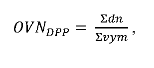

# § 5 Stanovenie obvyklej výšky nájomného

(1) Nájomca poskytuje podľa § 14 ods. 3 zákona okresnému úradu sumárne údaje z evidencie nájomného za kalendárny rok v tabuľkovej forme v listinnej podobe alebo elektronickej podobe za každé katastrálne územie na formulári uvedenom v prílohe č. 3.

(2) Okresný úrad spracúva poskytnuté údaje podľa katastrálnych území a v členení poľnohospodárskej pôdy podľa § 4 ods. 2.

(3) Obvyklá výška nájomného v eurách/ha poľnohospodárskej pôdy sa určí pre každé katastrálne územie a v členení poľnohospodárskej pôdy podľa § 4 ods. 2 z poskytnutých údajov podľa vzorca

kde: OVNDPP je obvyklá výška nájomného za katastrálne územie pre členenie poľnohospodárskej pôdy podľa § 4 ods. 2, dn je dohodnuté nájomné [v eurách], vym je prenajatá výmera [ha].

(4) Ak je v katastrálnom území súčet výmer z poskytnutých údajov menší ako jedna tretina poľnohospodárskej pôdy v katastrálnom území alebo nie sú poskytnuté žiadne údaje, obvyklá výška nájomného v eurách/ha sa určí ako 2 % z hodnoty ornej pôdy v danom katastrálnom území podľa osobitného predpisu.4) Ak v katastrálnom území nie je určená hodnota ornej pôdy, použije sa najvyššia hodnota zo všetkých susediacich katastrálnych území.
