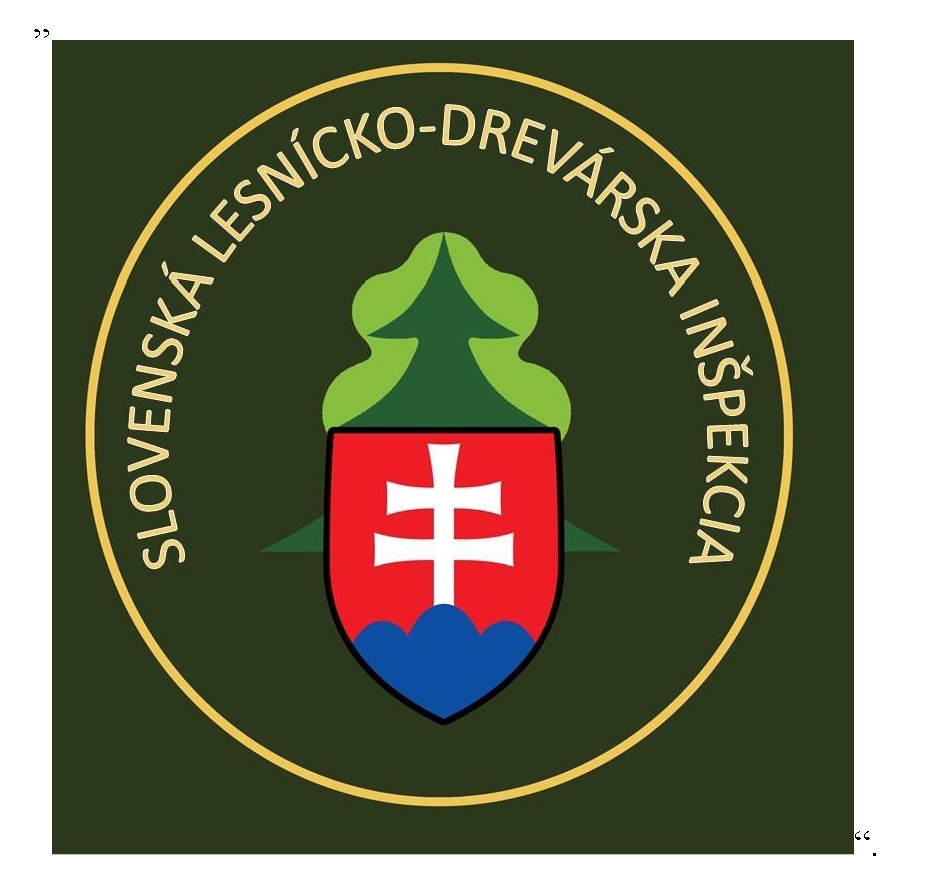

# Čl. I

Vyhláška Ministerstva pôdohospodárstva a rozvoja vidieka Slovenskej republiky č. 116/2016

Z. z., ktorou sa ustanovujú podrobnosti o lesníckej rovnošate sa mení a dopĺňa takto:

- 1. § 5 znie:

- 㤠5

- Rovnošatové súčasti sa prideľujú štátnemu zamestnancovi, ktorý vykonáva štátnu správu lesného hospodárstva podľa § 56 až 62 zákona, štátnu správu poľovníctva5) alebo štátnu správu v oblasti uvádzania dreva a výrobkov z dreva na vnútorný trh.5a)“.

  - Poznámka pod čiarou k odkazu 5a znie:

  - „5a) § 11 ods. 3 písm. f) zákona č. 113/2018 Z. z. o uvádzaní dreva a výrobkov z dreva na vnútorný trh a o zmene a doplnení zákona č. 280/2017 Z. z. o poskytovaní podpory a dotácie v pôdohospodárstve a rozvoji vidieka a o zmene zákona č. 292/2014 Z. z. o príspevku poskytovanom z európskych štrukturálnych a investičných fondov a o zmene a doplnení niektorých zákonov v znení neskorších predpisov.“.

- 2. Príloha č. 1 sa dopĺňa písmenami x) a y), ktoré znejú:

- „x)

- reflexná vesta nepremokavá žltá,

- y)

- reflexná bunda nepremokavá žltá.“.

- 3. Príloha č. 2 sa dopĺňa tabuľkami „Reflexná vesta nepremokavá žltá“ a „Reflexná bunda nepremokavá žltá“, ktoré znejú:

- [Reflexná vesta nepremokavá žltá](assets/423647480a2a1c4fb6330e0c719ec5d6d88dc3efdd94c9be857894b36ff940ab.pdf)

- 4. V prílohe č. 3 druhom bode písmeno a) znie:

- „a)

- Ministerstvo – sekcia riadiaca činnosti lesného hospodárstva, spracovania dreva a poľovníctva a Slovenská lesnícko-drevárska inšpekcia – tmavozelená výložka, obdĺžnikového tvaru 100 x 40 mm, tenký hnedý pásik ako olemovanie a spevnenie okraja výložky, spodný a horný okraj výložky pretkávaný hrubým prerušovaným zlatistým lemovaním, v ľavej časti šikmo ležiaca zelená lipová ratolesť so štátnym znakom, napravo od ratolesti zlatisto-zelené rozety. Zo spodnej časti je prišitý suchý zips.

- Generálny riaditeľ sekcie – 4 rozety,

- riaditeľ odboru a riaditeľ Slovenskej lesnícko-drevárskej inšpekcie – 3 rozety,

- vedúci oddelenia – 2 rozety,

- odborný zamestnanec – 1 rozeta.“.

- 5. V prílohe č. 3 treťom bode písm. a) sa za slovo „REPUBLIKA,“ vkladajú slová „alebo štátnej správy v oblasti uvádzania dreva a výrobkov z dreva na vnútorný trh, s textom SLOVENSKÁ LESNÍCKO-DREVÁRSKA INŠPEKCIA,“ a pod vyobrazenie špecifického znaku odnímateľnej nášivky – rukávnika štátnej správy lesného hospodárstva a poľovníctva sa vkladá toto vyobrazenie:

- 

- 6. Príloha č. 4 znie:

- „Príloha č. 4 k vyhláške č. 116/2016 Z. z.

- Hodnota jednotlivých rovnošatových súčastí

- Bod číslo | Názov rovnošatovej súčasti | Merná jednotka | Počet prideľovaných merných jednotiek | Hodnota mernej jednotky s DPH [eurá] | Hodnota spolu s DPH [eurá]

- 1. | Sako | ks | 1 | 126,00 | 126,00

- 2. | Nohavice alebo sukňa | ks | 2 | 51,00 | 102,00

- 3. | Košeľa zelená dlhý rukáv | ks | 2 | 26,40 | 52,80

- 4. | Viazanka zelená alebo šatka | ks | 2 | 11,40 | 22,80

- 5. | Čiapka letná | ks | 1 | 10,80 | 10,80

- 6. | Čiapka zimná | ks | 1 | 30,60 | 30,60

- 7. | Šál | ks | 1 | 8,40 | 8,40

- 8. | Sveter | ks | 1 | 64,70 | 64,70

- 9. | Bunda 3/4 s odopínateľnou vložkou | ks | 1 | 153,60 | 153,60

- 10. | Špecifické označenie – rukávnik | ks | 3 | 5,20 | 15,60

- 11. | Špecifické označenie – služobné označenie | ks | 3 | 3,00 | 9,00

- 12. | Nohavice terénne letné | ks | 1 | 59,40 | 59,40

- 13. | Obuv do terénu s membránou | pár | 1 | 135,00 | 135,00

- 14. | Nohavice terénne zimné | ks | 1 | 69,00 | 69,00

- 15. | Bunda do pása | ks | 1 | 95,40 | 95,40

- 16. | Zelená košeľa krátky rukáv | ks | 1 | 25,20 | 25,20

- 17. | Košeľa biela dlhý rukáv | ks | 1 | 26,40 | 26,40

- 18. | Polokošeľa krátky rukáv | ks | 1 | 20,20 | 20,20

- 19. | Polokošeľa dlhý rukáv | ks | 1 | 21,60 | 21,60

- 20. | Nepremokavá súprava | ks | 1 | 148,20 | 148,20

- 21. | Ponožky k rovnošate | pár | 3 | 2,20 | 6,60

- 22. | Ponožky pracovné | pár | 3 | 5,40 | 16,20

- 23. | Termotričko | ks | 1 | 24,00 | 24,00

- 24. | Termonohavice | ks | 1 | 21,60 | 21,60

- 25. | Reflexná vesta nepremokavá žltá | ks | 1 | 41,40 | 41,40

- 26. | Reflexná bunda nepremokavá žltá | ks | 1 | 43,70 | 43,70

- Hodnota základných rovnošatových súčastí je 790,70 eur.

- Celková hodnota rovnošaty je 1 350,20 eur.“.

- 7. V prílohe č. 5 stĺpci „Druh rovnošatovej súčasti“ sa za riadok „Termonohavice“ vkladajú riadky „Reflexná vesta nepremokavá žltá“ a „Reflexná bunda nepremokavá žltá“.
