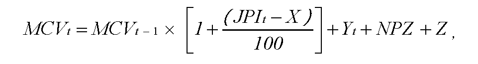
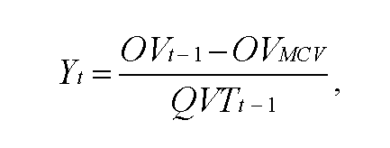
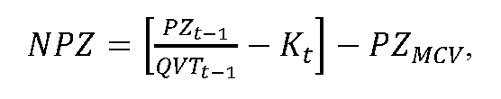
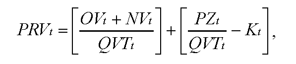
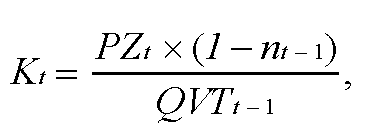
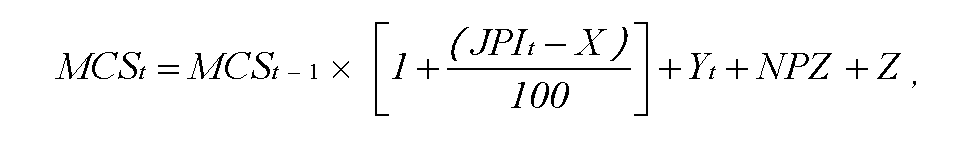
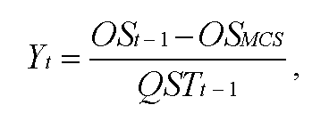
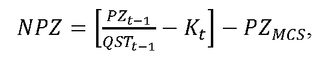
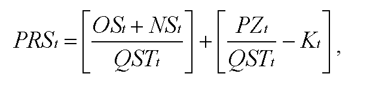
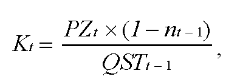

# Čl. I

Vyhláška Úradu pre reguláciu sieťových odvetví č. 21/2017 Z. z., ktorou sa ustanovuje cenová regulácia výroby, distribúcie a dodávky pitnej vody verejným vodovodom a odvádzania a čistenia odpadovej vody verejnou kanalizáciou sa mení a dopĺňa takto:

- 1. V § 4 ods. 1 písmeno e) znie:

- „e)

- odpisy hmotného majetku,6) ktorý bol obstaraný z vlastných zdrojov alebo úveru, okrem odpisov hmotného majetku podľa písmena g), najviac vo výške ustanovenej osobitným predpisom7) z jeho obstarávacej ceny8) a odpisy nehmotného majetku,6) ktorý bol obstaraný z vlastných zdrojov alebo úveru, okrem odpisov nehmotného majetku podľa písmena g), vo výške 25 % z obstarávacej ceny nehmotného majetku zahrnutého v účtovníctve; na účel cenovej regulácie pri prerušení odpisovania hmotného majetku a nehmotného majetku6) doba odpisovania plynie podľa osobitného predpisu,7) akoby odpisovanie nebolo prerušené,“.

- 2. V § 4 ods. 1 písm. f) sa na konci pripájajú tieto slová: „bez možnosti prerušenia odpisovania až do nulovej zostatkovej hodnoty“.

- 3. V § 5 ods. 5 sa slová „§ 8 ods. 4“ nahrádzajú slovami „§ 8 ods. 5“ a slová „§ 9 ods. 4“ sa nahrádzajú slovami „§ 9 ods. 5“.

- 4. V § 6 ods. 2 písm. a) sa slová „§ 8 ods. 3“ nahrádzajú slovami „§ 8 ods. 4“ a slová „§ 8 ods. 7 až 10“ sa nahrádzajú slovami „§ 8 ods. 8 až 11“.

- 5. V § 6 ods. 2 písm. b) sa slová „§ 9 ods. 3“ nahrádzajú slovami „§ 9 ods. 4“ a slová „§ 9 ods. 7 až 10“ sa nahrádzajú slovami „§ 9 ods. 8 až 11“.

- 6. § 8 a 9 vrátane nadpisov znejú:

- 㤠8

- Spôsob výpočtu maximálnej ceny za výrobu, distribúciu a dodávku pitnej vody a výšky primeraného zisku

- (1)

- Maximálna cena za výrobu a dodávku pitnej vody, maximálna cena za výrobu a distribúciu pitnej vody, maximálna cena za dodávku pitnej vody alebo maximálna cena za výrobu a dodávku pitnej vody pre skupinu odberateľov2) v eurách na objemovú jednotku sa vypočíta podľa vzorca

- 

- ak (JPIt – X) < 0, na účely výpočtu maximálnej ceny sa hodnota rozdielu JPIt a X rovná nule,

- kde

- MCVt je maximálna cena za výrobu a dodávku pitnej vody, maximálna cena za výrobu a distribúciu pitnej vody, maximálna cena za dodávku pitnej vody alebo maximálna cena za výrobu a dodávku pitnej vody pre skupinu odberateľov2) v eurách na objemovú jednotku na rok t,

- MCVt-1 je maximálna cena za výrobu a dodávku pitnej vody, maximálna cena za výrobu a distribúciu pitnej vody, maximálna cena za dodávku pitnej vody alebo maximálna cena za výrobu a dodávku pitnej vody pre skupinu odberateľov2) v eurách na objemovú jednotku schválená alebo určená v cenovom rozhodnutí na rok t-1, ktorá zohľadňuje ekonomicky oprávnené náklady a primeraný zisk,

- JPIt je aritmetický priemer zverejnených hodnôt ukazovateľa „jadrová inflácia“ za posledných 12 mesiacov predchádzajúcich mesiacu, v ktorom sa návrh ceny predkladá, uvedených na webovom sídle Štatistického úradu Slovenskej republiky v časti „Jadrová a čistá inflácia – oproti rovnakému obdobiu minulého roku v percentách“,

- X je faktor efektivity podľa § 5 ods. 6,

- Yt je faktor investičného rozvoja určeného na podporu investícií do vodárenského majetku využívaného na výrobu, distribúciu a dodávku pitnej vody v eurách na objemovú jednotku vypočítaný podľa odseku 2,

- NPZ je hodnota zmeny primeraného zisku v eurách na objemovú jednotku vypočítaná podľa odseku 3,

- Z je hodnota zmeny nákladov v eurách na objemovú jednotku, ktorá sa vo výpočte použije, ak sa postupuje v cenovom konaní o zmene rozhodnutia podľa § 17 ods. 2 písm. d) zákona; hodnota zmeny vyjadruje zmenu ekonomických parametrov, ktoré ovplyvňujú ekonomicky oprávnené prevádzkové náklady NV regulovaného subjektu, z ktorých sa vychádzalo pri určení maximálnej ceny za výrobu a dodávku pitnej vody, za výrobu a distribúciu pitnej vody, za dodávku pitnej vody alebo za výrobu a dodávku pitnej vody pre skupinu odberateľov2) v eurách na objemovú jednotku a odôvodňuje sa analýzami v predloženom návrhu na zmenu cenového rozhodnutia.

- (2)

- Faktor investičného rozvoja Yt sa vypočíta podľa vzorca

- 

- kde

- OVt-1 je hodnota odpisov hmotného a nehmotného majetku a nájomného v eurách využívaného výhradne na výrobu, distribúciu a dodávku pitnej vody skutočne zaradeného do účtovníctva do konca roka t-1 podľa § 4 ods. 1 písm. e) až h),

- OVMCV je hodnota odpisov hmotného a nehmotného majetku a nájomného podľa § 4 ods. 1 písm. e) až h) v eurách využívaného výhradne na výrobu, distribúciu a dodávku pitnej vody, ktoré sú uplatnené v maximálnej cene za výrobu a dodávku pitnej vody, maximálnej cene za výrobu a distribúciu pitnej vody, maximálnej cene za dodávku pitnej vody alebo maximálnej cene za výrobu a dodávku pitnej vody pre skupinu odberateľov2) schválenej alebo určenej v cenovom rozhodnutí na rok t-1; to platí aj pre prevádzkové spoločnosti, ktoré si taký majetok prenajímajú,

- QVTt-1 je skutočné množstvo dodanej pitnej vody v objemových jednotkách pre všetkých odberateľov v roku t-1 vrátane vlastnej spotreby.

- (3)

- Hodnota zmeny primeraného zisku NPZ sa vypočíta podľa vzorca

- 

- kde

- PZt-1 je výška primeraného zisku v eurách vypočítaná podľa odseku 5, pričom najvyššia miera primeraného zisku je 0,08 eura na 1 m3 množstva dodanej pitnej vody v roku t-1 vrátane vlastnej spotreby, alebo podľa odseku 6; pri výpočte ceny za dodávku pitnej vody sa uplatní najviac polovica hodnoty PZt-1,

- PZMCV je hodnota primeraného zisku v eurách na objemovú jednotku v maximálnej cene za výrobu a dodávku pitnej vody, maximálnej cene za výrobu a distribúciu pitnej vody, maximálnej cene za dodávku pitnej vody alebo maximálnej cene za výrobu a dodávku pitnej vody pre skupinu odberateľov2) schválenej alebo určenej v cenovom rozhodnutí na rok t-1.

- (4)

- Ak regulovaný subjekt prvýkrát predkladá návrh na určenie maximálnej ceny za výrobu a dodávku pitnej vody, maximálnej ceny za výrobu a distribúciu pitnej vody, maximálnej ceny za dodávku pitnej vody alebo maximálnej ceny za výrobu a dodávku pitnej vody pre skupinu odberateľov2) v eurách na objemovú jednotku, priemerná cena sa vypočíta podľa vzorca

- 

- kde

- PRVt je priemerná cena za výrobu, distribúciu a dodávku pitnej vody v eurách na objemovú jednotku,

- OVt sú odpisy hmotného a nehmotného majetku používaného na výrobu, distribúciu a dodávku pitnej vody a nájomné za prenájom hmotného a nehmotného majetku v eurách na rok t podľa § 4 ods. 1 písm. e) až h),

- NVt sú ekonomicky oprávnené prevádzkové náklady v eurách na výrobu, distribúciu a dodávku pitnej vody v roku t okrem OVt,

- QVTt je množstvo dodanej pitnej vody v objemových jednotkách pre všetkých odberateľov2) v roku t vrátane vlastnej spotreby,

- PZt je výška primeraného zisku v eurách vypočítaná podľa odseku 5, pričom najvyššia miera primeraného zisku je 0,08 eura na 1 m3 množstva dodanej pitnej vody v roku t vrátane vlastnej spotreby, alebo podľa odseku 6; pri výpočte ceny za dodávku pitnej vody sa uplatní najviac polovica hodnoty PZt,

- Kt je faktor využitia kapacity vodárenského majetku používaného na výrobu, distribúciu a dodávku pitnej vody podľa odseku 7.

- (5)

- Výška primeraného zisku PZt v eurách sa vypočíta podľa vzorca

- PZt = RAB2015 × WACCt,

- kde

- RAB2015 je účtovná hodnota (zostatková cena) hmotného majetku a nehmotného majetku v eurách v roku 2015 používaného na regulovanú činnosť podľa prílohy č. 12.

- (6)

- Výška primeraného zisku PZt pre regulovaný subjekt, ktorého dodávka pitnej vody verejným vodovodom nepresiahne 1 000 000 m3, je maximálne 0,04 eura na 1 m3 množstva dodanej pitnej vody v roku t vrátane vlastnej spotreby.

- (7)

- Hodnota faktora využitia vodárenského majetku používaného na výrobu, distribúciu a dodávku pitnej vody v eurách na objemovú jednotku sa vypočíta podľa vzorca

- 

- kde

- nt-1 je koeficient využitia projektovanej kapacity vodárenského majetku používaného na výrobu, distribúciu a dodávku pitnej vody, ktorý sa vypočíta ako priemer podielov skutočne využívanej kapacity a celkovej projektovanej kapacity jednotlivého vodárenského majetku v roku t-1 podľa prílohy č. 15; vypočítaná hodnota sa matematicky zaokrúhli na dve desatinné miesta.

- (8)

- Maximálna cena za výrobu a dodávku pitnej vody MCVt v eurách na objemovú jednotku sa navrhuje tak, aby vážený priemer maximálnej ceny za výrobu a dodávku pitnej vody a maximálnej ceny za výrobu a distribúciu pitnej vody prepočítaný na objemovú jednotku neprekročil priemernú cenu na rok t vypočítanú podľa odseku 4. Maximálna cena za dodávku pitnej vody sa navrhuje najviac do výšky vypočítanej priemernej ceny. Pri návrhu maximálnej ceny sa prihliada na sociálne, environmentálne a ekonomické dôsledky úhrady za vodohospodárske služby, ako aj na geografické podmienky a klimatické podmienky príslušného regiónu.

- (9)

- Ak regulovaný subjekt dodáva vodu inému regulovanému subjektu, návrh maximálnej ceny za výrobu a distribúciu pitnej vody sa predkladá tak, že maximálna cena za výrobu a distribúciu pitnej vody je cena znížená o priemerné náklady spojené s dodávkou pitnej vody konečným odberateľom.2)

- (10)

- Návrh maximálnej ceny pre jednotlivé skupiny odberateľov2) sa predkladá tak, aby maximálne ceny zohľadňovali ekonomicky oprávnené náklady jednotlivých skupín odberateľov2) a výšku primeraného zisku.

- (11)

- Ak sa návrh na určenie maximálnej ceny za výrobu a dodávku pitnej vody, maximálnej ceny za výrobu a distribúciu pitnej vody, maximálnej ceny za dodávku pitnej vody alebo maximálnej ceny za výrobu a dodávku pitnej vody pre skupinu odberateľov2) predkladá prvýkrát, vypočíta sa priemerná cena za výrobu, distribúciu a dodávku pitnej vody v eurách na objemovú jednotku na rok t podľa odseku 4, pričom sa na výpočet použijú plánované údaje na rok t a návrh maximálnej ceny sa predkladá podľa odsekov 8 až 10.

- § 9

- Spôsob výpočtu maximálnej ceny za odvádzanie a čistenie odpadovej vody a výšky primeraného zisku

- (1)

- Maximálna cena za odvádzanie a čistenie odpadovej vody, maximálna cena za odvádzanie odpadovej vody, maximálna cena za čistenie odpadovej vody alebo maximálna cena za odvádzanie a čistenie odpadovej vody pre skupinu producentov3) v eurách na objemovú jednotku sa vypočíta podľa vzorca

- 

- ak (JPIt – X) < 0, na účely výpočtu maximálnej ceny sa hodnota rozdielu JPIt a X rovná nule,

- kde

- MCSt je maximálna cena za odvádzanie a čistenie odpadovej vody, maximálna cena za odvádzanie odpadovej vody, maximálna cena za čistenie odpadovej vody alebo maximálna cena za odvádzanie a čistenie odpadovej vody pre skupinu producentov3) v eurách na objemovú jednotku na rok t,

- MCSt-1 je maximálna cena za odvádzanie a čistenie odpadovej vody, maximálna cena za odvádzanie odpadovej vody, maximálna cena za čistenie odpadovej vody alebo maximálna cena za odvádzanie a čistenie odpadovej vody pre skupinu producentov3) v eurách na objemovú jednotku schválená alebo určená v cenovom rozhodnutí na rok t-1, ktorá zohľadňuje ekonomicky oprávnené náklady a primeraný zisk,

- JPIt je aritmetický priemer zverejnených hodnôt ukazovateľa „jadrová inflácia“ za posledných 12 mesiacov predchádzajúcich mesiacu, v ktorom sa návrh ceny predkladá, uvedených na webovom sídle Štatistického úradu Slovenskej republiky v časti „Jadrová a čistá inflácia – oproti rovnakému obdobiu minulého roku v percentách,

- X je faktor efektivity podľa § 5 ods. 6,

- Yt je faktor investičného rozvoja určeného na podporu investícií do vodárenského majetku využívaného na odvádzanie a čistenie odpadovej vody v eurách na objemovú jednotku vypočítaný podľa odseku 2,

- NPZ je hodnota zmeny primeraného zisku v eurách na objemovú jednotku vypočítaná podľa odseku 3,

- Z je hodnota zmeny nákladov v eurách na objemovú jednotku, ktorá sa vo výpočte použije, ak sa postupuje v cenovom konaní o zmene rozhodnutia podľa § 17 ods. 2 písm. d) zákona; hodnota zmeny vyjadruje zmenu ekonomických parametrov, ktoré ovplyvňujú ekonomicky oprávnené prevádzkové náklady NS regulovaného subjektu a z ktorých sa vychádzalo pri určení maximálnej ceny za odvádzanie a čistenie odpadovej vody, za odvádzanie odpadovej vody, za čistenie odpadovej vody alebo za odvádzanie a čistenie odpadovej vody pre skupinu producentov3) v eurách na objemovú jednotku a odôvodňuje sa analýzami v predloženom návrhu na zmenu cenového rozhodnutia.

- (2)

- Faktor investičného rozvoja Yt sa vypočíta podľa vzorca

- 

- kde

- OSt-1 je hodnota odpisov hmotného a nehmotného majetku a nájomného v eurách využívaného výhradne na odvádzanie a čistenie odpadovej vody skutočne zaradeného do účtovníctva do konca roka t-1 podľa § 4 ods. 1 písm. e) až h),

- OSMCS je hodnota odpisov hmotného a nehmotného majetku a nájomného podľa § 4 ods. 1 písm. e) až h) v eurách využívaného výhradne na odvádzanie a čistenie odpadovej vody, ktoré sú uplatnené v maximálnej cene za odvádzanie a čistenie odpadovej vody, maximálnej cene za odvádzanie odpadovej vody, maximálnej cene za čistenie odpadovej vody alebo maximálnej cene za odvádzanie a čistenie odpadovej vody pre skupinu producentov3) schválenej alebo určenej v cenovom rozhodnutí na rok t-1; to platí aj pre prevádzkové spoločnosti, ktoré si taký majetok prenajímajú,

- QSTt-1 je skutočné množstvo odvedenej a čistenej odpadovej pitnej vody v objemových jednotkách pre všetkých producentov v roku t-1 vrátane vlastnej produkcie.

- (3)

- Hodnota zmeny primeraného zisku NPZ sa vypočíta podľa vzorca

- 

- kde

- PZt-1 je výška primeraného zisku v eurách vypočítaná podľa odseku 5, pričom najvyššia miera primeraného zisku je 0,10 eura na 1 m3 množstva odvedenej odpadovej vody v roku t-1 vrátane vlastnej produkcie, alebo podľa odseku 6; pri výpočte ceny za čistenie odpadovej vody sa uplatní najviac polovica hodnoty PZt-1,

- PZMCS je hodnota primeraného zisku v eurách na objemovú jednotku v maximálnej cene za odvádzanie a čistenie odpadovej vody, maximálnej cene za odvádzanie odpadovej vody, maximálnej cene za čistenie odpadovej vody alebo maximálnej cene za odvádzanie a čistenie odpadovej vody pre skupinu producentov3) schválenej alebo určenej v cenovom rozhodnutí na rok t-1.

- (4)

- Ak regulovaný subjekt prvýkrát predkladá návrh na určenie maximálnej ceny za odvádzanie a čistenie odpadovej vody, maximálnej ceny za odvádzanie odpadovej vody, maximálnej ceny za čistenie odpadovej vody alebo maximálnej ceny za odvádzanie a čistenie odpadovej vody pre skupinu producentov3) v eurách na objemovú jednotku, priemerná cena sa vypočíta podľa vzorca

- 

- kde

- PRSt je priemerná cena za odvádzanie a čistenie odpadovej vody v eurách na objemovú jednotku,

- OSt sú odpisy hmotného a nehmotného majetku a nájomné za prenájom hmotného a nehmotného majetku používaného na odvádzanie a čistenie odpadovej vody v eurách na rok t podľa § 4 ods. 1 písm. e) až h),

- NSt sú ekonomicky oprávnené prevádzkové náklady v eurách na odvádzanie a čistenie odpadovej vody v roku t okrem OSt,

- QSTt je množstvo odvedenej a čistenej odpadovej vody v objemových jednotkách pre všetkých producentov3) v roku t,

- PZt je výška primeraného zisku v eurách vypočítaná podľa odseku 5, pričom najvyššia miera primeraného zisku je 0,10 eura na 1 m3 množstva odvedenej odpadovej vody v roku t vrátane vlastnej produkcie, alebo podľa odseku 6; pri výpočte ceny za čistenie odpadovej vody sa uplatní najviac polovica hodnoty PZt,

- Kt je faktor využitia kapacity vodárenského majetku používaného na odvádzanie a čistenie odpadovej vody vypočítaný podľa odseku 7.

- (5)

- Výška primeraného zisku PZt sa vypočíta podľa vzorca

- PZt = RAB2015 × WACCt ,

- kde

- RAB2015 je účtovná hodnota (zostatková cena) hmotného a nehmotného majetku v eurách v roku 2015 používaného na odvádzanie a čistenie odpadovej vody podľa prílohy č. 12.

- (6)

- Výška primeraného zisku PZt pre regulovaný subjekt, ktorého odvedené a čistené množstvo odpadovej vody verejnou kanalizáciou nepresiahne 1 000 000 m3, sa ustanovuje maximálne vo výške 0,05 eura za 1m3 množstva odvedenej odpadovej vody v roku t vrátane vlastnej produkcie.

- (7)

- Hodnota faktora využitia vodárenského majetku používaného na odvádzanie a čistenie odpadovej vody v eurách na objemovú jednotku sa vypočíta podľa vzorca

- 

- kde

- nt-1 je koeficient využitia projektovanej kapacity vodárenského majetku používaného na odvádzanie a na čistenie odpadovej vody, ktorý sa vypočíta ako priemer podielov skutočne využívanej kapacity a celkovej projektovanej kapacity jednotlivého vodárenského majetku v roku t-1 podľa prílohy č. 15; vypočítaná hodnota sa matematicky zaokrúhli na dve desatinné miesta.

- (8)

- Maximálna cena za odvádzanie a čistenie odpadovej vody MCSt sa navrhuje tak, aby vážený priemer maximálnej ceny za odvádzanie a čistenie odpadovej vody a maximálnej ceny za čistenie odpadovej vody prepočítaný na objemovú jednotku neprekročil priemernú cenu na rok t vypočítanú podľa odseku 4. Maximálna cena za odvádzanie odpadovej vody alebo za čistenie odpadovej vody sa navrhuje najviac do výšky vypočítanej priemernej ceny. Pri návrhu maximálnej ceny sa prihliada na sociálne, environmentálne a ekonomické dôsledky úhrady za vodohospodárske služby, ako aj na geografické podmienky a klimatické podmienky príslušného regiónu.

- (9)

- Ak regulovaný subjekt čistí odpadovú vodu odvádzanú od iného regulovaného subjektu, návrh maximálnej ceny za čistenie odpadovej vody sa predkladá tak, že maximálna cena za odvádzanie a čistenie odpadovej vody je cena znížená o priemerné náklady spojené s odvádzaním odpadovej vody od konečných producentov.3)

- (10)

- Maximálne ceny za odvádzanie a čistenie odpadovej vody pre jednotlivé skupiny producentov3) v eurách na objemovú jednotku sa navrhujú tak, aby zohľadňovali ekonomicky oprávnené náklady jednotlivých skupín producentov3) a výšku primeraného zisku.

- (11)

- Ak sa návrh na určenie maximálnej ceny za odvádzanie a čistenie odpadovej vody, za odvádzanie odpadovej vody, za čistenie odpadovej vody alebo za odvádzanie a čistenie odpadovej vody pre skupinu producentov3) predkladá prvýkrát, vypočíta sa priemerná cena za odvádzanie a čistenie odpadovej vody v eurách na objemovú jednotku na rok t podľa odseku 4, pričom sa na výpočet použijú plánované údaje na rok t a návrh maximálnej ceny sa predkladá podľa odsekov 8 až 10.“.

- 7. V § 11 odsek 2 znie:

- „(2)

- Ak maximálnu cenu za regulovanú činnosť vypočítava regulovaný subjekt, ktorým je obec, podľa § 14 ods. 8 zákona prvýkrát, postupuje sa podľa § 8 ods. 4, 6, 8 až 11 alebo § 9 ods. 4, 6, 8 až 11.“.

- 8. Prílohy č. 1 a 2 vrátane nadpisov znejú:

- „[Prílohy č. 1 a 2](assets/4e30ade5811e1e07d430899a97d9dc5b88c16199c5a55c0aba4bae9ac1bb1a54.pdf)“.

- 9. V prílohe č. 5 v p. č. 11 tabuľky v stĺpci „Ukazovateľ“ sa slová „§ 4 ods. 1 písm. f)“ nahrádzajú slovami „§ 4 ods. 1 písm. h)“.

- 10. V prílohe č. 7 v p. č. 14 tabuľky v stĺpci „Ukazovateľ“ sa slová „§ 6 ods. 2 alebo 3“ nahrádzajú slovami „§ 8 ods. 4 alebo ods. 6“.

- 11. V prílohe č. 8 v p. č. 14 tabuľky v stĺpci „Ukazovateľ“ sa slová „§ 7 ods. 2 alebo 3“ nahrádzajú slovami „§ 9 ods. 4 alebo ods. 6“.
