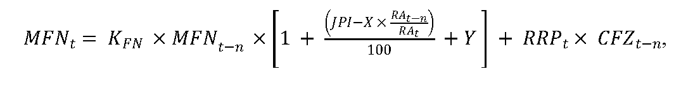
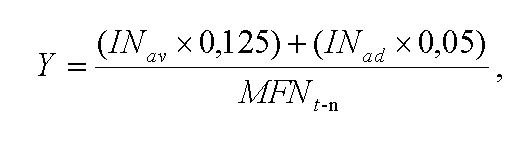

# Čl. I

Vyhláška Úradu pre reguláciu sieťových odvetví č. 248/2016 Z. z., ktorou sa ustanovuje cenová regulácia v tepelnej energetike sa mení a dopĺňa takto:

- 1. § 1 sa dopĺňa písmenom m), ktoré znie:

- „m)

- plánovanou generálnou opravou pravidelná komplexná obnova projektovanej funkčnosti zariadenia na kombinovanú výrobu elektriny a tepla.“.

- 2. V § 4 ods. 1 písm. c) sa slová „odseku 9 písm. a)“ nahrádzajú slovami „odseku 10 písm. a)“.

- 3. V § 4 ods. 1 písm. d) sa slová „odsekov 6 a 7“ nahrádzajú slovami „odsekov 7 a 8“.

- 4. V § 4 ods. 1 písm. l) sa na konci čiarka nahrádza bodkočiarkou a pripájajú sa tieto slová: „náklady na plánované generálne opravy môžu byť rozložené rovnomerne počas nasledujúcich piatich rokov, ak to regulovaný subjekt uvedie v návrhu ceny tepla,“.

- 5. V § 4 ods. 2 písm. d) sa za slová „tohto majetku“ dopĺňajú slová „regulovaným subjektom“.

- 6. V § 4 ods. 2 písm. g) sa vypúšťajú slová „a príspevky na doplnkové dôchodkové sporenie14) platené zamestnávateľom okrem príspevkov na doplnkové dôchodkové sporenie podľa odseku 1 písm. d)“.

  - Poznámka pod čiarou k odkazu 14 sa vypúšťa.

- 7. V § 4 ods. 3 písm. a) sa za slová „sústav tepelných zariadení3)“ vkladajú slová „staršom ako 30 dní“.

- 8. V § 4 ods. 4 písmeno a) znie:

- „a)

- zemného plynu bez nákladov na prepravu, distribúciu a uskladňovanie zemného plynu a bez spotrebnej dane zo zemného plynu na rok t v eurách/kWh sa vypočíta podľa vzorca

- CZPt = 1,15 × CENCGt × kp,

- kde

- CENCGt je aritmetický priemer denných cien zverejnených burzou EEX (European Energy Exchange) na webovom sídle www.powernext.com/futures-market-data v časti All contracts, Settlement prices on Seasons and Calendars, produktu NCG Calendar + 1 v eurách na megawatthodinu za obdobie od 1. januára roku t-1 do 30. júna roku t-1,

- kp je korekčný koeficient, ktorého hodnota nie je menšia ako 1,“.

- 9. V § 4 ods. 5 sa za slovo „koeficientov“ vkladá slovo „kp,“.

- 10. V § 4 sa za odsek 5 vkladá nový odsek 6, ktorý znie:

- „(6)

- Ekonomicky oprávneným nákladom je náklad na palivo so zmluvne dohodnutou cenou vo výške podľa odseku 4 pre rok t počas celého trvania platnosti zmluvnej ceny.“.

  - Doterajšie odseky 6 až 19 sa označujú ako odseky 7 až 20.

- 11. V § 4 ods. 8 sa slová „odseku 6“ nahrádzajú slovami „odseku 7“.

- 12. V § 4 ods. 9 sa za slovami „tepla zo slnečnej energie“ spojka „a“ nahrádza čiarkou a za slová „geotermálnej energie“ sa vkladajú slová „a aerotermálnej energie“.

- 13. V § 4 ods. 10 písmeno a) znie:

- „a)

- náklady regulovanej zložky fixných nákladov, ktoré sa pre každý návrh ceny určia v rozsahu podľa prílohy č. 2 podľa celkového regulačného príkonu všetkých odberných zariadení v kilowattoch

- 1.

- do 300 kW vrátane, maximálne 16 800 eur,

- 2.

- nad 300 kW do 3 500 kW vrátane, maximálne 56 eur/kW,

- 3.

- nad 3 500 kW do 5 200 kW vrátane, maximálne 196 000 eur + 41 eur/kW za každý ďalší kilowatt nad 3 500 kW,

- 4.

- nad 5 200 kW do 13 000 kW vrátane, maximálne 265 700 eur + 40 eur/kW za každý ďalší kilowatt nad 5 200 kW,

- 5.

- nad 13 000 kW do 21 000 kW vrátane, maximálne 577 700 eur + 34 eur/kW za každý ďalší kilowatt nad 13 000 kW,

- 6.

- nad 21 000 kW, maximálne 849 700 eur + 28 eur/kW za každý ďalší kilowatt nad

- 21 000 kW,“.

- 14. V § 4 odsek 11 znie:

- „(11)

- Maximálna výška celkových ekonomicky oprávnených fixných nákladov v návrhu ceny regulovaného subjektu na rok t sa vypočíta podľa vzorca

- 

- ak RAt-n/RAt > 1, na výpočet maximálnej výšky ekonomicky oprávnených fixných nákladov sa použije hodnota RAt-n/RAt = 1,

- ak RAt-n=RAt, na výpočet maximálnej výšky ekonomicky oprávnených fixných nákladov sa použije hodnota (JPI – X × RAt-n/RAt) = 0,

- ak (JPI – X × RAt-n/RAt) < 0, na výpočet maximálnej výšky ekonomicky oprávnených fixných nákladov sa použije hodnota (JPI – X × RAt-n/RAt) = 0,

- kde

- MFNt je maximálna výška ekonomicky oprávnených fixných nákladov okrem nákladov na nákup tepla v eurách za výrobu, distribúciu a dodávku tepla na rok t bez primeraného zisku,

- MFNt-n je výška fixných nákladov okrem nákladov na nákup tepla v eurách za výrobu, distribúciu a dodávku tepla schválená alebo určená v cenovom rozhodnutí na rok t-n bez primeraného zisku,

- KFN je koeficient fixných nákladov; na rok 2019 sa KFN ustanovuje vo výške 1,02 a na roky 2020 a 2021 sa KFN ustanovuje vo výške 1,

- JPI je aritmetický priemer hodnôt jadrovej inflácie za obdobie od júla roku t-2 do júna roku t-1 zverejnených Štatistickým úradom Slovenskej republiky v percentách,

- X je faktor efektivity využívania nákladov na výrobu, distribúciu a dodávku tepla v percentách, ktorého hodnota na regulačné obdobie sa ustanovuje vo výške 3,50 %,

- RAt je predpokladaná výška neobežných aktív súvisiacich s regulovanou činnosťou v roku t,

- RAt-n sú neobežné aktíva súvisiace s regulovanou činnosťou v roku t-n, ktoré boli uplatnené v schválenej alebo určenej cene v cenovom rozhodnutí na rok t-n,

- RRPt je údaj, ktorý predstavuje kladný rozdiel regulačného príkonu odberných zariadení, ktoré boli pripojené do sústavy tepelných zariadení a regulačného príkonu odberných zariadení, ktoré boli odpojené zo sústavy tepelných zariadení v období od roku t-n, v ktorom bola schválená alebo určená cena cenovým rozhodnutím,

- CFZt-n je schválená alebo určená cena fixnej zložky ceny tepla bez primeraného zisku v roku t-n,

- Y je faktor investičného rozvoja v tepelnej energetike, ktorý zohľadňuje náklady v roku t na modernizáciu, rekonštrukciu a výstavbu nového tepelného zariadenia na základe predloženého stavebného povolenia alebo ohlásenia stavebnému úradu,26) ak ich cieľom bude zvýšenie energetickej účinnosti tepelných zariadení alebo zníženie prevádzkových nákladov pri výrobe tepla alebo distribúcii tepla, a náklady na ekologizáciu zariadenia na výrobu tepla, ktorý sa vypočíta podľa vzorca

- 

- kde

- INav sú náklady na modernizáciu, rekonštrukciu, ekologizáciu a výstavbu zariadenia na výrobu tepla po odčítaní príspevku poskytnutého z prostriedkov štátneho rozpočtu alebo z prostriedkov Európskej únie; pri kombinovanej výrobe elektriny a tepla sa náklady INav vypočítajú z celkových nákladov na modernizáciu, rekonštrukciu alebo výstavbu zariadenia na výrobu elektriny a tepla vynásobených koeficientom delenia nákladov βq,

- INad sú náklady na modernizáciu, rekonštrukciu a výstavbu zariadenia na distribúciu tepla po odčítaní príspevku poskytnutého z prostriedkov štátneho rozpočtu alebo z prostriedkov Európskej únie.“.

- 15. V § 4 ods. 12 sa slová „odseku 10“ nahrádzajú slovami „odseku 11“.

- 16. V § 4 sa za odsek 12 vkladá nový odsek 13, ktorý znie:

- „(13)

- Ak sa opatrenia súvisiace s faktorom investičného rozvoja Y uplatneného v cene tepla na rok t nerealizovali, platí pre výpočet výšky maximálnych ekonomicky oprávnených fixných nákladov MFNt podľa odseku 11 hodnota Y = 0.“.

  - Doterajšie odseky 13 až 20 sa označujú ako odseky 14 až 21.

- 17. V § 4 ods. 15 sa slová „odseku 12“ nahrádzajú slovami „odseku 14“.

- 18. V § 4 ods. 16 prvej vete sa slová „odseku 16“ nahrádzajú slovami „odseku 18“.

- 19. V § 5 ods. 2 a 4 sa číslo „0,0420“ nahrádza číslom „0,0450“.

- 20. V § 5 sa vypúšťa odsek 3.

  - Doterajší odsek 4 sa označuje ako odsek 3.

- 21. V § 6 ods. 3 sa slová „8. septembra“ nahrádzajú slovami „30. júna“.

- 22. V § 7 ods. 2 písm. h) a i) sa slová „§ 4 ods. 10“ nahrádzajú slovami „§ 4 ods. 11“.

- 23. V § 7 ods. 2 písm. j) sa slová „§ 4 ods. 11“ nahrádzajú slovami „§ 4 ods. 12“.

- 24. V § 7 ods. 3 písm. b) sa slová „§ 4 ods. 16“ nahrádzajú slovami „§ 4 ods. 18“.

- 25. V § 7 ods. 4 prvej vete sa za slová „elektronickej podobe“ vkladajú slová „v tabuľkovom editore“.

- 26. V § 8 ods. 1 sa slová „§ 4 ods. 9 písm. a)“ nahrádzajú slovami „§ 4 ods. 10 písm. a)“.

- 27. V § 8 ods. 2 sa za slová „elektronickej podobe“ vkladajú slová „v tabuľkovom editore“.

- 28. Za § 9 sa vkladá § 9a, ktorý vrátane nadpisu znie:

- 㤠9a

- Prechodné ustanovenie k úpravám účinným od 20. júla 2018

- Podľa úprav účinných od 20. júla 2018 sa prvýkrát postupuje pri vykonávaní cenovej regulácie na rok 2019.“.

- 29. Príloha č. 8 vrátane nadpisu znie:

- „[Príloha č. 8 k vyhláške č. 248/2016 Z. z.](assets/95db70863e9546e0159c88ed07e47f7754a7324a05a5025f6dafbf36eb96aad9.pdf)“.

- 30. Príloha č. 16 vrátane nadpisu znie:

- „[Príloha č. 16 k vyhláške č. 248/2016 Z. z.](assets/11b93c3f565616cfd0f35e99eb32a996ab9dbd47ffc06fbe61f8404a89c2167a.pdf)“.
