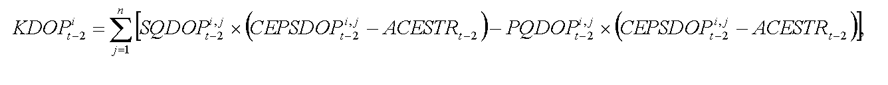
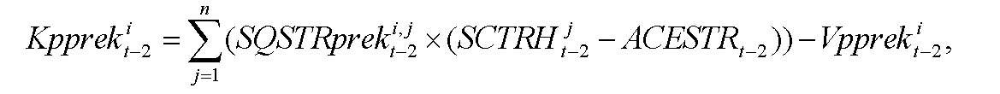
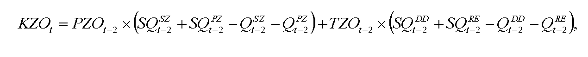
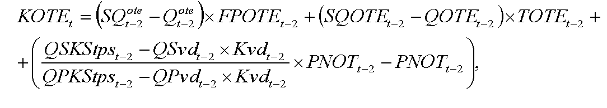
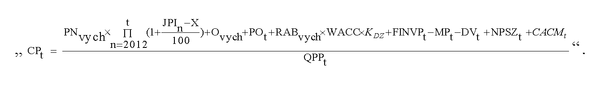
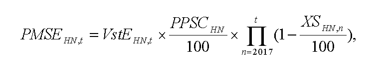
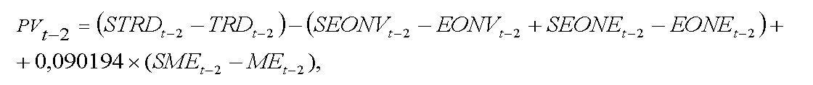
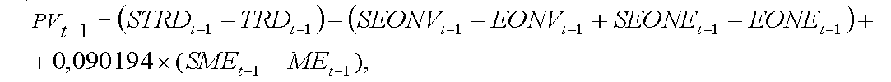
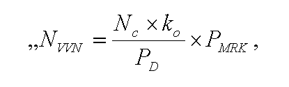

# Čl. I

Vyhláška Úradu pre reguláciu sieťových odvetví č. 18/2017 Z. z., ktorou sa ustanovuje cenová regulácia v elektroenergetike a niektoré podmienky vykonávania regulovaných činností v elektroenergetike sa mení a dopĺňa takto:

- 1. § 5 znie:

- 㤠5

- (1)

- Primeraný zisk zohľadňuje rozsah potrebných investícií na zabezpečenie dlhodobej, spoľahlivej, bezpečnej a efektívnej prevádzky sústavy, primeranú návratnosť prevádzkových aktív a stimuláciu stabilného dlhodobého podnikania.

- (2)

- Výška primeraného zisku v percentách sa určuje ako miera výnosnosti regulačnej bázy aktív pred zdanením na regulačné obdobie, kde WACC je reálna miera výnosnosti regulačnej bázy aktív pred zdanením na regulačné obdobie vypočítaná podľa vzorca

- [vzorecp1](assets/2da51d237cbd1c714882526fba4ed6623a37548709ffe9c8bf091e3fce695a8b.pdf)

- (3)

- Reálna miera výnosnosti regulačnej bázy aktív (WACC) sa určuje v maximálnej výške 6,47 % a platí konštantne na celé regulačné obdobie, ak odchýlka v jednotlivých parametroch WACC nie je vyššia ako 10 %. Ak bude odchýlka v jednotlivých parametroch WACC vyššia ako 10 %, na zvyšok regulačného obdobia sa určí nová miera výnosnosti regulačnej bázy aktív (WACC) a zverejní sa na webovom sídle úradu do 30. júna kalendárneho roku.“.

- 2. V § 7 ods. 8 písm. c) sa za slová „preukázateľne oddelené od“ vkladá slovo „elektrizačnej“.

- 3. V § 7 ods. 8 písmeno e) znie:

- „e)

- kópia zmluvy o pripojení zariadenia výrobcu elektriny k priamemu vedeniu, do distribučnej sústavy alebo do prenosovej sústavy; ak je zariadenie výrobcu elektriny pripojené do miestnej distribučnej sústavy, ktorá je pripojená do regionálnej distribučnej sústavy priamo alebo prostredníctvom jednej alebo viacerých miestnych distribučných sústav, predkladá sa s návrhom ceny aj potvrdenie vydané prevádzkovateľom regionálnej distribučnej sústavy o zmluvne dohodnutom pripojení miestnej distribučnej sústavy do regionálnej distribučnej sústavy podľa § 26 ods. 25, § 42 ods. 5, § 43 ods. 3 alebo § 44 ods. 5,“.

- 4. V § 7 sa odsek 11 dopĺňa písmenom f), ktoré znie:

- „f)

- kópia zmluvy o pripojení zariadenia výrobcu elektriny k priamemu vedeniu, do distribučnej sústavy alebo do prenosovej sústavy; ak je zariadenie výrobcu elektriny pripojené do miestnej distribučnej sústavy, ktorá je pripojená do regionálnej distribučnej sústavy priamo alebo prostredníctvom jednej alebo viacerých miestnych distribučných sústav, s návrhom ceny predkladanej výrobcom elektriny sa predkladá aj potvrdenie vydané prevádzkovateľom regionálnej distribučnej sústavy o zmluvne dohodnutom pripojení miestnej distribučnej sústavy do regionálnej distribučnej sústavy podľa § 26 ods. 25, § 42 ods. 5, § 43 ods. 3 alebo § 44 ods. 5.“.

- 5. V § 7 odsek 19 znie:

- „(19)

- Ak sa zmení výrobca elektriny, ktorý prevádzkuje zariadenie výrobcu elektriny, s návrhom ceny sa predkladá aj doklad o práve užívať zariadenie doterajšieho výrobcu elektriny, a to najmä kúpna zmluva, darovacia zmluva alebo nájomná zmluva a kópia zmluvy o pripojení zariadenia výrobcu elektriny k priamemu vedeniu, do distribučnej sústavy alebo do prenosovej sústavy.“.

- 6. V § 10 ods. 4 sa na konci bodka nahrádza bodkočiarkou a pripájajú sa tieto slová: „to neplatí pre výrobu elektriny zo spaľovania biometánu podľa § 10 odseku 1 písm. g) druhého bodu, ak je biometán distribuovaný distribučnou sieťou a množstvo biometánu na výrobu elektriny zodpovedá zmluvnému množstvu biometánu.49a)“.

  - Poznámka pod čiarou k odkazu 49a znie:

  - „49a) § 10 ods. 2 písm. b) zákona č. 309/2009 Z. z. v znení neskorších predpisov.“.

- 7. V § 11 ods. 1 sa vypúšťa písmeno g).

  - Doterajšie písmená h) a i) sa označujú ako písmená g) a h).

- 8. V § 12 ods. 5 znie:

- „(5)

- Korekcia nákladov na doplatok pre výrobcov elektriny z obnoviteľných zdrojov energie a vysoko účinnou kombinovanou výrobou vynaložené i-tým prevádzkovateľom regionálnej distribučnej sústavy v roku t sa vypočíta podľa vzorca

- 

- kde

- a)

- SQDOPi,jt-2 je skutočné množstvo elektriny, na ktoré je možné uplatniť doplatok, vyrobenej v j-tom zariadení na výrobu elektriny výrobcov z obnoviteľných zdrojov energie a vysoko účinnou kombinovanou výrobou, ktorí sú pripojení do i-tej regionálnej distribučnej sústavy, alebo na ktorej vymedzenom území sa nachádzajú, v jednotkách množstva elektriny v roku t-2,

- b)

- PQDOPi,jt-2 je plánované množstvo elektriny, na ktoré je možné uplatniť doplatok, vyrobenej v j-tom zariadení na výrobu elektriny výrobcov z obnoviteľných zdrojov energie a vysoko účinnou kombinovanou výrobou, ktorí sú pripojení do i-tej regionálnej distribučnej sústavy, alebo na ktorej vymedzenom území sa nachádzajú, v jednotkách množstva elektriny v roku t-2,

- c)

- CEPSDOPi,jt-2 je cena elektriny pre stanovenie doplatku pre zariadenie výrobcu elektriny z obnoviteľných zdrojov energie a vysoko účinnou kombinovanou výrobou v eurách na jednotku množstva elektriny na rok t-2,

- d)

- ACESTRt-2 je cena elektriny na straty podľa osobitného predpisu51) určená ako aritmetický priemer cien elektriny základného pásma na účely pokrytia strát prevádzkovateľov regionálnych distribučných sústav bez nákladov na odchýlku v roku t-2; výška ceny elektriny základného pásma na účely pokrytia strát prevádzkovateľa regionálnej distribučnej sústavy v eurách na jednotku množstva elektriny na rok t-2 sa vypočíta podľa § 28 ods. 3 písm. b) prvého bodu.“.

- 9. V § 12 ods. 6 znie:

- „(6)

- Korekcia výnosu získaného za predaj elektriny prevyšujúcej potreby pokrytia strát i-tým prevádzkovateľom regionálnej distribučnej sústavy v roku t sa vypočíta podľa vzorca

- 

- kde

- a)

- SQSTRpreki,jt-2 je skutočné množstvo elektriny v jednotkách množstva elektriny v j-tej hodine roku t-2 prekúpené i-tým prevádzkovateľom regionálnej distribučnej sústavy v súvislosti s odberom elektriny i-tého prevádzkovateľa regionálnej distribučnej sústavy zo zariadení výrobcov elektriny s právom na podporu na účely pokrytia strát distribučnej sústavy; SQSTRpreki,jt-2 sa vypočíta ako rozdiel v j-tej hodine roku t skutočného diagramu na pokrytie strát v i-tej regionálnej distribučnej sústave a skutočného diagramu odberu elektriny i-tého prevádzkovateľa regionálnej distribučnej sústavy zo zariadení výrobcov elektriny s právom na podporu; ak je tento rozdiel kladný, SQSTRpreki,jt-2 sa rovná nule,

- b)

- Vpprekit-2 je plánovaný výnos za predaj elektriny prevyšujúcej potreby pokrytia strát i-tým prevádzkovateľom regionálnej distribučnej sústavy schválený alebo určený cenovým rozhodnutím na rok t-2,

- c)

- SCTRHjt-2 je skutočná určená cena elektriny v eurách na jednotku množstva elektriny na rok t -2 v j-tej hodine roku t-2; SCTRHjt-2 sa rovná pre každú hodinu roka t-2 váženému priemeru cien elektriny príslušnej hodiny roka t-2, za ktoré boli odpredané jednotlivé časti množstva SQSTRprekjt-2 na obdobie roku t-2, od 1. marca 2013 je táto cena minimálne vo výške ceny elektriny na straty podľa osobitného predpisu;51) prekúpené množstvo elektriny SQSTRpreki,jt-2 i-tým prevádzkovateľom regionálnej distribučnej sústavy v súvislosti s odberom elektriny i-tého prevádzkovateľa regionálnej distribučnej sústavy zo zariadení výrobcov elektriny s právom na podporu na účely pokrytia strát distribučnej sústavy sa umožňuje odpredať na ročnej báze vo forme štandardného produktu ročného základného pásma s rovnakou hodnotou množstva elektriny v každej hodine roka t-2 a v dennom obchodovaní v obchodnej oblasti, v rámci ktorej je denný trh s elektrinou organizovaný organizátorom krátkodobého trhu s elektrinou.“.

- 10. V § 12 ods. 12 sa na konci pripája táto veta: „Tarifa za prevádzkovanie systému sa neuplatňuje za spotrebu elektriny pri skúškach po ukončení výstavby zariadenia na výrobu elektriny pred jeho uvedením do prevádzky, ak takéto skúšky sú vykonané prostredníctvom odberu elektriny z prenosovej sústavy a netrvajú viac ako 12 mesiacov.“.

- 11. V § 14 ods. 2 sa vypúšťa písmeno f).

  - Doterajšie písmená g) a h) sa označujú ako písmená f) a g).

- 12. V § 15 odsek 1 znie:

- „(1)

- Pre subjekty zúčtovania sa uplatňujú tarify za zúčtovanie, vyhodnotenie a vysporiadanie odchýlok v štvrťhodinovom rozlíšení, kde maximálny výnos PPZOt z týchto platieb v eurách v roku t sa vypočíta podľa vzorca

- PPZOt = PNZOt + POZOt + RABt x WACC + INVZOt – KZOt ,

- kde

- a)

- PNZOt sú schválené alebo určené plánované prevádzkové ročné náklady súvisiace so zúčtovaním, vyhodnotením a vysporiadaním odchýlok zúčtovateľa odchýlok v eurách v roku t,

- b)

- POZOt sú plánované schválené alebo určené odpisy v eurách na rok t súvisiace s regulovanou činnosťou z plánovanej hodnoty regulačnej bázy aktív nevyhnutne využívanej pre regulovanú činnosť v roku t,

- c)

- RABt je schválená alebo určená hodnota regulačnej bázy aktív využívanej v súvislosti so zúčtovaním, s vyhodnotením a vysporiadaním odchýlok zúčtovateľa odchýlok k 31. decembru roku t-1,

- d)

- WACC je miera výnosnosti regulačnej bázy aktív na roky 2017 až 2021 určená podľa § 5 ods. 2 a 3,

- e)

- INVZOt je faktor investícií v eurách v roku t, ktorého hodnota sa vypočíta podľa vzorca

- INVZOt = SOzot-2 - POzot-2,

- kde

- 1.

- SOzot-2 sú skutočné schválené alebo určené odpisy v eurách zo skutočnej hodnoty schválených alebo určených investícií v eurách zaradených do hodnoty regulačnej bázy aktív nevyhnutne využívaných v súvislosti so zúčtovaním, s vyhodnotením a vysporiadaním odchýlok v roku t-2,

- 2.

- POzot-2 sú plánované schválené alebo určené odpisy v eurách z plánovanej hodnoty schválených alebo určených investícií v eurách zaradených do hodnoty regulačnej bázy aktív nevyhnutne využívaných v súvislosti so zúčtovaním, s vyhodnotením a vysporiadaním odchýlok v roku t-2,

- f)

- KZOt je faktor vyrovnania v eurách na rok t; KZOt sa vypočíta podľa vzorca

- 

- kde

- 1.

- PZOt-2 je ročná fixná platba za prístup do systému zúčtovania, vyhodnotenia a vysporiadania odchýlok v eurách v roku t-2 určená pre subjekt zúčtovania odchýlok, ktorý si zvolil režim vlastnej zodpovednosti za odchýlku a ktorý má uzavretú zmluvu o zúčtovaní, vyhodnotení a vysporiadaní odchýlok, a pre subjekt, ktorý poskytuje podporné služby, ale má prenesenú zodpovednosť za odchýlku na inú bilančnú skupinu,

- 2.

- SQSZt-2 je skutočný počet subjektov zúčtovania odchýlok v roku t-2, ktoré si zvolili režim vlastnej zodpovednosti za odchýlku a ktoré majú uzavretú zmluvu o zúčtovaní, vyhodnotení a vysporiadaní odchýlok,

- 3.

- SQPZt-2 je skutočný počet subjektov v roku t-2, ktoré poskytujú podporné služby, ale majú prenesenú zodpovednosť za odchýlku na inú bilančnú skupinu,

- 4.

- QSZt-2 je predpokladaný počet subjektov zúčtovania odchýlok v roku t-2, ktoré si zvolili režim vlastnej zodpovednosti za odchýlku a ktoré majú uzavretú zmluvu o zúčtovaní, vyhodnotení a vysporiadaní odchýlok,

- 5.

- QPZt-2 je predpokladaný počet subjektov v roku t-2, ktoré poskytujú podporné služby, ale majú prenesenú zodpovednosť za odchýlku na inú bilančnú skupinu,

- 6.

- TZOt-2 je tarifa za zúčtovanie, vyhodnotenie a vysporiadanie odchýlok v eurách za jednotku množstva elektriny v roku t-2 určená pre subjekt zúčtovania odchýlok, ktorý si zvolil režim vlastnej zodpovednosti za odchýlku a ktorý má uzavretú zmluvu o zúčtovaní, vyhodnotení a vysporiadaní odchýlok, a pre subjekt, ktorý poskytuje podporné služby, ale má prenesenú zodpovednosť za odchýlku na inú bilančnú skupinu,

- 7.

- SQDDt-2 je celkový skutočný objem dohodnutého množstva elektriny, ktorý sa vypočíta ako suma zmluvnej dodávky a zmluvného odberu vrátane plánovaných cezhraničných prenosov, bilančných skupín subjektov zúčtovania odchýlok, ktoré si zvolili režim vlastnej zodpovednosti za odchýlku a ktoré majú uzavretú zmluvu o zúčtovaní, vyhodnotení a vysporiadaní odchýlok, podľa denných diagramov v jednotkách množstva elektriny v roku t-2,

- 8.

- SQREt-2 je celkový skutočný objem poskytnutej regulačnej elektriny subjektov, ktoré poskytujú podporné služby, ale majú prenesenú zodpovednosť za odchýlku na inú bilančnú skupinu, v jednotkách množstva elektriny v roku t-2,

- 9.

- QDDt-2 je celkový plánovaný objem dohodnutého množstva elektriny, ktorý sa vypočíta ako suma zmluvnej dodávky a zmluvného odberu vrátane plánovaných cezhraničných prenosov, bilančných skupín subjektov zúčtovania odchýlok, ktoré si zvolili režim vlastnej zodpovednosti za odchýlku a ktoré majú uzavretú zmluvu o zúčtovaní, vyhodnotení a vysporiadaní odchýlok, podľa denných diagramov v jednotkách množstva elektriny v roku t-2,

- 10.

- QREt-2 je celkový plánovaný objem poskytnutej regulačnej elektriny subjektov, ktoré poskytujú podporné služby, ale majú prenesenú zodpovednosť za odchýlku na inú bilančnú skupinu, v jednotkách množstva elektriny v roku t-2.“.

- 13. V § 16 odsek 1 znie:

- „(1)

- Pre subjekty zúčtovania, ktoré majú s organizátorom krátkodobého trhu s elektrinou uzatvorenú zmluvu o prístupe a podmienkach účasti na organizovanom krátkodobom trhu s elektrinou, sa uplatňujú tarify za organizovanie a vyhodnotenie krátkodobého trhu s elektrinou, pričom schválený alebo určený maximálny výnos VOTEt z týchto platieb a z alikvotnej časti výnosu z tarify za prevádzkovanie systému v eurách v roku t sa vypočíta podľa vzorca

- VOTEt = PNOTEt + POOTEt + RABt x WACC + INVOTEt - KOTEt,

- kde

- a)

- PNOTEt sú schválené alebo určené plánované prevádzkové ročné náklady súvisiace s organizovaním a vyhodnotením krátkodobého trhu s elektrinou v eurách na rok t,

- b)

- POOTEt sú plánované schválené alebo určené odpisy v eurách na rok t súvisiace s regulovanou činnosťou z plánovanej hodnoty regulačnej bázy aktív nevyhnutne využívanej pre regulovanú činnosť v roku t,

- c)

- RABt je schválená alebo určená hodnota regulačnej bázy aktív využívanej v súvislosti s organizovaním a vyhodnotením krátkodobého trhu s elektrinou k 31. decembru roku t-1,

- d)

- WACC je miera výnosnosti regulačnej bázy aktív na roky 2017 až 2021 určená podľa § 5 ods. 2 a 3,

- e)

- INVOTEt je faktor investícií v eurách v roku t, ktorého hodnota sa vypočíta podľa vzorca

- INVOTEt = SOotet-2 - POotet-2,

- kde

- 1.

- SOotet-2 sú skutočné schválené alebo určené odpisy v eurách zo skutočnej hodnoty schválených alebo určených investícií v eurách zaradených do hodnoty regulačnej bázy aktív nevyhnutne využívaných v súvislosti s organizovaním a vyhodnotením krátkodobého trhu s elektrinou v roku t-2,

- 2.

- POotet-2 sú plánované schválené alebo určené odpisy v eurách z plánovanej hodnoty schválených alebo určených investícií v eurách zaradených do hodnoty regulačnej bázy aktív nevyhnutne využívaných v súvislosti s organizovaním a vyhodnotením krátkodobého trhu s elektrinou v roku t-2,

- f)

- KOTEt je faktor vyrovnania v eurách v roku t vypočítaný podľa odseku 3.“.

- 14. V § 16 odsek 3znie:

- „(3)

- Faktor vyrovnania KOTEt v eurách v roku t sa vypočíta podľa vzorca

- 

- kde

- a)

- SQotet-2 je skutočný počet účastníkov organizovaného krátkodobého trhu s elektrinou v roku t-2,

- b)

- Qotet-2 je plánovaný počet účastníkov organizovaného krátkodobého trhu s elektrinou v roku t-2,

- c)

- FPOTEt-2 je ročná fixná platba v eurách určená na rok t-2 cenovým rozhodnutím pre subjekt zúčtovania, ktorý je účastníkom organizovaného krátkodobého trhu s elektrinou,

- d)

- SQOTEt-2 je skutočné množstvo elektriny v jednotkách množstva elektriny v roku t-2 nakúpenej a predanej účastníkom krátkodobého trhu s elektrinou,

- e)

- QOTEt-2 je plánované schválené množstvo elektriny v jednotkách množstva elektriny na rok t-2 nakúpenej na krátkodobom trhu s elektrinou,

- f)

- TOTEt-2 je tarifa za organizovanie a vyhodnotenie krátkodobého trhu s elektrinou schválená alebo určená cenovým rozhodnutím na rok t-2 v eurách za jednotku množstva elektriny nakúpenej na krátkodobom trhu s elektrinou,

- g)

- QSKStpst-2 je celková skutočná koncová spotreba elektriny na vymedzenom území za rok t-2, na ktorú sa uplatňujú tarify za prevádzkovanie systému,

- h)

- QSvdt-2 je celkový skutočný objem elektriny v jednotkách množstva elektriny v roku t-2 odobratej koncovými odberateľmi elektriny priamo pripojenými do prenosovej sústavy s dobou ročného využitia maxima v roku t-4 vyššou ako 6 800 hodín a súčasne pomernou odchýlkou subjektu zúčtovania menšou ako 0,025; dobou ročného využitia maxima sa rozumie podiel celkového ročného odobratého množstva elektriny v roku t-4 a rezervovanej kapacity určenej ako aritmetický priemer mesačných maxím štvrťhodinového výkonu za mesiac november roku t-6 až február roku t-5,

- i)

- Kvdt-2 je koeficient zvýhodnenia odberového diagramu pre individuálne sadzby taríf koncových odberateľov elektriny priamo pripojených do prenosovej sústavy na rok t-2, ktorého hodnota je 0,95,

- j)

- QPKStpst-2 je celková plánovaná koncová spotreba elektriny na vymedzenom území na rok t-2, na ktorú sa uplatňujú tarify za prevádzkovanie systému,

- k)

- QPvdt-2 je celkový plánovaný objem elektriny v jednotkách množstva elektriny v roku t-2 odobratej koncovými odberateľmi elektriny priamo pripojenými do prenosovej sústavy s dobou ročného využitia maxima v roku t-4 vyššou ako 6 800 hodín a súčasne pomernou odchýlkou subjektu zúčtovania menšou ako 0,025; dobou ročného využitia maxima sa rozumie podiel celkového ročného odobratého množstva elektriny v roku t-4 a rezervovanej kapacity určenej ako aritmetický priemer mesačných maxím štvrťhodinového výkonu za mesiac november roku t-6 až február roku t-5,

- l)

- PNOTt-2 sú schválené alebo určené plánované náklady v eurách zohľadňujúce alikvotnú časť nákladov na organizovanie a vyhodnotenie krátkodobého trhu s elektrinou v eurách na rok t-2.“.

- 15. V § 16 sa vypúšťa odsek 4.

- 16. V § 17 odsek 1 znie:

- „(1)

- Celkové plánované náklady a zisk za výkon ostatných činností organizátora krátkodobého trhu s elektrinou v roku t Noktet sa vypočítajú podľa vzorca

- Noktet = PNt + POt + RABt x WACC + INVostt - KOTt,

- kde

- a)

- PNt sú schválené alebo určené plánované ekonomicky oprávnené prevádzkové ročné náklady súvisiace so správou, zberom a sprístupňovaním nameraných údajov a s centrálnou fakturáciou taríf vykonávanou organizátorom krátkodobého trhu s elektrinou v eurách v roku t,

- b)

- POt sú plánované schválené alebo určené odpisy v eurách na rok t súvisiace s regulovanou činnosťou z plánovanej hodnoty regulačnej bázy aktív nevyhnutne využívanej pre regulovanú činnosť v roku t,

- c)

- RABt je schválená alebo určená hodnota regulačnej bázy aktív využívanej v súvislosti so správou, zberom a sprístupňovaním nameraných údajov, s centrálnou fakturáciou taríf vykonávanou organizátorom krátkodobého trhu s elektrinou k 31. decembru roku t-1,

- d)

- WACC je miera výnosnosti regulačnej bázy aktív na roky 2017 až 2021 určená podľa § 5 ods. 2 a 3,

- e)

- INVostt je faktor investícií v eurách na rok t; INVostt sa na roky 2017 až 2021 vypočíta podľa vzorca

- INVostt = SOt-2 - POt-2 ,

- kde

- 1.

- SOt-2 sú skutočné schválené alebo určené odpisy v eurách zo skutočnej hodnoty schválených alebo určených investícií v eurách zaradených do hodnoty regulačnej bázy aktív nevyhnutne využívaných pre regulovanú činnosť v období roku t-2,

- 2.

- POt-2 sú plánované schválené alebo určené odpisy v eurách z plánovanej hodnoty schválených alebo určených investícií v eurách zaradených do hodnoty regulačnej bázy aktív nevyhnutne využívaných pre regulovanú činnosť v období roku t-2,

- f)

- KOTt je korekcia organizátora krátkodobého trhu s elektrinou v eurách, ktorá sa vypočíta podľa odseku 3.“.

- 17. V § 18 ods. 2 sa na konci pripája táto veta: „Náklady na prevádzkovanie systému sa neuplatňujú za koncovú spotrebu elektriny pri skúškach po ukončení výstavby zariadenia na výrobu elektriny pred jeho uvedením do prevádzky, ak takéto skúšky sú vykonané prostredníctvom odberu elektriny z prenosovej sústavy a netrvajú viac ako 12 mesiacov.“.

- 18. V § 19 ods. 1 sa slová „§ 20 až 22“ nahrádzajú slovami „§ 20 až 25“.

- 19. V § 19 ods. 2 písm. a) sa za slová „prenos elektriny“ vkladajú slová „návrh parametrov k cenám“.

- 20. V § 19 ods. 2 písm. b) sa vypúšťajú slová „v členení po jednotlivých sadzbách“.

- 21. V § 19 ods. 2 písm. d) sa slová „§ 20 až 22“ nahrádzajú slovami „§ 19 až 23“.

- 22. V § 19 ods. 2 sa vypúšťa písmeno e).

  - Doterajšie písmená f) a g) sa označujú ako písmená e) a f).

- 23. V § 19 ods. 5 sa vypúšťa písmeno d).

  - Doterajšie písmená e) až h) sa označujú ako písmená d) až g).

- 24. V § 19 odsek 6 znie:

- „(6)

- Na účely cenovej regulácie sa úradu predkladajú najneskôr do 31. júla roku t-1 údaje o plánovanom množstve v roku t a do 20. kalendárneho dňa každého mesiaca skutočné množstvo v predchádzajúcom mesiaci roku t

- a)

- fakturovanej prenesenej elektriny v megawatthodinách odobratej koncovými odberateľmi elektriny, ktorí sú priamo pripojení do prenosovej sústavy, a prevádzkovateľmi distribučnej sústavy,

- b)

- celkového maximálneho pohotového výkonu v megawattoch zdrojov výrobcov elektriny, ktorí sú pripojení do prenosovej sústavy,

- c)

- elektriny na vstupe do prenosovej sústavy dodanej zo zariadení jednotlivých výrobcov elektriny,

- d)

- elektriny na vstupe do prenosovej sústavy vrátane tokov zo zahraničia.“.

- 25. V § 19 odsek 14 znie:

- „(14)

- Ak je zariadenie na výrobu elektriny výrobcu elektriny pripojené do miestnej distribučnej sústavy, uhrádza sa prevádzkovateľom miestnej distribučnej sústavy prevádzkovateľovi prenosovej sústavy, do ktorej je jeho miestna distribučná sústava pripojená, platba za prístup do prenosovej sústavy vo výške podľa odseku 8 a podľa platného cenového rozhodnutia úradu za prístup do prenosovej sústavy a prenos elektriny na rok t pre prevádzkovateľa prenosovej sústavy. To neplatí pre výrobcu elektriny, ktorého zariadenie na výrobu elektriny slúži výlučne na poskytovanie podporných služieb pre prevádzkovateľa prenosovej sústavy alebo výlučne na dodávku regulačnej elektriny, a výrobcu elektriny, ktorý prevádzkuje zariadenie na výrobu elektriny z vodnej energie s celkovým inštalovaným výkonom do 5 MW.“.

- 26. V § 20 ods. 1 vzorec na výpočet CPt znie:

- 

- 27. V § 20 sa odsek 1 dopĺňa písmenom n), ktoré znie:

- „n)

- CACMt sú schválené náklady na projekty prideľovania kapacity a riadenia preťaženia sústavy, ktoré nie sú evidované v majetku prevádzkovateľa prenosovej sústavy v eurách na rok t.“.

- 28. V § 20 sa za odsek 2 vkladá nový odsek 3, ktorý znie:

- „(3)

- Ak nebol do odberných miest užívateľa prenosovej sústavy vykonávaný prenos elektriny v roku t-1 a t-2, rezervovaná kapacita odberu užívateľa prenosovej sústavy a výrobcu elektriny, ktorého zariadenie na výrobu elektriny je pripojené do prenosovej sústavy výlučne na účel odberu elektriny (pred začatím výroby a dodávky elektriny do prenosovej sústavy, alebo po ukončení výroby a dodávky elektriny do prenosovej sústavy), sa určuje prevádzkovateľom prenosovej sústavy mesačne na základe nameraného mesačného maxima štvrťhodinového činného výkonu. Hodnoty výkonov sa určujú v megawattoch s rozlíšením na tri desatinné miesta. Takto určená rezervovaná kapacita nesmie byť vyššia ako kapacita pripojenia uvedená v zmluve o pripojení do prenosovej sústavy.“.

  - Doterajšie odseky 3 a 4 sa označujú ako odseky 4 a 5.

- 29. V § 21 ods. 2 písm. d) šiestom bode sa slová „skutočné množstvo strát elektriny pri prenose elektriny v roku t-2“ nahrádzajú slovami „skutočné čisté množstvo elektriny obstaranej na krytie strát elektriny pri prenose elektriny v roku t-2 po odpočítaní množstva predanej prebytočnej elektriny“.

- 30. V § 23 ods. 3 písm. e) prvý až šiesty bod znejú:

- „1.

- NOcvt-2 sú skutočné náklady prevádzkovateľa prenosovej sústavy ako subjektu zúčtovania odchýlok za spôsobenú odchýlku súvisiace s cezhraničným saldom a havarijnou výpomocou v roku t-2,

- 2.

- VOcvt-2 sú skutočné výnosy prevádzkovateľa prenosovej sústavy ako subjektu zúčtovania odchýlok za spôsobenú odchýlku súvisiace s cezhraničným saldom a havarijnou výpomocou v roku t-2,

- 3.

- NREcvt-2 sú skutočné náklady prevádzkovateľa prenosovej sústavy ako dodávateľa regulačnej elektriny z havarijnej výpomoci v roku t-2,

- 4.

- VREcvt-2 sú skutočné výnosy prevádzkovateľa prenosovej sústavy ako dodávateľa regulačnej elektriny z havarijnej výpomoci v roku t-2,

- 5.

- Ncvt-2 sú skutočné náklady prevádzkovateľa prenosovej sústavy za havarijnú výpomoc a dodávku elektriny v rámci cezhraničného redispečingu poskytnutú ostatnými prevádzkovateľmi prenosových sústav v roku t-2,

- 6.

- Vcvt-2 sú skutočné výnosy prevádzkovateľa prenosovej sústavy za havarijnú výpomoc a dodávku elektriny v rámci cezhraničného redispečingu poskytnutú ostatným prevádzkovateľom prenosových sústav v roku t-2.“.

- 31. V § 23 ods. 8 sa za slová „nadradenej distribučnej sústavy,“ vkladajú slová „za spotrebu elektriny pri skúškach po ukončení výstavby zariadenia na výrobu elektriny pred jeho uvedením do prevádzky, ak takéto skúšky sú vykonané prostredníctvom odberu elektriny z prenosovej sústavy a netrvajú viac ako 12 mesiacov,“.

- 32. V § 26 ods. 2 sa vypúšťa písmeno e).

  - Doterajšie písmená f) a g) sa označujú ako písmená e) a f).

- 33. V § 26 ods. 5 písm. a) a b) sa za slová „preukázateľne oddelené od“ vkladá slovo „elektrizačnej“.

- 34. V § 26 ods. 7 písm. h) sa číslo „20“ nahrádza číslom „22“.

- 35. V § 26 ods. 8 písm. f) sa číslo „20“ nahrádza číslom „22“.

- 36. V § 26 odsek 13 znie:

- „(13)

- Podiel výnosov z platieb za rezerváciu výkonu a celkových výnosov za prístup do distribučnej sústavy a distribúciu elektriny okrem výnosov za straty elektriny pri distribúcii elektriny sa ustanovuje maximálne vo výške 0,65. Medziročná zmena podielu výnosov z platieb za rezervovanú kapacitu a celkových výnosov za prístup do distribučnej sústavy a distribúciu elektriny okrem výnosov za straty elektriny pri distribúcii elektriny na rok t sa ustanovuje maximálne vo výške 3 % z povolenej hodnoty podielu výnosov z platieb za rezerváciu výkonu a celkových výnosov za prístup do distribučnej sústavy a distribúciu elektriny okrem výnosov za straty elektriny pri distribúcii elektriny v roku t-1.“.

- 37. V § 26 odseky 15 a 16 znejú:

- „(15)

- Dvanásťmesačná, trojmesačná a mesačná rezervovaná kapacita na napäťovej úrovni veľmi vysokého napätia a vysokého napätia je hodnota štvrťhodinového výkonu, ktorý sa na príslušné obdobie zabezpečuje pre odberateľa elektriny v zmluve o prístupe do distribučnej sústavy a distribúcii elektriny alebo v rámcovej distribučnej zmluve. Hodnota rezervovanej kapacity nemôže prekročiť hodnotu maximálnej rezervovanej kapacity a nemôže byť nižšia ako minimálna hodnota rezervovanej kapacity. Minimálnou hodnotou rezervovanej kapacity je

- 20 % hodnoty maximálnej rezervovanej kapacity okrem odberného miesta so sezónnym odberom elektriny, na ktorom je minimálnou hodnotou rezervovanej kapacity 5 % hodnoty maximálnej rezervovanej kapacity. Hodnotu rezervovanej kapacity počas doby platnosti dohodnutého typu rezervovanej kapacity nie je možné znížiť. Hodnotu rezervovanej kapacity je možné meniť v intervale hodnôt maximálnej a minimálnej hodnoty rezervovanej kapacity pri zmene typu rezervovanej kapacity alebo po uplynutí doby, na ktorú bola rezervovaná kapacita dohodnutá. Ak sa zvýši hodnota maximálnej rezervovanej kapacity a táto zmena bude mať za následok, že dohodnutá hodnota rezervovanej kapacity bude nižšia ako minimálna hodnota rezervovanej kapacity, potom na základe zmeny dohodnutej hodnoty rezervovanej kapacity bude nová hodnota rezervovanej kapacity rovnaká ako minimálna hodnota rezervovanej kapacity; to neplatí, ak odberateľ elektriny požiada prevádzkovateľa distribučnej sústavy o zvýšenie dohodnutej hodnoty rezervovanej kapacity. Ak sa zvýši hodnota maximálnej rezervovanej kapacity, odberateľ elektriny môže požiadať prevádzkovateľa distribučnej sústavy o súčasné zvýšenie dohodnutej hodnoty rezervovanej kapacity v intervale hodnôt maximálnej a minimálnej hodnoty rezervovanej kapacity; dohodnutý typ a dohodnutá doba platnosti rezervovanej kapacity týmto zvýšením dohodnutej hodnoty rezervovanej kapacity nie sú dotknuté.

- (16)

- Za sezónny odber elektriny sa považuje odber elektriny z distribučnej sústavy na napäťovej úrovni vysokého napätia alebo nízkeho napätia s priebehovým meraním typu A alebo B trvajúci najmenej jeden mesiac a najviac sedem mesiacov v kalendárnom roku v odbernom mieste, v ktorom množstvo elektriny odobratej počas sezónneho odberu elektriny tvorí najmenej 90 % množstva elektriny odobratej za príslušný kalendárny rok. Pre sezónny odber elektriny je možné meniť rezervovanú kapacitu dvakrát za kalendárny rok s využitím dvanásťmesačnej rezervovanej kapacity. Splnenie podmienok sezónneho odberu za uplynulý kalendárny rok sa vyhodnocuje prevádzkovateľom distribučnej sústavy po ukončení kalendárneho roka a vyúčtovacia faktúra sa odberateľovi elektriny zasiela do konca februára nasledujúceho roka. Ak odberné miesto nesplní podmienky pridelenia sezónneho odberu elektriny, odberateľovi elektriny za obdobie mimo sezóny sa uplatní platba za rezervovanú kapacitu, a to uplatnením mesačnej rezervovanej kapacity (mesačná tarifa za mesačnú rezervovanú kapacitu) s hodnotou rezervovanej kapacity vo výške 20 % maximálnej rezervovanej kapacity alebo nameranej hodnoty maximálneho výkonu za predchádzajúce obdobie uplatňovania tarify sezónneho odberu, ak je táto hodnota vyššia ako 20 % maximálnej rezervovanej kapacity a platba za prácu v sadzbe, na ktorú má užívateľ sústavy právo. Zistený rozdiel v platbe (tarify za prácu a tarify za výkon) v dôsledku nesplnenia podmienok pridelenia tarify sezónneho odberu sa uhradí odberateľom elektriny prevádzkovateľovi distribučnej sústavy.“.

- 38. V § 26 odsek 18 znie:

- „(18)

- Ak odberateľ elektriny zvyšuje hodnotu rezervovanej kapacity bez zmeny typu rezervovanej kapacity, na dodržanie minimálneho času použitia daného typu rezervovanej kapacity podľa tohto odseku sa neprihliada. Zmena rezervovanej kapacity sa vykoná vždy k 1. dňu v mesiaci v súlade s platnými pravidlami pre zmenu rezervovanej kapacity príslušného prevádzkovateľa distribučnej sústavy. O zmenu rezervovanej kapacity môže odberateľ elektriny, ktorého odberné miesto je pripojené na napäťovej úrovni veľmi vysokého napätia alebo vysokého napätia a ktorý má uzavretú zmluvu o prístupe do distribučnej sústavy a distribúcii elektriny, požiadať prevádzkovateľa distribučnej sústavy pri zmene z

- a)

- dvanásťmesačnej rezervovanej kapacity na trojmesačnú rezervovanú kapacitu alebo mesačnú rezervovanú kapacitu po uplynutí troch mesiacov, odkedy bola dvanásťmesačná kapacita uplatňovaná,

- b)

- trojmesačnej rezervovanej kapacity na mesačnú rezervovanú kapacitu alebo dvanásťmesačnú rezervovanú kapacitu po uplynutí troch mesiacov, odkedy bola trojmesačná kapacita uplatňovaná; zmena na dvanásťmesačnú rezervovanú kapacitu je možná jedenkrát počas kalendárneho roka,

- c)

- mesačnej rezervovanej kapacity na trojmesačnú rezervovanú kapacitu alebo dvanásťmesačnú rezervovanú kapacitu po uplynutí jedného mesiaca, odkedy bola mesačná kapacita uplatňovaná; zmena na dvanásťmesačnú rezervovanú kapacitu je možná jedenkrát počas kalendárneho roka.“.

- 39. V § 26 ods. 19 sa slová „odseku 17“ nahrádzajú slovami „odseku 18“.

- 40. V § 26 ods. 20 tretej vete sa slová „do 20. dňa“ nahrádzajú slovami „posledný pracovný deň“.

- 41. V § 26 ods. 23 tretej vete sa za slová „si rezervovanú kapacitu“ vkladajú slová „pre odovzdávacie miesto“.

- 42. V § 26 odsek 25 znie:

- „(25)

- Ak sa zariadenie na výrobu elektriny výrobcu elektriny pripája do miestnej distribučnej sústavy, ktorá je pripojená do regionálnej distribučnej sústavy priamo alebo prostredníctvom jednej alebo viacerých miestnych distribučných sústav, alebo sa mení maximálna rezervovaná kapacita existujúceho zariadenia na výrobu elektriny výrobcu elektriny pripojeného do miestnej distribučnej sústavy, ktorá je pripojená do regionálnej distribučnej sústavy priamo alebo prostredníctvom jednej alebo viacerých miestnych distribučných sústav, prevádzkovateľ miestnej distribučnej sústavy a prevádzkovateľ regionálnej distribučnej sústavy, do ktorej je miestna distribučná sústava prevádzkovateľa miestnej distribučnej sústavy pripojená, môžu dohodnúť v zmluve o pripojení do regionálnej distribučnej sústavy medzi prevádzkovateľom miestnej distribučnej sústavy a prevádzkovateľom regionálnej distribučnej sústavy maximálnu rezervovanú kapacitu vo výške celkového inštalovaného výkonu takého zariadenia na výrobu elektriny, maximálne však do výšky rezervovanej kapacity, ktorú je technicky možné dodať do regionálnej distribučnej sústavy a ktorú prevádzkovateľ regionálnej distribučnej sústavy písomne odsúhlasil.“.

- 43. V § 26 odsek 27 znie:

- „(27)

- Užívateľovi regionálnej distribučnej sústavy, ktorý je prevádzkovateľom distribučnej sústavy na vymedzenom území, ktorý má na jednej z napäťových úrovní veľmi vysokého napätia alebo vysokého napätia jedného prevádzkovateľa distribučnej sústavy pripojených viac odberných miest s priebehovým meraním typu A alebo meraním typu B, ich odber elektriny je prepojený vlastnou elektrickou sústavou a ktorými sú napájané dopravné prostriedky elektrickej trakcie, sa určí prevádzkovateľom regionálnej distribučnej sústavy na základe žiadosti užívateľa distribučnej sústavy s uvedením EIC kódov odberných miest rezervovaná kapacita na účely vyhodnotenia a určenia cien za rezervovanú kapacitu pre každú napäťovú úroveň osobitne zo súčtov výkonov nameraných v odberných miestach v čase, keď je tento súčet v danom mesiaci najvyšší. Prekročenie maximálnej rezervovanej kapacity v odbernom mieste podľa tohto odseku o viac ako 10 % sa nefakturuje, ak o to vlastník odberného miesta požiada a súčasne preukáže v termíne do dvoch pracovných dní po uplynutí kalendárneho mesiaca, v ktorom k prekročeniu došlo, že k prekročeniu došlo v dôsledku prekážky podľa

- § 374 Obchodného zákonníka.“.

- 44. V § 26 odsek 35 znie:

- „(35)

- Ceny za prístup do distribučnej sústavy a distribúciu elektriny a ceny za prístup do prenosovej sústavy a prenos elektriny sa určujú pri základnom zabezpečení pripojenia užívateľa sústavy štandardným pripojením.“.

- 45. § 26 sa dopĺňa odsekmi 36 až 39, ktoré znejú:

- „(36)

- Za štandardné pripojenie odberateľa elektriny sa považuje pripojenie jedným napájacím vedením podľa technických podmienok prevádzkovateľa distribučnej sústavy. Pri pripojení odberateľa elektriny s osobitnými nárokmi na spôsob zabezpečenia distribúcie elektriny, napríklad cez ďalšie napájacie vedenia, sa cena za prístup do distribučnej sústavy určuje vo výške 15 % z tarify za rezervovanú kapacitu, ktorá je dohodnutá pre ďalšie napájacie vedenie, podľa cenového rozhodnutia na rok t. Odberateľ elektriny si určuje, ktoré napájacie vedenie je štandardné a ktoré je ďalšie napájacie vedenie, a to na obdobie kalendárneho roka. Pri distribúcii elektriny cez ďalšie napájacie vedenie na základe požiadavky odberateľa elektriny v príslušnom mesiaci sa cena za prístup do distribučnej sústavy určuje vo výške 15 % z tarify za rezervovanú kapacitu pre napäťovú úroveň, do ktorej je ďalšie napájacie vedenie pripojené, a cena za distribúciu elektriny sa určuje vo výške 100 % tarify za distribúciu elektriny pre napäťovú úroveň, do ktorej je ďalšie napájacie vedenie pripojené, pričom cena za prístup do distribučnej sústavy a distribúciu elektriny za štandardné pripojenie nie je tým dotknutá. Ak je dohodnutá rezervovaná kapacita pre ďalšie napájacie vedenie na napäťovej úrovni vysokého napätia vo výške nad 5 MW, cena za prístup do distribučnej sústavy sa určuje tak, že do hodnoty 5 MW vrátane sa určuje vo výške 15 % z tarify za rezervovanú kapacitu podľa cenového rozhodnutia na rok t, a nad hodnotu 5 MW sa cena za prístup do distribučnej sústavy určuje vo výške 7,5 % z tarify za rezervovanú kapacitu podľa cenového rozhodnutia na rok t, a v prípade distribúcie elektriny cez ďalšie napájacie vedenie sa cena za distribúciu elektriny určuje vo výške 100 % tarify za distribúciu elektriny, pričom cena za prístup do distribučnej sústavy a distribúciu elektriny za štandardné pripojenie nie je tým dotknutá. Ak je dohodnutá rezervovaná kapacita pre ďalšie napájacie vedenie na napäťovej úrovni veľmi vysokého napätia vo výške nad 50 MW, cena za prístup do distribučnej sústavy sa určuje tak, že do hodnoty 50 MW vrátane sa určuje vo výške 15 % z tarify za rezervovanú kapacitu podľa cenového rozhodnutia na rok t, a nad hodnotu 50 MW sa cena za prístup do distribučnej sústavy určuje vo výške 7,5 % z tarify za rezervovanú kapacitu podľa cenového rozhodnutia na rok t, a pri distribúcii elektriny cez ďalšie napájacie vedenie sa cena za distribúciu elektriny určuje vo výške 100 % tarify za distribúciu elektriny, pričom cena za prístup do distribučnej sústavy a distribúciu elektriny za štandardné pripojenie nie je tým dotknutá. Ak sa odber elektriny vykonáva cez štandardné napájacie vedenie, nie je prípustné vykonávať súčasne odber elektriny cez ďalšie napájacie vedenie.

- (37)

- Ak má odberateľ elektriny určenú rovnakú hodnotu rezervovanej kapacity a maximálnej rezervovanej kapacity na napäťovej úrovni nízkeho napätia v príslušnom odbernom mieste, za prekročenie rezervovanej kapacity odberateľom elektriny sa uplatní len prekročenie maximálnej rezervovanej kapacity.

- (38)

- Odberateľovi elektriny, ktorý neoprávnene využíva sadzbu za distribúciu elektriny, sa určí nová sadzba za distribúciu elektriny na základe histórie odberu elektriny v odbernom mieste a táto nová sadzba za distribúciu elektriny sa oznámi príslušnému dodávateľovi elektriny.

- (39)

- Ak prevádzkovateľ distribučnej sústavy nameria dodávku elektriny alebo odber jalovej elektriny a nedodržanie predpísanej hodnoty účinníka, uplatnia sa tarify za dodávku alebo odber jalovej elektriny a tarify za nedodržanie predpísanej hodnoty účinníka; to neplatí pre zraniteľného odberateľa elektriny na napäťovej úrovni nízkeho napätia. Nedodržanie účinníka cos φ za odber elektriny z distribučnej sústavy na odbernom mieste výrobcu elektriny pripojeného do distribučnej sústavy, ak výrobca elektriny odoberie na odbernom mieste za mesiac množstvo elektriny nižšie ako 5 % z hodnoty rezervovanej kapacity pre odber elektriny vynásobenej 720 hodinami, sa nevyhodnocuje.“.

- 46. V § 28 odseky 4 a 5 znejú:

- „(4)

- Povolené množstvo strát elektriny PMSEHN,t v jednotkách množstva elektriny na príslušnej napäťovej úrovni v roku t sa vypočíta podľa vzorca

- 

- kde

- a)

- VstEHN,t je celkové plánované množstvo elektriny v jednotkách množstva elektriny vstupujúce do príslušnej napäťovej úrovne v roku t cez transformáciu z vyššej napäťovej úrovne, zo všetkých zdrojov elektriny pripojených na príslušnú napäťovú úroveň, z prítokov elektriny zo susedných distribučných sústav, z dovozov elektriny zo susedných elektrizačných sústav a z prítokov elektriny prepravenej cez miestne distribučné sústavy pripojené do distribučnej sústavy regulovaného subjektu,

- b)

- PPSCHN,t je hodnota počiatočného percenta celkových strát pri distribúcii elektriny na príslušnej napäťovej úrovni určená podľa odseku 5,

- c)

- XSHN,n je faktor efektivity strát elektriny na príslušnej napäťovej úrovni; na roky 2017 až 2021 sa určí podľa odseku 5.

- (5)

- Hodnota počiatočného percenta celkových strát pri distribúcii elektriny PPSCHN na príslušnej napäťovej úrovni a hodnota faktora efektívnosti strát XSHN,n sa určuje takto:

- | Regionálna distribučná sústava |

- | PPSCHN | XSHN,n

- VV N | 0,875 % | 0,075 %

- VN | 3,475 % | 0,75 %

- NN | 10,185 % | 1,5 %

- .“.

- 47. V § 29 ods. 2 sa vypúšťa písmeno e).

  - Doterajšie písmená f) a g) sa označujú ako písmená e) a f).

- 48. V § 29 odsek 5 znie:

- „(5)

- V roku t môže regulovaný subjekt použiť tarify za distribúciu elektriny prevádzkovateľa distribučnej sústavy, do ktorej je pripojený vrátane podmienok pridelenia jednotlivých taríf (ďalej len „prevzaté tarify“). Ak regulovaný subjekt nepoužil v roku t-1 prevzaté tarify za distribúciu elektriny, môže použiť prevzaté tarify v roku t len vtedy, ak preukáže, že za roky t-2 a t-1 mu nevznikne prebytok výnosov za distribúciu elektriny podľa vzorca

- a)

- za rok t-2

- 

- b)

- za rok t-1

- 

- kde

- 1.

- SEONVt-2 sú očakávané schválené alebo určené oprávnené náklady v eurách na distribúciu elektriny v roku t-2 okrem nákladov na obstaranie elektriny na krytie strát elektriny pri distribúcii elektriny a ekonomicky oprávnených nákladov na distribúciu elektriny od prevádzkovateľa sústavy, do ktorého sústavy je regulovaný subjekt pripojený,

- 2.

- EONVt-2 sú plánované schválené alebo určené ekonomicky oprávnené náklady v eurách na distribúciu elektriny v roku t-2 okrem nákladov na obstaranie elektriny na krytie strát elektriny pri distribúcii elektriny a ekonomicky oprávnených nákladov na distribúciu elektriny od prevádzkovateľa sústavy, do ktorého sústavy je regulovaný subjekt pripojený,

- 3.

- SEONEt-1 sú očakávané schválené alebo určené ekonomicky oprávnené náklady v eurách na distribúciu elektriny v roku t-1, ktoré zahŕňajú náklady na distribúciu elektriny a straty elektriny pri distribúcii od prevádzkovateľa sústavy, do ktorého sústavy je regulovaný subjekt pripojený,

- 4.

- EONEt-1 sú plánované schválené alebo určené ekonomicky oprávnené náklady v eurách na distribúciu elektriny v roku t-1, ktoré zahŕňajú náklady na distribúciu elektriny a straty elektriny pri distribúcii od prevádzkovateľa sústavy, do ktorého sústavy je regulovaný subjekt pripojený,

- 5.

- SMEt-2 je skutočná účtovná zostatková cena dlhodobého majetku v eurách používaného výhradne na distribúciu elektriny k 31. decembru roku t-2,

- 6.

- MEt-2 je očakávaná účtovná zostatková cena dlhodobého majetku v eurách používaného výhradne na distribúciu elektriny k 31. decembru roku t-2,

- 7.

- STRDt-1 sú očakávané schválené alebo určené výnosy v eurách za distribúciu elektriny v roku t-1 okrem nákladov na obstaranie elektriny na krytie strát elektriny pri distribúcii elektriny,

- 8.

- TRDt-1 sú plánované schválené alebo určené výnosy v eurách za distribúciu elektriny v roku t-1 okrem nákladov na obstaranie elektriny na krytie strát elektriny pri distribúcii elektriny; suma finančných prostriedkov vo výške súčtu PVt-2 a PVt-1 sa rozdelí medzi odberateľov elektriny pomerne podľa sumy zaplatenej za prístup do distribučnej sústavy a distribúciu elektriny za roky t-2 a t-1.“.

- 49. V § 30 ods. 5 písm. b) podbode 2a sa číslo „0,2“ nahrádza číslom „2“.

- 50. V § 31 ods. 2 sa vypúšťa písmeno e).

  - Doterajšie písmená f) a g) sa označujú ako písmená e) a f).

- 51. V § 31 ods. 5 písm. f) sa číslo „20“ nahrádza číslom „22“.

- 52. V § 32 ods. 1 písm. b) sa číslo „12“ nahrádza číslom „10“.

- 53. V § 32 ods. 2 písm. a) a ods. 3 písm. a) sa číslo „0,65“ nahrádza číslom „0,75“.

- 54. V § 32 ods. 6 sa vypúšťajú slová „bez odchýlky“.

- 55. V § 33 ods. 2 sa vypúšťa písmeno e).

  - Doterajšie písmená f) a g) sa označujú ako písmená e) a f).

- 56. V § 34 písm. h) sa číslo „20“ nahrádza číslom „22“.

- 57. V § 35 ods. 1 písm. b) sa číslo „12“ nahrádza číslom „10“.

- 58. V § 35 ods. 2 písm. a) a ods. 3 písm. a) sa číslo „0,65“ nahrádza číslom „0,75“.

- 59. V § 37 ods. 2 písm. a) sa číslo „0,65“ nahrádza číslom „0,75“.

- 60. V § 41 odsek 5 znie:

- „(5)

- Ak sa pridelená maximálna rezervovaná kapacita po uplynutí 12 mesiacov od zmluvne dohodnutého termínu nevyužíva aspoň na 50 %, zníži sa na 50 % pôvodne dohodnutej maximálnej rezervovanej kapacity, ak sa žiadateľ s prevádzkovateľom sústavy nedohodne inak. Ak sa znížená maximálna rezervovaná kapacita nevyužíva odberateľom elektriny ani ďalších 12 mesiacov po jej znížení prevádzkovateľom distribučnej sústavy, môže sa jednostranne znížiť na skutočne využívanú hodnotu za posledných 12 mesiacov, ak o zmene informuje odberateľa elektriny najneskôr 15 kalendárnych dní vopred, pričom za skutočne využívanú hodnotu sa považuje aj nulová hodnota odberu elektriny. Na základe žiadosti žiadateľa o opätovné pridelenie pôvodnej maximálnej rezervovanej kapacity sa táto kapacita opätovne žiadateľovi bezplatne pridelí. Podmienkou na bezplatné opätovné pridelenie maximálnej rezervovanej kapacity je predloženie žiadosti o opätovné pridelenie pôvodnej maximálnej rezervovanej kapacity do 12 mesiacov od zníženia maximálnej rezervovanej kapacity podľa prvej vety, ak má prevádzkovateľ distribučnej sústavy dostatočnú kapacitu. Ak žiadateľ o pripojenie nezačne odoberať elektrinu z distribučnej sústavy v priebehu 12 mesiacov, odkedy má možnosť pripojiť sa do distribučnej sústavy, zníži sa maximálna rezervovaná kapacita na úroveň 0 kW.“.

- 61. V § 42 ods. 1 vzorec a písmená a) až d) znejú:

- 

- kde

  - a) NVVN sú celkové náklady prevádzkovateľa distribučnej sústavy súvisiace s výstavbou zariadení na pripojenie žiadateľov a súvisiace úpravy v distribučnej sústave a prenosovej sústave v eurách za predchádzajúcich piatich kalendárnych rokov,

  - b) PMRK je maximálna rezervovaná kapacita žiadateľa o pripojenie v megawattoch,

  - c) PD je disponibilná kapacita na pripojenie v megawattoch vytvorená nevyhnutnými úpravami energetických zariadení v distribučnej sústave prevádzkovateľa distribučnej sústavy na základe žiadostí žiadateľov o pripojenie do distribučnej sústavy za predchádzajúcich piatich kalendárnych rokov,

  - d) ko je koeficient výšky spoluúčasti žiadateľa o pripojenie; pre žiadateľa, ktorý je odberateľom elektriny, sa hodnota koeficientu ko ustanovuje vo výške 0,5, pre žiadateľa, ktorý je výrobcom elektriny, sa hodnota koeficientu ko ustanovuje vo výške 1,00 a pre žiadateľa, ktorý je výrobca elektriny z obnoviteľných zdrojov energie alebo vysoko účinnou kombinovanou výrobou, hodnota koeficientu ko sa ustanovuje vo výške 0,98.“.

- 62. V § 42 ods. 2 sa slová „Ak sa zvýši maximálna rezervovaná kapacita“ nahrádzajú slovami „Pri požiadavke na zvýšenie maximálnej rezervovanej kapacity“.

- 63. V § 42 odsek 5 znie:

- „(5)

- Ak sa zariadenie na výrobu elektriny výrobcu elektriny pripája do miestnej distribučnej sústavy, ktorá je pripojená do regionálnej distribučnej sústavy priamo alebo prostredníctvom jednej alebo viacerých miestnych distribučných sústav, alebo sa mení maximálna rezervovaná kapacita existujúceho zariadenia na výrobu elektriny výrobcu elektriny pripojeného do miestnej distribučnej sústavy, ktorá je pripojená do regionálnej distribučnej sústavy priamo alebo prostredníctvom jednej alebo viacerých miestnych distribučných sústav, prevádzkovateľ miestnej distribučnej sústavy a prevádzkovateľ regionálnej distribučnej sústavy, do ktorej je miestna distribučná sústava prevádzkovateľa miestnej distribučnej sústavy pripojená, môžu dohodnúť v zmluve o pripojení do regionálnej distribučnej sústavy medzi prevádzkovateľom miestnej distribučnej sústavy a prevádzkovateľom regionálnej distribučnej sústavy maximálnu rezervovanú kapacitu vo výške celkového inštalovaného výkonu takého zariadenia na výrobu elektriny, maximálne však do výšky rezervovanej kapacity, ktorú je technicky možné dodať do regionálnej distribučnej sústavy.“.

- 64. V § 43 odseky 2 a 3 znejú:

- „(2)

- Maximálna cena za pripojenie Cp určená podľa odseku 1 v eurách na kilowatt na obdobie od 1. marca roku t do posledného dňa mesiaca február roku t+1 sa oznamuje úradu najneskôr do konca februára roku t.

- (3)

- Ak sa zariadenie na výrobu elektriny výrobcu elektriny pripája do miestnej distribučnej sústavy, ktorá je pripojená do regionálnej distribučnej sústavy priamo alebo prostredníctvom jednej alebo viacerých miestnych distribučných sústav, alebo sa mení maximálna rezervovaná kapacita existujúceho zariadenia na výrobu elektriny výrobcu elektriny pripojeného do miestnej distribučnej sústavy, ktorá je pripojená do regionálnej distribučnej sústavy priamo alebo prostredníctvom jednej alebo viacerých miestnych distribučných sústav, prevádzkovateľ miestnej distribučnej sústavy a prevádzkovateľ regionálnej distribučnej sústavy, do ktorej je miestna distribučná sústava prevádzkovateľa miestnej distribučnej sústavy pripojená, môžu dohodnúť v zmluve o pripojení do regionálnej distribučnej sústavy medzi prevádzkovateľom miestnej distribučnej sústavy a prevádzkovateľom regionálnej distribučnej sústavy maximálnu rezervovanú kapacitu vo výške celkového inštalovaného výkonu takého zariadenia na výrobu elektriny, maximálne však do výšky rezervovanej kapacity, ktorú je technicky možné dodať do regionálnej distribučnej sústavy. Maximálna cena za pripojenie sa určuje vo výške preukázateľne vyvolaných nákladov prevádzkovateľa regionálnej distribučnej sústavy na zvýšenie maximálnej rezervovanej kapacity, najviac však do výšky podľa odseku 1.“.

- 65. V § 44 odsek 5 znie:

- „(5)

- Ak sa zariadenie na výrobu elektriny výrobcu elektriny pripája do miestnej distribučnej sústavy, ktorá je pripojená do regionálnej distribučnej sústavy priamo alebo prostredníctvom jednej alebo viacerých miestnych distribučných sústav, alebo sa mení maximálna rezervovaná kapacita existujúceho zariadenia na výrobu elektriny výrobcu elektriny pripojeného do miestnej distribučnej sústavy, ktorá je pripojená do regionálnej distribučnej sústavy priamo alebo prostredníctvom jednej alebo viacerých miestnych distribučných sústav, prevádzkovateľ miestnej distribučnej sústavy a prevádzkovateľ regionálnej distribučnej sústavy, do ktorej je miestna distribučná sústava prevádzkovateľa miestnej distribučnej sústavy pripojená, môžu dohodnúť v zmluve o pripojení do regionálnej distribučnej sústavy medzi prevádzkovateľom miestnej distribučnej sústavy a prevádzkovateľom regionálnej distribučnej sústavy maximálnu rezervovanú kapacitu vo výške celkového inštalovaného výkonu takého zariadenia na výrobu elektriny, maximálne však do výšky rezervovanej kapacity, ktorú je technicky možné dodať do regionálnej distribučnej sústavy. Maximálna cena za pripojenie sa určuje vo výške určenej podľa cenového rozhodnutia pre prevádzkovateľa regionálnej distribučnej sústavy na rok t podľa odseku 1.“.

- 66. Za § 46 sa vkladá § 46a, ktorý vrátane nadpisu znie:

- 㤠46a

- Prechodné ustanovenie k úpravám účinným od 20. júla 2018

- Podľa úprav účinných od 20. júla 2018 sa prvýkrát postupuje pri vykonávaní cenovej regulácie na rok 2019 okrem ustanovení uvedených v § 12 ods. 12, § 18 ods. 2 a § 23 ods. 8, podľa ktorých sa postupuje od 20. júla 2018.“.

- 67. V prílohe č. 1 tabuľke č. 3 v riadku Katalóg produktov bode 29 sa číslo „15“ nahrádza číslom „8“.

- 68. V prílohe č. 3 treťom bode sa vypúšťajú slová „a náklady za prevádzkovanie systému“.

- 69. V prílohe č. 3 štvrtý bod vrátane nadpisu znie:

- „4.

- Výkaz vybraných nákladov a výnosov prevádzkovateľa prenosovej sústavy

- Vybrané náklady/výnosy prevádzkovateľa prenosovej sústavy | | tisíc eur

- 1 | Náklady na nákup elektriny na krytie strát |

- 2 | Náklady na nákup elektriny pre vlastnú spotrebu |

- Druh nakúpenej podpornej služby | | tisíc eur

- 1 | |

- 2 | |

- 3 | |

- 4 | |

- 5 | |

- 6 | |

- 7 | |

- 8 | |

- 9 | |

- 10 | |

- 11 | |

- 12 | |

- 13 | |

- 14 | Celkom |

- V tabuľke sa vyplnia druhy nakúpených podporných služieb podľa technických podmienok prístupu a pripojenia a pravidiel prevádzkovania prenosovej sústavy.“.

- 70. V prílohe č. 5 sa slová „Tabuľka č. 11 – Výkaz skutočných a plánovaných výnosov“ nahrádzajú slovami „Tabuľka č. 12 – Výkaz skutočných výnosov a plánovaných výnosov“.
