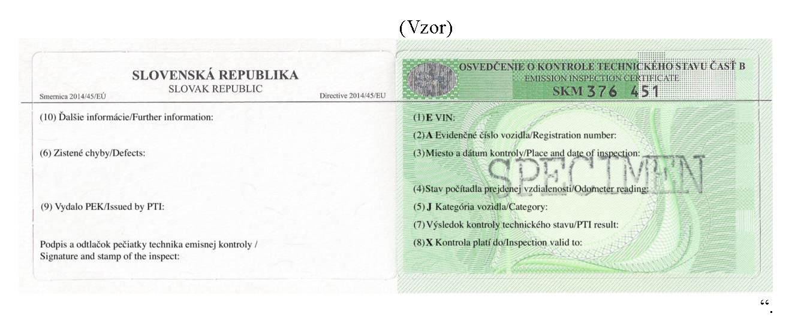

# Čl. I

Vyhláška Ministerstva dopravy a výstavby Slovenskej republiky č. 138/2018 Z. z., ktorou sa ustanovujú podrobnosti v oblasti emisnej kontroly sa mení a dopĺňa takto:

- 1. V § 3 sa odsek 2 dopĺňa písmenom o), ktoré znie:

- „o)

- označenia pracoviska emisnej kontroly podľa § 28 a označenia pracoviska emisnej kontroly o monitorovaní záznamovým zariadením podľa § 31.“.

- 2. V § 6 ods. 2 písmeno d) znie:

- „d)

- oprávnenej osobe emisnej kontroly v rozsahu vykonaných emisných kontrol oprávnenou osobou emisnej kontroly; údaje podľa odseku 1 sa poskytujú len počas platnosti emisnej kontroly,“.

- 3. Poznámka pod čiarou k odkazu 8 znie:

- „8) § 16 zákona č. 157/2018 Z. z. o metrológii a o zmene a doplnení niektorých zákonov.“.

- 4. V § 17 ods. 2 úvodnej vete sa slovo „Certifikát“ nahrádza slovami „Prvá strana certifikátu“.

- 5. V § 17 ods. 3 sa za slovo „Vzor“ vkladajú slová „prvej strany“.

- 6. § 17 sa dopĺňa odsekom 4, ktorý znie:

- „(4)

- Ďalšie strany certifikátu o kalibrácii obsahujú

- a)

- meracie rozsahy kalibrovaných veličín kalibrovaného zariadenia,

- b)

- výsledky merania pri kalibrácii vrátane neistôt merania,

- c)

- lehotu platnosti nadväznosti použitého kalibračného zariadenia.“.

- 7. § 18 sa dopĺňa písmenom e), ktoré znie:

- „e)

- zoznam fyzických osôb vykonávajúcich kalibráciu a preukázanie ich vyškolenia v oblasti kalibrácie zariadení.“.

- 8. V § 22 ods. 1 sa za písmeno e) vkladá nové písmeno f), ktoré znie:

- „f)

- čestné vyhlásenie navrhovateľa o plnení podmienky zákazu personálneho a majetkového prepojenia podľa § 168 ods. 6 zákona,“.

  - Doterajšie písmená f) a g) sa označujú ako písmená g) a h).

- 9. V § 23 ods. 4 sa na konci pripájajú tieto slová: „a musí byť výrazne farebne vyznačený na podlahe“.

- 10. V § 26 ods. 1 sa za písmeno o) vkladá nové písmeno p), ktoré znie:

- „p)

- čestné vyhlásenie navrhovateľa o plnení podmienky zákazu personálneho a majetkového prepojenia podľa § 168 ods. 6 zákona,“.

  - Doterajšie písmeno p) sa označuje ako písmeno q).

- 11. V § 38 ods. 4 sa slová „25 minút“ nahrádzajú slovami „35 minút“.

- 12. V § 38 ods. 6 písmená a) a b) znejú:

- „a)

- „vyhovel“, ak skúšaná osoba dosiahla celkovú úspešnosť aspoň 90 % správnych odpovedí, pričom v každom type testu podľa odseku 3 dosiahla úspešnosť aspoň 80 % správnych odpovedí,

- b)

- „nevyhovel“, ak skúšaná osoba dosiahla celkovú úspešnosť menej ako 90 % správnych odpovedí alebo v akomkoľvek type testu podľa odseku 3 dosiahla úspešnosť menej ako 80 % správnych odpovedí.“.

- 13. V § 42 odsek 2 znie:

- „(2)

- Písomný test pozostáva zo 100 otázok, a to

- a)

- 17 otázok je z oblasti podľa § 32 ods. 1 písm. a) prvého bodu,

- b)

- 5 otázok je z oblasti podľa § 32 ods. 1 písm. a) druhého bodu,

- c)

- 5 otázok je z oblasti podľa § 32 ods. 1 písm. a) tretieho bodu,

- d)

- 15 otázok je z oblasti podľa § 32 ods. 1 písm. a) štvrtého bodu,

- e)

- 15 otázok je z oblasti podľa § 32 ods. 1 písm. a) piateho bodu,

- f)

- 8 otázok je z oblasti podľa § 32 ods. 1 písm. a) šiesteho bodu,

- g)

- 8 otázok je z oblasti podľa § 32 ods. 1 písm. a) siedmeho bodu,

- h)

- 10 otázok je z oblasti podľa § 32 ods. 1 písm. a) ôsmeho bodu,

- i)

- 12 otázok je z oblasti podľa § 32 ods. 1 písm. a) deviateho bodu a

- j)

- 5 otázok je z oblasti podľa § 32 ods. 1 písm. a) desiateho bodu.“.

- 14. V § 43 odsek 2 znie:

- „(2)

- Zápisnicu o skúške z overenia znalostí o vozidlách zasiela technická služba fyzickej osobe, ktorá skúšku absolvovala.“.

- 15. V § 47 odseky 12 a 13 znejú:

- „(12)

- Emisie viditeľných škodlivín výfukových plynov (dymivosť) vznetového motora vozidla kategórie M alebo N, ktoré je prvýkrát prihlásené do evidencie vozidiel

- a)

- do 31. decembra 2007, s pohonom na motorovú naftu alebo s duálnym pohonom na motorovú naftu a zemný plyn alebo skvapalnený ropný plyn zistené metódou voľnej akcelerácie nemôžu prekročiť emisné limity určené výrobcom vozidla; ak výrobca emisné limity neurčil, použijú sa emisné limity ustanovené podľa odseku 13,

- b)

- od 1. januára 2008, s pohonom na motorovú naftu alebo s duálnym pohonom na motorovú naftu a zemný plyn alebo skvapalnený ropný plyn zistené metódou voľnej akcelerácie nemôžu prekročiť ustanovené emisné limity podľa odseku 13 alebo emisné limity určené výrobcom vozidla, ak sú prísnejšie ako emisné limity ustanovené podľa odseku 13.

- (13)

- Ustanovené emisné limity pre emisie viditeľných škodlivín výfukových plynov (dymivosť) vznetového motora vozidla sú najviac

- a)

- 4,0 m-1, ak ide o vznetový motor vozidla, ktoré je prvýkrát prihlásené do evidencie vozidiel do 31. decembra 1979,

- b)

- 3,0 m-1, ak ide o preplňovaný vznetový motor vozidla, ktoré je prvýkrát prihlásené do evidencie vozidiel od 1. januára 1980 do 30. júna 2008,

- c)

- 2,5 m-1, ak ide o nepreplňovaný vznetový motor vozidla, ktoré je prvýkrát prihlásené do evidencie vozidiel od 1. januára 1980 do 30. júna 2008,

- d)

- 1,5 m-1, ak ide o vznetový motor vozidla, ktoré je prvýkrát prihlásené do evidencie vozidiel od 1. júla 2008,

- e)

- 0,7 m-1, ak ide o vznetový motor vozidla, ktoré je prvýkrát prihlásené do evidencie vozidiel od 1. januára 2015,

- f)

- 0,3 m-1, ak ide o vznetový motor vozidla, ktoré je prvýkrát prihlásené do evidencie vozidiel od 1. januára 2017.“.

- 16. V § 48 ods. 2 sa vkladá nová prvá veta, ktorá znie: „Emisná kontrola pravidelná sa vykonáva v rozsahu kontrolných položiek určených metodickými pokynmi ministerstva dopravy na vykonávanie emisnej kontroly pravidelnej [§ 136 ods. 2 písm. a) tridsiaty ôsmy bod zákona].“.

- 17. V § 50 ods. 3 písm. b) prvý bod znie:

- „1.

- osvedčenie o evidencii z krajiny pôvodu alebo zo štátu, v ktorom je vozidlo evidované, pri dvoch častiach osvedčenia o evidencii sa predkladajú obidve časti; ak osvedčenia sú v inom ako slovenskom jazyku alebo českom jazyku, predkladajú sa s úradne osvedčeným prekladom do štátneho jazyka, pričom pri harmonizovanom osvedčení o evidencii vydanom v členskom štáte alebo zmluvnom štáte sa úradne prekladajú len časti, ktoré nepodliehajú harmonizácii,“.

- 18. V § 50 ods. 3 písm. b) sa vypúšťa druhý bod.

  - Doterajší tretí bod sa označuje ako druhý bod.

- 19. V § 53 ods. 1 prvá veta znie: „Každá kontrolovaná oblasť v rámci emisnej kontroly obsahuje jednu kontrolnú položku alebo viacero kontrolných položiek.“.

- 20. V § 53 odsek 4 znie:

- „(4)

- Technický stav vozidla sa pri emisnej kontrole nevyhodnotí, ak nemožno vykonať všetky predpísané kontrolné položky z dôvodu poruchy niektorého predpísaného zariadenia z technologického vybavenia pracoviska emisnej kontroly a táto situácia nebola spôsobená chybou vozidla alebo konaním vodiča vozidla.“.

- 21. V § 56 ods. 4 poslednej vete sa slová „kontroly a ďalšie informácie“ nahrádzajú slovami „kontroly, harmonizované kódy Európskej únie a ďalšie informácie“.

- 22. V § 57 ods. 2 sa slová „Pred začatím“ nahrádzajú slovom „Počas“.

- 23. § 60 sa dopĺňa odsekom 11, ktorý znie:

- „(11)

- Predaj emisných plakiet podľa § 10 sa začne do dvoch mesiacov od vyhlásenia prvej nízkoemisnej zóny podľa osobitného predpisu.14a)“.

  - Poznámka pod čiarou k odkazu 14a znie:

  - „14a) § 9 zákona č. 137/2010 Z. z. v znení zákona č. 293/2017 Z. z.“.

- 24. Príloha č. 1 Časť B bod 1 sa dopĺňa bodom 1.1.8, ktorý znie:

- „1.1.8

- Na účely vyhotovovania snímok podľa bodu 1.1.2 pri výkone emisnej kontroly je možné použiť snímky vyhotovené mobilným zariadením aj pre výkon technickej kontroly.“.

- 25. V prílohe č. 1 Časti B bode 2.1.17 sa na konci pripájajú tieto vety: „Každý videozáznam musí monitorovacie záznamové zariadenie označiť časom vytvorenia. Čas vytvorenia musí byť zhodný s aktuálnym univerzálnym koordinovaným časom UTC +1 zisteným prostredníctvom protokolu NTP (network time protocol).“.

- 26. V prílohe č. 1 Časti B bode 3.1.7 sa za slovo „±150“ vkladá slovo „min-1“.

- 27. V prílohe č. 1 Časti B bod 3.2.1 znie:

- „3.2.1

- Kalibrácia otáčkomera sa vykonáva zisťovaním plnenia požiadavky podľa bodov 3.1.5 a 3.1.7 v minimálne štyroch kalibračných bodoch, a to jeden kalibračný bod musí byť v rozsahu otáčok (400 až 1 000) min-1 a ostatné kalibračné body musia byť primerane rozložené v rozsahu otáčok (1 000 až 6 000) min-1. Kalibrácia sa vykonáva pre každý kalibrovaný snímač otáčkomera samostatne.“.

- 28. V prílohe č. 1 Časti B bode 3.2.4 prvej vete sa za slovami „snímača otáčok“ vypúšťa čiarka a na konci prvej vety sa pripájajú tieto slová: „alebo systém palubnej diagnostiky motorového vozidla“.

- 29. V prílohe č. 1 Časti B bod 3.2.5 znie:

- „3.2.5

- Kalibračné zariadenie, ktoré je samostatným zariadením, musí mať certifikát o nadviazaní (kalibrácii) nie starší ako štyri roky preukazujúci, že jeho chyba je v rozsahu otáčok podľa bodu 3.2.1 menšia alebo rovná ±15 min-1 v celom rozsahu otáčok.“.

- 30. V prílohe č. 1 Časti B bode 4.1.3 sa slová „merací rozsah (20 až 100) °C“ nahrádzajú slovami „minimálny merací rozsah (0 až 100) °C“.

- 31. V prílohe č. 1 Časti B bode 4.1.5 sa slová „±2,5 °C“ nahrádzajú slovami „±3 °C “.

- 32. V prílohe č. 1 Časti B bod 4.2.1 znie:

- „4.2.1

- Kalibrácia teplomera sa vykonáva zisťovaním plnenia požiadaviek podľa bodov 4.1.3 a 4.1.5 v troch teplotných bodoch primerane rozložených v rozsahu (40 až 100) °C pre každý používaný snímač teploty samostatne.“.

- 33. V prílohe č. 1 Časti B bod 4.2.5 znie:

- „4.2.5

- Referenčný teplomer alebo kalibračné zariadenie musí mať certifikát o nadviazaní (kalibrácii) nie starší ako štyri roky preukazujúci, že jeho chyba je v rozsahu teplôt podľa bodu 4.2.1 menšia alebo rovná ±2,5 °C.“.

- 34. V prílohe č. 1 Časti B bode 5.2.1 sa slovo „troch“ nahrádza slovom „dvoch“ a na konci sa pripája táto veta: „Jeden kontrolný bod musí byť v rozsahu otáčok (400 až 1 000) min-1 a druhý kontrolný bod musí byť v rozsahu otáčok (1 500 až 5 000) min-1.“.

- 35. V prílohe č. 1 Časti B bode 5.2.6 sa slovo „dva“ nahrádza slovom „štyri“.

- 36. V prílohe č. 1 Časti B bod 8.1.12 znie:

- „8.1.12

- Najväčšia dovolená chyba merania zariadenia na meranie dymivosti výfukových plynov je

- 8.1.12.1

- ±0,1 m-1 v rozsahu dymivosti od 0 do 1,0 m-1 v porovnaní s referenčným materiálom,

- 8.1.12.2

- ±0,2 m-1 v rozsahu dymivosti od 1,1 do 2,0 m-1 v porovnaní s referenčným materiálom,

- 8.1.12.3

- ±0,4 m-1 v rozsahu dymivosti nad 2,0 m-1 v porovnaní s referenčným materiálom.“.

- 37. V prílohe č. 1 Časti B bode 8.2.4 sa slová „Referenčným materiálom“ nahrádzajú slovami „Kalibračným zariadením“.

- 38. V prílohe č. 1 Časti B bod 8.2.5 znie:

- „8.2.5

- Kalibračné zariadenie musí mať certifikát o kalibrácii nie starší ako štyri roky preukazujúci, že chyba merania je menšia alebo rovná ±0,1 m-1 alebo jej ekvivalent.“.

- 39. V prílohe č. 1 Časti B bode 10 sa slová „Stacionárne detektory“ nahrádzajú slovami „Stacionárny detektor“.

- 40. V prílohe č. 1 Časti B sa bod 10 dopĺňa bodom 10.2, ktorý znie:

- „10.2 Požiadavky na kontrolu

- 10.2.1

- Stacionárny detektor úniku plynu kontroluje výrobca zariadenia alebo predajca zariadenia spôsobom určeným výrobcom zariadenia v jednoročnej lehote.

- 10.2.2

- O vykonaní kontroly a jej zisteniach sa vydá protokol o kontrole.“.

- 41. V prílohe č. 1 Časti B sa bod 11 dopĺňa bodom 11.2, ktorý znie:

- „11.2 Požiadavky na kontrolu

- 11.2.1

- Prenosný detektor úniku plynu kontroluje výrobca zariadenia alebo predajca zariadenia spôsobom určeným výrobcom zariadenia v jednoročnej lehote.

- 11.2.2

- O vykonaní kontroly a jej zisteniach sa vydá protokol o kontrole.“.

- 42. V prílohe č. 1 Časti C sa vypúšťa bod 6.

  - Doterajšie body 7 a 8 sa označujú ako body 6 a 7.

- 43. V nadpise prílohy č. 4 sa slovo „CERTIFIKÁT“ nahrádza slovami „PRVÁ STRANA CERTIFIKÁTU“.

- 44. Príloha č. 12 vrátane nadpisu znie:

„Príloha č. 12

k vyhláške č. 138/2018 Z. z.

OSVEDČENIE O KONTROLE TECHNICKÉHO STAVU ČASŤ B – EMISNÁ KONTROLA“.

