# Čl. I

Vyhláška Úradu pre reguláciu sieťových odvetví č. 18/2017 Z. z., ktorou sa ustanovuje cenová regulácia v elektroenergetike a niektoré podmienky vykonávania regulovaných činností v elektroenergetike v znení vyhlášky č. 207/2018 Z. z. sa mení a dopĺňa takto:

- 1. Nadpis nad § 7 až 11 znie:

- „Cenová regulácia výroby elektriny z obnoviteľných zdrojov energie, výroby elektriny vysoko účinnou kombinovanou výrobou, výroby elektriny z domáceho uhlia a cenová regulácia činnosti výkupcu elektriny, postup a podmienky uplatňovania cien a niektoré podmienky vykonávania regulovaných činností“.

- 2. V § 7 odsek 1 znie:

- „(1)

- Cenová regulácia podľa odsekov 2 až 19 a § 8 až 10 sa vzťahuje na výrobcu elektriny, ktorý vyrába elektrinu z obnoviteľných zdrojov energie a vysoko účinnou kombinovanou výrobou. Cenová regulácia podľa § 10a a 10b sa vzťahuje na činnosť výkupcu elektriny. Cenová regulácia podľa § 11 sa vzťahuje na výrobu elektriny z domáceho uhlia na základe rozhodnutia ministerstva hospodárstva o uložení povinnosti vo všeobecnom hospodárskom záujme.25a)“.

  - Poznámka pod čiarou k odkazu 25a znie:

  - „25a) § 24 ods. 3 zákona č. 251/2012 Z. z.“.

- 3. V § 7 ods. 15 sa slová „príplatku Pznit zohľadňujúceho vývoj ceny primárneho paliva“ nahrádzajú slovami „korekcie Pznit zohľadňujúcej výrazné zvýšenie alebo zníženie ceny vstupných surovín, ktoré sa použili na výrobu elektriny“.

- 4. V § 7 ods. 16 a 17 a § 8 ods. 1 písm. b) sa slovo „príplatok“ nahrádza slovom „korekcia“.

- 5. V poznámke pod čiarou k odkazu 48 sa citácia „§ 6 ods. 4 zákona č. 309/2009 Z. z. v znení zákona č. 30/2013 Z. z.“ nahrádza citáciou „§ 6 ods. 5 zákona č. 309/2009 Z. z. v znení zákona č. 309/2018 Z. z.“.

- 6. V § 8 ods. 3 sa slová „Príplatok Pznit v eurách na jednotku množstva elektriny na rok t pre

- i-té technológie výroby elektriny s primárnymi palivami podľa odseku 5 zohľadňujúci vývoj ceny primárneho paliva i-tej technológie na výrobu elektriny z obnoviteľných zdrojov energie alebo vývoj ceny primárneho paliva z neobnoviteľného zdroja energie i-tej technológie“ nahrádzajú slovami „Korekcia Pznit v eurách na jednotku množstva elektriny na rok t pre i-té technológie výroby elektriny s primárnymi palivami podľa odseku 5 zohľadňujúca výrazné zvýšenie alebo zníženie ceny vstupných surovín, ktoré sa použili na výrobu elektriny i-tou technológiou na výrobu elektriny z obnoviteľných zdrojov energie alebo výrazné zvýšenie alebo zníženie ceny vstupných surovín, ktoré sa použili na výrobu elektriny z neobnoviteľných zdrojov energie i-tou technológiou“.

- 7. Za § 8 sa vkladá § 8a, ktorý vrátane nadpisu znie:

- 㤠8a

- Výpočet rozsahu podpory doplatkom a príplatkom

- (1)

- Doplatok Di v eurách/MWh za základný časový úsek48a) pre i-té zariadenie výrobcu elektriny s nárokom na podporu doplatkom48b) sa vypočíta podľa vzorca

- 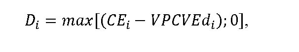

- kde

- CEije cena elektriny podľa osobitného predpisu,48c)

- VPCVEdi je vážený priemer cien vykupovanej elektriny pre i-té zariadenie výrobcu elektriny s nárokom na podporu doplatkom48b) za základný časový úsek v eurách/MWh vypočítaný podľa vzorca

- 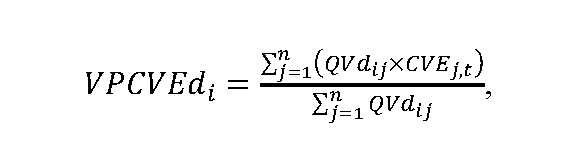

- kde

- QVdij je množstvo elektriny vyrobené i-tým zariadením výrobcu elektriny s nárokom na podporu doplatkom48b) v j-tej hodine základného časového úseku v MWh,

- CVEj,t je cena vykupovanej elektriny v j-tej hodine základného časového úseku v eurách/MWh podľa § 10a ods. 4,

- n je počet hodín základného časového úseku.

- (2)

- Doplatok za elektrinu vyrobenú v i-tom zariadení výrobcu elektriny s nárokom na podporu doplatkom48b) za základný časový úsek PDi v eurách uhrádzaný výrobcovi elektriny organizátorom krátkodobého trhu s elektrinou sa vypočíta podľa vzorca

- 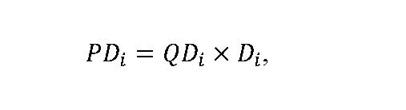

- kde

- QDi je množstvo elektriny, na ktoré je možné uplatniť doplatok v i-tom zariadení výrobcu elektriny s nárokom na podporu doplatkom48b) za základný časový úsek určené podľa osobitného predpisu48d) v MWh,

- Di je doplatok pre i-té zariadenie výrobcu elektriny s nárokom na podporu doplatkom48b) vypočítaný podľa odseku 1 v eurách/MWh.

- (3)

- Príplatok Pi v eurách/MWh za základný časový úsek48e) pre i-té zariadenie výrobcu elektriny s nárokom na podporu príplatkom48f) sa vypočíta podľa vzorca

- 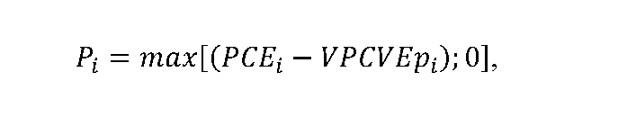

- kde

- PCEi je ponúknutá cena elektriny,48g)

- VPCVEpi je vážený priemer cien vykupovanej elektriny pre i-té zariadenie výrobcu elektriny s nárokom na podporu príplatkom48f) za základný časový úsek v eurách/MWh vypočítaný podľa vzorca

- 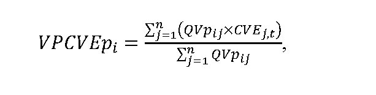

- kde

- QVpij je množstvo elektriny vyrobenej i-tým zariadením výrobcu elektriny s nárokom na podporu príplatkom48f) v j-tej hodine základného časového úseku v MWh,

- CVEj,t je cena vykupovanej elektriny v j-tej hodine základného časového úseku v eurách/MWh podľa § 10a ods. 4,

- n je počet hodín základného časového úseku.

- (4)

- Príplatok za elektrinu vyrobenú v i-tom zariadení výrobcu elektriny s nárokom na podporu príplatkom48f) za základný časový úsek PPi v eurách uhrádzaný výrobcovi elektriny organizátorom krátkodobého trhu s elektrinou sa vypočíta podľa vzorca

- 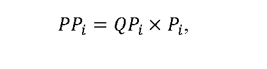

- kde

- QPi je množstvo elektriny, na ktoré je možné uplatniť príplatok v i-tom zariadení výrobcu elektriny s nárokom na podporu príplatkom48f) za základný časový úsek určené podľa osobitného predpisu48d) v MWh,

- Pi je príplatok pre i-té zariadenie výrobcu elektriny s nárokom na podporu príplatkom48f) vypočítaný podľa odseku 3 v eurách/MWh.“.

  - Poznámky pod čiarou k odkazom 48a až 48g znejú:

  - „48a) § 9 ods. 2 zákona č. 309/2009 Z. z. v znení zákona č. 309/2018 Z. z.

  - 48b) § 3 ods. 1 písm. c) zákona č. 309/2009 Z. z. v znení zákona č. 309/2018 Z. z.

  - 48c) § 6 ods. 1 písm. a) zákona č. 309/2009 Z. z. v znení zákona č. 309/2018 Z. z.

  - 48d) § 19 ods. 2 písm. i) zákona č. 309/2009 Z. z. v znení zákona č. 309/2018 Z. z.

  - 48e) § 9 ods. 3 zákona č. 309/2009 Z. z. v znení zákona č. 309/2018 Z. z.

  - 48f) § 3 ods. 1 písm. e) zákona č. 309/2009 Z. z. v znení zákona č. 309/2018 Z. z.

  - 48g) § 6 ods. 1 písm. d) zákona č. 309/2009 Z. z. v znení zákona č. 309/2018 Z. z.“.

- 8. Za § 10 sa vkladajú § 10a a 10b, ktoré vrátane nadpisov znejú:

- 㤠10a

- Spôsob výpočtu ceny vykupovanej elektriny, postup a podmienky uplatňovania cien

- (1)

- Základ pre výpočet ceny vykupovanej elektriny50a) v j-tej hodine roku t v eurách/MWh sa vypočíta podľa vzorca

- 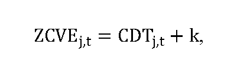

- kde

- CDTj,tje cena elektriny slovenskej obchodnej oblasti na dennom trhu organizovanom organizátorom krátkodobého trhu s elektrinou v j-tej hodine roku t v eurách/MWh,

- k je koeficient podľa osobitného predpisu50a) určený podľa odsekov 2 a 3 eurách/MWh.

- (2)

- Ak bol výkupca elektriny vybratý ministerstvom hospodárstva formou aukcie, koeficient k sa rovná výške úhrady za činnosť výkupcu elektriny požadovanej výkupcom elektriny v aukcii vyhlásenej ministerstvom hospodárstva.50b)

- (3)

- Ak bol výkupca elektriny určený ministerstvom hospodárstva50c) alebo ak činnosť výkupcu elektriny vykonáva dodávateľ poslednej inštancie,50d) koeficient k sa rovná výške úhrady za činnosť výkupcu elektriny podľa § 10b.

- (4)

- Cena vykupovanej elektriny v j-tej hodine roku t v eurách/MWh CVEj,t sa vypočíta podľa vzorca

- 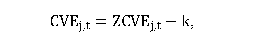

- kde

- ZCVEj,t je základ pre výpočet ceny vykupovanej elektriny v j-tej hodine roku t v eurách/MWh vypočítaný podľa odseku 1,

- k je koeficient podľa odsekov 2 a 3 v eurách/MWh.

- (5)

- Po uplynutí základného časového úseku48a) sa pre i-té zariadenie výrobcu elektriny, ktorý využil právo na podporu výkupom elektriny50e) a prevzatím zodpovednosti za odchýlku,50f) vypočíta vážený priemer cien vykupovanej elektriny VPCVEvi v eurách/MWh za základný časový úsek podľa vzorca

- 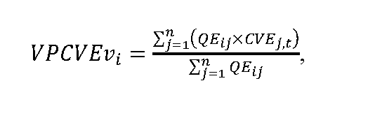

- kde

- QEij je množstvo elektriny s nárokom na podporu výkupom elektriny50e) a prevzatím zodpovednosti za odchýlku50f) vyrobenej v i-tom zariadení výrobcu elektriny a vykúpenej výkupcom elektriny v režime prenesenej zodpovednosti za odchýlku v j-tej hodine základného časového úseku v MWh,

- CVEj,t je cena vykupovanej elektriny v j-tej hodine základného časového úseku v eurách/MWh vypočítaná podľa odseku 4,

- n je počet hodín základného časového úseku.

- (6)

- Ak je VPCVEvi nižší alebo sa rovná cene elektriny podľa osobitného predpisu,48c) výška platby za vykúpenú elektrinu vyrobenú v i-tom zariadení výrobcu elektriny, ktorý využil právo na podporu výkupom elektriny50e) a prevzatím zodpovednosti za odchýlku,50f) za základný časový úsek PVEi v eurách sa vypočíta podľa vzorca

- 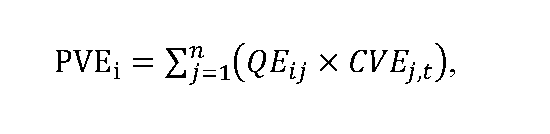

- kde

- QEijje množstvo elektriny s nárokom na podporu výkupom elektriny50e) a prevzatím zodpovednosti za odchýlku50f) vyrobenej v i-tom zariadení výrobcu elektriny a vykúpenej výkupcom elektriny v režime prenesenej zodpovednosti za odchýlku v j-tej hodine základného časového úseku v MWh,

- CVEj,t je cena vykupovanej elektriny v j-tej hodine základného časového úseku v eurách/MWh vypočítaná podľa odseku 4,

- n je počet hodín základného časového úseku.

- (7)

- Ak je VPCVEvi vyšší ako cena elektriny podľa osobitného predpisu,48c) výška platby za vykúpenú elektrinu vyrobenú v i-tom zariadení výrobcu elektriny, ktorý využil právo na podporu výkupom elektriny50e) a prevzatím zodpovednosti za odchýlku,50f) za základný časový úsek PVEi v eurách sa vypočíta podľa vzorca

- 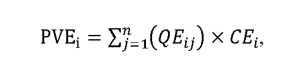

- kde

- QEijje množstvo elektriny s nárokom na podporu výkupom elektriny50e) a prevzatím zodpovednosti za odchýlku,50f) vyrobenej v i-tom zariadení výrobcu elektriny a vykúpenej výkupcom elektriny v režime prenesenej zodpovednosti za odchýlku v j-tej hodine základného časového úseku v MWh,

- CEi je cena elektriny podľa osobitného predpisu,48c)

- n je počet hodín základného časového úseku.

- (8)

- Ak výrobca elektriny využil pre i-té zariadenie výrobcu elektriny právo na podporu výkupom elektriny50e) bez prevzatia zodpovednosti za odchýlku,50f) výška platby za vykúpenú elektrinu vyrobenú v i-tom zariadení výrobcu elektriny, ktorý využil právo na podporu výkupom elektriny,50e) za základný časový úsek PVEi v eurách sa vypočíta podľa vzorca

- 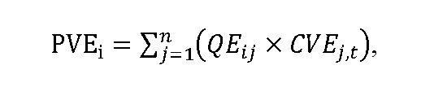

- kde

- QEijje množstvo elektriny s nárokom na podporu výkupom elektriny,50e) vyrobenej v i-tom zariadení výrobcu elektriny a vykúpenej výkupcom elektriny v j-tej hodine základného časového úseku v MWh,

- CVEj,t je cena vykupovanej elektriny v j-tej hodine základného časového úseku v eurách/MWh vypočítaná podľa odseku 4,

- n je počet hodín základného časového úseku.

- (9)

- Odmena k-teho výkupcu elektriny v eurách za základný časový úsek QVEk sa vypočíta podľa vzorca

- 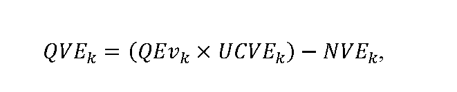

- kde

- QEv je množstvo elektriny s nárokom na podporu výkupom elektriny50e) a prevzatím zodpovednosti za odchýlku50f) vykúpenej k-tym výkupcom elektriny v režime prenesenej zodpovednosti za odchýlku v základnom časovom úseku v MWh,

- UCVEk je úhrada za činnosť k-teho výkupcu elektriny za základný časový úsek v eurách/MWh vo výške koeficientu určeného podľa odsekov 2 a 3,

- NVEk sú nadvýnosy k-teho výkupcu elektriny z vykúpenej elektriny v základnom časovom úseku v eurách, ktorých výška sa vypočíta podľa vzorca

- 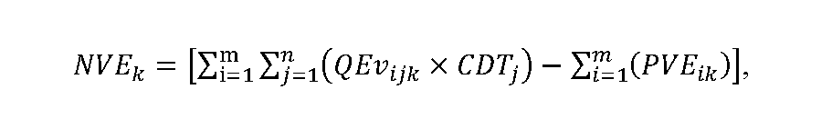

- kde

- QEvijk je množstvo elektriny s nárokom na podporu výkupom elektriny50e) a prevzatím zodpovednosti za odchýlku50f) vyrobenej v i-tom zariadení výrobcu elektriny a vykúpenej k-tym výkupcom elektriny v režime prenesenej zodpovednosti za odchýlku v j-tej hodine základného časového úseku v MWh,

- CDTj je cena elektriny slovenskej obchodnej oblasti na dennom trhu organizovanom organizátorom krátkodobého trhu s elektrinou v j-tej hodine základného časového úseku v eurách/MWh,

- PVEikje platba za vykúpenú elektrinu vyrobenú v i-tom zariadení výrobcu elektriny, ktorý využil právo na podporu výkupom elektriny50e) a prevzatím zodpovednosti za odchýlku50f) k-tym výkupcom elektriny za základný časový úsek v eurách vypočítaná podľa odsekov 6 a 7,

- m je počet zariadení výrobcu elektriny, pre ktoré výrobca elektriny využil právo na podporu výkupom elektriny50e) a prevzatím zodpovednosti za odchýlku,50f) z ktorých vykupuje elektrinu k-ty výkupca elektriny, ktoré sú zahrnuté do vyhodnotenia podľa tohto odseku za príslušný základný časový úsek,

- n je počet hodín základného časového úseku.

- § 10b

- Cenová regulácia výkonu činnosti výkupcu elektriny

- Cenová regulácia sa vzťahuje na výkon činnosti výkupcu elektriny, ktorý bol určený ministerstvom hospodárstva,50c) a na výkon činnosti výkupcu elektriny dodávateľom poslednej inštancie,50d) pričom úhrada za činnosť výkupcu elektriny UCVEt v eurách/MWh sa vypočíta podľa vzorca

- 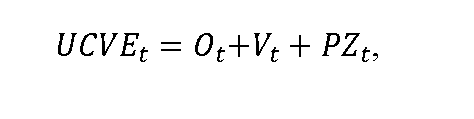

- kde

- Otsú určené náklady regulovaného subjektu na odchýlku súvisiace s výkupom elektriny od výrobcov elektriny s nárokom na podporu výkupom elektriny50e) a prevzatím zodpovednosti za odchýlku50f) v eurách na jednotku množstva elektriny vykúpenej v režime prenesenej zodpovednosti za odchýlku v roku t,

- Vt sú určené náklady regulovaného subjektu na obsluhu výrobcov elektriny s nárokom na podporu výkupom elektriny50e) v eurách na jednotku množstva elektriny vykúpenej v režime prenesenej zodpovednosti za odchýlku v roku t,

- PZtje primeraný zisk v eurách na jednotku množstva elektriny vykúpenej v režime prenesenej zodpovednosti za odchýlku v roku t, ktorý je možné zahrnúť do úhrady za činnosť výkupcu elektriny.“.

- Poznámky pod čiarou k odkazom 50a až 50f znejú:

- „50a) § 6 ods. 1 písm. b) zákona č. 309/2009 Z. z. v znení zákona č. 309/2018 Z. z.

- 50b) § 19 ods. 1 písm. n) zákona č. 309/2009 Z. z. v znení zákona č. 309/2018 Z. z.

- 50c) § 88 ods. 2 písm. y) zákona č. 251/2012 Z. z. v znení zákona č. 309/2018 Z. z.

- 50d) § 18a zákona č. 251/2012 Z. z. v znení zákona č. 309/2018 Z. z.

- 50e) § 3 ods. 1 písm. b) zákona č. 309/2009 Z. z. v znení zákona č. 309/2018 Z. z.

- 50f) § 3 ods. 1 písm. d) zákona č. 309/2009 Z. z. v znení zákona č. 309/2018 Z. z.“.

- 9. V § 12 ods. 12 sa vypúšťajú slová „a netrvajú viac ako 12 mesiacov“.

- 10. Za § 12 sa vkladá § 12a, ktorý vrátane nadpisu znie:

- 㤠12a

- Podrobnosti o individuálnych sadzbách tarify za prevádzkovanie systému

- (1)

- Individuálna sadzba tarify za prevádzkovanie systému na rok t sa uplatňuje ako koeficient individuálnej sadzby tarify za prevádzkovanie systému na rok t Kistpst, ktorý sa uplatňuje na koncovú spotrebu elektriny koncového odberateľa elektriny, pre ktorého je individuálna sadzba tarify za prevádzkovanie systému určená.52a)

- (2)

- Individuálna sadzba tarify za prevádzkovanie systému podľa odseku 1 sa uplatňuje na koncovú spotrebu koncového odberateľa elektriny, ktorý predloží úradu správu52b) a preukáže, že najmenej 80 % jeho koncovej spotreby elektriny zodpovedá niektorému z kódov činnosti podniku alebo ich kombinácii podľa štatistickej klasifikácie ekonomických činností52c) uvedených v zozname podľa prílohy č. 8 a zároveň jeho elektroenergetická náročnosť podľa odseku 3 sa rovná alebo je väčšia ako elektroenergetická náročnosť podľa odseku 8.

- (3)

- Elektroenergetická náročnosť podniku v percentách sa vypočíta podľa vzorca

- 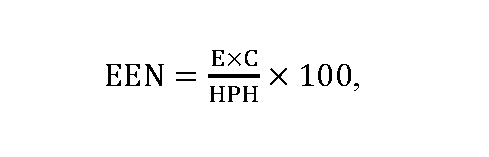

- kde

- E je spotreba elektriny koncového odberateľa elektriny v MWh, ktorá sa určí podľa odseku 4,

- C je cena elektriny v eurách/MWh, ktorá sa určí podľa odseku 5,

- HPH je hrubá pridaná hodnota podniku v eurách, ktorá sa určí ako aritmetický priemer hodnôt hrubej pridanej hodnoty podniku za posledné tri kalendárne roky vypočítaných podľa odseku 6.

- (4)

- Spotreba elektriny koncového odberateľa elektriny E sa určí ako aritmetický priemer hodnôt koncovej spotreby elektriny koncového odberateľa elektriny za posledné tri kalendárne roky.

- (5)

- Cena elektriny C je aritmetický priemer maloobchodných cien elektrickej energie pre odberateľov mimo domácnosti v kategórii spotreby od 500 MWh do 1 999 MWh vrátane daní a poplatkov, v roku t-2 v eurách/MWh, bez dane z pridanej hodnoty zverejnených Eurostatom pre Slovenskú republiku.

- (6)

- Hrubá pridaná hodnota podniku v kalendárnom roku HPH sa určí podľa vzorca

- 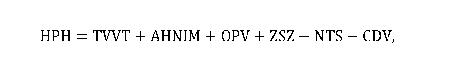

- kde

- TVVT sú tržby za vlastné výkony a tovar [kalendárny rok/euro],

- AHNIM je aktivácia hmotného a nehmotného investičného majetku [kalendárny rok/euro],

- OPV sú ostatné prevádzkové výnosy bez výnosov z odpísaných pohľadávok, výnosov z predaja pohľadávok, výnosov z postúpených pohľadávok a výnosov z faktoringu [kalendárny rok/euro],

- ZSZ je zmena stavu zásob [kalendárny rok/euro],

- NTS sú náklady na nákup tovaru, materiálu, energie a služieb bez nákladov na personálny lízing a nákladov na operatívny lízing [kalendárny rok/euro],

- CDV sú clá a dane súvisiace s výrobou a iné dane z výrobkov, ktoré súvisia s tržbami, ale nie sú odpočítateľné [kalendárny rok/euro].

- (7)

- Minimálna požadovaná výška elektroenergetickej náročnosti podniku na určenie individuálnej sadzby tarify za prevádzkovanie systému EENpt je pre rok 2020 určená vo výške 100 % a pre nasledujúce roky sa vypočíta v percentách podľa vzorca

- 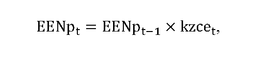

- kde

- EENpt-1 je minimálna požadovaná výška elektroenergetickej náročnosti podniku pre určenie individuálnej sadzby tarify za prevádzkovanie systému v roku t-1 v percentách,

- kzcet je koeficient zmeny cien elektriny pre rok t, ktorý sa vypočíta podľa vzorca

- 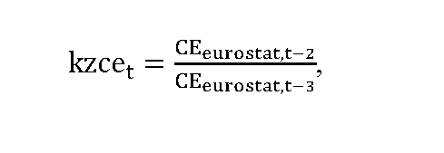

- kde

- CEeurostat,t-2 je aritmetický priemer maloobchodných cien elektrickej energie pre odberateľov mimo domácnosti v kategórii spotreby od 500 MWh do 1 999 MWh vrátane daní a poplatkov, v roku t-2 v eurách/MWh, bez dane z pridanej hodnoty zverejnených Eurostatom pre Slovenskú republiku,

- CEeurostat,t-3 je aritmetický priemer maloobchodných cien elektrickej energie pre odberateľov mimo domácnosti v kategórii spotreby od 500 MWh do 1 999 MWh vrátane daní a poplatkov, v roku t-3 v eurách/MWh, bez dane z pridanej hodnoty zverejnených Eurostatom pre Slovenskú republiku.

- (8)

- Na výpočty podľa odsekov 2 až 4 sa používajú aritmetické priemery údajov koncového odberateľa elektriny za obdobie posledných troch kalendárnych rokov v štruktúre podľa prílohy č. 9. Ak koncový odberateľ elektriny vykonáva činnosť menej ako tri kalendárne roky, použijú sa aritmetické priemery údajov za dva kalendárne roky, za ktoré sú údaje k dispozícii. Ak koncový odberateľ elektriny vykonáva činnosť menej ako dva kalendárne roky, použijú sa údaje za jeden kalendárny rok, za ktorý sú údaje k dispozícii.

- (9)

- Správa,52b) ktorú vypracúva koncový odberateľ elektriny, obsahuje:

- a)

- pri právnickej osobe obchodné meno, sídlo a identifikačné číslo organizácie, ak je pridelené, a pri fyzickej osobe – podnikateľovi meno a priezvisko, miesto podnikania a identifikačné číslo organizácie, ak je pridelené,

- b)

- potvrdenie alebo vyhlásenie o výške koncovej spotreby elektriny koncového odberateľa elektriny v MWh, ak

- 1.

- je koncový odberateľ elektriny subjektom zúčtovania, potvrdenie o výške koncovej spotreby elektriny vystavené organizátorom krátkodobého trhu s elektrinou,

- 2.

- nie je koncový odberateľ elektriny subjektom zúčtovania, potvrdenie o výške koncovej spotreby elektriny vystavené dodávateľom elektriny, ktorý za odberné miesta koncového odberateľa elektriny prebral zodpovednosť za odchýlku,

- 3.

- je koncový odberateľ elektriny výrobcom elektriny a vyrobenú elektrinu spotrebúva pre vlastnú spotrebu, vyhlásenie o výške koncovej spotreby elektriny vypracované koncovým spotrebiteľom,

- 4.

- koncový odberateľ elektriny spĺňa viacero podmienok podľa prvého bodu, druhého bodu alebo tretieho bodu a na preukázanie splnenia podmienky podľa osobitného predpisu52d) nepostačuje jedno potvrdenie alebo vyhlásenie, bude súčasťou správy viacero potvrdení alebo vyhlásení,

- c)

- výšku elektroenergetickej náročnosti podniku v percentách vypočítanú podľa odseku 3,

- d)

- údaje potrebné na výpočet výšky elektroenergetickej náročnosti podniku podľa prílohy č. 9 tabuľky č. 3:

- 1.

- hrubá pridaná hodnota podniku,

- 2.

- aritmetický priemer maloobchodných cien elektrickej energie pre odberateľov mimo domácnosti v kategórii spotreby od 500 MWh do 1 999 MWh vrátane daní a poplatkov, v roku t-2 v eurách/MWh, bez dane z pridanej hodnoty zverejnených Eurostatom pre Slovenskú republiku,

- 3.

- koncová spotreba elektriny podniku v MWh,

- e)

- údaje potrebné na výpočet hrubej pridanej hodnoty podniku vypočítanej podľa odseku 6 a prílohy č. 9 tabuľky č. 1:

- 1.

- tržby za vlastné výkony a tovar v eurách,

- 2.

- aktivácia hmotného a nehmotného investičného majetku v eurách,

- 3.

- ostatné prevádzkové výnosy v eurách,

- 4.

- výnosy z odpísaných pohľadávok, z predaja pohľadávok, z postúpených pohľadávok, z faktoringu a akékoľvek ďalšie výnosy súvisiace s postúpením pohľadávok v eurách,

- 5.

- zmena stavu zásob v eurách,

- 6.

- náklady na nákup tovaru materiálu, energie a služieb v eurách,

- 7.

- náklady na personálny lízing v eurách,

- 8.

- náklady na operatívny lízing v eurách,

- 9.

- clá a dane súvisiace s výrobou a iné dane z výrobkov, ktoré súvisia s tržbami, ale nie sú odpočítateľné v eurách,

- f)

- ostatné údaje na posúdenie nároku na určenie individuálnej sadzby tarify za prevádzkovanie systému podľa prílohy č. 9 tabuľky č. 2:

- 1.

- výšku koncovej spotreby elektriny zodpovedajúcu jednotlivým kódom činnosti podniku podľa štatistickej klasifikácie ekonomických činností uvedených v prílohe č. 8 v MWh,

- 2.

- podiel súčtu koncovej spotreby elektriny podniku podľa prvého bodu a koncovej spotreby podniku podľa písmena d) tretieho bodu v percentách,

- g)

- potvrdenie vyhotovené znalcom v odbore Elektroenergetika – Elektroenergetické stroje a zariadenia alebo Energetika – Regulácia a riadenie sieťových odvetví preukazujúce správnosť výpočtu hodnoty vypočítanej podľa písmena f) druhého bodu.

- (10)

- Údaje podľa odseku 9 písm. c) až e) sa uvádzajú v rozsahu a štruktúre podľa prílohy č. 9.“.

  - Poznámky pod čiarou k odkazom 52a až 52d znejú:

  - „52a) § 12 ods. 7 zákona č. 250/2012 Z. z. v znení zákona č. 309/2018 Z. z.

  - 52b) § 12 ods. 8 zákona č. 250/2012 Z. z. v znení zákona č. 309/2018 Z. z.

  - 52c) Vyhláška Štatistického úradu Slovenskej republiky č. 306/2007 Z. z., ktorou sa vydáva Štatistická klasifikácia ekonomických činností.

  - 52d) § 12 ods. 7 písm. a) zákona č. 250/2012 Z. z. v znení zákona č. 309/2018 Z. z.“.

- 11. V § 13 odsek 3 znie:

- „(3)

- Skutočná koncová spotreba elektriny na odbernom mieste alebo odovzdávacom mieste QSKSnpsoomt, za ktorú sa za odberné miesto a odovzdávacie miesto uhrádzajú náklady na prevádzkovanie systému, sa vypočíta podľa vzorca

- 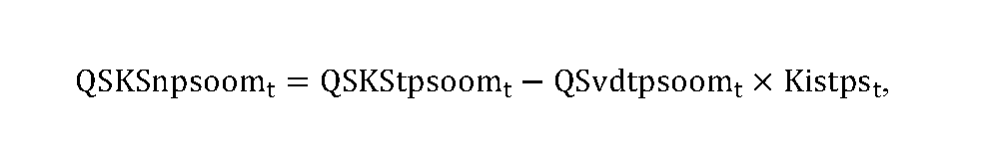

- kde

- QSKStpsoomt je celková skutočná koncová spotreba elektriny na odbernom mieste alebo odovzdávacom mieste v roku t, na ktorú sa uplatňujú tarify za prevádzkovanie systému,

- QSvdtpsoomt je celkový skutočný objem koncovej spotreby elektriny na odbernom mieste alebo odovzdávacom mieste v jednotkách množstva elektriny v roku t, na ktorý sa uplatňuje koeficient individuálnej sadzby tarify za prevádzkovanie systému; koeficient individuálnej sadzby tarify za prevádzkovanie systému sa uplatňuje na koncovú spotrebu elektriny koncových odberateľov elektriny, ktorým úrad určil individuálnu sadzbu tarify za prevádzkovanie systému na rok t podľa osobitného predpisu,52a)

- Kistpst je koeficient individuálnej sadzby tarify za prevádzkovanie systému, ktorého hodnota sa určí maximálne vo výške 0,95.“.

- 12. V § 18 ods. 1 vzorec NPSszi a veličiny znejú:

- 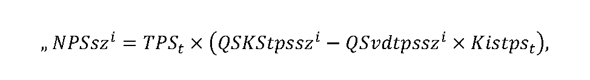

- „kde

- NPSszi sú náklady na prevádzkovanie systému pre i-ty subjekt zúčtovania s vlastnou zodpovednosťou za odchýlku,

- TPSt je tarifa za prevádzkovanie systému v roku t,

- QSKStpsszi je skutočná celková koncová spotreba elektriny i-tého subjektu zúčtovania s vlastnou zodpovednosťou za odchýlku, na ktorú sa uplatňujú tarify za prevádzkovanie systému,

- QSvdtpsszi je celkový skutočný objem koncovej spotreby elektriny v jednotkách množstva elektriny, na ktorý sa uplatňuje koeficient individuálnej sadzby tarify za prevádzkovanie systému; koeficient individuálnej sadzby tarify za prevádzkovanie systému sa použije na koncovú spotrebu elektriny koncových odberateľov elektriny, ktorým úrad určil individuálnu sadzbu tarify za prevádzkovanie systému na rok t podľa osobitného predpisu,52a)

- Kistpst je koeficient individuálnej sadzby tarify za prevádzkovanie systému na rok t, ktorého hodnotu určí úrad maximálne vo výške 0,95.“.

- 13. V § 18 odseky 2 až 4 znejú:

- „(2)

- Náklady na prevádzkovanie systému sa neuplatňujú za celkovú koncovú spotrebu elektriny na prečerpávanie v prečerpávacích vodných elektrárňach ani malým výrobcom elektriny, ktorí nepodnikajú v energetike podľa osobitného predpisu.53) Náklady na prevádzkovanie systému sa neuplatňujú za koncovú spotrebu elektriny pri skúškach po ukončení výstavby zariadenia na výrobu elektriny pred jeho uvedením do prevádzky, ak takéto skúšky sú vykonané prostredníctvom odberu elektriny z prenosovej sústavy. Náklady na prevádzkovanie systému sa neuplatňujú na straty elektriny v sústave, za vlastnú spotrebu prevádzkovateľa sústavy pri prevádzkovaní sústavy, za vlastnú spotrebu elektriny pri výrobe elektriny, ktorá nie je odobratá z nadradenej sústavy. Náklady na prevádzkovanie systému sa neuplatňujú na elektrinu vyrobenú v zariadení na kombinovanú výrobu a spotrebovanú na účely výroby tepla z obnoviteľných zdrojov energie využitého v centralizovanom zásobovaní teplom, ak ide o zariadenie s celkovým inštalovaným výkonom do 1 MW, z ktorého sa využije najmenej 60 % vyrobeného tepla na dodávku tepla centralizovaným zásobovaním tepla a úspora primárnej energie dosahuje najmenej 10 %, elektriny vyrobenej v zariadení na kombinovanú výrobu a spotrebovanú na účely výroby tepla z obnoviteľných zdrojov energie využitého v centralizovanom zásobovaní teplom, ak celkový inštalovaný výkon pred rekonštrukciou alebo modernizáciou technologickej časti zariadenia výrobcu elektriny je menší ako 125 MW a elektrinu vyrobenú v lokálnom zdroji a spotrebovanú v odbernom mieste identickom s odovzdávacím miestom lokálneho zdroja.

- (3)

- Ak prevádzkovateľ regionálnej distribučnej sústavy nakupuje elektrinu na krytie strát a vypláca doplatok k cene elektriny vyrobenej z obnoviteľných zdrojov energie a vysoko účinnou kombinovanou výrobou výrobcom elektriny pripojeným do regionálnej distribučnej sústavy, vyúčtujú sa organizátorovi krátkodobého trhu s elektrinou mesačne vždy k 15. dňu nasledujúceho mesiaca náklady spojené s nákupom elektriny od týchto výrobcov elektriny NPSdsi podľa vzorca

- 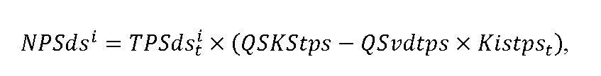

- kde

- a)

- TPSdsti je tarifa za prevádzkovanie systému určená rozhodnutím pre i-tého prevádzkovateľa regionálnej distribučnej sústavy v eurách na jednotku množstva elektriny na rok t, ktorá sa vypočíta podľa vzorca

- 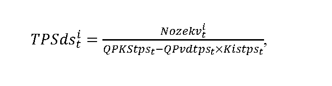

- kde

- Nozekvti sú celkové plánované náklady na nákup elektriny vyrobenej z obnoviteľných zdrojov energie a vysoko účinnou kombinovanou výrobou i-tého prevádzkovateľa sústavy v roku t,

- QPKStpst je celková plánovaná koncová spotreba elektriny na vymedzenom území na rok t, na ktorú sa uplatňujú tarify za prevádzkovanie systému,

- QPvdtpst je celkový plánovaný objem koncovej spotreby elektriny v jednotkách množstva elektriny v roku t, na ktorý sa uplatňuje koeficient individuálnej sadzby tarify za prevádzkovanie systému; koeficient individuálnej sadzby tarify za prevádzkovanie systému sa aplikuje na koncovú spotrebu elektriny koncových odberateľov elektriny, ktorým úrad určil individuálnu sadzbu tarify za prevádzkovanie systému na rok t podľa osobitného predpisu,52a)

- Kistpst je koeficient individuálnej sadzby tarify za prevádzkovanie systému na rok t, ktorého hodnota sa určí maximálne vo výške 0,95,

- b)

- QSKStps je celková skutočná koncová spotreba elektriny na vymedzenom území za uplynulé obdobie, na ktorú sa uplatňujú tarify za prevádzkovanie systému,

- c)

- QSvdtps je celkový skutočný objem koncovej spotreby elektriny za uplynulé obdobie, na ktorý sa uplatňuje koeficient individuálnej sadzby tarify za prevádzkovanie systému,

- d)

- Kistpst je koeficient individuálnej sadzby tarify za prevádzkovanie systému na rok t, ktorého hodnota sa určí maximálne vo výške 0,95.

- (4)

- Ak výrobca elektriny na základe rozhodnutia ministerstva hospodárstva o uložení povinnosti vo všeobecnom hospodárskom záujme vyrába v roku t elektrinu z domáceho uhlia, vyúčtuje sa organizátorovi krátkodobého trhu s elektrinou mesačne vždy k 15. dňu nasledujúceho mesiaca platba NPSv podľa vzorca

- 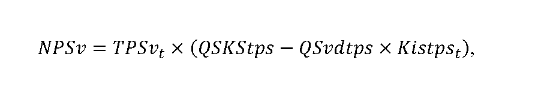

- kde

- a)

- TPSvt je tarifa za prevádzkovanie systému určená rozhodnutím úradu pre výrobcu elektriny, ktorý na základe rozhodnutia ministerstva hospodárstva o uložení povinnosti vo všeobecnom hospodárskom záujme vyrába v roku t elektrinu z domáceho uhlia, v eurách na jednotku množstva elektriny na rok t, ktorá sa vypočíta sa podľa vzorca

- 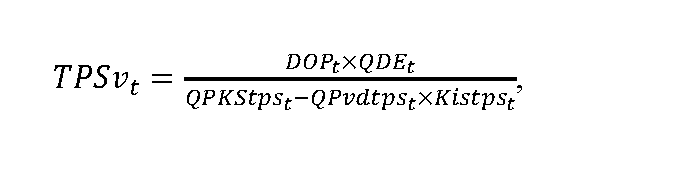

- kde

- DOPt je pevná cena elektriny vyrobenej z domáceho uhlia v eurách za megawatthodinu pre rok t,

- QDEt je objem elektriny určený rozhodnutím ministerstva hospodárstva o uložení povinnosti vo všeobecnom hospodárskom záujme vyrábať elektrinu z domáceho uhlia a dodávať elektrinu vyrobenú z domáceho uhlia na rok t,

- QPKStpst je celková plánovaná koncová spotreba elektriny na vymedzenom území na rok t, na ktorú sa uplatňujú tarify za prevádzkovanie systému,

- QPvdtpst je celkový plánovaný objem koncovej spotreby elektriny v jednotkách množstva elektriny v roku t, na ktorý sa uplatňuje koeficient individuálnej sadzby tarify za prevádzkovanie systému; koeficient individuálnej sadzby tarify za prevádzkovanie systému sa aplikuje na koncovú spotrebu elektriny koncových odberateľov elektriny, ktorým úrad určil individuálnu sadzbu tarify za prevádzkovanie systému na rok t podľa osobitného predpisu,52a)

- Kistpst je koeficient individuálnej sadzby tarify za prevádzkovanie systému na rok t v určenej výške,

- b)

- QSKStps je celková skutočná koncová spotreba elektriny na vymedzenom území za uplynulé obdobie, na ktorú sa uplatňujú tarify za prevádzkovanie systému,

- c)

- QSvdtps je celkový skutočný objem koncovej spotreby elektriny za uplynulé obdobie, na ktorý sa uplatňuje koeficient individuálnej sadzby tarify za prevádzkovanie systému,

- d)

- Kistpst je koeficient individuálnej sadzby tarify za prevádzkovanie systému na rok t, ktorého hodnota sa určí maximálne vo výške 0,95.“.

- 14. V § 23 ods. 8 sa vypúšťajú slová „a netrvajú viac ako 12 mesiacov“.

- 15. Za § 46a sa vkladá § 46b, ktorý vrátane nadpisu znie:

- 㤠46b

- Prechodné ustanovenie k úpravám účinným od 1. júla 2019

- Podľa úprav účinných od 1. júla 2019 uvedených v 10b sa prvýkrát postupuje pri vykonávaní cenovej regulácie na rok 2020.“.

- 16. Vyhláška sa dopĺňa prílohami č. 8 a 9, ktoré vrátane nadpisov znejú:

„Príloha č. 8 k vyhláške č. 18/2017 Z. z.

Zoznam oprávnených priemyselných odvetví pre posúdenie nároku na určenie individuálnej sadzby tarify za prevádzkovanie systému pre koncových odberateľov elektriny

Kód NACE | Opis

2015 | Výroba priemyselných hnojív a dusíkatých zlúčenín

2016 | Výroba plastov v primárnej forme

2410 | Výroba surového železa a ocele a ferozliatin

2442 | Výroba hliníka

[Príloha č. 9 k vyhláške č. 18/2017 Z. z.](assets/06422ecf7fea8ad5008f18ddefedc1e8fffef96934ae9df5f2933242e6d38cee.pdf)“.
