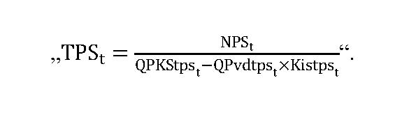
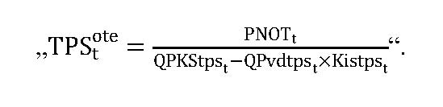
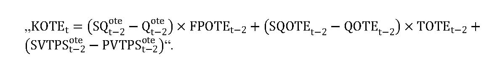
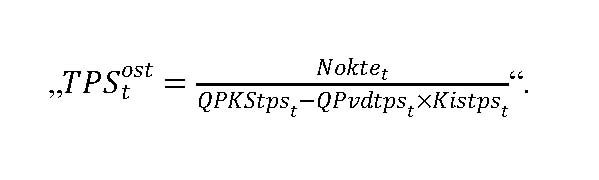
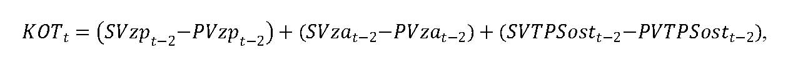
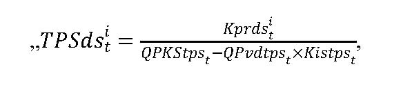
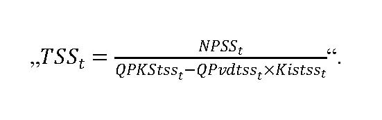
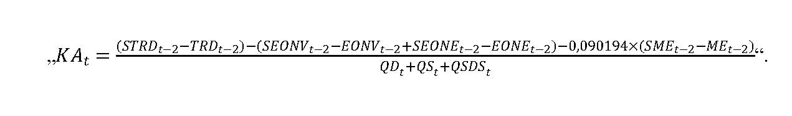

# Čl. I

Vyhláška Úradu pre reguláciu sieťových odvetví č. 18/2017 Z. z., ktorou sa ustanovuje cenová regulácia v elektroenergetike a niektoré podmienky vykonávania regulovaných činností v elektroenergetike v znení vyhlášky č. 207/2018 Z. z. a vyhlášky č. 178/2019 Z. z. sa mení a dopĺňa takto:

- 1. V § 1 sa vypúšťajú písmená h) a i).

  - Doterajšie písmená j) až p) sa označujú ako písmená h) až n).

- 2. V § 1 písm. j) sa na konci pripájajú tieto slová: „pozostávajúci najmä zo zariadenia na skladovanie primárneho zdroja energie, zariadenia na úpravu primárneho zdroja energie, zariadenia, v ktorom sa vykonáva premena formy primárnej energie na elektrinu, zariadenia vykonávajúceho kvalitatívnu úpravu elektriny, meracieho zariadenia, riadiaceho zariadenia, kontrolného zariadenia a zariadenia na ochranu životného prostredia“.

- 3. V § 2 písmeno j) znie:

- „j)

- výkon činnosti dodávateľa poslednej inštancie vrátane dodávky elektriny dodávateľom poslednej inštancie,“.

- 4. § 2 sa dopĺňa písmenom k), ktoré znie:

- „k)

- výkon činnosti výkupcu elektriny.“.

- 5. Doterajší text § 2 sa označuje ako odsek 1 a dopĺňa sa odsekom 2, ktorý znie:

- „(2)

- Cenovou reguláciou v elektroenergetike je aj určenie tarify za prevádzkovanie systému.“.

- 6. V § 3 písmeno j) znie:

- „j)

- určením spôsobu výpočtu maximálnej ceny za výkon činnosti dodávateľa poslednej inštancie vrátane dodávky elektriny dodávateľom poslednej inštancie,“.

- 7. § 3 sa dopĺňa písmenami k) a l), ktoré znejú:

- „k)

- určením spôsobu výpočtu maximálnej ceny za výkon činnosti výkupcu elektriny,

- l)

- priamym určením tarify a určením spôsobu výpočtu tarify alebo rozdelením nákladov podľa osobitných predpisov.1)“.

  - Poznámka pod čiarou k odkazu 1 znie:

  - „1) Napríklad nariadenie Komisie (EÚ) 2015/1222 z 24. júla 2015, ktorým sa stanovuje usmernenie pre prideľovanie kapacity a riadenie preťaženia (Ú. v. EÚ L 197, 25. 7. 2015) a nariadenie Komisie (EÚ) 2017/460 zo 16. marca 2017, ktorým sa stanovuje sieťový predpis o harmonizovaných štruktúrach taríf za prepravu plynu (Ú. v. EÚ L 72, 17. 3. 2017).“.

- 8. V § 4 ods. 1 písm. b) sa doterajší odkaz 1 vrátane poznámky pod čiarou označuje ako odkaz 1a.

- 9. V § 4 ods. 1 písmeno k) znie:

- „k)

- úrok z úveru na zabezpečenie finančných prostriedkov na prevádzkové náklady súvisiace s činnosťou organizovania a zúčtovania podpory elektriny vyrobenej z obnoviteľných zdrojov energie a vysoko účinnou kombinovanou výrobou vykonávanou organizátorom krátkodobého trhu s elektrinou maximálne vo výške obvyklej pre porovnateľné úvery,“.

- 10. V § 7 ods. 10 písm. a) štvrtý bod znie:

- „4.

- množstve vyrobenej elektriny dodanej výkupcovi elektriny37) na základe zmluvy o povinnom výkupe elektriny,“.

  - Poznámka pod čiarou k odkazu 37 znie:

  - „37) § 4 ods. 1 písm. b) zákona č. 309/2009 Z. z. v znení neskorších predpisov.“.

- 11. V § 7 sa odsek 11 dopĺňa písmenom g), ktoré znie:

- „g)

- doklady preukazujúce poskytnutie podpory z prostriedkov štátneho rozpočtu na rekonštrukciu alebo modernizáciu zariadenia na výrobu elektriny alebo vyhlásenie o tom, že podpora z prostriedkov štátneho rozpočtu nebola poskytnutá.“.

- 12. V § 7 odsek 13 znie:

- „(13)

- Ak pri výstavbe zariadenia na výrobu elektriny, rekonštrukcii alebo modernizácii technologickej časti zariadenia na výrobu elektriny bola poskytnutá podpora z podporných programov financovaných z prostriedkov štátneho rozpočtu, na výpočet ceny elektriny sa uplatní aj osobitný predpis.44)“.

- 13. V § 7 sa odsek 14 dopĺňa písmenom h), ktoré znie:

- „h)

- výška podpory poskytnutej z podporných programov financovaných z prostriedkov štátneho rozpočtu.“.

- 14. V § 8 ods. 1 písmeno b) znie:

- „b)

- Pznt na i je korekcia48) v eurách na jednotku množstva elektriny na rok t uplatňovaná v hodnote podľa odseku 6; Pznt na i sa vypočíta podľa odseku 4,“.

- 15. V § 8 sa za odsek 1 vkladá nový odsek 2, ktorý znie:

- „(2)

- Cena elektriny pre stanovenie príplatku na rok t v eurách na jednotku množstva elektriny za elektrinu vyrobenú i-tou technológiou j-tého zariadenia výrobcu elektriny CEPSPt na i, j sa pre výrobcu elektriny vypočíta podľa vzorca

- CEPSPt na i, j = CEPSPZ na i, j + suma Pznt na i, ak suma PZnt na i je menej ako nula, potom CEPSPt na i, j = CEPSPZ na i, j,

- kde

- a)

- CEPSPZ na i, j je cena elektriny pre stanovenie príplatku na rok Z predchádzajúci roku t vyrobenej i-tou technológiou j-tého zariadenia výrobcu elektriny na základe roku uvedenia zariadenia výrobcu elektriny do prevádzky alebo poslednej uplatnenej rekonštrukcie alebo modernizácie v eurách na jednotku množstva elektriny,

- b)

- Pznt na i je korekcia48) v eurách na jednotku množstva elektriny na rok t uplatňovaná v hodnote podľa odseku 6; Pznt na i sa vypočíta podľa odseku 4,

- c)

- rok Z je rok uvedenia zariadenia výrobcu elektriny do prevádzky alebo rok poslednej uplatnenej rekonštrukcie alebo modernizácie.“.

  - Doterajšie odseky 2 až 5 sa označujú ako odseky 3 až 6.

- 16. V § 8 ods. 4 sa slová „podľa odseku 5“ nahrádzajú slovami „podľa odseku 6“.

- 17. V § 8 ods. 5 sa slová „podľa odseku 3“ nahrádzajú slovami „podľa odseku 4“.

- 18. V § 8 odsek 6 znie:

- „(6)

- Hodnotou Pznt na i v eurách na jednotku množstva elektriny na rok t pre i-té technológie výroby elektriny je hodnota zohľadňujúca výrazné zvýšenie alebo zníženie ceny vstupných surovín, ktoré sa použili na výrobu elektriny i-tou technológiou na výrobu elektriny z obnoviteľných zdrojov energie alebo výrazné zvýšenie alebo zníženie ceny vstupných surovín, ktoré sa použili na výrobu elektriny z neobnoviteľného zdroja energie i-tou technológiou na výrobu elektriny vysoko účinnou kombinovanou výrobou zverejnená na webovom sídle úradu najneskôr do 30. júna kalendárneho roku t-1.“.

- 19. V § 10 ods. 1 úvodnej vete a v § 10 ods. 2 úvodnej vete sa za slová „od 1. januára 2017“ vkladajú slová „do 31. decembra 2019“.

- 20. V § 10 sa za odsek 2 vkladajú nové odseky 3 a 4, ktoré znejú:

- „[odseky 3 a 4](assets/b85286c67ddadc2366a8f476e3a5c92f7c5b1676ef253374981a34abe723560c.pdf)“.

  - Doterajšie odseky 3 až 6 sa označujú ako odseky 5 až 8.

  - Poznámka pod čiarou k odkazu 50aa znie:

  - „50aa) § 3c zákona č. 309/2009 Z. z. v znení zákona č. 309/2018 Z. z.“.

- 21. V § 10a ods. 9 popise vzorca sa veličina „QEv“ nahrádza veličinou „QEvk“.

- 22. V § 11 ods. 4 písmeno d) znie:

- „d)

- PZt je plánovaný primeraný zisk regulovaného subjektu v eurách na rok t určený podľa vzorca

- PZt = (VNt – NEK,t + FNt + ONZt) x WACC,

- kde

- WACC je miera výnosnosti regulačnej bázy aktív na regulačné obdobie rokov 2017 až 2021 určená podľa § 5 ods. 2 a 3,“.

- 23. V § 11 ods. 4 písmeno g) znie:

- „g)

- QDEt je plánovaný objem elektriny určený rozhodnutím ministerstva hospodárstva o uložení povinnosti vo všeobecnom hospodárskom záujme vyrábať elektrinu z domáceho uhlia a dodávať elektrinu vyrobenú z domáceho uhlia na rok t,“.

- 24. V § 11 ods. 5 písm. i) štvrtom bode sa vypúšťajú slová „minimálne vo výške ceny elektriny na straty podľa osobitného predpisu51)“

- 25. V § 11 ods. 5 písmeno m) znie:

- „m)

- KTPSvt je korekcia výnosov z platieb na základe tarify za prevádzkovanie systému výrobcu elektriny, ktorý na základe rozhodnutia ministerstva hospodárstva o uložení povinnosti vo všeobecnom hospodárskom záujme vyrába elektrinu z domáceho uhlia v eurách v roku t-2, ktorá sa vypočíta podľa vzorca

- 

- K

- T

- P

- S

- v

- t

- =

- S

- V

- T

- P

- S

- v

- t

- -

- 2

- -

- P

- V

- T

- P

- S

- v

- t

- -

- 2

- ,

- kde

- 1.

- SVTPSvt-2 sú skutočné výnosy z uplatňovania tarify za prevádzkovanie systému určenej rozhodnutím úradu pre výrobcu elektriny, ktorý na základe rozhodnutia ministerstva hospodárstva o uložení povinnosti vo všeobecnom hospodárskom záujme vyrába elektrinu z domáceho uhlia v roku t-2,

- 2.

- PVTPSvt-2 sú plánované výnosy z uplatňovania tarify za prevádzkovanie systému určenej rozhodnutím úradu pre výrobcu elektriny, ktorý na základe rozhodnutia ministerstva hospodárstva o uložení povinnosti vo všeobecnom hospodárskom záujme vyrába elektrinu z domáceho uhlia v roku t-2.“.

- 26. V § 12 ods. 1 vzorec na výpočet tarify za prevádzkovanie systému TPSt znie:

- 

- 27. V § 12 ods. 1 písm. a) sa na konci pripájajú tieto slová: „v roku t“.

- 28. V § 12 ods. 1 písmená c) a d) znejú:

- „c)

- QPvdtpst je celkový plánovaný objem koncovej spotreby elektriny v jednotkách množstva elektriny v roku t, na ktorý sa uplatňuje koeficient individuálnej sadzby tarify za prevádzkovanie systému,

- d)

- Kistpst je koeficient individuálnej sadzby tarify za prevádzkovanie systému v roku t najviac vo výške 0,95.“.

- 29. V § 12 ods. 2 úvodnej vete sa za slovo „systému“ vkladajú slová „v roku t“.

- 30. V § 12 ods. 2 písm. a) sa za slovo „uhlia“ vkladajú slová „v roku t“.

- 31. V § 12 ods. 2 písmená b) a c) znejú:

- „b)

- QDEt je plánovaný objem elektriny určený rozhodnutím ministerstva hospodárstva o uložení povinnosti vo všeobecnom hospodárskom záujme vyrábať elektrinu z domáceho uhlia a dodávať elektrinu vyrobenú z domáceho uhlia na rok t,

- c)

- Nozekvt sú celkové plánované náklady na podporu elektriny vyrobenej z obnoviteľných zdrojov energie a vysoko účinnou kombinovanou výrobou v roku t,“.

- 32. V § 12 odsek 3 znie:

- „(3)

- Celkové plánované náklady na podporu elektriny vyrobenej z obnoviteľných zdrojov energie a vysoko účinnou kombinovanou výrobou v roku t sa vypočítajú podľa vzorca

- 

- N

- o

- z

- e

- k

- v

- t

- =

- P

- N

- D

- t

- +

- P

- N

- P

- t

- +

- P

- N

- V

- E

- t

- +

- P

- N

- F

- t

- -

- P

- F

- P

- t

- +

- ∑

- i

- =

- 1

- n

- K

- p

- r

- d

- s

- t

- i

- +

- K

- o

- z

- e

- k

- v

- t

- ,

- kde

- a)

- PNDt sú plánované náklady organizátora krátkodobého trhu s elektrinou na doplatok pre výrobcov elektriny z obnoviteľných zdrojov energie a vysoko účinnou kombinovanou výrobou v roku t v eurách, ktoré sa vypočítajú podľa vzorca

- 

- P

- N

- D

- t

- =

- ∑

- i

- =

- 1

- n

- P

- Q

- D

- t

- i

- ×

- m

- a

- x

- 0

- ;

- C

- E

- P

- S

- D

- t

- i

- -

- P

- C

- V

- E

- t

- ,

- kde

- 1.

- PQDti je plánované množstvo elektriny, na ktoré je možné uplatniť doplatok, vyrobenej v roku t v i-tom zariadení na výrobu elektriny výrobcov elektriny z obnoviteľných zdrojov energie a vysoko účinnou kombinovanou výrobou, v jednotkách množstva elektriny,

- 2.

- CEPSDti je cena elektriny pre stanovenie doplatku pre i-te zariadenie na výrobu elektriny výrobcov elektriny z obnoviteľných zdrojov energie a vysoko účinnou kombinovanou výrobou v eurách na jednotku množstva elektriny na rok t,

- 3.

- PCVEt je plánovaná priemerná cena vykupovanej elektriny v eurách na jednotku množstva elektriny na rok t,

- 4.

- n je počet zariadení na výrobu elektriny výrobcov elektriny z obnoviteľných zdrojov energie a vysoko účinnou kombinovanou výrobou v roku t,

- b)

- PNPt sú plánované náklady organizátora krátkodobého trhu s elektrinou na príplatok pre výrobcov elektriny z obnoviteľných zdrojov energie a vysoko účinnou kombinovanou výrobou v roku t v eurách, ktoré sa vypočítajú podľa vzorca

- 

- P

- N

- P

- t

- =

- ∑

- i

- =

- 1

- n

- P

- Q

- P

- t

- i

- ×

- m

- a

- x

- 0

- ;

- C

- E

- P

- S

- P

- t

- i

- -

- P

- C

- V

- E

- t

- ,

- kde

- 1.

- PQPti je plánované množstvo elektriny, na ktoré je možné uplatniť príplatok, vyrobenej v roku t v i-tom zariadení na výrobu elektriny výrobcov elektriny z obnoviteľných zdrojov energie a vysoko účinnou kombinovanou výrobou, v jednotkách množstva elektriny,

- 2.

- CEPSPti je cena elektriny pre stanovenie príplatku pre i-te zariadenie na výrobu elektriny výrobcov elektriny z obnoviteľných zdrojov energie a vysoko účinnou kombinovanou výrobou v eurách na jednotku množstva elektriny na rok t,

- 3.

- PCVEt je plánovaná priemerná cena vykupovanej elektriny v eurách na jednotku množstva elektriny na rok t,

- 4.

- n je počet zariadení na výrobu elektriny výrobcov elektriny z obnoviteľných zdrojov energie a vysoko účinnou kombinovanou výrobou v roku t,

- c)

- PNVEt sú plánované náklady organizátora krátkodobého trhu s elektrinou na úhradu za činnosť výkupcu elektriny v roku t v eurách, ktoré sa vypočítajú podľa vzorca

- 

- P

- N

- V

- E

- t

- =

- ∑

- i

- =

- 1

- n

- P

- Q

- E

- v

- t

- i

- ×

- P

- U

- C

- V

- E

- t

- i

- -

- P

- N

- V

- E

- t

- i

- ,

- kde

- 1.

- PQEvti je plánované množstvo elektriny s nárokom na podporu výkupom elektriny50e) a prevzatím zodpovednosti za odchýlku50f) vykúpenej i-tým výkupcom elektriny v režime prenesenej zodpovednosti za odchýlku v jednotkách množstva elektriny v roku t,

- 2.

- PUCVEti je plánovaná úhrada za činnosť i-teho výkupcu elektriny v eurách na jednotku množstva elektriny na rok t,

- 3.

- PNVEti sú plánované nadvýnosy i-teho výkupcu elektriny z vykúpenej elektriny v eurách na rok t,

- 4.

- i je počet výkupcov elektriny v roku t,

- d)

- PNFt sú plánované náklady na úrok na zabezpečenie finančných prostriedkov na prevádzkové náklady súvisiace s výkonom regulovaných činností vykonávaných organizátorom krátkodobého trhu s elektrinou v roku t v eurách,

- e)

- PFPt je plánovaná výška finančných prostriedkov poskytnutých na rok t ministerstvom hospodárstva na financovanie nákladov vynaložených na zúčtovanie podpory v roku t v eurách,

- f)

- Kprdsti je korekcia neuhradených nákladov vynaložených i-tým prevádzkovateľom regionálnej distribučnej sústavy na podporu elektriny vyrobenej z obnoviteľných zdrojov energie a vysoko účinnou kombinovanou výrobou doplatkom a príplatkom za roky 2018 a 2019 v eurách, ktorá sa vypočíta podľa vzorcov

- 1.

- pre roky 2020 a 2021 podľa vzorca

- 

- K

- p

- r

- d

- s

- t

- i

- =

- ∑

- j

- =

- 2018

- t

- -

- 2

- k

- z

- p

- r

- d

- s

- j

- ,

- t

- ×

- N

- N

- j

- i

- ,

- 2.

- pre roky 2022 a nasledujúce podľa vzorca

- 

- K

- p

- r

- d

- s

- t

- i

- =

- ∑

- j

- =

- 2018

- 2019

- k

- z

- p

- r

- d

- s

- j

- ,

- t

- ×

- N

- N

- j

- i

- +

- P

- V

- t

- p

- s

- t

- -

- 2

- i

- -

- S

- V

- t

- p

- s

- t

- -

- 2

- i

- ,

- kde

- 2.1.

- kzprdsj,t je koeficient zahrnutia neuhradených nákladov vynaložených v j-tom roku prevádzkovateľmi regionálnych distribučných sústav na podporu elektriny vyrobenej z obnoviteľných zdrojov energie a vysoko účinnou kombinovanou výrobou doplatkom a príplatkom pre rok t, ktorého hodnoty určené v cenovom konaní pre roky 2020 a nasledujúce sú väčšie ako 0 a súčasne menšie alebo sa rovnajúce rozdielu hodnoty 1 a sumy kzprdsj,t od roku 2020 do roku t-1; ak sa suma kzprdsj,t od roku 2020 do roku t-1 rovná 1, kzprdsj,t sa rovná 0,

- 2.2.

- NNij sú neuhradené náklady i-teho prevádzkovateľa regionálnej distribučnej sústavy na podporu elektriny vyrobenej z obnoviteľných zdrojov energie a vysoko účinnou kombinovanou výrobou doplatkom a príplatkom v eurách v j-tom roku, vypočítané podľa vzorca

- 

- N

- N

- j

- i

- =

- S

- N

- P

- j

- i

- -

- P

- N

- P

- j

- i

- +

- P

- V

- t

- p

- s

- j

- i

- -

- S

- V

- t

- p

- s

- j

- i

- ,

- kde

- 2.2.1.

- SNPij sú skutočné náklady i-teho prevádzkovateľa regionálnej distribučnej sústavy na podporu elektriny vyrobenej z obnoviteľných zdrojov energie a vysoko účinnou kombinovanou výrobou doplatkom a príplatkom v eurách v j-tom roku,

- 2.2.2.

- PNPij sú plánované náklady i-teho prevádzkovateľa regionálnej distribučnej sústavy na podporu elektriny vyrobenej z obnoviteľných zdrojov energie a vysoko účinnou kombinovanou výrobou doplatkom a príplatkom v eurách v j-tom roku,

- 2.2.3.

- PVtpsij sú plánované výnosy i-teho prevádzkovateľa regionálnej distribučnej sústavy z uplatňovania tarify za prevádzkovanie systému určenej rozhodnutím pre i-tého prevádzkovateľa regionálnej distribučnej sústavy v eurách v j-tom roku,

- 2.2.4.

- SVtpsij sú skutočné výnosy i-teho prevádzkovateľa regionálnej distribučnej sústavy z uplatňovania tarify za prevádzkovanie systému určenej rozhodnutím pre i-tého prevádzkovateľa regionálnej distribučnej sústavy v eurách v j-tom roku,

- 2.3.

- PVtpsit-2 sú plánované výnosy i-teho prevádzkovateľa regionálnej distribučnej sústavy z uplatňovania tarify za prevádzkovanie systému určenej rozhodnutím pre i-tého prevádzkovateľa regionálnej distribučnej sústavy v eurách v roku t-2,

- 2.4.

- SVtpsit-2 sú skutočné výnosy i-teho prevádzkovateľa regionálnej distribučnej sústavy z uplatňovania tarify za prevádzkovanie systému určenej rozhodnutím pre i-tého prevádzkovateľa regionálnej distribučnej sústavy v eurách v roku t-2,

- g)

- n je počet prevádzkovateľov regionálnych distribučných sústav,

- h)

- Kozekvt je korekcia nákladov a výnosov organizátora krátkodobého trhu s elektrinou v súvislosti s doplatkom, príplatkom, úhradou za činnosť výkupcu elektriny a prostriedkami poskytnutými ministerstvom hospodárstva v eurách v roku t, ktorá sa vypočíta podľa vzorca

- 

- K

- o

- z

- e

- k

- v

- t

- =

- P

- D

- t

- -

- 2

- -

- P

- N

- D

- t

- -

- 2

- +

- P

- P

- t

- -

- 2

- -

- P

- N

- P

- t

- -

- 2

- +

- Q

- V

- E

- t

- -

- 2

- -

- P

- N

- V

- E

- t

- -

- 2

- +

- 

- +

- S

- N

- F

- t

- -

- 2

- -

- P

- N

- F

- t

- -

- 2

- -

- S

- P

- F

- t

- -

- 2

- +

- P

- F

- P

- t

- -

- 2

- +

- 

- +

- N

- o

- z

- e

- k

- v

- t

- -

- 2

- ×

- 1

- -

- Q

- S

- K

- S

- t

- p

- s

- t

- -

- 2

- -

- Q

- S

- v

- d

- t

- p

- s

- t

- -

- 2

- ×

- K

- i

- s

- t

- p

- s

- t

- -

- 2

- Q

- P

- K

- S

- t

- p

- s

- t

- -

- 2

- -

- Q

- P

- v

- d

- t

- p

- s

- t

- -

- 2

- ×

- K

- i

- s

- t

- p

- s

- t

- -

- 2

- ,

- kde

- 1.

- PDt-2 sú skutočné náklady organizátora krátkodobého trhu s elektrinou na doplatok pre výrobcov elektriny z obnoviteľných zdrojov energie a vysoko účinnou kombinovanou výrobou v roku t-2 v eurách,

- 2.

- PNDt-2 sú plánované náklady organizátora krátkodobého trhu s elektrinou na doplatok pre výrobcov elektriny z obnoviteľných zdrojov energie a vysoko účinnou kombinovanou výrobou v roku t-2 v eurách,

- 3.

- PPt-2 sú skutočné náklady organizátora krátkodobého trhu s elektrinou na príplatok pre výrobcov elektriny z obnoviteľných zdrojov energie a vysoko účinnou kombinovanou výrobou v roku t-2 v eurách,

- 4.

- PNPt-2 sú plánované náklady organizátora krátkodobého trhu s elektrinou na príplatok pre výrobcov elektriny z obnoviteľných zdrojov energie a vysoko účinnou kombinovanou výrobou v roku t-2 v eurách,

- 5.

- QVEt-2 sú skutočné náklady organizátora krátkodobého trhu s elektrinou na úhradu za činnosť výkupcu elektriny v roku t-2 v eurách,

- 6.

- PNVEt-2 sú plánované náklady organizátora krátkodobého trhu s elektrinou na úhradu za činnosť výkupcu elektriny v roku t-2 v eurách,

- 7.

- SNFt-2 sú skutočné náklady na úrok na zabezpečenie finančných prostriedkov na prevádzkové náklady súvisiace s výkonom regulovaných činností vykonávaných organizátorom krátkodobého trhu s elektrinou v roku t-2 v eurách,

- 8.

- PNFt-2 sú plánované náklady na úrok na zabezpečenie finančných prostriedkov na prevádzkové náklady súvisiace s výkonom regulovaných činností vykonávaných organizátorom krátkodobého trhu s elektrinou v roku t-2 v eurách,

- 9.

- SFPt-2 je skutočná výška finančných prostriedkov poskytnutých ministerstvom hospodárstva na financovanie nákladov vynaložených na zúčtovanie podpory v roku t-2 v eurách,

- 10.

- PFPt-2 je plánovaná výška finančných prostriedkov poskytnutých ministerstvom hospodárstva na financovanie nákladov vynaložených na zúčtovanie podpory v roku t-2 v eurách,

- 11.

- Nozekvt-2 sú celkové plánované náklady na podporu elektriny vyrobenej z obnoviteľných zdrojov energie a vysoko účinnou kombinovanou výrobou v roku t-2,

- 12.

- QSKStpst-2 je celková skutočná koncová spotreba elektriny v MWh na vymedzenom území v roku t-2, na ktorú sa uplatňujú tarify za prevádzkovanie systému,

- 13.

- QSvdtpst-2 je celkový skutočný objem koncovej spotreby elektriny v MWh, na ktorý sa uplatňuje koeficient individuálnej sadzby tarify za prevádzkovanie systému v roku t-2,

- 14.

- Kistpst-2 je koeficient individuálnej sadzby tarify za prevádzkovanie systému v roku t-2,

- 15.

- QPKStpst-2 je celková plánovaná koncová spotreba elektriny v MWh na vymedzenom území na rok t-2, na ktorú sa uplatňujú tarify za prevádzkovanie systému,

- 16.

- QPvdtpst-2 je celkový plánovaný objem koncovej spotreby elektriny v MWh, na ktorý sa uplatňuje koeficient individuálnej sadzby tarify za prevádzkovanie systému na rok t-2.“.

- 33. V § 12 sa vypúšťajú odseky 4 až 7.

  - Doterajšie odseky 8 až 13 sa označujú ako odseky 4 až 9.

- 34. V § 12 ods. 8 sa na konci pripája táto veta: „Tarifa za prevádzkovanie systému sa neuplatňuje na elektrinu vyrobenú v zariadení na kombinovanú výrobu a spotrebovanú na účely výroby tepla z obnoviteľných zdrojov energie využitého v centralizovanom zásobovaní teplom, ak ide o zariadenie s celkovým inštalovaným výkonom do 1 MW, z ktorého sa využije najmenej 60 % vyrobeného tepla na dodávku tepla centralizovaným zásobovaním teplom a úspora primárnej energie dosahuje najmenej 10 %, elektrinu vyrobenú v zariadení na kombinovanú výrobu a spotrebovanú na účely výroby tepla z obnoviteľných zdrojov energie využitého v centralizovanom zásobovaní teplom, ak celkový inštalovaný výkon pred rekonštrukciou alebo modernizáciou technologickej časti zariadenia výrobcu elektriny je menší ako 125 MW a elektrinu vyrobenú v lokálnom zdroji a spotrebovanú v odbernom mieste identickom s odovzdávacím miestom lokálneho zdroja.“.

- 35. V § 12 ods. 9 sa za slovo „predkladajú“ vkladajú slová „organizátorom krátkodobého trhu s elektrinou,“, vypúšťajú sa slová „a výrobcami elektriny“ a slová „vrátane údajov o množstve elektriny vyrobenej vo vlastnom zariadení na výrobu elektriny, v inom zariadení na výrobu elektriny a údaje o spotrebe takto vyrobenej elektriny spotrebovanej na vlastnú spotrebu elektriny, dodanej odberateľom elektriny bez použitia prenosovej alebo regionálnej distribučnej sústavy, vlastnej spotrebe elektriny pri výrobe elektriny“.

- 36. V § 14 ods. 2 písmeno b) znie:

- „b)

- údaje potrebné na preverenie taríf za rok t-2 v tomto členení:

- 1.

- údaje za zúčtovanie, vyhodnotenie a vysporiadanie odchýlok,

- 2.

- údaje za organizovanie a vyhodnotenie krátkodobého trhu s elektrinou,

- 3.

- údaje za ostatné činnosti vykonávané organizátorom krátkodobého trhu s elektrinou,“.

- 37. § 14 sa dopĺňa odsekom 5, ktorý znie:

- „(5)

- Ak úrad v roku t-2 nevydá s účinnosťou od roka t-1 nové cenové rozhodnutie alebo zmenu posledného cenového rozhodnutia, údaje podľa odseku 2 písm. b) sa poskytujú aj za všetky roky predchádzajúce roku t-2, za ktoré neboli v schválenom cenovom rozhodnutí zohľadnené.“.

- 38. V § 15 sa za odsek 1 vkladá nový odsek 2, ktorý znie:

- „(2)

- Ak úrad v roku t-2 nevydá s účinnosťou od roka t-1 nové cenové rozhodnutie alebo zmenu posledného cenového rozhodnutia, v údajoch podľa odseku 1 písm. e) prvého bodu a druhého bodu a písm. f) prvého bodu až desiateho bodu sa zohľadnia aj údaje za všetky roky predchádzajúce roku t-2, ktoré neboli v poslednom cenovom rozhodnutí zohľadnené.“.

  - Doterajšie odseky 2 až 6 sa označujú ako odseky 3 až 7.

- 39. V § 16 ods. 2 písm. b) vzorec na výpočet alikvotnej časti tarify za prevádzkovanie systému na organizovanie a vyhodnotenie krátkodobého trhu s elektrinou organizátora krátkodobého trhu s elektrinou znie:

- 

- 40. V § 16 ods. 2 písm. b) druhý a tretí bod znejú:

- „2.

- QPvdtpst je celkový plánovaný objem koncovej spotreby elektriny v jednotkách množstva elektriny v roku t, na ktorý sa uplatňuje koeficient individuálnej sadzby tarify za prevádzkovanie systému,

- 3.

- Kistpst je koeficient individuálnej sadzby tarify za prevádzkovanie systému na rok t najviac vo výške 0,95.“.

- 41. V § 16 ods. 3 vzorec na výpočet faktora vyrovnania KOTEt znie:

- 

- 42. V § 16 ods. 3 písmená g) a h) znejú:

- „g)

- SVTPSt-2ote sú skutočné výnosy z uplatňovania alikvotnej časti tarify za prevádzkovanie systému na organizovanie a vyhodnotenie krátkodobého trhu s elektrinou organizátora krátkodobého trhu s elektrinou v eurách v roku t-2,

- h)

- PVTPSt-2ote sú plánované výnosy z uplatňovania alikvotnej časti tarify za prevádzkovanie systému na organizovanie a vyhodnotenie krátkodobého trhu s elektrinou organizátora krátkodobého trhu s elektrinou v eurách v roku t-2.“.

- 43. V § 16 ods. 3 sa vypúšťajú písmená i) až l).

- 44. § 16 sa dopĺňa odsekom 4, ktorý znie:

- „(4)

- Ak úrad v roku t-2 nevydá s účinnosťou od roka t-1 nové cenové rozhodnutie alebo zmenu posledného cenového rozhodnutia, v údajoch podľa odseku 1 písm. e) prvého bodu a druhého bodu a odseku 3 písm. a) až h) sa zohľadnia aj údaje za všetky roky predchádzajúce roku t-2, ktoré neboli v poslednom cenovom rozhodnutí zohľadnené.“.

- 45. V § 17 odsek 1 znie:

- „(1)

- Celkové plánované náklady a zisk za výkon ostatných činností organizátora krátkodobého trhu s elektrinou v roku t Noktet sa vypočítajú podľa vzorca

- 

- N

- o

- k

- t

- e

- t

- =

- P

- N

- t

- +

- P

- O

- t

- +

- R

- A

- B

- t

- ×

- W

- A

- C

- C

- +

- I

- N

- V

- o

- s

- t

- t

- -

- P

- V

- z

- p

- t

- -

- P

- V

- z

- a

- t

- -

- K

- O

- T

- t

- ,

- kde

- a)

- PNt sú schválené alebo určené plánované ekonomicky oprávnené prevádzkové ročné náklady súvisiace so správou, zberom a sprístupňovaním nameraných údajov, s centrálnou fakturáciou taríf, s organizovaním a zúčtovaním podpory elektriny vyrobenej z obnoviteľných zdrojov energie a vysoko účinnou kombinovanou výrobou a s evidenciou, prevodmi a organizovaním trhu so zárukami pôvodu z obnoviteľných zdrojov energie a zárukami pôvodu elektriny vyrobenej vysoko účinnou kombinovanou výrobou (ďalej len „záruky pôvodu“) vykonávanými organizátorom krátkodobého trhu s elektrinou v eurách v roku t,

- b)

- POt sú plánované schválené alebo určené odpisy v eurách na rok t súvisiace so správou, zberom a sprístupňovaním nameraných údajov, s centrálnou fakturáciou taríf, s organizovaním a zúčtovaním podpory elektriny vyrobenej z obnoviteľných zdrojov energie a vysoko účinnou kombinovanou výrobou a s evidenciou, prevodmi a organizovaním trhu so zárukami pôvodu vykonávanými organizátorom krátkodobého trhu s elektrinou z plánovanej hodnoty regulačnej bázy aktív nevyhnutne využívanej pre regulovanú činnosť v roku t,

- c)

- RABt je schválená alebo určená hodnota regulačnej bázy aktív využívanej v súvislosti so správou, zberom a sprístupňovaním nameraných údajov, s centrálnou fakturáciou taríf, s organizovaním a zúčtovaním podpory elektriny vyrobenej z obnoviteľných zdrojov energie a vysoko účinnou kombinovanou výrobou a s evidenciou, prevodmi a organizovaním trhu so zárukami pôvodu vykonávanými organizátorom krátkodobého trhu s elektrinou k 31. decembru roku t-1,

- d)

- WACC je miera výnosnosti regulačnej bázy aktív na roky 2017 až 2021 určená podľa § 5 ods. 2 a 3,

- e)

- INVostt je faktor investícií v eurách na rok t; ktorého hodnota sa vypočíta podľa vzorca

- INVostt = SOt-2 - POt-2,

- kde

- 1.

- SOt-2 sú skutočné schválené alebo určené odpisy v eurách zo skutočnej hodnoty schválených alebo určených investícií v eurách zaradených do hodnoty regulačnej bázy aktív nevyhnutne využívaných pre regulovanú činnosť období roku t-2,

- 2.

- POt-2 sú plánované schválené alebo určené odpisy v eurách z plánovanej hodnoty schválených alebo určených investícií v eurách zaradených do hodnoty regulačnej bázy aktív nevyhnutne využívaných pre regulovanú činnosť v období roku t-2,

- f)

- PVzpt je plánovaný výnos z uplatňovania taríf za vedenie účtu, za vydanie záruk pôvodu a za prevody záruk pôvodu v eurách v roku t,

- g)

- PVzat je plánovaný výnos z predaja záruk pôvodu, na ktoré bude uplatnené právo na podporu doplatkom alebo príplatkom v eurách v roku t,

- h)

- KOTt je korekcia organizátora krátkodobého trhu s elektrinou zo správy, zberu a sprístupňovania nameraných údajov, z centrálnej fakturácie taríf, z organizovania a zúčtovania podpory elektriny vyrobenej z obnoviteľných zdrojov energie a vysoko účinnou kombinovanou výrobou a z evidencie, prevodov a organizovania trhu so zárukami pôvodu vykonávanými organizátorom krátkodobého trhu s elektrinou v eurách v roku t, ktorá sa vypočíta podľa odseku 3.“.

- 46. V § 17 ods. 2 vzorec na výpočet alikvotnej časti tarify za prevádzkovanie systému na zabezpečenie ostatných činností organizátora krátkodobého trhu s elektrinou TPStost znie:

- 

- 47. V § 17 ods. 2 písmená b) a c) znejú:

- „b)

- QPvdtpst je celkový plánovaný objem koncovej spotreby elektriny v jednotkách množstva elektriny v roku t, na ktorý sa uplatňuje koeficient individuálnej sadzby tarify za prevádzkovanie systému,

- c)

- Kistpst je koeficient individuálnej sadzby tarify za prevádzkovanie systému na rok t najviac vo výške 0,95.“.

- 48. V § 17 odsek 3 znie:

- „(3)

- Korekcia organizátora krátkodobého trhu s elektrinou v eurách sa vypočíta podľa vzorca

- 

- kde

- a)

- SVzpt-2 je skutočný výnos z uplatňovania taríf za vedenie účtu, za vydanie záruk pôvodu a za prevody záruk pôvodu v eurách v roku t-2,

- b)

- PVzpt-2 je plánovaný výnos z uplatňovania taríf za vedenie účtu, za vydanie záruk pôvodu a za prevody záruk pôvodu v eurách v roku t-2,

- c)

- SVzat-2 je skutočný výnos z predaja záruk pôvodu, na ktoré bolo uplatnené právo na podporu doplatkom alebo príplatkom v eurách v roku t-2,

- d)

- PVzat-2 je plánovaný výnos z predaja záruk pôvodu, na ktoré bude uplatnené právo na podporu doplatkom alebo príplatkom v eurách v roku t-2,

- e)

- SVTPSostt-2 sú skutočné výnosy z uplatňovania alikvotnej časti tarify za prevádzkovanie systému na zabezpečenie ostatných činností organizátora krátkodobého trhu s elektrinou v eurách v roku t-2,

- f)

- PVTPSostt-2 sú plánované výnosy z uplatňovania alikvotnej časti tarify za prevádzkovanie systému na zabezpečenie ostatných činností organizátora krátkodobého trhu s elektrinou v eurách v roku t-2.“.

- 49. V § 18 ods. 1 popise vzorca popis veličiny QSvdtpssz na i znie:

- „QSvdtpssz na i je celkový skutočný objem koncovej spotreby elektriny i-tého subjektu zúčtovania s vlastnou zodpovednosťou za odchýlku, na ktorý sa uplatňuje koeficient individuálnej sadzby tarify za prevádzkovanie systému,“.

- 50. V § 18 ods. 3 úvodná veta znie:

- „(3)

- Náklady prevádzkovateľa regionálnej distribučnej sústavy na podporu elektriny vyrobenej z obnoviteľných zdrojov energie a vysoko účinnou kombinovanou výrobou NPSdsi sa vyúčtujú organizátorovi krátkodobého trhu s elektrinou mesačne vždy k 15. dňu nasledujúceho kalendárneho mesiaca podľa vzorca“.

- 51. V § 18 ods. 3 písm. a) vzorec na výpočet tarify za prevádzkovanie systému určenej rozhodnutím pre i-tého prevádzkovateľa regionálnej distribučnej sústavy TPSdsti vrátane veličín znie:

- 

- „kde

- Kprdsti je korekcia neuhradených nákladov vynaložených i-tým prevádzkovateľom regionálnej distribučnej sústavy na podporu elektriny vyrobenej z obnoviteľných zdrojov energie a vysoko účinnou kombinovanou výrobou doplatkom a príplatkom za roky 2018 a 2019 určená v eurách pre rok t,

- QPKStpst je celková plánovaná koncová spotreba elektriny na vymedzenom území na rok t, na ktorú sa uplatňujú tarify za prevádzkovanie systému,

- QPvdtpst je celkový plánovaný objem koncovej spotreby elektriny v jednotkách množstva elektriny v roku t, na ktorý sa uplatňuje koeficient individuálnej sadzby tarify za prevádzkovanie systému,

- Kistpst je koeficient individuálnej sadzby tarify za prevádzkovanie systému na rok t najviac vo výške 0,95,“.

- 52. V § 18 ods. 4 písm. a) popisy veličín QDEt a QPvdtpst znejú:

- „QDEt je plánovaný objem elektriny určený rozhodnutím ministerstva hospodárstva o uložení povinnosti vo všeobecnom hospodárskom záujme vyrábať elektrinu z domáceho uhlia a dodávať elektrinu vyrobenú z domáceho uhlia na rok t,

- QPvdtpst je celkový plánovaný objem koncovej spotreby elektriny v jednotkách množstva elektriny v roku t, na ktorý sa uplatňuje koeficient individuálnej sadzby tarify za prevádzkovanie systému,“.

- 53. V § 19 ods. 9 druhá veta znie:

- „(9)

- Hodnota rezervovanej kapacity sa určí z hodnoty kapacity pripojenia dohodnutej v zmluve o pripojení zariadenia na výrobu elektriny do prenosovej sústavy.“.

- 54. V § 22 ods. 4 sa slovo „kladnej“ nahrádza slovom „zápornej“ a slovo „zápornej“ sa nahrádza slovom „kladnej“.

- 55. V § 23 ods. 1 vzorec na výpočet tarify za systémové služby TSSt znie:

- 

- 56. V § 23 ods. 1 písmená c) a d) znejú:

- „c)

- QPvdtsst je celkový plánovaný objem koncovej spotreby elektriny v jednotkách množstva elektriny v roku t odobratej koncovými odberateľmi elektriny priamo pripojenými do prenosovej sústavy s dobou ročného využitia maxima v roku t-2 vyššou ako 6 800 hodín a súčasne pomernou odchýlkou subjektu zúčtovania menšou ako 0,025; dobou ročného využitia maxima sa rozumie podiel celkového ročného preneseného množstva elektriny v roku t-2 a rezervovanej kapacity určenej ako aritmetický priemer mesačných maxím štvrťhodinového výkonu za mesiace november roku t-4 až február roku t-3, pričom podmienky zvýhodnenia odberového diagramu na rok t sa preukazujú znaleckým posudkom, predloženým prevádzkovateľovi prenosovej sústavy, organizátorovi krátkodobého trhu s elektrinou a úradu, a to tými koncovými odberateľmi priamo pripojenými do prenosovej sústavy, u ktorých je predpoklad splnenia týchto podmienok v roku t,

- d)

- Kistsst je koeficient individuálnej sadzby tarify za systémové služby na rok t najviac vo výške 0,95.“.

- 57. V § 24 odsek 3 znie:

- „(3)

- Skutočná koncová spotreba elektriny na odbernom mieste alebo odovzdávacom mieste QSKSnssoomt, na ktorú sa za odberné miesto a odovzdávacie miesto uhrádzajú náklady za systémové služby, sa určí podľa vzorca

- 

- Q

- S

- K

- S

- n

- s

- s

- o

- o

- m

- t

- =

- Q

- S

- K

- S

- t

- s

- s

- o

- o

- m

- t

- -

- Q

- S

- v

- d

- t

- s

- s

- o

- o

- m

- t

- ×

- K

- i

- s

- t

- s

- s

- t

- ,

- kde

- a)

- QSKStssoomt je celková skutočná koncová spotreba elektriny na odbernom mieste alebo odovzdávacom mieste v roku t, na ktorú sa uplatňujú tarify za systémové služby,

- b)

- QSvdtssoomt je celkový skutočný objem koncovej spotreby elektriny na odbernom mieste alebo odovzdávacom mieste v jednotkách množstva elektriny v roku t odobratej koncovými odberateľmi elektriny priamo pripojenými do prenosovej sústavy s dobou ročného využitia maxima v roku t-2 vyššou ako 6 800 hodín a súčasne pomernou odchýlkou subjektu zúčtovania menšou ako 0,025; dobou ročného využitia maxima sa rozumie podiel celkového ročného preneseného množstva elektriny v roku t-2 a rezervovanej kapacity určenej ako aritmetický priemer mesačných maxím štvrťhodinového výkonu za mesiace november roku t-4 až február roku t-3,

- c)

- Kistsst je koeficient individuálnej sadzby tarify za systémové služby na rok t najviac vo výške 0,95.“.

- 58. V § 25 ods. 1 vzorec na výpočet nákladov na systémové služby pre i-tý subjekt zúčtovania NSSszi znie:

- „NSSszi = TSSt × (QSKStssszi − QSvdtssi × Kistsst)“.

- 59. V § 25 ods. 1 písmená b) a c) znejú:

- „b)

- QSvdtss na i je celkový skutočný objem koncovej spotreby elektriny i-tého subjektu zúčtovania s vlastnou zodpovednosťou za odchýlku v jednotkách množstva elektriny odobratej koncovými odberateľmi elektriny, ktorí patria do bilančnej skupiny i-tého subjektu zúčtovania s vlastnou zodpovednosťou za odchýlku a sú priamo pripojení do prenosovej sústavy s dobou ročného využitia maxima v roku t-2 vyššou ako 6 800 hodín a súčasne pomernou odchýlkou subjektu zúčtovania menšou ako 0,025; dobou ročného využitia maxima sa rozumie podiel celkového ročného odobratého množstva elektriny v roku t-2 a rezervovanej kapacity určenej ako aritmetický priemer mesačných maxím štvrťhodinového výkonu za mesiace november roku t-4 až február roku t-3,

- c)

- Kistsst je koeficient individuálnej sadzby tarify za systémové služby na rok t najviac vo výške 0,95.“.

- 60. V § 25 ods. 3 vzorec na výpočet nákladov prevádzkovateľa prenosovej sústavy spojených so systémovými službami NSSps znie:

- „NSSps = TSSt × (QSKStsst − QSvdtsst × Kistsst)“.

- 61. V § 25 ods. 3 písmená b) a c) znejú:

- „b)

- QSvdtsst je celkový skutočný objem koncovej spotreby elektriny v jednotkách množstva elektriny za uplynulé obdobie odobratej koncovými odberateľmi elektriny priamo pripojenými do prenosovej sústavy s dobou ročného využitia maxima v roku t-2 vyššou ako 6 800 hodín a súčasne pomernou odchýlkou subjektu zúčtovania menšou ako 0,025; dobou ročného využitia maxima sa rozumie podiel celkového ročného odobratého množstva elektriny v roku t-2 a rezervovanej kapacity určenej ako aritmetický priemer mesačných maxím štvrťhodinového výkonu za mesiace november roku t-4 až február roku t-3, na ktorý sa uplatňuje koeficient individuálnej sadzby tarify za systémové služby,

- c)

- Kistsst je koeficient zvýhodnenia odberového diagramu pre individuálne sadzby taríf koncových odberateľov elektriny priamo pripojených do prenosovej sústavy na rok t, ktorého hodnota je najviac vo výške 0,95.“.

- 62. V § 26 ods. 24 posledná veta znie:

- „To neplatí pre výrobcu elektriny, ktorého zariadenie na výrobu elektriny slúži výlučne na poskytovanie podporných služieb pre prevádzkovateľa prenosovej sústavy alebo výlučne na dodávku regulačnej elektriny, výrobcu elektriny, ktorý prevádzkuje zariadenie na výrobu elektriny z vodnej energie s celkovým inštalovaným výkonom do 5 MW a pre dopravné prostriedky elektrickej trakcie dodávajúce elektrinu do sústavy.“.

- 63. V § 28 odsek 3 znie:

- „(3)

- Cena za straty pri distribúcii elektriny na príslušnej napäťovej úrovni CSHDHN,t v eurách na jednotku množstva elektriny v roku t sa vypočíta podľa vzorca

- 

- C

- S

- H

- D

- H

- N

- ,

- t

- =

- P

- C

- S

- E

- S

- t

- ×

- P

- M

- S

- E

- H

- N

- ,

- t

- V

- y

- s

- t

- E

- H

- N

- ,

- t

- ,

- kde

- a)

- PMSEHN,t je povolené množstvo strát elektriny v jednotkách množstva elektriny na príslušnej napäťovej úrovni v roku t podľa odseku 4,

- b)

- PCSESt je schválená alebo určená cena elektriny na účely pokrytia strát elektriny pri distribúcii elektriny v eurách na jednotku množstva elektriny na rok t vypočítaná podľa vzorca

- 

- P

- C

- S

- E

- S

- t

- =

- C

- E

- P

- X

- E

- ,

- t

- ×

- 1

- +

- k

- t

- 100

- +

- O

- t

- +

- K

- P

- C

- S

- E

- S

- t

- ,

- kde

- 1.

- CEPXE,t je aritmetický priemer denných cien oficiálneho kurzového lístka, zverejneného burzou PXE (POWER EXCHANGE CENTRAL EUROPE) na jej webovom sídle, produktu F PXE SK BL Cal-t v eurách na jednotku množstva elektriny za obdobie od 1. januára roku t-1 do 30. júna roku t-1,

- 2.

- kt je koeficient na rok t v percentách, ktorého hodnota je najviac 7 %,

- 3.

- Ot sú schválené alebo určené plánované náklady regulovaného subjektu za podiel na nákladoch na regulačnú elektrinu a za zúčtovanie rozdielov strát podľa osobitného predpisu58) na základe údajov poskytnutých organizátorom krátkodobého trhu s elektrinou a vyrovnávacej ceny elektriny na zúčtovanie rozdielov; vyrovnávacia cena elektriny na zúčtovanie rozdielov je určená vo výške určenej ceny na nákup elektriny na krytie strát v príslušnej sústave na príslušné obdobie na rok t,

- 4.

- KPCSESt je korekcia ceny elektriny na účely pokrytia strát elektriny pri distribúcii elektriny v eurách na jednotku množstva elektriny na rok t, ktorej výška sa pre roky 2020 až 2022 rovná nule a pre roky 2023 a nasledujúce sa vypočíta podľa nasledujúceho vzorca

- 

- K

- P

- C

- S

- E

- S

- t

- =

- ∑

- i

- =

- 1

- n

- C

- E

- i

- ,

- t

- -

- 2

- ×

- Q

- S

- i

- ,

- t

- -

- 2

- ∑

- i

- =

- 1

- n

- Q

- S

- i

- ,

- t

- -

- 2

- -

- P

- C

- S

- E

- S

- t

- -

- 2

- ,

- kde

- 4.1

- CEi,t-2 je cena elektriny slovenskej obchodnej oblasti na dennom trhu organizovanom organizátorom krátkodobého trhu s elektrinou v i-tej štvrťhodine roku t-2 v eurách na jednotku množstva elektriny,

- 4.2

- QSi,t-2 je množstvo strát elektriny pri distribúcii elektriny v i-tej štvrťhodine roku t-2 v jednotkách množstva elektriny na základe údajov poskytnutých organizátorom krátkodobého trhu s elektrinou,

- 4.3

- PCSESt-2 je schválená alebo určená cena elektriny na účely pokrytia strát elektriny pri distribúcii elektriny v eurách na jednotku množstva elektriny na rok t-2.“.

- 64. V § 29 ods. 13 sa na konci pripájajú tieto slová: „a pre dopravné prostriedky elektrickej trakcie dodávajúce elektrinu do sústavy.“.

- 65. V § 30 ods. 1 písm. h) vzorec na výpočet faktoru vyrovnania maximálnej ceny za prístup do miestnej distribučnej sústavy a distribúciu elektriny KAt znie:

- 

- 66. V § 30 ods. 4 písm. a) druhom bode sa slová „12 %“ nahrádzajú slovami „10 %“.

- 67. V § 32 ods. 1 písmeno c) znie:

- „c)

- Ot sú schválené náklady regulovaného subjektu na odchýlku súvisiace s dodávkou elektriny domácnostiam v eurách na jednotku množstva elektriny v roku t; ak je regulovaným subjektom dodávateľ elektriny, ktorý je súčasne prevádzkovateľom miestnej distribučnej sústavy a nie je subjektom zúčtovania, hodnota Ot je maximálne vo výške aritmetického priemeru nákladov na odchýlku súvisiacich s dodávkou elektriny domácnostiam schválených pre dodávateľov elektriny, ktorí sú určení dodávateľom poslednej inštancie podľa osobitného predpisu.58a)“.

  - Poznámka pod čiarou k odkazu 58a znie:

  - „58a) § 3 písm. a) deviaty bod zákona č. 251/2012 Z. z.“.

- 68. V § 32 ods. 4 sa na konci bodka nahrádza čiarkou a pripájajú sa tieto slová: „pričom pre koeficienty KVTDi a KNTDi platí, že koeficient KVTDi musí byť výrazne vyšší ako koeficient KNTDi.“.

- 69. V § 35 ods. 1 písmeno c) znie:

- „c)

- Ot sú schválené náklady regulovaného subjektu na odchýlku súvisiace s dodávkou elektriny malému podniku v eurách na jednotku množstva elektriny v roku t; ak je regulovaným subjektom dodávateľ elektriny, ktorý je súčasne prevádzkovateľom miestnej distribučnej sústavy a nie je subjektom zúčtovania, hodnota Ot je maximálne vo výške aritmetického priemeru nákladov na odchýlku súvisiacich s dodávkou elektriny malým podnikom schválených pre dodávateľov elektriny, ktorí sú určení dodávateľom poslednej inštancie podľa osobitného predpisu,58a)“.

- 70. V § 35 ods. 4 sa na konci bodka nahrádza čiarkou a pripájajú sa tieto slová: „pričom pre koeficienty KVTMPi a KNTMPi platí, že koeficient KVTMPi musí byť výrazne vyšší ako koeficient KNTMPi.“.

- 71. V § 36 ods. 2 sa vypúšťa písmeno d).

  - Doterajšie písmeno e) sa označuje ako písmeno d).

- 72. V § 38 ods. 2 sa vypúšťa písmeno d).

  - Doterajšie písmeno e) sa označuje ako písmeno d).

- 73. Za § 46b, sa vkladá § 46c, ktorý vrátane nadpisu znie:

- 㤠46c

- Prechodné ustanovenia k úpravám účinným od 20. októbra 2019

- (1)

- Podľa úprav účinných od 20. októbra 2019 sa prvýkrát postupuje pri vykonávaní cenovej regulácie na rok 2020.

- (2)

- Pri vykonávaní cenovej regulácie týkajúcej sa tarify za prevádzkovanie systému sa koeficient individuálnej sadzby tarify za prevádzkovanie systému v roku t-2 Kistpst-2 považuje za koeficient zvýhodnenia odberového diagramu v roku t-2 Kvdt-2 a koeficient individuálnej sadzby tarify za prevádzkovanie systému v j-tom roku Kistpsj sa považuje za koeficient zvýhodnenia odberového diagramu v j-tom roku Kvdj.

- (3)

- Pri vykonávaní cenovej regulácie týkajúcej sa tarify za systémové služby sa koeficient individuálnej sadzby tarify za systémové služby v roku t-2 Kistsst-2 považuje za koeficient zvýhodnenia odberového diagramu v roku t-2 Kvdt-2 a koeficient individuálnej sadzby tarify za systémové služby v j-tom roku Kistssj sa považuje za koeficient zvýhodnenia odberového diagramu v j-tom roku Kvdj.“.
