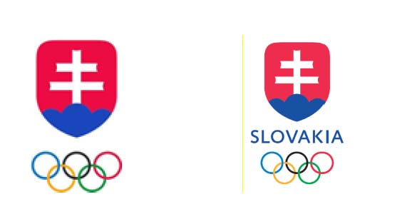

# ČI. VI

Zákon č. 440/2015 Z. z. o športe a o zmene a doplnení niektorých zákonov v znení zákona č. 354/2016 Z. z., zákona č. 335/2017 Z. z., zákona č. 177/2018 Z. z. a zákona č. 221/2019 Z. z. sa mení a dopĺňa takto:

- 1. Slová „Slovenský olympijský výbor“ vo všetkých tvaroch sa v celom texte zákona okrem prílohy č. 1 nahrádzajú slovami „Slovenský olympijský a športový výbor“ v príslušnom tvare.

- 2. V § 3 písm. h) treťom bode sa za slovo „súťaž“ vkladá čiarka a vypúšťajú sa slová „v uznanom športe podľa písmena f) prvého a druhého bodu alebo“.

- 3. V § 3 písm. h) sa vypúšťa štvrtý bod.

- 4. V § 3 písm. u) sa za slovo „reprezentantov“ vkladajú slová „a zoskupení v individuálnych športoch“.

- 5. V § 6 odseky 4 až 6 znejú:

- „(4)

- Oprávnenie vykonávať činnosť športového odborníka ako podnikanie vzniká dňom vydania oprávnenia na podnikanie. Športový odborník, ktorý získal oprávnenie na výkon činnosti športového odborníka podľa odseku 2, môže podať žiadosť o zápis oprávnenia na podnikanie okresnému úradu, ktorý plní úlohy jednotného kontaktného miesta.6b) Súčasťou žiadosti je potvrdenie o zápise športového odborníka do registra fyzických osôb v športe podľa § 80 ods. 11.

- (5)

- Jednotné kontaktné miesto vydá športovému odborníkovi oprávnenie na podnikanie a bezodkladne oznámi ministerstvu školstva vydanie oprávnenia na podnikanie. Ministerstvo školstva zapíše oprávnenie na podnikanie športového odborníka do registra fyzických osôb v športe podľa § 80 ods. 6 písm. h). Vykonanie zápisu ministerstvo školstva bezodkladne oznámi športovému odborníkovi.

- (6)

- Športový odborník môže oznámiť jednotnému kontaktnému miestu pozastavenie podnikania; jednotné kontaktné miesto bezodkladne doručí oznámenie o pozastavení podnikania ministerstvu školstva. Ministerstvo školstva zapíše do registra fyzických osôb v športe pozastavenie podnikania podľa § 80 ods. 6 písm. h) tretieho bodu a tento zápis bezodkladne oznámi športovému odborníkovi. Účinky pozastavenia podnikania športového odborníka nastávajú dňom doručenia oznámenia o pozastavení podnikania jednotnému kontaktnému miestu, alebo ak je v oznámení uvedený neskorší deň, týmto dňom.“.

- 6. V § 6 odsek 9 znie:

- „(9)

- Športový odborník môže oznámiť jednotnému kontaktnému miestu ukončenie podnikania; jednotné kontaktné miesto bezodkladne doručí oznámenie o ukončení podnikania ministerstvu školstva. Ministerstvo školstva zapíše do registra fyzických osôb v športe ukončenie podnikania podľa § 80 ods. 6 písm. h) druhého bodu a tento zápis bezodkladne oznámi športovému odborníkovi. Účinky ukončenia podnikania športového odborníka nastávajú dňom doručenia oznámenia o ukončení podnikania jednotnému kontaktnému miestu, alebo ak je v oznámení uvedený neskorší deň, týmto dňom.“.

- 7. V § 7 ods. 2 písm. a) sa vypúšťajú slová „obzvlášť závažný“.

- 8. V § 7 ods. 2 písm. b) sa na konci vypúšťa slovo „alebo”.

- 9. V § 7 ods. 2 písm. c) sa na konci bodka nahrádza čiarkou a pripája sa slovo „alebo“.

- 10. V § 7 sa odsek 2 dopĺňa písmenom d), ktoré znie:

- „d)

- trestný čin podľa písmen a) až c), trestný čin proti majetku alebo hospodársky trestný čin, ak ide o kontrolóra alebo člena štatutárneho orgánu športovej organizácie.“.

- 11. V § 8 sa odsek 6 dopĺňa písmenom c), ktoré znie:

- „c)

- zabezpečiť vo svojej pôsobnosti vzdelávanie v oblasti boja proti dopingu.“.

- 12. V § 9 ods. 4 písm. a) sa číslo „100 000“ nahrádza číslom „250 000“.

- 13. V § 9 ods. 4 písm. b) sa číslo „400 000“ nahrádza číslom „800 000“.

- 14. V § 20 ods. 1 písm. b) celom texte sa za slová „štatutárnom orgáne“ vkladá čiarka a slová „kontrolnom orgáne“.

- 15. V § 50 odsek 4 znie:

- „(4)

- Súčasťou zmluvy o sponzorstve v športe je čestné vyhlásenie štatutárneho orgánu sponzora o tom, že

- a)

- sponzor má vysporiadané finančné vzťahy so štátnym rozpočtom,

- b)

- voči sponzorovi nie je vedené konkurzné konanie, sponzor nie je v konkurze, v reštrukturalizácii a nebol proti nemu zamietnutý návrh na vyhlásenie konkurzu pre nedostatok majetku.“.

- 16. V § 60 ods. 1 sa za prvú vetu vkladá nová druhá veta, ktorá znie: „Hlavný kontrolór športu vykonáva odbornú kontrolu prijímateľov prostriedkov z Fondu na podporu športu.27a)“.

  - Poznámka pod čiarou k odkazu 27a znie:

  - „27a) § 15 ods. 9 zákona č. 310/2019 Z. z. o Fonde na podporu športu a o zmene a doplnení niektorých zákonov“.

  - 17. V § 65 ods. 3 sa vypúšťa písmeno d).

  - 18. V § 67 sa odsek 2 dopĺňa písmenom h), ktoré znie:

  - „h)

  - zabezpečuje športovú činnosť športovým odborníkom, ktorý nespĺňa podmienku bezúhonnosti podľa § 7 ods. 2.“.

- 19. V § 68 ods. 5 sa na konci pripája táto veta: „Váhy navrhnuté národným športovým zväzom schvaľuje ministerstvo školstva.“.

- 20. V § 68 ods. 6 sa slová „písm. a), ods. 4 alebo príspevok na športový poukaz podľa § 76“ nahrádzajú slovami „písm. a) alebo ods. 4“.

- 21. V § 69 sa vypúšťa odsek 2.

  - Doterajšie odseky 3 až 9 sa označujú ako odseky 2 až 8.

- 22. V § 69 ods. 3 sa na konci pripája táto veta: „Národný športový zväz je povinný priebežne zverejňovať použitie príspevku uznanému športu za športové kluby, ktorým rozdelil príspevok uznanému športu podľa odseku 4.“.

- 23. V § 75 odsek 2 znie:

„(2)

Ministerstvo školstva môže z prostriedkov štátneho rozpočtu poskytnúť športovej organizácii zapísanej v registri právnických osôb v športe príspevok na národný športový projekt, ktorým je

a)

organizácia významnej súťaže alebo účasť na významnej súťaži podľa § 3 písm. h) vrátane prípravy na túto súťaž,

b)

plnenie úloh verejného záujmu v športe.“.

- 24. V § 75 odsek 4 znie:

„(4)

Ministerstvo školstva poskytuje každoročne príspevok športovcom podľa zoznamu športovcov top tímu. Výšku príspevku jednotlivým športovcom určí ministerstvo školstva podľa poradia športovcov zaradených do zoznamu športovcov top tímu na základe kritérií schválených ministerstvom školstva a oponentúr schváleného plánu prípravy. Príspevok sa poukazuje národnému športovému zväzu, ku ktorému má športovec príslušnosť, národnej športovej organizácii, ku ktorej má športovec príslušnosť alebo rezortnému športovému stredisku určenému ministerstvom školstva. Ak národný športový zväz alebo národná športová organizácia stratí spôsobilosť prijímateľa verejných prostriedkov, ministerstvo školstva poukáže príspevok alebo jeho zodpovedajúcu časť rezortnému športovému stredisku. Ak ide o športovca, ktorý nie je zaradený do žiadneho rezortného športového strediska, ministerstvo školstva poukáže príspevok rezortnému športovému stredisku zriadenému ministerstvom školstva.“.

- 25. § 76 sa vypúšťa.

- 26. V § 79 sa odsek 2 dopĺňa písmenom e), ktoré znie:

- „e)

- register projektov podpory športu podľa osobitného predpisu.32a)“.

  - Poznámka pod čiarou k odkazu 32a znie:

  - „32a) Zákon č. 310/2019 Z. z.“.

- 27. V § 79 ods. 5 sa za slová „športovej organizácie“ vkladajú slová „alebo Fondu na podporu športu“.

- 28. V § 80 ods. 1 písm. d) sa za slovo „poukazu“ vkladajú slová „podľa osobitného predpisu34a)“.

- Poznámka pod čiarou k odkazu 34a znie:

- „34a) § 20 zákona č. 310/2019 Z. z.“.

- 29. V § 80 ods. 2 písmeno r) znie:

- „r)

- dátumy posledných troch účastí na súťaži,“.

- 30. V § 80 ods. 11 sa číslo „4“ nahrádza číslom „3“.

- 31. V § 81 ods. 1 písm. f) sa vypúšťa štvrtý bod.

  - Doterajší piaty bod sa označuje ako štvrtý bod.

- 32. V § 82 ods. 1 sa slová „e) a g)“ nahrádzajú slovami „b), e), g) a i)“.

- 33. V § 82 ods. 2 písm. j) sa vypúšťa štvrtý bod.

  - Doterajší piaty bod a šiesty bod sa označujú ako štvrtý bod a piaty bod.

- 34. Za § 82 sa vkladá § 82a, ktorý vrátane nadpisu znie:

- 㤠82a

- Register projektov podpory športu

- (1)

- V registri projektov podpory športu sa zverejňujú

- a)

- výzvy na predkladanie žiadostí o poskytnutie príspevku na projekt podpory športu,

- b)

- žiadosti o poskytnutie príspevku na projekt podpory športu,

- c)

- žiadatelia o poskytnutie príspevku na projekt podpory športu,

- d)

- prijímatelia príspevku na projekt podpory športu,

- e)

- zápis z rokovania správnej rady Fondu na podporu športu,

- f)

- rozhodnutia o poskytnutí príspevku na projekt podpory športu vrátane jeho výšky,

- g)

- rozhodnutia o neposkytnutí príspevku na projekt podpory športu s uvedením dôvodu jeho neposkytnutia,

- h)

- zoznam poskytovateľov športových poukazov,

- i)

- vyúčtovanie príspevku na projekt podpory športu.

- (2)

- Zápis údajov podľa odseku 1 písm. a), d), f) až h) vykoná Fond na podporu športu do desiatich dní od rozhodnutia správnej rady.

- (3)

- Zápis údajov podľa odseku 1 písm. b) a c) vykoná Fond na podporu športu do desiatich dní od doručenia žiadostí o poskytnutie príspevku na projekt podpory športu.

- (4)

- Zápis údajov podľa odseku 1 písm. e) vykoná Fond na podporu športu do desiatich dní od zasadnutia správnej rady.

- (5)

- Zápis údajov podľa odseku 1 písm. i) vykoná prijímateľ príspevku na projekt podpory športu v lehote určenej v zmluve o príspevku na projekt podpory športu.“.

- 35. V § 83 ods. 4 písm. a) a ods. 5 písm. a) sa za slovo „získaním“ vkladajú slová „úplného stredného všeobecného vzdelania v študijnom odbore strednej športovej školy alebo“.

- 36. V § 95 sa odsek 1 dopĺňa písmenom q), ktoré znie:

- „q)

- zabezpečuje športovú činnosť športovým odborníkom, ktorý nespĺňa podmienku bezúhonnosti podľa § 7 ods. 2.“.

- 37. V § 95 ods. 7 a v § 97 ods. 6 a 10 sa slová „až p)“ nahrádzajú slovami „až q)“.

- 38. V § 97 ods. 5 sa za slová „športových zväzov“ vkladá čiarka a slová „právnických osôb v oblasti športu“.

- 39. V § 99 sa vypúšťa odsek 3.

- Doterajšie odseky 4 až 7 sa označujú ako odseky 3 až 6.

- 40. Príloha č. 1 znie:

„Príloha č. 1 k zákonu č. 440/2015 Z. z.

OLYMPIJSKÁ SYMBOLIKA SLOVENSKÉHO OLYMPIJSKÉHO A ŠPORTOVÉHO VÝBORU

1.

Ako olympijská symbolika Slovenského olympijského a športového výboru sa rozumie

a)

Olympijský emblém/emblémy Slovenského olympijského a športového výboru a Slovenského olympijského a športového múzea v slovenskej aj anglickej verzii, tak ako ho/ich schválil Medzinárodný olympijský výbor,

b)

olympijská vlajka Slovenského olympijského a športového výboru (s olympijským emblémom Slovenského olympijského a športového výboru).

2.

Olympijskou symbolikou Medzinárodného olympijského výboru sa rozumie:

a)

olympijský symbol, olympijská vlajka, olympijské motto: citius, altius, fortius, olympijské emblémy, olympijská hymna, olympijský oheň a olympijské pochodne,

b)

olympijské identifikačné výrazy uvedené v článku 14 Olympijskej charty.

3.

Olympijská symbolika uvedená v bode 1. je výhradné vlastníctvo Slovenského olympijského a športového výboru. Olympijská symbolika Slovenského olympijského a športového výboru je predmet schválenia zo strany Medzinárodného olympijského výboru v súlade s článkom 31 Olympijskej charty.“.
