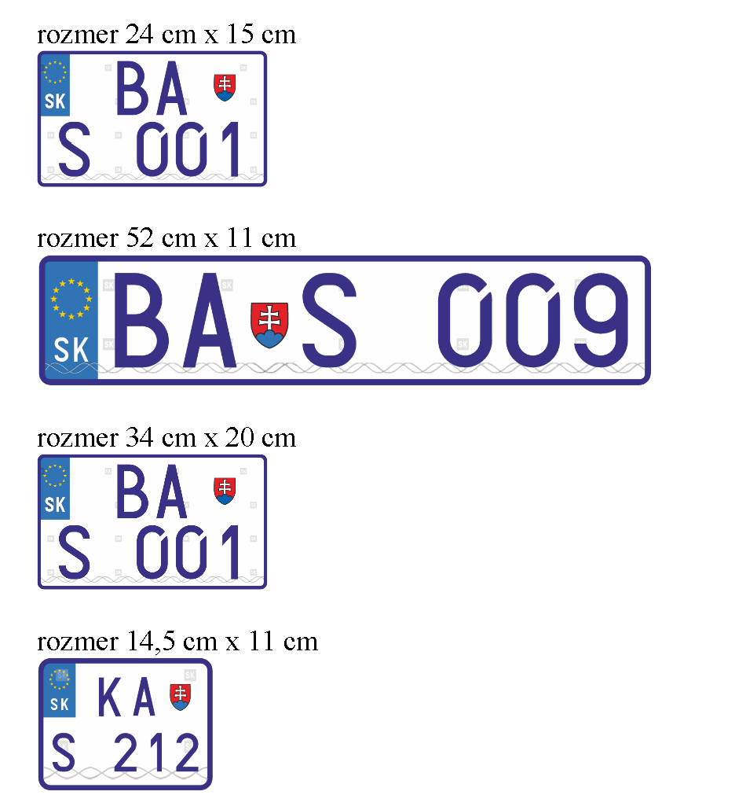
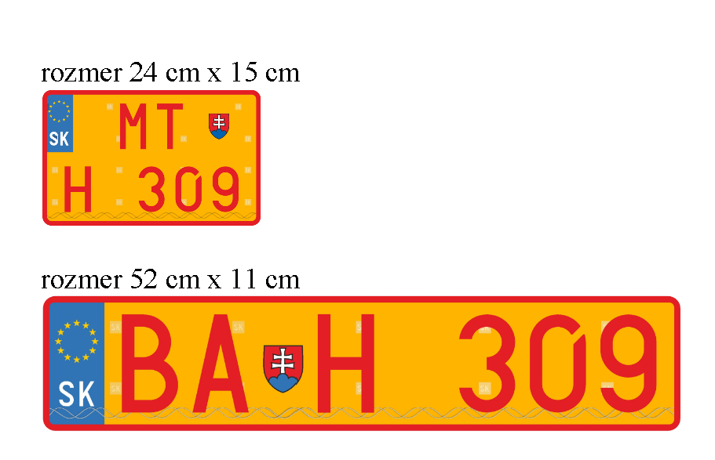
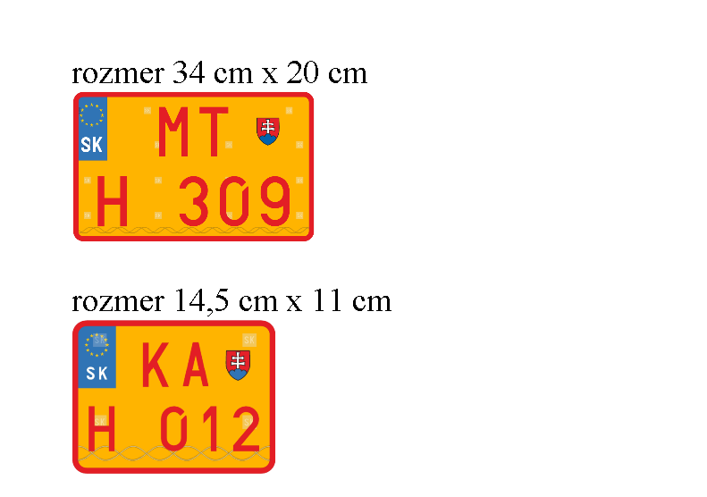
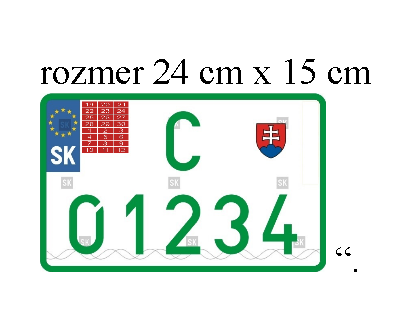
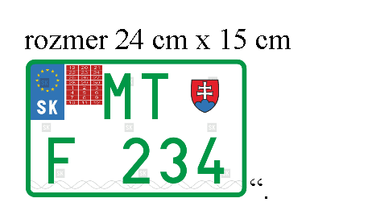
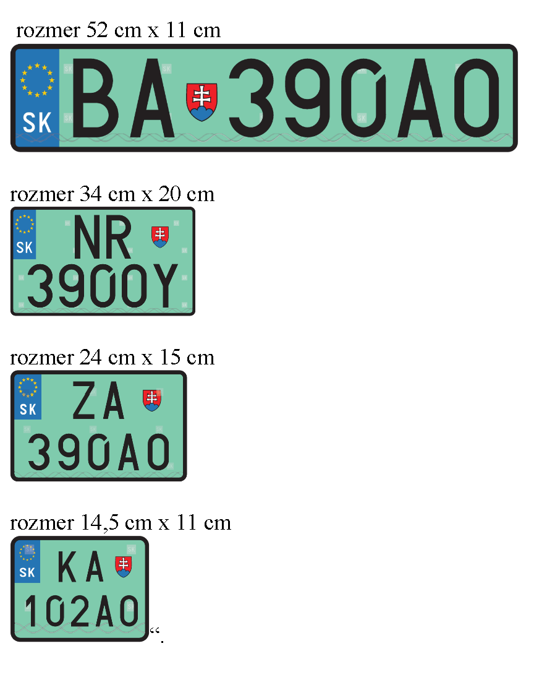

# Čl. I

Vyhláška Ministerstva vnútra Slovenskej republiky č. 9/2009 Z. z., ktorou sa vykonáva zákon o cestnej premávke a o zmene a doplnení niektorých zákonov v znení vyhlášky č. 130/2010 Z. z., vyhlášky č. 413/2010 Z. z., vyhlášky č. 361/2011 Z. z., vyhlášky č. 381/2012 Z. z., vyhlášky č. 128/2013 Z. z., vyhlášky č. 467/2013 Z. z., vyhlášky č. 20/2016 Z. z. a vyhlášky č. 19/2018 Z. z. sa mení a dopĺňa takto:

- 1. V § 33 ods. 1 prvej vete sa na konci pripájajú tieto slová: „s ochrannými prvkami“.

- 2. V § 33 ods. 2 sa slová „nemeckom, španielskom“ nahrádzajú slovami „španielskom, nemeckom, čínskom“.

- 3. V § 35 ods. 6 sa na konci bodka nahrádza bodkočiarkou a pripájajú sa tieto slová: „tabuľka s evidenčným číslom pridelená vozidlu, ktorého jediným zdrojom energie je elektrina, alebo hybridnému elektrickému vozidlu s možnosťou externého nabíjania môže mať písmená a číslice čiernej farby na svetlozelenom podklade.“.

- 4. V § 35 ods. 10 sa za bodkočiarku vkladajú tieto slová: „písmená a číslice evidenčných čísel vozidiel, ktorých jediným zdrojom energie je elektrina, alebo hybridných elektrických vozidiel s možnosťou externého nabíjania môžu byť čiernej farby na svetlozelenom podklade a“.

- 5. Poznámka pod čiarou k odkazu 7 znie:

- „7) § 136 ods. 2 písm. a) a § 138 písm. a) zákona č. 106/2018 Z. z. o prevádzke vozidiel v cestnej premávke a o zmene a doplnení niektorých zákonov.“.

- 6. V § 36 ods. 1 písmeno f) znie:

- „f)

- písmeno C alebo písmeno F, ktoré sú zelenej farby na bielom podklade.“.

- 7. Príloha č. 15 vrátane nadpisu znie:

- „[priloha č. 15 k vyhláške č 9/2009 Z. z.](assets/a34185affeb1e7af43e6e8b750e26db2f4a8157e673d196a486acfc4fccbf9c1.pdf)“.

- 8. V prílohe č. 17 siedmom bode sa slová „novokúpenému vozidlu alebo vozidlu používanému na skúšobné jazdy“ nahrádzajú slovami „novokúpenému vozidlu, ktoré dosiaľ nebolo evidované, alebo vozidlu používanému na skúšobnú prevádzku“.

- 9. V prílohe č. 17 ôsmy až desiaty bod znejú:

- „8.

- Tabuľka so zvláštnym evidenčným číslom obsahujúcim písmeno S pridelená športovému vozidlu

- 

- 9.

- Tabuľka so zvláštnym evidenčným číslom obsahujúcim písmeno H pridelená historickému vozidlu

- 

- 

- 10.

- Tabuľka so zvláštnym evidenčným číslom obsahujúcim písmeno C

- a)

- pridelená jednotlivému vozidlu, ktorého vlastník požiada o schválenie jednotlivého vozidla,

- b)

- pridelená vozidlu, ktoré nie je schválené na prevádzku v cestnej premávke, ak je používané na poľnohospodárske alebo lesné práce,

- c)

- pridelená vozidlu na základe dočasného povolenia na prevádzku neschváleného jednotlivého vozidla,

- d)

- vydaná osobe, ktorej predmetom činnosti je predaj vozidiel evidovaných v Slovenskej republike alebo inom štáte“.

- 

- 10. V prílohe č. 17 sa za bod 10 vkladá nový bod 11, ktorý znie:

- „11.

- Tabuľka so zvláštnym evidenčným číslom obsahujúcim písmeno F pridelená jednotlivému vozidlu s obmedzenou prevádzkou“.

- 

  - Doterajšie body 11 až 14 sa označujú ako body 12 až 15.

- 11. V prílohe č. 17 bode 14 sa za slovo „organizácií“ vkladajú slová „alebo štátneho podniku“.

- 12. Príloha č. 17 sa dopĺňa bodom 16, ktorý znie:

- „16.

- Tabuľka s evidenčným číslom pridelená vozidlu, ktorého jediným zdrojom energie je elektrina, alebo hybridnému elektrickému vozidlu s možnosťou externého nabíjania“.

- 

- 13. V prílohe č. 19 prvom bode písm. b) sa slová „§ 127 ods. ...“ nahrádzajú slovami „§ ... ods. ...“.

- 14. V prílohe č. 19 druhom bode sa pod slovo „OSVEDČENIE“ vkladajú slová „Platí len v Slovenskej republike – Valid only in Slovak Republic“ a slová „§ 127 ods. .......“ sa nahrádzajú slovami „§ ... ods. ...“.

- 15. V celom texte vyhlášky sa označenie kategórie „L1e“ nahrádza označením kategórie „L1e“, označenie kategórie „L2e“ sa nahrádza označením kategórie „L2e“, označenie kategórie „L3e“ sa nahrádza označením kategórie „L3e“, označenie kategórie „L4e“ sa nahrádza označením kategórie „L4e“, označenie kategórie „L5e“ sa nahrádza označením kategórie „L5e“, označenie kategórie „L6e“ sa nahrádza označením kategórie „L6e“, označenie kategórie „L7e“ sa nahrádza označením kategórie „L7e“, označenie kategórie „PS“ sa nahrádza označením kategórie „PS“ a označenie kategórie „LS“ sa nahrádza označením kategórie „LS“.
