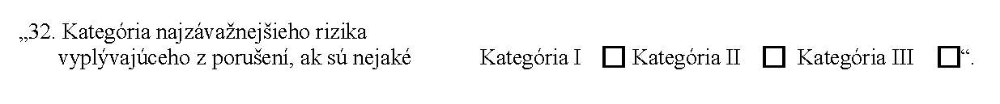

# Čl. I

Vyhláška Ministerstva dopravy, výstavby a regionálneho rozvoja Slovenskej republiky č. 124/2012 Z. z., ktorou sa vykonáva zákon č. 56/2012 Z. z. o cestnej doprave v znení vyhlášky č. 43/2016 Z. z. sa mení a dopĺňa takto:

- 1. V § 1 ods. 1 sa vypúšťa písmeno c).

  - Doterajšie písmená d) až j) sa označujú ako písmená c) až i).

- 2. V § 1 ods. 1 písmeno e) znie:

- „e)

- preukaze vodiča vozidla taxislužby“.

- 3. V § 2 odsek 2 znie:

- „(2)

- Finančná spoľahlivosť podniku prevádzkovateľa cestnej dopravy1) sa preukazuje individuálnou účtovnou závierkou,1a) bankovou zárukou alebo poistením vrátane poistenia zodpovednosti za výkon povolania.1b) Ak sa finančná spoľahlivosť podniku prevádzkovateľa cestnej dopravy preukazuje individuálnou účtovnou závierkou, posudzuje sa podľa individuálnej účtovnej závierky uloženej v registri účtovných závierok1c) za účtovné obdobie bezprostredne predchádzajúce účtovnému obdobiu, v ktorom je podaná žiadosť. Ak táto individuálna účtovná závierka nie je uložená v registri účtovných závierok, finančná spoľahlivosť sa preukazuje individuálnou účtovnou závierkou zostavenou ku dňu, od ktorého ku dňu podania žiadosti neuplynulo viac ako 60 dní, a potvrdenou riadne akreditovanou osobou1d) alebo štatutárnym audítorom, ktorý v nej preveruje1e) skutočnosti podľa osobitného predpisu.1)“.

  - Poznámky pod čiarou k odkazom 1 až 1e znejú:

  - „1) Čl. 7 nariadenia Európskeho parlamentu a Rady (ES) č. 1071/2009 z 21. októbra 2009, ktorým sa ustanovujú spoločné pravidlá týkajúce sa podmienok, ktoré je potrebné dodržiavať pri výkone povolania prevádzkovateľa cestnej dopravy, a ktorým sa zrušuje smernica Rady 96/26/ES (Ú. v. EÚ

  - L 300, 14. 11. 2009) v platnom znení.

  - 1a) § 17 ods. 1 zákona č. 431/2002 Z. z. o účtovníctve v znení neskorších predpisov.

  - 1b) § 622 až 624 Obchodného zákonníka v znení neskorších predpisov.

  - Dohovor o prepravnej zmluve v medzinárodnej cestnej nákladnej doprave (CMR) (vyhláška ministra zahraničných vecí č. 11/1975 Zb.) v platnom znení.

  - Nariadenie Európskeho parlamentu a Rady (EÚ) č. 181/2011 zo 16. februára 2011 o právach cestujúcich v autobusovej a autokarovej doprave a o zmene a doplnení nariadenia (ES) č. 2006/2004 (Ú. v. EÚ L 55, 28. 2. 2011).

  - Čl. 7 ods. 2 nariadenia (ES) č. 1071/2009 v platnom znení.

  - 1c) § 23c zákona č. 431/2002 Z. z. v znení neskorších predpisov.

  - 1d) § 2 zákona Slovenskej národnej rady č. 78/1992 Zb. o daňových poradcoch a Slovenskej komore daňových poradcov v znení neskorších predpisov.

  - 1e) § 2 ods. 17 zákona č. 423/2015 Z. z. štatutárnom audite a o zmene a doplnení zákona č. 431/2002 Z. z. o účtovníctve v znení neskorších predpisov.“.

- 4. § 4 vrátane nadpisu sa vypúšťa.

- 5. Nadpis § 5 znie:

- „Označovanie vozidiel obchodným menom“.

- 6. V § 5 ods. 1 úvodnej vete sa slová „prevádzkovateľa cestnej dopravy“ nahrádzajú slovom „dopravcu“.

- 7. V § 5 ods. 2 prvej vete sa slová „prevádzkovateľa cestnej dopravy, telefónne číslo a faxové číslo, prípadne iný údaj“ nahrádzajú slovom „dopravcu“ a vo štvrtej vete sa slová „prevádzkovateľa cestnej dopravy“ nahrádzajú slovom „dopravcu“.

- 8. § 5 sa dopĺňa odsekmi 6 a 7, ktoré znejú:

- „(6)

- Autobusy používané v osobitnej pravidelnej doprave musia byť vpredu a vzadu označené názvom cieľovej zastávky a nápisom označujúcim osobitnú pravidelnú dopravu, napríklad Školský autobus, Zmluvná preprava alebo obchodným menom objednávateľa prepravy. Výška písmen označenia je najmenej 100 mm.

- (7)

- Autobusy používané v príležitostnej doprave musia byť vpredu a vzadu označené nápisom Zájazd. Výška písmen označenia je najmenej 100 mm.“.

- 9. § 6 vrátane nadpisu znie:

- 㤠6

- Vybavenosť technickej základne prevádzkovateľa cestnej dopravy

- (1)

- Vybavením potrebným na dennú údržbu vozidla je vybavenie, ktoré umožňuje dennú údržbu po ukončení prepravy a prípravu na ďalšiu prepravu.

- (2)

- Vybavením potrebným na starostlivosť o cestujúcich a ich batožinu a domáce zvieratá sú najmä čakárne, hygienické a sociálne zariadenia, informačné miesta, úschovne batožín, stravovacie miesta na autobusových staniciach, prístrešky, lavičky, odpadkové koše a informačné tabule na zastávkach.“.

- 10. V § 7 ods. 1 písm. c) sa za slová „čísla a“ vkladajú slová „tarifnej zóny alebo“.

- 11. V § 7 ods. 3 a § 11b ods. 1 písm. h) sa slová „Ministerstva dopravy, výstavby a regionálneho rozvoja Slovenskej republiky“ nahrádzajú slovami „Ministerstva dopravy a výstavby Slovenskej republiky.“.

- 12. V § 7 ods. 4 prvá veta znie: „Podkladom na výpočet cestovného za prepravu cestujúcich a úhrad za prepravu batožiny, živých spoločenských zvierat a autobusových zásielok je tarifná zóna alebo tarifná vzdialenosť.“.

- 13. Nadpis § 8 znie:

- „Preukaz vodiča vozidla taxislužby“.

- 14. V § 8 sa vypúšťajú odseky 1 až 9.

  - Doterajšie odseky 10 a 11 sa označujú ako odseky 1 a 2.

- 15. V § 8 ods. 2 druhá veta znie: „Preukaz vodiča vozidla taxislužby sa musí umiestniť vo vozidle taxislužby na mieste viditeľnom pre cestujúceho.“.

- 16. Prílohy č. 1 a 2 sa vypúšťajú.

- 17. V prílohe č. 3 druhom bode sa na konci za poslednou značkou pripája táto značka:

- 

- 18. V prílohe č. 5 bod 32 znie:

- 
