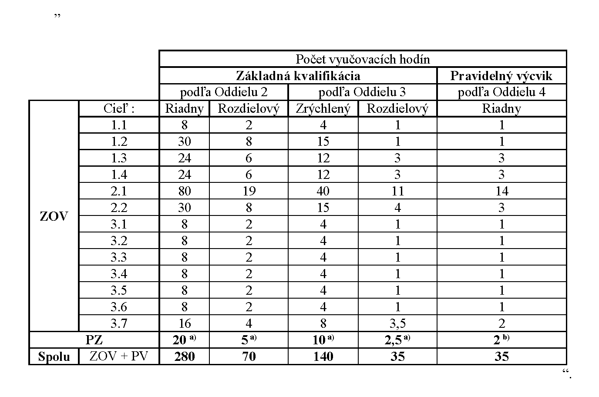

# Čl. I

Vyhláška Ministerstva dopravy, výstavby a regionálneho rozvoja Slovenskej republiky č. 44/2016 Z. z., ktorou sa vykonáva zákon č. 280/2006 Z. z. o povinnej základnej kvalifikácii a pravidelnom výcviku niektorých vodičov v znení neskorších predpisov sa mení a dopĺňa takto:

- 1. Doterajší text § 1 sa označuje ako odsek 1 a dopĺňa sa odsekom 2, ktorý znie:

- „(2)

- Dokumentácia podľa odseku 1 sa vedie v elektronickej podobe prostredníctvom jednotného informačného systému v cestnej doprave1) (ďalej len „cestný informačný systém“).“.

  - Poznámka pod čiarou k odkazu1znie:

  - „1) § 9 ods. 6 a § 10 ods. 7 zákona č. 387/2015 Z. z. o jednotnom informačnom systéme v cestnej doprave a o zmene a doplnení niektorých zákonov v znení neskorších predpisov.“.

- 2. § 2 až 5 vrátane nadpisov znejú:

- 㤠2

- Kniha účastníkov kurzu

- [k § 11h písm. a) zákona]

- O účastníkoch kurzu sa vedie kniha účastníkov kurzu, do ktorej sa zapisujú tieto údaje:

- a)

- poradové číslo, meno, priezvisko, dátum a miesto narodenia, adresa bydliska a e-mailová adresa účastníka kurzu,

- b)

- druh a číslo kurzu,

- c)

- trvanie a obsah kurzu s uvedením dátumu začatia a ukončenia kurzu,

- d)

- cena kurzu a dátum jej zaplatenia,

- e)

- dátum vydania potvrdenia o ukončení kurzu základnej kvalifikácie alebo pravidelného výcviku.

- § 3

- Triedna kniha

- [k § 11h písm. a) zákona]

- (1)

- O každom kurze sa vedie triedna kniha, do ktorej lektori a inštruktori školiaceho strediska pred začatím a po ukončení výučby teórie a praktického výcviku zapisujú údaje o priebehu kurzu a o účasti účastníkov kurzu.

- (2)

- Do triednej knihy sa zapisujú tieto údaje:

- a)

- druh a číslo kurzu,

- b)

- meno a priezvisko zodpovedného zástupcu školiaceho strediska podľa § 4a ods. 2 písm. g) zákona,

- c)

- dátum začatia a ukončenia kurzu,

- d)

- dátum začatia a ukončenia výučby teórie,

- e)

- meno a priezvisko inštruktorov a lektorov školiaceho strediska vykonávajúcich výučbu teórie, praktického výcviku a praktickej zručnosti,

- f)

- poradové číslo účastníka kurzu z knihy účastníkov kurzu,

- g)

- meno a priezvisko účastníka kurzu,

- h)

- záznamy o účasti účastníka v kurze,

- i)

- záznamy o obsahu výučby teórie,

- j)

- záznamy o praktickom výcviku a praktickej zručnosti.

- § 4

- Výkaz

- [k § 11h písm. a) zákona]

- (1)

- O prevádzke výcvikového vozidla sa vedie výkaz, do ktorého inštruktor školiaceho strediska pred začatím a po ukončení jazdy, praktického výcviku a vykonaní praktickej zručnosti na výcvikovom vozidle zaznamenáva údaje o prevádzke výcvikového vozidla a o účasti účastníkov kurzu.

- (2)

- Do výkazu sa zapisujú tieto údaje:

- a)

- identifikačné číslo výcvikového vozidla VIN,

- b)

- evidenčné číslo výcvikového vozidla,

- c)

- meno a priezvisko inštruktora školiaceho strediska vykonávajúceho praktický výcvik a praktickú zručnosť,

- d)

- dátum a čas použitia výcvikového vozidla,

- e)

- cieľ praktickej jazdy; pri vykonávaní praktickej zručnosti v kurze pravidelného výcviku aj oblasť zamerania podľa prílohy č. 1,

- f)

- stav počítadla prejdenej vzdialenosti výcvikového vozidla pred začatím a po ukončení praktického výcviku,

- g)

- údaje o stave a spotrebe pohonných látok a o ich dopĺňaní,

- h)

- počet vyučovacích hodín, v ktorých bolo výcvikové vozidlo použité na autocvičisku a v cestnej premávke,

- i)

- druh a číslo kurzu,

- j)

- meno a priezvisko účastníka kurzu a jeho poradové číslo z knihy účastníkov kurzu.

- § 5

- Trenažérová kniha

- [k § 11h písm. a) zákona]

- (1)

- O prevádzke výkonného trenažéra počas kurzu sa vedie trenažérová kniha, do ktorej inštruktor školiaceho strediska zaznamenáva údaje o praktickom výcviku účastníka kurzu na výkonnom trenažéri.

- (2)

- Do trenažérovej knihy sa zapisujú tieto údaje:

- a)

- typ a výrobné číslo výkonného trenažéra,

- b)

- meno a priezvisko inštruktora školiaceho strediska, ktorý vykonáva praktický výcvik na výkonnom trenažéri,

- c)

- dátum a čas použitia výkonného trenažéra,

- d)

- poradové číslo vyučovacej hodiny,

- e)

- druh a číslo kurzu,

- f)

- meno a priezvisko účastníka kurzu a jeho poradové číslo z knihy účastníkov kurzu,

- g)

- celkový počet vyučovacích hodín na výkonnom trenažéri.“.

- 3. Nadpis § 7 znie: „Skúšobná komisia [k § 11h písm. e) a n) zákona]“.

- 4. § 7 sa dopĺňa odsekmi 3 a 4, ktoré znejú:

- „(3)

- Skúšobná komisia sa schádza minimálne raz za tri mesiace. Skúšobnú komisiu zvoláva a jej rokovanie vedie jej predseda alebo iný člen skúšobnej komisie, ktorý ho zastupuje. Rokovanie skúšobnej komisie je neverejné.

- (4)

- Skúšobná komisia oslobodí podľa § 7 ods. 4 zákona v kurze základnej kvalifikácie

- a)

- od výučby teórie toho, kto ku dňu konania skúšky preukáže, že je absolventom učebného odboru alebo študijného odboru podľa prílohy č. 11,

- b)

- od praktických jázd v kurze základnej kvalifikácie toho, kto je oslobodený od výučby teórie podľa písmena a) a ku dňu konania skúšky preukáže, že je držiteľom tej skupiny vodičského oprávnenia, na ktorú žiada o vydanie kvalifikačnej karty vodiča.“.

- 5. V § 8 odsek 1 znie:

- „(1)

- Po ukončení kurzu základnej kvalifikácie sa vykonáva pred skúšobnou komisiou skúška na overenie úrovne vedomostí uchádzača. Uchádzača na skúšku prihlasuje školiace stredisko, ktoré mu vydalo potvrdenie o absolvovaní kurzu základnej kvalifikácie podaním prihlášky na okresný úrad v sídle kraja, v ktorého územnom obvode uchádzač absolvoval kurz základnej kvalifikácie.“.

- 6. V § 9 odsek 1 znie:

- „(1)

- Termín a miesto konania skúšky sa určí do 30 dní odo dňa zaslania hlásenia o ukončení kurzu a v prípade opakovanej skúšky do 30 dní odo dňa neúspešne vykonanej skúšky.“.

- 7. V § 13 ods. 1 sa nad slovom „miestnosti“ odkaz „1)“ nahrádza odkazom „1a)“ a doterajšia poznámka pod čiarou k odkazu 1 sa označuje ako poznámka pod čiarou k odkazu 1a.

- 8. V § 13 sa odsek 4 dopĺňa písmenom c), ktoré znie:

- „c)

- schváleným typom identifikačného zariadenia učebne na zabezpečenie odosielania záznamu1b) z priebehu výučby teórie teoretickej časti kurzu podľa § 6 ods. 2, ktoré nie je možné premiestniť mimo schválenej učebne a umožňuje bezpečnú komunikáciu s cestným informačným systémom.“.

  - Poznámka pod čiarou k odkazu 1b znie:

  - „1b) § 27, § 29, § 30, § 32 a 33 vyhlášky Ministerstva dopravy, výstavby a regionálneho rozvoja Slovenskej republiky č. 45/2016 Z. z., ktorou sa vykonáva zákon č. 93/2005 Z. z. o autoškolách a o zmene a doplnení niektorých zákonov v znení neskorších predpisov.“.

- 9. Poznámky pod čiarou k odkazom 2 a 3 znejú:

- „2) § 22 vyhlášky Ministerstva vnútra Slovenskej republiky č. 9/2009 Z. z., ktorou sa vykonáva zákon o cestnej premávke a o zmene a doplnení niektorých zákonov v znení neskorších predpisov.

- § 5 vyhlášky č. 45/2016 Z. z.

- 3) § 6 vyhlášky č. 45/2016 Z. z.“.

- 10. V § 14 sa odsek 1 dopĺňa písmenom d), ktoré znie:

- „d)

- byť vybavené schváleným typom identifikačného zariadenia výcvikového vozidla na zabezpečenie odosielania záznamu4) z priebehu praktickej časti kurzu podľa § 6 ods. 2, ktoré umožňuje bezpečnú komunikáciu s cestným informačným systémom.“.

  - Poznámka pod čiarou k odkazu 4 znie:

  - „4) § 26, § 28, § 30, § 31 a 33 vyhlášky č. 45/2016 Z. z.“.

- 11. V § 15 ods. 4 sa slová „MINISTERSTVO DOPRAVY, VÝSTAVBY A REGIONÁLNEHO ROZVOJA“ nahrádzajú slovami „MINISTERSTVO DOPRAVY A VÝSTAVBY“.

- 12. Za § 17 sa vkladá § 17a, ktorý vrátane nadpisu znie:

- 㤠17a

- Prechodné ustanovenia k úpravám účinným od 23. mája 2020

- (1)

- Dokumentácia o priebehu kurzu začatého po zmene registrácie podľa § 13d ods. 1 zákona sa vedie podľa tejto vyhlášky v znení účinnom od 23. mája 2020.

- (2)

- Dokumentácia o priebehu kurzu začatého a neukončeného pred zmenou registrácie podľa §13d ods. 1 zákona sa vedie podľa tejto vyhlášky v znení účinnom do 22. mája 2020.“.

- 13. V prílohe č. 1 časti A: Rozsah kurzov pre vodiča nákladnej dopravy podľa prílohy č. 1 k zákonu tabuľka znie:

- 

- 14. Príloha č. 4 vrátane nadpisu znie:

- „[VZOR PROTOKOLU O VYKONANÍ SKÚŠKY](assets/cbed3135a02b7f4e011ee54c881e96ed751c34c45568610a11b698324ce07660.pdf)“.

- 15. Príloha č. 6 vrátane nadpisu znie:

- „[VZOR PREUKAZU KONTROLÓRA](assets/713ba9fb9c45a565a65f2f624fd6930e7f2b5be31fc2548a6c6db98f4b808c82.pdf)“.

- 16. Vyhláška sa dopĺňa prílohou č. 11, ktorá vrátane nadpisu znie:

- „[ZOZNAM UČEBNÝCH ODBOROV A ŠTUDIJNÝCH ODBOROV](assets/3f3a65ca7325a9d216a173051adf520dceec87de6fe4b13cbda67fabcf7502d0.pdf)“.
